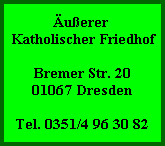
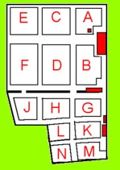
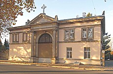
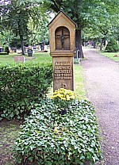

* * *

* * *

* * *

**Übersichtsplan**

**(rechts die Bremer Str.):**

* * *

Der Äußere Katholische Friedhof wurde als zweiter katholischer Begräbnisplatz
in Dresden angelegt und 1875 eröffnet. Für den neuen Begräbnisplatz hatte die Kirchgemeinde zwei Jahre zuvor 3,3 Hektar Land erworben und erschlossen.
Noch bis 1900 trug der Zufahrtsweg, die heutige Bremer Straße, den Namen Friedhofsweg. Für die Anlage entstanden nach Plänen K. Canzlers eine Parentationshalle mit Wärterwohnung und einVerwaltungsgebäude am
Haupteingang. Das Haus weist zum Teil klassizistische Formen auf und ist trotz einiger baulicher Veränderungen bis heute erhalten geblieben. 1910 wurde eine
weitere kleine Halle für Lagerzwecke errichtet. Außerdem erfolgte 1915 eine Erweiterung des Friedhofes in westlicher Richtung. Noch heute sind beide Friedhofsteile durch eine Mauer voneinander
abgetrennt. Die Innengestaltung der Kapelle wurde 1977 vom Architekten Gonschor erneuert.

Neben einigen künstlerisch interessanten Grabplastiken und den Grabstätten verschiedener
Dresdner Persönlichkeiten **_(Foto:_** _Grab von Adrian Ludwig Richter)_ besitzt der Äußere Katholische Friedhof mehrere Gemeinschaftsgräber für Angehörige katholischer Orden.
Außerdem haben hier zahlreiche Opfer der nationalsozialistischen Gewaltherrschaft und des Zweiten Weltkriegs ihre letzte Ruhestätte gefunden. Eine Gräberfeld mit zahlreichen schlichten
Holzstelen erinnert an über 500 Tote der Luftangriffe auf Dresden. Unweit davon ruhen zwölf polnische Jugendliche, die als Mitglieder der “Legio Maria” von den Nazis erschossen
wurden. Zu den Opfern des Faschismus gehören auch 128 Tschechen und Slowaken sowie Angehörige weiterer Nationen, die während ihrer Haft ums Leben kamen bzw. hingerichtet
wurden. Im neuen Friedhofsteil erinnert eine Gemeinschaftsgrabanlage mit mehreren Einzelgrabplatten an die gefallenen Soldaten des Ersten und Zweiten Weltkrieges.

Bedeutende Grabstätten:

**_Grabstätte_**

**_Todesjahr_**

**_Standort\*_**

Miguel de Cárdenas y Penalver, mit Grabplastik “Trauernde”

1883

Feld A (W)

Adrian Ludwig Richter, Maler und Zeichner

(die Grabstätte wurde 1984 erneuert und mit einem neuen Stein versehen)

1884

Feld A / Reihe 14 / 1

Alexander Salvator von Pereira, Kommandant der Festung Königstein

Elisabeth von der Decken, mit Grabplastik “Ruhender Engel”

1907

Feld B (W)

Edward Two-Two, Sioux-Häuptling, Artist im Zirkus Sarrasani

(Grabstein 1986 erneuert)

1914

Feld F /Reihe 12 /32

Franz Krucht, Musikstudent, mit Grabplastik “Kniender Musikant”

1926

Feld G / Nr. 279

Nikolaus Graf von Seebach, Intendant des Dresdner Hoftheaters

1930

Feld A (W)

Wolfgang Luckhaupt, Pfarrer; Grabkreuz von Friedrich Press

1987

Feld F / Nr. 16

Gemeinschaftsgrab der Grauen Schwestern von der Hl. Elisabeth

Feld E (W)

Gemeinschaftsgrab der Nazarethschwestern vom Hl. Franziskus

Feld G/H (W)

Gemeinschaftsgrab der Schwestern der Kongregation vom Hl. Karl Borromäus (8 Einzelgräber)

Feld H/J (W)

Gedenkstätte für Gefallene des Ersten und Zweiten Weltkriegs, für Opfer der Bombenangriffe auf Dresden und Opfer nationalsozialistischer Gewaltherrschaft

Feld H

Gedenkstätte für 128 tschechoslowakische Opfer des Faschismus

1933/45

Feld J

Gedenkstätte für die Opfer des Faschismus aus 14 Nationen

1935/45

Feld N

Gedenkstätte für sieben polnische Gymnasiasten aus Posen (am 28. August 1942 am Münchner Platz hingerichtet, 1999 selig gesprochen)

1945

(2003)

\\* Die Felder A - F liegen auf dem alten, die Felder G - M auf dem neuen Teil. Wandgräber befinden sich in unmittelbarer Nachbarschaft der einzelnen Felder und sind mit dem Buchstaben W bezeichnet.

* * *

 \[ [Nord](../../../nord/)\] \[ [Nordwest](../../../nordwest/)\] \[ [Neustadt](../../../neustadt/)\] \[ [Nordost](../../../nordost/)\]
 \[ [West](../../../west/)\] \[ [Zentrum](../../../zentrum/)\] \[ [Südwest](../../../sudwest/)\] \[ [Süd](../../../sud/)\] \[ [Südost](../../../sudost/)\] \[ [Ost](../../../ost/)\] \[ [Register](../../../Register/register.html)\] \[ [Kontakt](../../../Kontakt/kontakt.html)\] \[ [Impressum](../../../impressum/)\]
