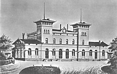
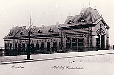
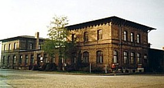
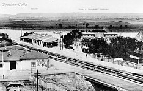
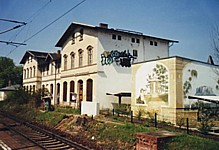
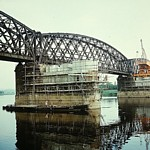
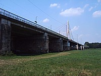

* * *

Noch bis ins letzte Drittel des 19. Jahrhunderts mussten Reisende, die von Dresden nach Berlin fahren wollten, zunächst die Leipziger Bahn bis nach Riesa benutzen und dort umsteigen. Zur Schaffung einer
Direktverbindung gründete sich 1870 ein Komitee zum Bau einer neuen Bahnlinie. Nach Abschluss eines Staatsvertrages zwischen Preußen und Sachsen am 6. Juli 1872 konnte die private Berlin - Dresdner Eisenbahngesellschaft
mit der Umsetzung des Vorhabens beginnen. Der sächsische Landtag hatte hierfür zwar die Genehmigung erteilt, unterstützte die Pläne jedoch nur eingeschränkt, da kein Interesse an einer preußisch dominierten Eisenbahn in
die sächsische Hauptstadt bestand.

1873 begannen die Bauarbeiten für die neue Strecke, die ihren Ausgangspunkt
in der Friedrichstadt hatte. Am 17. Juni 1875 fuhr der erste Zug am Berliner Bahnhof in Dresden ab _(Foto)_. Die private Bahngesellschaft war zu diesem
Zeitpunkt bereits bankrott und konnte nur Dank einer vom preußischen Staat garantierten Anleihe überleben. Die Betriebsführung oblag in den ersten Jahren der Königlich-Preußischen Eisenbahn-Verwaltung. Ein Versuch des
sächsischen Staates, die Berlin - Dresdner Eisenbahn zu kaufen, scheiterte zunächst. Erst 1885 begannen erneute Verhandlungen zwischen beiden Ländern, in deren Folge Preußen die Bahnlinie per 1. April 1887 aufkaufte.
Ein Jahr später wurde der auf sächsischen Territorium gelegene Streckenabschnitt bis Elsterwerda an Sachsen verkauft. Die vorhandenen Fahrzeuge wurden ebenfalls anteilig aufgeteilt.

Im Zusammenhang mit der Umgestaltung der Dresdner Bahnanlagen nach 1890 und dem Bau des Hauptbahnhofes verlor die Strecke an Bedeutung. Fernzüge von und nach Berlin verkehren seitdem ab Hauptbahnhof bzw. ab dem
Bahnhof Dresden-Neustadt. Die alte Strecke über Friedrichstadt und die Niederwarthaer Elbbrücke wurde nun nur noch von Regionalzügen genutzt. 1966 erfolgte ihre Elektrifizierung. Heute ist sie Teil des S-Bahn-Netzes.

**Streckenverlauf und Stationen im Dresdner Stadtgebiet:**

Berliner Bahnhof:
Der Berliner Bahnhof entstand 1873/75 als Endpunkt der von der privaten Berlin - Dresdner Eisenbahngesellschaft gebauten Bahnstrecke in die Hauptstadt. Zuvor waren die hier gelegenen militärischen Pulvermagazine
auf Kosten der Bahngesellschaft in die Albertstadt an den Rand des Prießnitzgrundes verlegt worden. In den Anfangsjahren begannen und endeten an diesem Bahnhof alle Züge der Strecke, die lediglich über zwei
Anschlussgleise mit dem Leipziger und dem Böhmischen Bahnhof (heute Hauptbahnhof) verbunden war. Um eine schnelle Verbindung in die Innenstadt herzustellen, legte man nach Eröffnung des Bahnhofes die Berliner Straße an.
Das repräsentative Empfangsgebäude wurde später beim Umbau der Bahnanlagen abgerissen und durch einen 1945 zerstörten Neubau ersetzt _(Foto)_
. Eine überdachte Treppenanlage verband den Bahnsteig mit der Waltherbrücke.

Nach Übernahme der Bahnstrecke durch den sächsischen Staat und der Umgestaltung der Bahnanlagen wurde die Personenabfertigung im
Berliner Bahnhof 1894 eingestellt. Fortan diente dieser nur noch dem Güterverkehr sowie als Haltepunkt der Regionalzüge in Richtung Meißen. Einige Nebengebäude, darunter die frühere Güterabfertigung _(Foto)_
blieben bis heute erhalten. Hier gab es vor 1945 auch eine Umladestation von der Eisenbahn zur Straßenbahn.  In unmittelbarer Nachbarschaft befindet sich seit 1894 der Werkstättenbahnhof sowie der [Rangierbahnhof](../../../zentrum/friedrichstadt/dresden_-_berlin/rangierbahnhof/) Friedrichstadt.

Nach dem Passieren der ausgedehnten Gleisanlagen des einst
größten ostdeutschen Rangierbahnhofes zweigt rechts die Anschlussbahn zum [Alberthafen](../../../zentrum/friedrichstadt/alberthafen/) ab, die ausschließlich dem Gütertransport dient. Die Hauptstrecke verläuft weiter in
nordwestlicher Richtung, überquert auf einer Brücke die Hamburger Straße, wo sich der Haltepunkt Cotta befindet. Dieser wurde sechs Jahre nach Eröffnung der Bahnstrecke, am 1. Juni 1881, eingeweiht _(Foto um 1910)_.

Abschnitt Cotta - Cossebaude:
Für den Bau des folgenden Abschnittes, der unmittelbar oberhalb des Elbufers verläuft, mussten 1875 große Teile des [Bürstinghausparks](../../../west/cotta/strassen_cotta/meissner_landstrasse/), darunter auch die romantische Neptungrotte, weichen.
Reste der Parkanlagen nehmen heute das Gelände zwischen Bahntrasse und Meißner Landstraße ein. Nachdem der von Kesselsdorf kommende Zschonerbach passiert wird, erreicht die Bahnstrecke die Flurgrenze zu
Kemnitz. Hier überspannen die nach 1990 erneuerte Autobahnbrücke sowie die 1905 errichtete und mehrfach umgebaute Straßenbrücke der B 6 die Gleise. Der Haltepunkt Kemnitz (eröffnet am 15. Oktober 1877) dient ebenso
wie die Station des Nachbarortes Stetzsch (1. Juni 1881) vorrangig dem S-Bahn-Verkehr.

Die Bahnlinie verläuft nun parallel zur Straße und durchquert die ehemals selbständigen Gemeinden Gohlis und
Cossebaude. Für die Trasse mussten einige Gebäude des Vorderdorfes abgerissen sowie das Bett des Lotzebaches
verlegt werden. Entlang der Strecke entstanden nach ihrer Eröffnung eine Reihe von Industriebetrieben, die über eigene Anschlussgleise verfügten, heute jedoch größtenteils nicht mehr existieren.

Bahnhof Cossebaude:
Die Station wurde zeitgleich mit Eröffnung der Bahnstrecke am 17. Juni 1875 in Betrieb genommen und war ursprünglich erster Halt nach dem Berliner Bahnhof. Die Haltepunkte in Cotta, Kemnitz und Stetzsch
entstanden erst einige Jahre später, um auch den Bewohnern dieser Dresdner Vororte Anschluss an das Eisenbahnnetz zu bringen. Wegen seiner Bedeutung erhob man den Haltepunkt Cossebaude 1888 zum Bahnhof und errichtete in
diesem Zusammenhang auch das heutige Empfangsgebäude.

Nachdem erneut die Bundesstraße 6 unterquert wird, erreicht die Bahn den unteren Stausee des 1928 errichteten [Pumpspeicherwerkes](../../../west/niederwartha/pumpspeicherwerk/) Niederwartha. Am Ufer befindet sich ein von den
Dresdnern gern genutztes Freibad. Letzte Station auf Dresdner Territorium ist der 1881 eingerichtete Haltepunkt Niederwartha, unmittelbar vor der Elbbrücke gelegen.

Elbbrücke Niederwartha:
Das Bauwerk entstand 1873/74 im Zusammenhang mit dem Bau der Eisenbahnstrecke nach Berlin und war zunächst nur eingleisig befahrbar. Später
erweiterte man die Brücke, so dass nun zwei Gleise zur Verfügung standen. Neben Zügen des Vorortverkehrs war die Brücke vor allem für Güterzüge zum Rangierbahnhof
Friedrichstadt von Bedeutung. Außerdem gab es einen schmalen Fuß- und Fahrweg.

**_Foto:_** _Die alte Niederwarthaer Elbbrücke - Aufnahme Eugen Nosko / Wikipedia_

Am 8. Mai 1945 sprengten abziehende deutsche Truppen wenige Stunden vor Kriegsende das Bauwerk, ohne es jedoch komplett zu zerstören. Erst der Versuch russischer Soldaten, die Brücke trotz Warnungen des deutschen
Eisenbahnpersonals zu befahren, führte schließlich zum Kompletteinsturz zweier Segmente des Stahlgitterüberbaus. Zwei sowjetische Soldaten kamen dabei ums Leben. Die als angeblich Schuldige bezeichneten Eisenbahner
verschleppte man in ein Straflager.

Wenig Monate später konnte die Niederwarthaer Elbbrücke notdürftig wieder
hergestellt werden und war ab August 1945 wieder befahrbar. Da dieses Provisorium in den 1970er Jahren nicht mehr dem stark angewachsenen Verkehrsaufkommen genügte, entschloss sich die Deutsche Reichsbahn 1977 zum
kompletten Neubau. Bis 1983 entstand auf den elf alten Pfeilern die noch heute erhaltene 346 Meter lange Brücke _(Foto)_, die neben den Gleisanlagen auch einen
kombinierten Fuß- und Radweg erhielt. Ab 2006 wurde in unmittelbarer Nachbarschaft eine neue [Straßenbrücke](../../../west/niederwartha/niederwarthaer_elbbrucke/) gebaut.

* * *

 \[ [Home](../../../index.html)\] \[ [Nord](../../../nord/)\] \[ [Nordwest](../../../nordwest/)\] \[ [Neustadt](../../../neustadt/)\] \[ [Nordost](../../../nordost/)\] \[ [West](../../../west/)\] \[ [Zentrum](../../../zentrum/)\] \[ [Südwest](../../../sudwest/)\] \[ [Süd](../../../sud/)\] \[ [Südost](../../../sudost/)\] \[ [Ost](../../../ost/)\] \[ [Register](../../../Register/register.html)\] \[ [Kontakt](../../../Kontakt/kontakt.html)\] \[ [Impressum](../../../impressum/)\]
