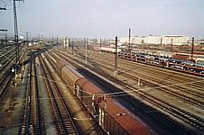
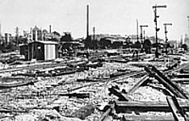
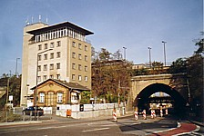
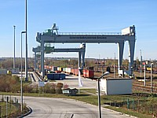
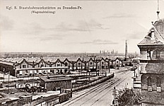
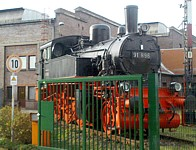

* * *

* * *

Erste Pläne für den Bau eines Dresdner Zentralbahnhofes kamen bereits in der
Mitte des 19. Jahrhunderts auf. Der sächsische Vermessungsingenieur Karl Friedrich Preßler entwarf damals ein neues Verkehrskonzept für Dresden, welches die Zusammenlegung der einzelnen Bahnhöfe, die kreuzungsfreie
Verlegung der Gleisanlagen auf einen Hochdamm sowie den Bau eines Elbhafens in der Friedrichstadt vorsah. Dieses Konzept wurde schließlich ab 1890 mit
einigen Veränderungen in die Realität umgesetzt. Allerdings entschloss man sich, statt eines Hauptbahnhofes in der Friedrichstadt lediglich einen Güter- und
Rangierbahnhof anzulegen sowie die Eisenbahnwerkstätten hier zu konzentrieren.

Bereits 1875 war an Stelle des heutigen Rangierbahnhofes Friedrichstadt der [Berliner Bahnhof](../../../../zentrum/friedrichstadt/dresden_-_berlin/) einer privaten
Eisenbahngesellschaft entstanden. Hier begannen und endeten die Fernzüge nach Berlin. Nachdem die Bahn wenige Jahre später vom sächsischen Staat übernommen worden war, begann eine umfassende Umgestaltung des Areals. Der
ehemalige Personenbahnhof wurde zum Haltepunkt Friedrichstadt, da alle Fernzüge nun bis zum Hauptbahnhof geleitet wurden. Heute wird die Station an der Waltherstraße nur noch von der S-Bahn genutzt

Unter Verwendung von Abraummaterial, welches beim Bau des Hafenbeckens des [Alberthafens](../../../../zentrum/friedrichstadt/alberthafen/) gewonnen worden
war, ließ die sächsische Staatsbahn zwischen 1890 und 1893 einen 17 m hohen Ablaufberg anschütten, der unter
Nutzung des natürlichen Gefälles dem Rangierbetrieb diente. Der Berg ist 2,5 km lang und verfügt über fünf Ablaufgleise
mit einem Gefälle von 1:100. Die feierliche Einweihung des Rangierbahnhofes fand am 1. Mai 1894 statt.

Zwischen 1924 und 1935 er
folgten umfangreiche Modernisierungsmaßnahmen an den Bahnanlagen. U.a. entstand zum automatischen Abbremsen der Waggons eine Seilzuganlage am Ablaufberg. Hinzu kamen moderne
Gleisbremsen und Standschutzgleise, um unkontrolliert abrollende Wagen rechtzeitig aufhalten zu können. Außerdem wurden die mechanischen durch elektromechanische Stellwerke ersetzt. Schwere Schäden richtete der
Bombenangriff vom 17. April 1945 an, bei dem große Teile des Bahnhofes in Mitleidenschaft gezogen wurden _(Foto)_.

Der zunächst provisorisch wieder aufgenommene Rangierbetrieb konnte erst
1947 wieder unter Nutzung des reparierten Ablaufberges erfolgen. Weitere Verbesserungen brachte der Bau von drei modernen Gleisbildstellwerken ab
1964, die Einführung des elektrischen Zugbetriebes 1966  und die Einführung des Funksprechverkehrs. Moderne Weichenheizungen und der Umbau einiger
Gleisanlagen erhöhten zusätzlich die Effektivität des Bahnhofes. In Spitzenzeiten konnten nun bis zu 5000 Güterwaggons am Tag abgefertigt werden. Für die
Angestellten des größten Rangierbahnhofes der DDR entstanden verschiedene Sozialgebäude, eine Poliklinik am Emerich-Ambros-Ufer, ein Betriebskindergarten und Wohnheime.

Nach der Wende reduzierte sich das Verkehrsaufkommen des Rangierbahnhofes Friedrichstadt deutlich. Um den veränderten Transportwegen gerecht zu werden,
entschloss sich die Deutsche Bahn zum Bau eines neuen Güterverkehrszentrums, welches als Schnittstelle zwischen Schienen- und Straßenverkehr fungieren soll _(Foto)_
. Dafür entstanden ein Terminal für den Kombinierten Ladungsverkehr und ein Stückgut-Frachtzentrum. Eine Novität war die 1994 zur Entlastung der Bundesstraße 170
eingeführte, inzwischen jedoch wieder eingestellte “rollende Landstraße” nach Lobosice in der Tschechischen Republik. Dabei wurden Lkws samt ihrer Ladung auf
spezielle Transportwagen verladen und per Schiene zum Zielbahnhof  transportiert. Seit 1998/99 hat hier auch das Logistikzentrum der Gläsernen VW-Manufaktur sein Domizil. Die vorgefertigten Bauteile
werden per Güterstraßenbahn direkt zur Endmontage am  Straßburger Platz gebracht.

Eisenbahnwerkstätten (RAW Dresden-Friedrichstadt):

Gleichzeitig mit dem Bahnhofsbau begann die Errichtung eines großen
Werkstättenbahnhofes der Sächsischen Staatsbahn, welcher fast das gesamte Gelände zwischen Weißeritzufer und Rangierbahnhof einnahm. Die Arbeiten begannen am 6. September 1890 und waren im November 1894
abgeschlossen. Neben ausgedehnten Gleisanlagen entstanden große Richthallen, Schmiede, Lagerräume, Dienst- und Verwaltungsgebäude sowie mehrere Wohngebäude. 1894 konnten am Weißeritzufer (Emerich-Ambros-
Ufer 54-72) fünf Eisenbahnerwohnhäuser bezogen werden. Wenig später folgten drei kleinere Gebäude in der Nähe der Straßenunterführung am Flügelweg sowie die Wohnhäuser Flügelweg Nr. 1-8.

Die
zum Teil mit Klinkerfassaden versehenen Gebäude sind bis heute im wesentlichen erhalten geblieben und stellen ein
interessantes Zeugnis der Eisenbahn- und Sozialgeschichte dar. Nach dem Ersten Weltkrieg wurden auf dem Gelände des zur Deutschen Reichsbahn gehörenden Ausbesserungswerkes weitere Hallen gebaut. Nach Ausgliederung der
Personen- und Güterwageninstandsetzung entstand 1935 ein neues Werk an der Hamburger Straße.

Dieser Betrieb, offiziell als Bahnbetriebswerk Dresden bezeichnet, widmete sich vorrangig der Reparatur von Lokomotiven und Personenwagen. Zu den bis heute
erhaltenen Bauwerken gehören das dreigeschossige Verwaltungsgebäude an der Hamburger Straße, eine 100 x 130 Meter große Werkhalle und einige Nebengebäude. 1945 zerstörten Bomben Teile des Areals, welches jedoch in der
Nachkriegszeit wieder in Betrieb genommen werden konnte. Am Haupteingang erinnerte bis 2009 die historische Dampflokomotive 91 896 _(Foto)_ an die
Eisenbahngeschichte der Friedrichstadt. Heute befindet sie sich im sächsischen Eisenbahnmuseum Chemnitz-Hilbersdorf.

* * *

 \[ [Home](../../../../index.html)\] \[ [Nord](../../../../nord/)\] \[ [Nordwest](../../../../nordwest/)\] \[ [Neustadt](../../../../neustadt/)\] \[ [Nordost](../../../../nordost/)\] \[ [West](../../../../west/)\] \[ [Zentrum](../../../../zentrum/)\] \[ [Südwest](../../../../sudwest/)\] \[ [Süd](../../../../sud/)\] \[ [Südost](../../../../sudost/)\] \[ [Ost](../../../../ost/)\] \[ [Register](../../../../Register/register.html)\] \[ [Kontakt](../../../../Kontakt/kontakt.html)\] \[ [Impressum](../../../../impressum/)\]
