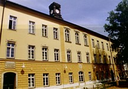
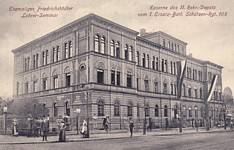

* * *

Das Friedrichstädter Lehrerseminar entstand auf Befehl Kurfürst Friedrich August III. und
wurde Ostern 1787 als erste Bildungseinrichtung für Lehrer in Sachsen eröffnet. Mit seiner Gründung sollte eine einheitliche Ausbildung von Volksschullehrern eingeführt und eine
Verbesserung der Qualität des Unterrichts gesichert werden. Für die Schaffung einer solchen Bildungsstätte hatten sich zuvor der Dresdner Oberkonsistorialrat Johann Christoh Rädler und
der Kreishauptmann des Wittenberger Kreises Peter von Hohenthal eingesetzt. Das Seminar befand sich zunächst im ersten Obergeschoss der zwei Jahre zuvor erbauten Real- und Armenschule auf der Seminarstraße _(Foto)_
. Zum ersten Direktor wurde der Diakon Johann Gottlieb Feilgenhauer ernannt, dem zwei ausgebildete und zwei angehende Lehrer zur Seite
standen. Für den praktischen Übungsunterricht nutzte man die im Haus untergebrachte Schule. Ausgebildet wurden die Seminaristen als Kirchschullehrer, da sie später auch den Kirchdienst
mit Orgelspiel und Chorgesang übernehmen mussten. Zum Fächerkanon gehörten neben Glaubens- und Sittenlehre und Bibelkunde Methodik und Pädagogik, Deutsch, Rechnen, Erdkunde, Naturkunde und
Geschichte sowie Klavier- und Orgelspiel, Gesang, Latein und Französisch und Zeichnen. Die Finanzierung der
Ausbildung erfolgte durch den Staat. Außerdem gewährten der Kurfürst sowie die Ritterschaft des Meißnischen Kreises
Stipendien für bedürftige Bewerber. Die Ausbildung dauerte in der Regel zwei bis drei, später sechs Jahre, bevor sich die angehenden Lehrer nach bestandener Abschlussprüfung um eine Lehrerstelle bewerben konnten.

Zu den bekannten Persönlichkeiten, die zeitweise an diesem Institut wirkten, gehören Carl Heinrich Nicolai und Gustav
Friedrich Dinter. Nicolai war ab 1789 Direktor des Lehrerseminars und ist Verfasser eines “Wegweisers durch die
Sächsische Schweiz”, welcher als erster touristischer Führer durch das Gebirge gilt. Dinter leitete die Einrichtung
zwischen 1797 und 1807. Als einer der ersten Pädagogen legte er Wert auf eine praxisorientierte Ausbildung und setzte
sich für die Abschaffung der Prügelstrafe ein. Unter seiner Leitung erhielt das Lehrerseminar 1798 seine erste Orgel.
1801 ließ er auf dem Schulgelände einen Obstgarten anlegen, der von den Seminaristen betreut wurde. An ihn erinnert eine Straße auf dem Gelände des Friedrichstädter Krankenhauses.

Nach Dinters Weggang und
infolge der Wirren der Befreiungskriege geriet das Lehrerbildungsseminar zeitweise in wirtschaftliche Schwierigkeiten und konnte nur mit Mühe und durch finanzielle Zuschüsse des Seminarleiters Heise vor
der Schließung bewahrt werden. Erhebliche Kosten verursachtee auch die zwischen 1822 und 1827 vorgenommenen Umbauten und Reparaturarbeiten, in deren Folge das Haus im wesentlichen sein heutiges Aussehen erhielt. 1827
entstand zudem ein Neubau an der Wachsbleichstraße, was die Einrichtung zusätzlicher Schlafsäle und Stuben für die
Seminaristen ermöglichte. Zwischen 1830 und 1835 war der Einrichtung eine Taubstummenschule angeschlossen. 1839
erfolgte die organisatorische Trennung von Seminar und Realschule, wobei die Leitung jedoch auch weiterhin einem
Direktor oblag. 1848/49 forderten die Lehrer des Friedrichstädter Seminars demokratische Reformen im Schulwesen
und eine bessere soziale Absicherung der Volksschullehrer. Eine neue Seminarordnung trat 1857 in Kraft und regelte
Unterbringung und Ausbildungsinhalte neu. Im Zuge dieser Reformen entstand 1861 ein Proseminar, in dem künftige Anwärter auf die bevorstehende Ausbildung vorbereitet wurden.

1865 verlegte man das Lehrerseminar in einen Neubau zur Waltherstraße 26. Das repräsentative Gebäude _(Foto)_ entstand nach einem Entwurf des Baumeisters Carl Adolph Canzler und bot neben Klassenzimmern auch Wohn- und Schlafräume für 80 auswärtige Schüler. Am 29. Oktober 1866 erfolgte die feierliche Einweihung. 1871 besuchten bereits 144 Schüler das Seminar. Ab 1874 unterstand es, wie alle sächsischen Lehrerseminare unmittelbar dem Kultusministerium. Die Seminarausbildung wurde einheitlich auf sechs Jahre festgeschrieben, wobei die Klassenstärke maximal 25 Schüler
betragen durfte. Die Übungsschule wurde in eine vierklassige mittlere Volksschule umgewandelt. Um den gewachsenen Bildungsansprüchen Rechnung zu tragen, gab es ab 1883 auch praktischen Unterricht im Buchbinden, Tischlern und Schnitzen. Außerdem konnten Schüler der oberen Klassen Fähigkeiten im Bau physikalischer Apparate erwerben.

1910 bezog das Lehrerbildungsseminar einen größeren [Gebäudekomplex am Weberplatz](../../../sudost/strehlen/) in Strehlen, der heute von der
Technischen Universität - Fakultät Erziehungswissenschaften genutzt wird. Während des Ersten Weltkriegs war im Haupthaus ein Ersatz-Schützenbataillon untergebracht. Später diente das Gebäude Wohnzwecken und fiel 1945 den Bomben zum Opfer. Das Seminargebäude im Hinterhof war in den Dreißiger Jahren Sitz der Maschinenfabrik Neupert, blieb auch nach 1945 Gewerbestandort und wurde nach 1990 abgerissen.

* * *

 \[ [Home](../../../index.html)\] \[ [Nord](../../../nord/)\] \[ [Nordwest](../../../nordwest/)\] \[ [Neustadt](../../../neustadt/)\] \[ [Nordost](../../../nordost/)\] \[ [West](../../../west/)\] \[ [Zentrum](../../../zentrum/)\] \[ [Südwest](../../../sudwest/)\] \[ [Süd](../../../sud/)\] \[ [Südost](../../../sudost/)\] \[ [Ost](../../../ost/)\] \[ [Register](../../../Register/register.html)\] \[ [Kontakt](../../../Kontakt/kontakt.html)\] \[ [Impressum](../../../impressum/)\]
