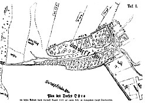
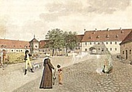

* * *

* * *

Die Geschichte des Dorfes Ostra begann im 11. Jahrhundert, als sich sorbische Bauern auf einer hochwasserfreien Erhebung westlich der damaligen Weißeritzmündung ansiedelten. Der Kern dieses Ortes, welcher
am 31. März 1206 gemeinsam mit Dresden erstmals als Oztrov erwähnt wurde, lag am Ende der heutigen Friedrichstraße. Der Name ist vom altsorbischen Wort ostrov = Werder, Flussinsel abgeleitet, was auf die geografische
Lage der Siedlung im früheren Mündungsgebiet der Weißeritz hinweist. In der Urkunde ging es um die Klärung eines Rechtsstreites, in welchem ein “Herbod von Ostrov” als Zeuge genannt ist.

_Plan des Dorfes Ostra 1568_

Ostra bestand aus einem Herrenhof, elf Bauerngütern und einigen kleineren Anwesen, die dem Meißner Bischof
unterstanden. Ab 1402 besaß die ursprünglich aus Freiberg stammende Familie Monhaupt das Herrengut als Lehen, musste ihren Besitz jedoch 1469 wegen Verschuldung nach einem langjährigen Rechtsstreit wieder an den Bischof
abtreten. Als die Bauern ihrem neuen Herren die Anerkennung verweigerten, ließ dieser einige Einwohner auf Burg
Stolpen gefangen setzen, bis diese einlenkten und die geforderten Abgaben und Frondienste zusagten. Unweit von Ostra,
in alten Urkunden und Karten auch als Groß-Ostra bezeichnet, lagen weitere kleine Siedlungen. So existierte am Weißeritzufer ein 1305 erwähntes Vorwerk Klein-Ostra. Unweit davon befanden sich die später zu Wüstungen
gewordenen Dörfer Rostagk und Wernten. 1305 vermachte der Besitzer Gunter Wolf sein Eigentum der Alexiuskapelle
auf der Dresdner Elbbrücke. 1535 kaufte der herzögliche Rat und Münzmeister Georg von Kommerstädt dieses Gut und ließ es zum Wirtschaftshof ausbauen.

Mitte des 16. Jahrhunderts erwarb Kurfürst Moritz das Vorwerk Klein-Ostra und
machte es zur Keimzelle einer herrschaftlichen Gutswirtschaft. Nach Moritz´ Tod fiel das Vorwerk an dessen Bruder August. Da das Gut für seine großzügigen
Planungen viel zu klein waren, veranlasste er 1559 den Meißner Bischof Johann von Haugwitz, ihm Ostra und die Fluren der ehemaligen Dörfer Wernten und Rostagk im
Tausch gegen andere Flächen abzutreten. 1568 begann August schließlich mit der Umsetzung seines Vorhabens, das [Ostravorwerk](../../../zentrum/friedrichstadt/ostragehege/) in einen landwirtschaftlichen
Großbetrieb umzuwandeln, der zum einen der Versorgung der Residenzstadt Dresden, aber auch als Mustergut zur Erprobung neuer Anbaumethoden dienen
sollte. Die Ostraer Bauern und Gärtner mussten dafür ihre Felder abgeben und erhielten als Entschädigung neue Anbauflächen in [Zschertnitz](../../../sud/zschertnitz/) und Leubnitz. Ein entsprechender Vertrag wurde dafür am 29. Oktober 1568 unterzeichnet,
der eigentliche Umzug erfolgte zwischen 14. März und 10. April 1569. An diese Umsiedlungsaktion erinnert noch heute der Name [Neuostra](../../../sudost/leubnitz-neuostra/). Da die Bewohner bei ihrem Umzug auch einen Großteil der vorhandenen Gebäude abbauten und
mitnahmen, blieb vom alten Ostra nur wenig erhalten. Die Reste des Dorfes wurden in das Ostravorwerk einbezogen. Ab 1670 entstand in unmittelbarer Nachbarschaft die heutige [Friedrichstadt](../../../zentrum/friedrichstadt/).

Rostagk und Wernten:

Westlich von Ostra lagen einst die Dörfer Rostagk und Wernten, welche heute verschwunden sind. Rostagk wurde 1326 erstmals als Rodstok genannt, wobei der Ortsname sowohl vom slawischen Wort rostok (= Flußgabel) oder vom
deutschen “Rodestock” abgeleitet worden sein kann. Das nur aus wenigen Gehöften bestehende Dorf befand sich in der
Nähe der heutigen Weißeritzmündung an der Hamburger Straße. Wernten, 1071 als Wirnotine (Dorf des Vernota) erwähnt, lag auf dem Gelände zwischen Hafen und Flügelwegbrücke. Beide Dörfer fielen wahrscheinlich im 14./15.
Jahrhundert einem Hochwasser zum Opfer und wurden nicht wieder aufgebaut. Ihre Fluren wurden später in das Areal des Ostravorwerkes einbezogen.

 \[ [Home](../../../index.html)\] \[ [Nord](../../../nord/)\] \[ [Nordwest](../../../nordwest/)\] \[ [Neustadt](../../../neustadt/)\] \[ [Nordost](../../../nordost/)\] \[ [West](../../../west/)\] \[ [Zentrum](../../../zentrum/)\] \[ [Südwest](../../../sudwest/)\] \[ [Süd](../../../sud/)\] \[ [Südost](../../../sudost/)\] \[ [Ost](../../../ost/)\] \[ [Register](../../../Register/register.html)\] \[ [Kontakt](../../../Kontakt/kontakt.html)\] \[ [Impressum](../../../impressum/)\]
