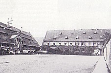
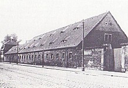
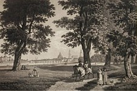
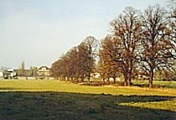
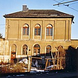
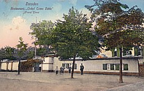
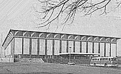
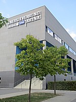

* * *

Bereits im 15. Jahrhundert existierte in der Nähe der alten Weißeritzmündung ein
Vorwerk, welches sich 1535 im Besitz Herzog Georg des Bärtigen befand. Dieser veräußerte es noch im gleichen Jahr an den Freiberger Münzmeister und Rat Dr. Georg von Kommerstädt, der das Vorwerk unter Einbeziehung des
sogenannten “Kapellengutes” der Alexiuskapelle ausbauen ließ. Nachdem Georg von Kommerstädt wegen Unregelmäßigkeiten in der Münzstätte in Ungnade gefallen war, musste er das Anwesen 1550 verkaufen. Den “Baumgarten zu
Klein-Ostra” erwarb nun Kurfürst Moritz, ohne sich um das bestehende Lehnsrecht der Meißner Bischöfe zu kümmern. Nach dessen Tod übernahm sein
Bruder August das Gut und plante, es in einen modernen landwirtschaftlichen Großbetrieb zur Versorgung der Residenz umzuwandeln. Da die Fläche des Vorwerks zu klein war, kaufte er 1559 dem Meißner Bischof das Dorf [Ostra](../../../zentrum/friedrichstadt/ostra/) mit den Fluren der untergegangenen Dörfer Wernten und Rostagk sowie Teile der Cottaer und Löbtauer Flur ab. Im Gegenzug
wurde Bischof Johann von Haugwitz das Amt Mühlberg zugesprochen. 1568 mussten die bisherigen Bewohner Ostras umsiedeln und erhielten als Entschädigung neue Felder in [Zschertnitz](../../../sud/zschertnitz/) und [Neuostra](../../../sudost/leubnitz-neuostra/) zugewiesen. Das in Ostra ansässige Adelsgeschlecht der Monhaupts wurde mit dem Vorwerk Daubnitz bei Lommatzsch entschädigt.

Nun stand den weitreichenden Planungen des Kurfürsten und seiner
landwirtschaftlich interessierten Frau, Kurfürstin Anna, nichts mehr im Wege. Das Paar ließ das bestehende Vorwerk, zu dessen Besitz fast 600 Hektar Nutzfläche
gehörten, vergrößern. U.a. entstanden ein Viehhof, Obstgärten, Stallungen und Scheunen sowie eine Schmelz- und Saigerhütte zur Kupferverarbeitung. Zum Mahlen des Getreides errichtete man in Plauen die [Hofmühle](../../../sud/plauen/bienertmuhle/), derem Mahlzwang fast alle Dörfer der Umgebung unterworfen waren. Zur Bewirtschaftung wurden
Bauern aus den Dörfern des Amtes Dresden sowie den Ämtern Moritzburg, Radeberg und Pirna herangezogen, die alljährlich 2500 Pflugtage, Spann- und
Handdienste leisten mussten. Aufgrund der großen Entfernung zwischen Ostravorwerk und den Heimatorten entstand am
Freiberger Platz 1570 der Frönerhof, in dem die zur Arbeit verpflichteten Knechte wohnen mussten. Außerdem gab es
ab 1568 den Gesindezwangsdienst, der eine zweijährige Dienstzeit für alle Kinder des Dresdner Amtes in Ostra vorsah.

1614 wurde ein neuer Fronhof am Anfang der späteren [Schäferstraße](../../../zentrum/friedrichstadt/strassen_friedrichstadt/schaferstrasse/) gebaut.
Hier wurde auch Schafzucht betrieben, weshalb sich später der Name Schäferei für das erst 1903 abgerissene Gebäude durchsetzte. Nach dem Dreißigjährigen Krieg arbeiteten auch
böhmische Exulanten auf den Feldern des Kammergutes, für die in Löbtau die sogenannten [“Drescherhäuser”](../../../zentrum/friedrichstadt/strassen_friedrichstadt/drescherhauser/) entstanden. Trotz aller
Bemühungen verlor das Gut jedoch unter Augusts Nachfolgern, die ihren Schwerpunkt mehr auf die Ansiedlung von Handwerkern und Manufakturen legten, an Bedeutung. Da Teile der Flächen im 17. und 18. Jahrhundert dem
kurfürstlichen Hof als Fasanerie und Tiergarten dienten, wurden diese ab 1696 umzäunt, woraufhin sich der Name “Großes Gehege” bzw. “Ostragehege” für dieses Areal durchsetzte. Neben Geflügel,
Rindern, Schweinen und Schafen wurden hier auch Rebhühner, Biber, Hirsche, Büffel und zeitweise sogar Kamele gehalten. Weite Teile des Ostrageheges dienten zudem als Jagdrevier der sächsischen Kurfürsten.

_Von Gottes Gnaden Wir Friedrich August fügen hierdurch männiglich zu wissen, welchergestalt wir an und bei Unserem Vorwerk Ostra allhier einen gewissen_
_Bezirk von jetzt berühmten Vorwerk an, hinter der Schäferei hinauf nach den Drescherhäuserchen zu, von da auf der Landstraße hinunter bis Cotta und von da bis zur Elbe zu einem Tiergarten, um_
_darin unser Lust und Ergötzlichkeit zu pflegen, ausersehen, selbigen sofort mit einer Vermachung verwahren, und damit diese in gutem Essen beständig bleiben, auch das hineingesetzte Wildpret_
_desto füglicher behalten werden möchte._

_**Aus einem Erlass August des Starken von 1696**_

Bereits 1670 hatte Johann Georg II. verfügt, dass auf den Fluren des Ostragutes
eine neue Vorstadt Neustadt-Ostra gegründet werden soll. Dort sollten sich gezielt Handwerker und Gewerbetreibende ansiedeln, welchen Gewerbefreiheit,
Steuererleichterungen und günstige Grundstückspreise zugesichert wurden. Aus dieser Handwerkersiedlung ging 1730 die heutige [Friedrichstadt](../../../zentrum/friedrichstadt/) hervor. Die
verbleibenden Felder wurden nach dem Tod August des Starken landschaftlich neu gestaltet und 1734 durch drei große Alleen gegliedert. Dabei führt die heute nur noch in Resten vorhandene Übigauer Allee _(Foto)_
als Sichtachse auf das [Schloss Übigau](../../../nordwest/ubigau/schloss_ubigau/) zu, während die Pieschener Allee in Blickrichtung der Lößnitzhänge
verläuft. Eine dritte, die sogenannte Hirsch-Allee, ist nicht mehr vorhanden. 1752 vernichtete ein Brand große Teile des
Kammergutes, es wurde jedoch wenig später wieder aufgebaut. 1768 übernahm ein Pächter die Bewirtschaftung des
Gutes. Planungen des Hofes, das gesamte Ostragehege durch den französischen Gartenarchitekten Francois Cuvilliés zu
einem großen Park umzugestalten, scheiterten an der wirtschaftlichen Lage in Sachsen nach dem Siebenjährigen Krieg.
1812 ließ Napoleon im Ostragehege aus Anlass seines Geburtstages 40.000 Soldaten aufmarschieren, seine letzte große Parade auf deutschem Boden.

Im 19. Jahrhundert musste, bedingt durch die zunehmende Bebauung der Vorwerksfluren, die
landwirtschaftliche Nutzung eingeschränkt werden. Stattdessen widmete sich man sich vorrangig der Milchwirtschaft und der Herstellung von Molkereiprodukten. Die
Bewirtschaftung oblag nunmehr wechselnden Pächtern. 1835 errichtete sich einer dieser Pächter namens Portius die noch erhaltene Villa Friedrichstraße 62 _(Foto)_ als eigenes
Wohnhaus (Portius-Villa). Nach einem Brand des Ostravorwerks am 27. März 1835 entstanden weiter Neubauten, die u.a. als Musterschule für Landwirte und Pflanzenzucht dienten und als Vorläufer der späteren [Lehranstalt für Gartenbau](../../../nordost/pillnitz/institut_fur_gartenbau/) in Pillnitz gelten.

Die verbliebenen Wiesen im Ostragehege wurden mit städtischen Fäkalien gedüngt, bevor auf dem Areal 1906-10 der städtische [Schlachthof](../../../zentrum/friedrichstadt/ostragehege/schlachthof/) entstand. 1917 wurde der Betrieb des Vorwerks endgültig eingestellt. Das Areal übernahm die
Dresdner Transport- und Lagerhaus-Gesellschaft und nutzte es als Lager. 1945 zerstörten die Bomben einen Großteil der
verbliebenen Bauten. Einige Reste des Vorwerks, darunter eine Scheune und der frühere Kuhstall blieben am Ende der [Friedrichstraße](../../../zentrum/friedrichstadt/strassen_friedrichstadt/friedrichstrasse/) noch erhalten. Diese sollen künftig in eine hier geplante Wohnanlage einbezogen werden.  Bemerkenswert
ist vor allem das frühere Hegereiterhaus (Friedrichstraße 64) an der Einmündung Waltherstraße.

Gegen Ende des 19. Jahrhunderts griff die Stadt Dresden Cuvilliés Pläne von 1760 noch einmal auf. Im Rahmen eines
städtebaulichen Wettbewerbes sollte das ehemalige Kammergut zusammen mit dem Ostragehege in einen Volkspark umgewandelt werden. Ziel war es, unter weitgehender Bewahrung des vorhandenen Baumbestandes und des
Wegenetzes eine Erholungsfläche für die Bevölkerung zu schaffen. Insgesamt gingen 38 Entwürfe ein, von denen der eines
Berliner Landschaftsgestalters mit 1000 Mark prämiert wurde. Vorgesehen war u.a. die Anlage eines Gondelteiches, der
Bau von Lokalen und Spielplätzen sowie eine ergänzende Bepflanzung mit heimischen Gehölzen. Letztlich blieben diese Pläne unrealisiert. Stattdessen wurden die
Flächen für den Bau des Alberthafens, für Gewerbeansiedlungen und für den neuen Schlachthof in Anspruch genommen.

Nach dem Bau des Schlachthofes siedelten sich zwischen Pieschener Allee und
Elbe mehrere Kleingartenanlagen an. So gründeten Schrebergartenfreunde 1923 die Anlage “Zur Aue” mit einer auch für die Öffentlichkeit zugänglichen
Vereinsgaststätte. Außerdem gab es hier die Gartenwirtschaft “Onkel Toms Hütte” _(Foto)_, benannt nach dem 1852 erschienenen Erfolgsroman von Harriet
Beecher-Stowe. Das rustikale Ausflugslokal entstand 1856 und war sowohl bei Elbschiffern und Hafenarbeitern als auch bei Ausflüglern beliebt. Neben den im
Stil einer Hafenkneipe gestalteten Innenräumen gab es einen großen Biergarten. Die mehrfach vom Hochwasser beschädigte Gastwirtschaft bestand bis 1960.

Unweit davon verband bis 1992 eine Elbfähre das Ostragehege mit den gegenüberliegenden Stadtteilen Neudorf und
Pieschen. Eine weitere Fähre existierte bis 1996 in der Nähe des Schlachthofes nach Altpieschen. Zeitweise gab es in
diesem Elbabschnitt auch eine Badeanstalt, welche von 1839 bis um 1890 nach ihrem Besitzer Schallersche Anstalt
genannt wurde. Nach deren Schließung wegen des Hafenausbaus entstand 1906 eine Städtische Badeanstalt unterhalb
der Fährstelle, die noch bis nach dem Ersten Weltkrieg existierte. Nach dem Elbehochwasser im August 2002 mussten die meisten Gärten aus Hochwasserschutzgründen aufgelassen werden.

Einige Flächen im Ostragehege wurden nach dem Ersten Weltkrieg mit
Sportanlagen bebaut. In dem hier entstandenen Stadion spielte der [Dresdner Sportclub](../../../zentrum/friedrichstadt/ostragehege/dsc/) DSC, der 1944 die letzte Deutsche Fußballmeisterschaft gewann.
Dieses [Stadion](../../../zentrum/friedrichstadt/ostragehege/heinz-steyer-stadion/) erhielt nach 1945 den Namen des von den Nazis ermordeten
Widerstandskämpfers Heinz Steyer. Weitere Sportbauten folgten in den 1960er und 70er Jahren, darunter die 1969/72 von H. Seifert und Siegfried Speer entworfene Eissporthalle _(Foto)_
und ein heute nur noch in Fragmenten erhaltenes Kunsteisstadion. In der am 26. Dezember 1960 eröffneten Sportstätte fand im Januar 1961 das erste Länderspiel einer DDR-
Eishockey-Nationalmannschaft statt. Bereits Anfang der 1970er Jahre wurde das Stadion jedoch wieder geschlossen.

Nach 1990 kamen neue Pläne für eine künftige Gestaltung des Ostrageheges auf. Das Gebiet sollte als Vergnügungs- und Erholungsgebiet entwickelt werden. Hier plante die Stadt die Internationale Gartenschau 2003 bzw. eine
Bundesgartenschau. Auch der Bau von Wohnungen, eines Veranstaltungszentrums für den Zirkus “Sarrasani” sowie eines
Freizeit- und Technologieparkes wurde erwogen. Allerdings konnte keines dieser Projekte in die Realität umgesetzt
werden. Lediglich der 1991 geschlossene Schlachthof wurde teilweise saniert und 1999 zum Messegelände umgestaltet. Außerdem entstand in der Nähe ein Open-Air-Gelände für Konzerte und andere Großveranstaltungen.

Ab 2005 wurde außerdem ein moderner Sportkomplex geschaffen, der die durch
jahrezehntelange Nutzung und das Hochwasser 2002 verschlissenen Anlagen ersetzen soll. Die Eröffnung der neuen “Freiberger Arena” (nach dem Hauptsponsor) erfolgte am 31.
August 2007. Das moderne Gebäude (Entwurf von Hans-Jürgen Schmidt-Schickedanz) bietet eine Eishalle mit 4000 Zuschauerplätzen, eine Ballspielhalle mit 400 Plätzen sowie
Trainings- und Büroräume und eine öffentliche Gaststätte. Die alte Eishalle wurde daraufhin entkernt und am 29. Februar 2008 gesprengt. Der Neubau trägt seit Dezember 2010 nach
einem Sponsorenwechsel den Namen “Energieverbund-Arena” und ist u.a. Spielstätte der “Dresdner Eislöwen”. Auf dem Areal der alten Halle wurde ein Spiel- und Freizeitpark mit
Ballspielplätzen, Kletteranlagen und einem Skaterbereich angelegt. Unweit davon befindet sich die 2003 errichtete Trainingshalle des Dresdner Sportclubs, welche die alte Laufhalle des Vereins ersetzt..

* * *

 \[ [Home](../../../index.html)\] \[ [Nord](../../../nord/)\] \[ [Nordwest](../../../nordwest/)\] \[ [Neustadt](../../../neustadt/)\] \[ [Nordost](../../../nordost/)\] \[ [West](../../../west/)\] \[ [Zentrum](../../../zentrum/)\] \[ [Südwest](../../../sudwest/)\] \[ [Süd](../../../sud/)\] \[ [Südost](../../../sudost/)\] \[ [Ost](../../../ost/)\] \[ [Register](../../../Register/register.html)\] \[ [Kontakt](../../../Kontakt/kontakt.html)\] \[ [Impressum](../../../impressum/)\]
