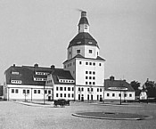
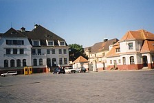
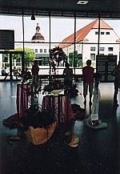
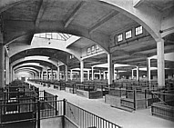
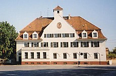
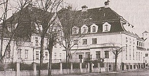
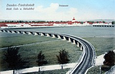
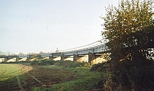

* * *

* * *

* * *

Der Städtische Vieh- und Schlachthof wurde 1906/10 im Ostragehege angelegt, nachdem die bisher genutzten Gebäude an der Leipziger Straße [(Alter Schlachthof)](../../../../neustadt/leipziger_vorstadt/leipziger_strasse/alter_schlachthof/) nicht mehr den Anforderungen an eine moderne Fleischverarbeitung genügten. Für den Bau nutzte man eine Erhebung in der Nähe der alten Weißeritzmündung, die zu einer künstlichen Insel hochwasserfrei aufgeschüttet wurde. Offizieller Baubeginn war am 30. September 1906.

Nach Plänen des Stadtbaurates Hans Erlwein und unter Leitung des Stadtbaumeisters Dr.
Geißler entstand auf einer Fläche von 36 Hektar eine architektonisch interessante abgeschlossene Anlage mit 68 Einzelgebäuden. Darunter befanden sich der Viehhof,
Ställe für Groß- und Kleinvieh, Schlachthallen sowie Kühl- und Lagerhäuser. Im Mittelpunkt lag das Kessel- und Maschinenhaus _(Foto)_ mit seinem markanten, weithin
sichtbaren Schornsteinturm. Hinzu kamen eine Pumpstation für Hoch- und Regenwasser, acht Trinkwasserbrunnen, ein Anlage zur Herstellung von Trockeneis sowie ein eigenes
Klärwerk für anfallendes Abwasser. Außerdem gab es eine Gaststätte mit Hotel, in welchem auswärtige Viehhändler übernachten konnten. Geschickt gelang es dem Architekten, dem Gebäudeensemble
den Charakter eines ländlichen Gutsbetriebes zu verleihen und so den Charakter als Industrieanlage zu kaschieren. Am
19\. August 1910 ging der neue Schlachthof, der seinerzeit zu den modernsten Europas gehörte, in Betrieb. Für sein
Werk wurde Hans Erlwein der Titel eines Professors verliehen, Stadtbaumeister Geißler bekam den Albrechtsorden.

Die Schlachtkapazität des
Betriebes betrug zu Beginn 550 Rinder, 3450 Kälber und Schafe sowie 2500 Schweine pro Tag. Außerdem fanden auf dem Gelände große Viehmärkte statt, eine Tradition, die erst nach dem Zweiten Weltkrieg
endete. Um das Unternehmen effizient betreiben zu können, erhielt die Schlachthofinsel Anschluss an das Eisenbahnnetz sowie eine Straßenbahnverbindung zur Friedrichstadt.

Bereits nach
Ende des Ersten Weltkrieges machten sich einige Erweiterungsbauten erforderlich, die in das Ursprungskonzept der Erlweinschen Anlage eingefügt wurden. Glücklicherweise blieb das abseits gelegene Gelände des Städtischen
Vieh- und Schlachthofes 1945 von größeren Zerstörungen verschont. Nach 1945 übernahm der VEB Dresdner Fleischkombinat das Areal und produzierte hier bis
1994 Fleisch- und Wurstwaren. Für die ca. 2000 Beschäftigten richtete man zu DDR-Zeiten eine eigene Kinderkrippe, einen Kindergarten, ein Betriebsambulatorium sowie ein eigenes Kulturhaus ein. Hinzu kam ein 1982
errichtetes Wohnheim für die Auszubildenden des Schlachthofes. Trotz Mangelwirtschaft gelang es, Teile der Produktionsstätten zu rekonstruieren und an moderne Qualitätsstandards
anzupassen. Größtes Investitionsvorhaben war der Bau eines modernen Verarbeitungsbetriebes für Fleisch- und Wurstwaren auf dem Gelände des früheren Viehhofes. Unzureichende Werterhaltungsmaßnahmen und einige
maßstabslose Neubauten beeinträchtigten jedoch das historische Erscheinungsbild.

1990 wurden die beiden auf dem Areal bestehenden Betriebe Dresdner Vieh- und Schlachthof GmbH und Sachsenhof GmbH i. G. durch die Treuhandanstalt an westdeutsche
Unternehmen veräußert. 1994 erfolgte die Schließung des Schlachthofes und die Verlegung in einen Neubau in Naunhof bei Radeberg. Danach standen die Bauten zunächst leer, bevor der
Stadtrat am 17. Dezember 1998 nach mehrjähriger Diskussion entschied, den Schlachthof künftig als Standort der Dresdner Messe zu nutzen. Zuvor hatte es Auseinandersetzungen um mögliche Alternativen in [Kaditz-Mickten](../../../../nordwest/kaditz/) bzw. auf dem Gelände der früheren [Heeresbäckerei](../../../../neustadt/aussere_neustadt/antonstadt/konigsbrucker_strasse/)
gegeben.

Am 18. Januar 1999 begann die Sanierung des früheren Schlachthofes unter Beachtung denkmalpflegerischer Forderungen. Auch der frühere Eingangsbereich und weitere
Erlweinbauten konnten äußerlich originalgetreu wiederhergestellt werden. Das nach Entwürfen von Walter Kaplan umgestaltete und um einige moderne Ergänzungen erweiterte Messegelände wurde am 24. September 1999 eingeweiht
und wird seitdem für Messen, Ausstellungen, Konzerte und andere Großveranstaltungen genutzt. Weitere Bauten nutzen das Leistungszentrum von Dynamo Dresden sowie die Jugendsportschule mit
Sportmittelschule und -gymnasium. Teile des Schlachthofes stehen jedoch noch immer leer.

Einzelne Bauten:

Viehhof:
Der frühere Viehhof diente ursprünglich als Marktplatz für die bis 1945 regelmäßig durchgeführten Viehmärkte,
bei denen Schlachttiere taxiert und gehandelt wurden. Zum Komplex gehörten zwei Markthallen für Rinder sowie eine weitere Halle für Schweine und Kälber. Außerdem gab es ein heute nur noch teilweise vorhandenes
Verwaltungsgebäude, mehrere Futterställe sowie einige Kleinbauten. Das Areal wurde von Erlwein in Form eines
Gutshofes gestaltet. Die früheren Futterställe werden seit 2007 für die jährliche Kunstausstellung “Ostrale” genutzt. In die ehemalige Rinderhalle zog 2011 das Zentrum für Eventkultur mit einem Restaurant-Theater ein.

Schlachthof:
Dieser Gebäudekomplex bildete das eigentliche Zentrum des Areals und bestand aus zwei Schlachthallen für Großvieh sowie weiteren Hallen für die Schlachtung von Schweinen und kleineren Tieren _(Foto)_
. Die Gebäude entstanden in baulich ähnlicher Form und wurden ebenfalls architektonisch ansprechend gestaltet. Gemeinsam mit dem alten Kühlhaus werden diese Hallen nach ihrem Umbau heute als
Messehallen genutzt. Regelmäßig finden hier auch Konzerte und andere kulturelle Veranstaltungen statt.

Zum Schlachthof gehörte auch der sogenannte Amtsschlachthof mit Kuttlerei, Düngerhaus sowie das Darmhaus, in
denen erkrankte Tiere sowie Schlachtabfälle weiterverarbeitet wurden. Hier befanden sich auch weitere Nebenanlagen wie die Talgschmelze und die Häuteverwertung sowie eine zuletzt als Waagenbauwerkstatt genutzte
Abwasseraufbereitung. Leider sind diese Gebäude heute größtenteils verfallen.

Kulturhaus:
Das ehemalige Kulturhaus des Fleischkombinates entstand 1952 in den Räumlichkeiten des früheren Pferde-
und Hundestalls. An der Nordfassade erinnert ein Sgraffito mit der Darstellung eines Gitarrespielers an die spätere
Nutzung. Bereits 1925 war dieses Gebäude erweitert und mit zwei Zwerchhäusern an der Nordseite versehen worden.

Kühlhaus:
Die frühere Kühlhalle gehört zu den größten Gebäuden des Schlachthofkomplexes und wurde, wie auch die meisten anderen Bauten, mit architektonisch interessant gestalteten Fassaden versehen. Am Kopfbau befindet sich ein
farbiges Mosaik mit der Darstellung zweier Bauern, die einen Stier zum Schlachter führen. Unmittelbar neben dem alten
Kühlhaus steht eine weitere Halle mit großen Einfahrtstoren und einer Uhr, die Kühlhaus und Schlachthallen miteinander verbindet. Diese Gebäude bilden heute das Kernstück des Messegeländes.

Kessel- und Maschinenhaus: Weithin sichtbar ist das frühere Kessel- und Maschinenhaus, welches als Wahrzeichen des
Schlachthofes gilt. Um die Stadtsilhouette nicht zu stören, ließ Erlwein den Schornstein des Heizhauses mit einem
kuppelartigen Bau verkleiden, so dass sich die Anlage gut in das Gesamtensemble einfügt. Hier wurde die für den Betrieb des Schlachthofes erforderliche Energie gewonnen. Teile des maroden Maschinenhauses mussten 1993
abgetragen werden. Die verbliebenen Gebäude stehen derzeit leer und warten auf ihre Sanierung.

Verwaltungsgebäude:
Als Büro- und Verwaltungsgebäude diente der markante Gebäudekomplex Schlachthofring (heute Messering) 6. Am Giebel befindet sich ein Mosaikbild “Bauer mit Sau”, an den Blendarkaden im Erdgeschoss weisen
Stierköpfe auf die Zweckbestimmung des Gebäudes hin. Außerdem würdigt eine Inschrift “Hoch das edle Fleischerhandwerk” die hier arbeitende Berufsgruppe.
Ein kleinerer Bau am Eingang diente einst als Pförtnerhaus. Im Vorhof steht ein kleiner, von Georg Wrba geschaffener Brunnen, der die Plastik eines Rindes zeigt und die Inschrift _“Der Gesundheit unserer schönen Stadt Dresden 1906/1910”_ trägt.

An der Fassade des Hauptgebäudes wurde wenige Jahre nach Eröffnung des Schlachthofes eine Tafel angebracht, die vom Dresdner Tierschutzverein
finanziert wurde. Die Inschrift nennt folgende Worte:

_“Blutig ist ja Dein Amt, o Schlaechter, drum uebe es menschlich._

_Schaffe nicht Leiden dem Tier, das Du zu toeten bestimmt._

_Leit es mit schonender Hand und toete es sicher und eilig._

_Wuenschest Du selber ja auch: Kaeme doch sanft mir der Tod._

_Alter Tierschutzverein Dresden”_

Während des Zweiten Weltkriegs waren im Keller des Gebäudes bis zu 150 amerikanische Kriegsgefangene untergebracht, welche hier auch den Luftangriff überlebten. Nach der damaligen postalischen Anschrift des Hauses
benannte der amerikanische Schriftsteller Kurt Vonnegut seinen 1969 erschienenen Roman “Schlachthof Nr. 5”, in dem
er seine Kriegserlebnisse literarisch verarbeitete. Das Buch gehört in der USA zur Schulliteratur. 2013 entstand in den Räumen eine Kunstinstallation des irischen Künstkers Ruairi O´Brian mit Zitaten aus Vonneguts Werk
. Das Haus selbst wird heute von der Messeverwaltung genutzt.

Neben dem eigentlichen Verwaltungsgebäude befindet sich das frühere Schauamt (Messering 4), welches die Einhaltung
der Gesundheitsbestimmungen bei der Schlachtung überwachte. Die Kartusche mit Inschrift über dem Eingang stammt
von August Strohriegl. Nach Abschluss der Sanierung ist hier seit 2006 das Nachwuchs-Leistungszentrum von Dynamo Dresden untergebracht. Auf dem Nachbargrundstück blieben die Wohn- und Geschäftshäuser Schlachthofring 1-3
erhalten. Im Erdgeschoss befanden sich früher Verkaufsräume für Fleisch- und Wurstwaren. Diese Gebäude werden heute als Internat und Gemeinschaftsbereich der Jugendsportschule genutzt.

Gastwirtschaft:
Der am Haupteingang gegenüber dem Verwaltungsgebäude stehende Bau diente einst als Gastwirtschaft für die Besucher des Schlachthofes. Neben den Restaurationsräumen gab
es hier auch einen großen Börsensaal sowie Versammlungsräume, die Hauptkasse und ein eigenes Postamt. Die Ausgestaltung der Innenräume übernahm der Maler Paul Perles. Für auswärtige Gäste
standen Hotelzimmer, Ställe und Autogaragen zur Verfügung. Nach 1945 wurde das Gebäude für Verwaltungszwecke, als Kindergarten und Verkaufsstelle genutzt. Später befand sich hier das
Veranstaltungslokal “Röschenhof”. 2009 begann der Umbau des Hauses zum Kernstück des künftigen Kongress- und Tagungszentrum “Börse Dresden” mit mehreren Sälen und Tagungsräumen. In diesem Zusammenhang entstanden ein
moderner Neubau sowie ein Verbindungsgang zu den  Messehallen 2 und 3.

Lehrlingswohnheim: Das Gebäude entstand 1982 und wurde zunächst als Bauarbeiterunterkunft, später als Wohnheim
für die Auszubildenden des Schlachthofes genutzt. 1994 eröffnete hier das “Wenotel”, ein preiswertes Hotel mit 162
Betten. Da das Haus dem Ausbau der neuen Jugendsportschule im Weg stand, musste das Hotel Ende 2004 schließen und wurde wenig später abgerissen.

Sachsenhof:
Der moderne Neubau entstand in den 1980er Jahren für die Verarbeitung von Fleisch- und Wurstwaren.
Auf einer 1,3 Hektar großen Brachfläche wurden Verarbeitungshallen für die Fleischzerlegung und -verarbeitung sowie den Versand gebaut. Nach 1990 übernahm die neu gegründete Sachsenhof GmbH i. G. den Betrieb. Nach deren
Verkauf an die Firma Redlefsen wurde die Produktion 1994 eingestellt und die Gebäude 1999 später abgerissen. Heute befindet sich auf dem Grundstück der Messe-Parkplatz.

Sportschule:
Die bereits 1954 gegründete Kinder- und Jugendsportschule hatte ihr Domizil ursprünglich an der Parkstraße. 2007 wurde die aus Sportmittelschule und -gymnasium bestehende Einrichtung ins Ostragehege verlegt und
am 1. September 2007 eingeweiht. Die Pläne für den modernen Komplex, in den auch einige denkmalgeschützte
Erlwein-Bauten integriert wurden, stammen vom Architektenbüro Meyer & Bassin sowie Heinle, Wischer und Partner.
Hier werden bis zu 750 Nachwuchssportler unterrichtet. Außerdem gibt es ein Internat für auswärtige Schüler.

Im Innenhof des Sportschulzentrums steht seit Juli 2014 die von Richard König stammende Plastik “Der Fechtsportler”.
Die zwei Meter hohe Bronzeskulptur stand ursprünglich ab 1913 vor der Turnhalle des Allgemeinen Turnvereins an der
heute nicht mehr vorhandenen Permoserstraße in der Wilsdruffer Vorstadt (Areal Haus der Presse). Dort wurde sie 1945 nur leicht beschädigt geborgen und auf Initative des Dresdner Fechtclubs nach 1990 restauriert.

Anschlussbahn: Zur Anbindung des Schlachthofes an das Eisenbahnnetz entstand zeitgleich mit dessen Bau eine Verbindungsbahn zum Friedrichstädter Rangierbahnhof. Diese nutzte zunächst die Gleise der Hafenbahn des [Alberthafens](../../../../zentrum/friedrichstadt/alberthafen/), zweigte dort auf eine Brücke über die Flutrinne ab und endete direkt im Betriebsgelände, wo es sogar einen von Erlwein entworfenen Lokschuppen gab. 1991 wurde die Strecke stillgelegt. Die auf 22 Pfeilern ruhende und 386 Meter lange Eisenbahnbrücke wurde im Februar 2006 aus Hochwasserschutzgründen abgetragen.

**_Fotos:_** _Die Schlachthofbrücke der Eisenbahn nach ihrer Einweihung (links) und_

_kurz vor ihrem Abbruch im Frühjahr 2006 (rechts)._

Wohnhäuser Schlachthofring (Messering) 25-27: In Ergänzung der vorhandenen Bebauung entstanden 1926 drei
Wohnhäuser, die vorrangig an Angestellte des Schlachthofes vermietet wurden. Die Häuser sind in Anlehnung an Erlweins Entwürfe gestaltet und fügen sich so harmonisch in das Gesamtbild der Anlage ein. In der zugehörigen
Gartenanlage fand eine Plastik Georg Wrbas Aufstellung, die einen Schlachter mit Schwein zeigt. Seit 2005 befindet sich diese im Innenhof des ebenfalls von Hans Erlwein entworfenen früheren [Obdachlosenasyls](../../../../nordwest/pieschen/strassen_pieschen/altpieschen/) in Altpieschen.

Schlachthofbrücke: Die Brücke entstand 1931/32 als Verbindung zwischen Friedrichstadt und Schlachthof und ersetzte eine 1899 erbaute Holzbrücke über die Flutrinne. Das neue Bauwerk wurde als geschweißte Stahlbrücke erbaut und am 27. Mai 1932 eingeweiht. Die aus 13 Feldern bestehende und 315 Meter lange Brücke galt damals als längste elektrisch geschweißte Brücke der Welt. Bis 1979 benutzten sie auch Straßenbahnen. 1999 wurde sie abgetragen und unter Verwendung der alten Pfeiler komplett neu errichtet. 2010 entstand parallel eine zweite Brücke für die Wiedereinrichtung der Straßenbahn zum Messegelände. Am 30. Mai 2011 ging die neue Strecke in Betrieb.

* * *

 \[ [Home](../../../../index.html)\] \[ [Nord](../../../../nord/)\] \[ [Nordwest](../../../../nordwest/)\] \[ [Neustadt](../../../../neustadt/)\] \[ [Nordost](../../../../nordost/)\] \[ [West](../../../../west/)\] \[ [Zentrum](../../../../zentrum/)\] \[ [Südwest](../../../../sudwest/)\] \[ [Süd](../../../../sud/)\] \[ [Südost](../../../../sudost/)\] \[ [Ost](../../../../ost/)\] \[ [Register](../../../../Register/register.html)\] \[ [Kontakt](../../../../Kontakt/kontakt.html)\] \[ [Impressum](../../../../impressum/)\]
