* * *

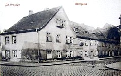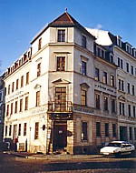Die Adlergasse wurde 1725 angelegt und zunächst Neue Gasse genannt. Nach dem benachbarten Gasthaus “Zum Schwarzen Adler” erhielt sie 1840 den Namen Adlergasse. Die meist nur ein- und zweigeschossigen Gebäude entstanden zwischen 1790 und 1900. In einem dieser Häuser wurde 1850 der sozialdemokratische Verleger Max Kegel geboren, der 1879 Herausgeber der “Dresdner Abendzeitung” und des Satireblattes “Hiddigeigei” war.Im Haus Adlergasse 9 gab es vor 1945 das kleine Hotel “König Anton”. Hinzu kamen einige kleinere Handwerks- und Gewerbebetriebe. Einige Häuser der Adlergasse fielen 1945 den Bomben zum Opfer. Weitere Gebäude wurden nach 1960 wegen ihres schlechten Bauzustandes abgetragen, so dass heute nur noch ein geringer Teil der ursprünglichen Bebauung vorhanden ist.

Im Eckhaus Adlergasse 14 _(Foto)_ befindet sich die frühere Gaststätte “Stadt Riesa”, die seit 1990 als Kulturzentrum “riesa efau” genutzt wird. Regelmäßig finden in hier öffentliche Veranstaltungen, Ausstellungen und Seminare statt. Außerdem dient das Haus als soziokulturelles Stadtteilzentrum und Domizil verschiedener Vereine und Initiativen. Ein moderner Ergänzungsbau entstand 2012-15 an der Wachsbleichstraße 4a.#

Die Altonaer Straße geht auf einen früheren Weg an der alten kurfürstlichen Ziegelei zurück und wurde deshalb früher “An der Ziegelscheune” genannt. In unmittelbarer Nähe befand sich der zur Erhebung der städtischen Akzise dienende Löbtauer Schlag. Im Umfeld der Ziegeleigebäude entstand Anfang des 19. Jahrhunderts eine kleine Siedlung, die nach einer hier gelegenen Gastwirtschaft “Altona” genannt wurde. Unweit davon lag das aus wenigen Häusern bestehende “Klein Hamburg”. Außerdem gab es in diesem Teil der Friedrichstadt das als Quarantänestation und Hilfskrankenhaus genutzte “Probierhaus”, welches in Seuchenzeiten krankheitsverdächtigen Reisenden als Unterkunft diente.

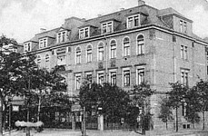1902 wurde der heute gültige Straßenname Altonaer Straße eingeführt. Mit diesem wird an das vermutlich nach dem gleichnamigen Hamburger Stadtteil benannte ehemalige Gasthaus erinnert. Um 1900 entstanden an der Altonaer Straße mehrgeschossige Wohnhäuser, darunter die aus Mitteln der Johann-Meyer-Stiftung finanzierte palaisartige Wohnanlage Nr. 17-21 (1905). Künstlerisch bemerkenswerte Treppenhausgestaltungen der Entstehungszeit haben sich u.a. in den Häusern Nr. 18, 20 und 24 erhalten. Im Erdgeschoss des Gebäudes an der Ecke zur Löbtauer Straße (Nr. 6 - _Foto_) gab es zeitweise das Lokal "Weldes Restaurant". Eine weitere Gaststätte befanden sich in der Nr. 12 (1910 Restaurant Westmünster, nach dem Ersten Weltkrieg "Altonaer Hof"). 1945 wurde das Gebäude zerstört.

Im Haus Altonaer Straße 6 lebte viele Jahre der Puppenspieler und Zauberkünstler Paul Hölzig (1911-1989). Hölzig gründete 1933 die "Dresdner Puppenspiele" und trat mit diesem Wandertheater unter den Namen "Künstler-Puppenspiele der Dresdner Kasperl-Bühne" bzw. ab 1938 als "Das Dresdner Puppenspiel - Künstlerische Handpuppenspiele" an verschiedenen Orten und sogar auf KdF-Kreuzfahrtschiffen auf. Während des Zweiten Weltkriegs übernahm er Aufgaben im Rahmen der Truppenbetreuung und verlegte seine Bühne ins besetzte Polen. Gegen Kriegsende nach Dresden zurückgekehrt, verlor er 1945 seine Bühne und die meisten seiner Puppen und lebte fortan in Bärenfels. Aus seinen "Bärenfelser Puppenspielen" ging 1951 das Staatliche Puppentheater Dresden hervor. 1956 übersiedelte Hölzig in die Bundesrepublik.

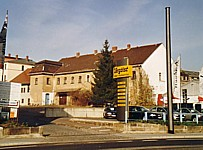Gambrinus-Brauerei:
Bis 1923 befand sich an der Einmündung zur Löbtauer Straße die Gambrinus-Brauerei, von der noch einige Gebäude erhalten geblieben sind _(Foto)_. Das
ursprünglich als Privatbrauerei gegründete Unternehmen gehörte um 1900 zur “Deutschen Bierbrauerei-AG zu Berlin und Dresden” und war zuletzt nur noch als Malzfabrik tätig.
Bereits 1911 hatte man den eigentlichen Braubetrieb aus wirtschaftlichen Gründen eingestellt. In den hier befindlichen Ställen wurden zeitweise auch die für die
Impfstoff-Herstellung des Sächsischen Serumwerkes erforderlichen Pferde gehalten. Aus Platzgründen zog das Unternehmen jedoch später zur Zirkusstraße um. Das Gelände der früheren Brauerei dient heute gewerblichen Zwecken.

Die Straße wurde 2011 auf dem Areal der früheren [Spirituosenfabrik Bramsch](../../../zentrum/friedrichstadt/strassen_friedrichstadt/friedrichstrasse/bramsch-spirituosenfabrik/) angelegt und erschließt hier ein neues Wohngebiet. Nach dem Abriss der ehemaligen Produktionsgebäude blieb lediglich das inzwischen zu Wohnzwecken
umgebaute Kontorhaus erhalten. Dieses gab den Anlass zur am 18. Januar 2012 offiziell beschlossenen Namensgebung Am Bramschkontor.

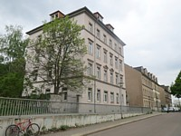1864 entstand in verkehrsgünstiger Lage unmittelbar am Gleisdreieck der Eisenbahn der städtische Straßenbauhof. Hier wurden die per Bahn angelieferten Rohbaumaterialien für den Straßenbau gelagert und für ihre künftige Verwendung vorbereitet. Im gleichen Jahr erhielt die an diesem Betrieb entlangführende Straße die Bezeichnung Bauhofstraße.

Gegenüber des Straßenbauhofes wurden 1864/65 einfache Arbeiterwohnhäuser errichtet _(Foto)_. In den Erdgeschosszonen gab es auch einige kleinere Läden sowie in der Nr. 11 und 27 zwei Schankwirtschaften. Trotz Kriegszerstörungen blieben Teile der Bebauung bis heute erhalten und wurden nach 1990 größtenteils saniert.

Die Behringstraße wurde um 1840 angelegt und nach dem sächsisch-österreichischen Kammerherrn Peter Paul Graf von Marcolini (1788-1863) zunächst Petergasse genannt. Marcolini hatte 1814 von seinem Vater das Palais an der Friedrichstraße geerbt und bewohnte es bis 1835. Da der seit 1893 verwendete Straßenname Peterstraße in der Nachkriegszeit als nicht mehr zeitgemäß angesehen wurde, beschloss man 1946 die Umbenennung in Behringstraße. Emil Adolf von Behring (1854–1917) gilt als Begründer der Serumheilkunde und Immunitätslehre und entwickelte einen Impfstoff gegen Diphterie und Wundstarrkrampf. 1901 erhielt er für seine Verdienste den Medizin-Nobelpreis.

Die Wohngebäude der Behringstraße entstanden im letzten Drittel des 19. Jahrhunderts und weisen zum Teil repräsentative Klinkerfassaden auf. Auch im Inneren finden sich interessante Architekturdetails, so eine neobarocke Deckenbemalung im Treppenhaus von Nr. 48. Bemerkenswert ist auch das 1895 als Verwaltungsgebäude der sächsischen Staatseisenbahn errichtete Haus Behringstraße 22. In der heute nicht mehr vorhandenen Nr. 7 befand sich um 1900 die Polizeiwache des 4. Bezirks. Das ebenfalls zerstörte Gebäude Behringstraße 45 an der Ecke zur Cottaer Straße war bis 1945 Sitz der
Dresdner Papier- Zigarrenspitzen- Fabrik Fleischer & Co., einem der zahlreichen Zulieferer der Dresdner Tabakwarenindustrie.

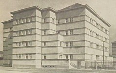Die Bodelschwinghstraße entstand nach dem Ersten Weltkrieg und wurde am 14. Oktober 1926 nach dem evangelischen Theologen Friedrich von Bodelschwingh (1831-1910) benannt. Bodelschwingh widmete sich der Pflege und Betreuung geistig behinderter Menschen und gründete in Bethel bei Bielefeld die “Bodelschwinghschen Anstalten”, eine der größten kirchlichen Hilfseinrichtungen der Inneren Mission.

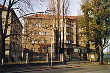1928 entstand an der Bodelschwinghstraße 3 im Auftrag des Städtischen Hochbauamtes ein Obdachlosenheim für Männer. Der im expressionistischen Stil gestaltete Gebäudekomplex wurde von Paul Wolf entworfen und besteht aus einem viergeschossigen Haupt- und einem dreigeschossigen Nebengebäude. Später dienten die Häuser zeitweise als Infektionskrankenhaus und seit 1959 als Medizinische Fachschule für Schwestern und Krankenpfleger _(Fotos)_. Eine umfassende Sanierung erfolgte 2009/10.

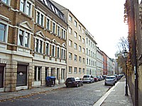Die Bräuergasse erhielt 1848 ihren Namen nach dem 1720 gegründeten Brauhaus der Gräfin von Manteuffel. Dieses gehörte zu den ersten gewerblichen Betrieben in der Friedrichstadt und entwickelte sich später zu einer Gastwirtschaft. 1880 wurde das Grundstück in das Krankenhausgelände einbezogen und die Gebäude wenig später abgerissen. Bis heute nimmt das Krankenhausareal die gesamte Westseite der Bräuergasse ein, während an der Ostseite Mietshäuser vom Ende des 19. Jahrhunderts dominieren _(Foto)_. Im Eckhaus zur Friedrichstraße 37 befand sich viele Jahrzehnte die kleine Gaststätte “Weißes Rössl”, deren Räume heute vom Verein “Rösslstube des Friedrich Rössl” für verschiedene Veranstaltungen genutzt werden. Am 3. September 1875 öffnete in einem Mietshaus auf der Bräuergasse Dresdens erste Volksbibliothek. Betreiber war der ein Jahr zuvor gegründete “Gemeinnützige Verein zur Förderung der sittlichen, geistigen und ökonomischen Interessen der Bevölkerung Dresdens”

Manteuffelsches Brauhaus: Nachdem 1718-21 Reichsgraf Ernst Christoph von Manteuffel gemeinsam mit seiner Frau drei Gartengrundstücke in der neuen Vorstadt erworben hatte, bemühte sich das Paar um die Brau- und Schankgerechtigkeit. Diese wurde ihnen wenig später auch gewährt, so dass 1720 das “Manteuffelsche Brauhaus” als einer der ersten größeren Gewerbebetriebe der Friedrichstadt eröffnet werden konnte. Manteuffel gehörte zu den engsten Vertrauten des sächsischen Premierministers Heinrich Graf von Flemming und hatte bis 1730 das Amt eines polnischen und sächsischen Kabinettsministers inne.

Das an der Ecke Bräuergasse/Friedrichstraße gelegene Brauhaus besaß um 1725 neben den Produktionsräumen vier Gaststuben sowie einen großen Gästegarten. Außerdem gehörten Meierei, Scheune, Wagenschuppen, Gärtnerhaus und ein Eiskeller zum Areal. Hinzu kamen großzügige Gartenanlagen mit Gewächshäusern, Wasserspielen und verschiedenen Statuen. Am 11. Januar 1726 erwarb August der Starke das Grundstück. Da der Kurfürst plante, die Brauerei künftig als Hofbrauhaus zu nutzen, wurde die Fläche wenig später aufgeteilt. Die dabei entstandene sogenannte “Lustgartenparzelle” schenkte August 1727 seinem Vertrauten Friedrich Ludwig Herzog zu Württemberg. Aus dieser ging später der [Brühlsche Garten](../../../zentrum/friedrichstadt/strassen_friedrichstadt/friedrichstrasse/marcolinipalais/) hervor. Brühl hatte bereits 1735 das Manteuffelsche Brauhaus “aus besonderen Gnaden und für geleistete Dienste” von Friedrich August II. erhalten, verkaufte es jedoch schon 1740 für 70.000 Taler an den Staat. Bis zu seiner Schließung 1880 gehörte das Lokal zu den beliebtesten Einkehrstätten der Stadt. An seiner Stelle entstand nach dem Abbruch ein Ärzte- und Beamtenhaus für das [Städtische Krankenhaus](../../../zentrum/friedrichstadt/strassen_friedrichstadt/friedrichstrasse/marcolinipalais/krankenhaus_friedrichstadt/)

Die seit November 1900 nach der norddeutschen Hansestadt Bremen benannte Verbindungsstraße zwischen Friedrichstraße und Hamburger Straße trug ursprünglich den Namen Friedrichstädter Friedhofsweg. Bereits 1851 war hier der Äußere bzw. [Neue Matthäusfriedhof](../../../zentrum/friedrichstadt/strassen_friedrichstadt/friedrichstrasse/matthauskirche/matthausfriedhof/) angelegt worden. 1875 folgte auf dem benachbarten Grundstück der [Äußere Katholische Friedhof](../../../zentrum/friedrichstadt/ausserer_katholischer_friedhof/). Beide Friedhöfe besitzen eine Reihe historisch bemerkenswerter Grabanlagen.

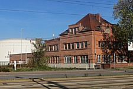Die übrigen Flächen an der Bremer Straße werden bis heute von verschiedenen Gewerbebetrieben eingenommen. Ursprünglich gehörten diese zum Ostravorwerk, wurden nach dessen Auflösung 1917 jedoch an Unternehmen, vorwiegend als Lagerplätze für Holz- und Kohlehändler vermietet. In dem um 1910 im Stile Erlweins errichteten Gebäude Nr. 16 hatte einst die königliche Lymphanstalt ihren Sitz, die im Hinterhaus ihre medizinisch-technischen Labors unterhielt. Markant sind auch die ausgedehnten Anlagen des Tanklagers auf dem Grundstück Nr. 40/42. Das expressionistisch beeinflusste Verwaltungsgebäude entstand 1928 _(Foto)_.

Zwischen 1942 und 1944 befand sich auf dem Areal zwischen Bremer und Hamburger Straße ein aus ca. 40 Baracken bestehendes Arbeitslager für “Ostarbeiter”, welche vor allem in der Rüstungsindustrie eingesetzt wurden (Bremer Straße 15). Zeitweise waren hier bis zu 2000 Menschen untergebracht. Das Lager wurde beim ersten Luftangriff am 7. Oktober 1944 zerstört, wobei 20 Menschen ums Leben kamen. Ein weiteres Ausländerlager gab es für Zwangsarbeiter der Firma [Seidel & Naumann](../../../west/cotta/strassen_cotta/hamburger_strasse/seidel___naumann/) auf dem Grundstück Nr. 25. Heute nutzen Speditionsfirmen, Autohändler und Bauunternehmen die Flächen.

Im Juli 2005 wurde auf der zeitweise als Automarkt bzw. Lager einer Natursteinfirma genutzten Brachfläche gegenüber dem Neuen Matthäusfriedhof (Bremer Straße 25) ein Notaufnahmelager für Asylbewerber und Flüchtlinge eingerichtet. Das am 24. Juli 2015 eröffnete Camp bot Platz für bis zu 1100 Menschen und wurde vom DRK betrieben. Neben Wohnzelten gehörten auch Sanitäranlagen und Verpflegungseinrichtungen zum Lager. Ende 2015 konnte die Einrichtung zugunsten fester Quartiere aufgegeben werden.

Königliche Lymphanstalt (Nr. 16): Die Einrichtung ging auf ein 1838 von Dr. C. G. Prinz an der Tierarzneischule gegründetes Labor zur Herstellung von Impfstoffen zurück. Im gleichen Jahr erfolgte die Gründung des Zentral-Impfinstituts zu Dresden. Unter Nutzung menschlicher Pockenviren wurden im [Ostragut](../../../zentrum/friedrichstadt/ostragehege/) Rinder injiziert und die dabei gewonnene tierische Lymphe für die Pockenschutzimpfung gewonnen. 1874 erfolgte die Auflösung des Zentral-Impfinstitutes und dessen Umwandlung in die städtische Impfanstalt. Drei Jahre später bezog diese zunächst provisorische Räume im Hintergebäude des ehemaligen Waisenhauses am Georgplatz.

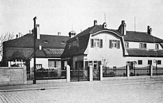Um die Bedingungen für die Impfstofferzeugung zu verbessern, entschloss sich die Stadt, einen Neubau an der Leipziger Straße 23 in der Nähe des [Alten Schlachthofes](../../../Neustadt/Leipziger_Vorstadt/Leipziger_Strasse/Alter_Schlachthof/alter_schalchthof.html) zu errichten. 1898 übernahm man zudem die Lymphanstalten Bautzen und Zwickau, womit die ganze Kreishauptmannschaft Dresden zum Zuständigkeitsbereich gehörte. Da man wegen der benötigten Kälber und Rinder auf die Nähe des Schlachthofes angewiesen war, plante man im Zusammenhang mit dessen Verlegung ins Ostragehege ursprünglich, die Lymphanstalt ebenfalls dorthin zu verlegen. Letztlich scheiterten diese Pläne an zu hohen Grundstückskosten, so dass man sich für das Grundstück Bremer Straße 16 entschied. Baubeginn war 1908, die Einweihung erfolgte zwei Jahre später. Neben dem villenartigen Verwaltungsgebäude gehörten im Hintergelände Ställe und medizinisch-pharmazeutische Labors zur Lymphanstalt. Heute wird das Grundstück von verschiedenen Unternehmen genutzt.

Die Cottaer Straße entstand 1861 und erhielt im gleichen Jahr ihren Namen, da sie in Richtung des damals noch selbständigen Dorfes Cotta führte. Bis zur Jahrhundertwende wurden hier überwiegend mehrgeschossige Mietshäuser in geschlossener Bauweise errichtet. Hinzu kamen einige Einzelgebäude sowie verschiedene Gewerbetriebe.
Auch in diesem Teil der Friedrichstadt rissen die Bomben des Luftangriffs 1945 größere Lücken in den Baubestand. Diese wurden meist erst nach 1990 geschlossen. 2015 entstand auf dem Grundstück Cottaer Straße 17-21 die Wohnanlage "Weißeritz-Gärten".

Zu den ältesten Häusern der Straße gehört das villenartige Wohngebäude Nr. 25 (um 1860). Im Eckhaus zur Peterstraße (heute Behringstraße) befand sich von 1911 bis zur Zerstörung 1945 das Restaurant "Peterhof" (Nr. 5). Ein weiteres Lokal gab es im gegenüberliegenden Eckhaus (Nr. 3). Um 1930 wurden diese Räume vom Konsumverein Vorwärts als Lebensmittelhandlung genutzt. Einkehrmöglichkeiten bestanden zudem in der bereits um 1890 eröffneten Schankwirtschaft "Cottaer Hof" (Nr. 19) und im "Cottaer Eck" an der Einmündung der Semmelweisstraße. Gegründet wurde letzteres bereits 1829 als Kaffeegarten von Johann Georg Wustmann. Ab 1891 war der Name "Altona", wohl nach der nahegelegenen Altonaer Straße gebräuchlich. 1943 wechselte der Name in "Cottaer Eck", bevor das Haus 1945 den Bomben zum Opfer fiel.

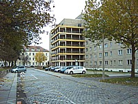Die zu den älteren Straßen der Friedrichstadt gehörende Dinterstraße trug ab 1840 wegen ihres gekrümmten Verlaufs den Namen Krumme Gasse. Nachdem dieser Weg begradigt und ausgebaut worden war, erhielt er 1873 den Namen Dinterstraße. Mit der Namensgebung sollte an den Theologen und Schuldirektor Christian Friedrich Dinter (1760-1831) erinnert werden. Dinter leitete zwischen 1797 und 1807 das Friedrichstädter [Lehrerseminar](../../../zentrum/friedrichstadt/lehrerbildungsseminar/) und war später bis zu seinem Tod in Königsberg tätig.

1867 wurde an der Dinterstraße die Königliche Frauenklinik eröffnet. Nach Verlegung dieser Einrichtung nach Johannstadt übernahm das [Friedrichstädter Krankenhaus](../../../zentrum/friedrichstadt/strassen_friedrichstadt/friedrichstrasse/marcolinipalais/krankenhaus_friedrichstadt/) die Gebäude. 1988 wurde die Dinterstraße in das Klinikgelände _(Foto)_ einbezogen.

Nachdem zwischen 1891 und 1893 die Weißeritz in westlicher Richtung verlegt worden war, entstand auf beiden Seiten des neuen Flussbettes eine Uferstraße, die 1894 den Namen Weißeritzufer erhielt. Vier Jahre später wurde dieser Name auch auf die gegenüberliegende Straßenseite übertragen. Die Grundstücke zwischen Bahngleisen und Uferstraße wurden 1893/94 mit Wohnhäusern für die auf dem [Rangierbahnhof](../../../zentrum/friedrichstadt/dresden_-_berlin/rangierbahnhof/) und in den Eisenbahnwerkstätten beschäftigten Eisenbahner bebaut _(Foto)_. Hinzu kamen mehrere Dienstgebäude des Reichsbahnausbesserungswerkes sowie 1906 die Kleingartensparte “Erholung”. Auch am gegenüberliegenden Weißeritzufer entstanden später Kleingärten.

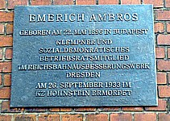Im September 1945 wurde das Weißeritzufer zu Ehren des ungarischen Antifaschisten Emerich Ambros (1896-1933) in Emerich-Ambros-Ufer umbenannt. Ambros arbeitete seit 1919 im Reichsbahnausbesserungswerk Dresden-Friedrichstadt und war dort als Betriebsrat tätig. Als Funktionär der SPD kam er nach Machtübernahme der Nationalsozialisten in Haft und starb bereits am 26. September 1933 an den Folgen von Misshandlungen im KZ Hohnstein. Eine Gedenktafel befand sich bis zum Weißeritzhochwasser 2002 an einer Fußgängerbrücke in der Nähe des RAW. Als Ersatz wurde 2006 eine neue Tafel am Gebäude Emerich-Ambros-Ufer 50 angebracht _(Foto rechts)_. Die alte Tafel konnte 2012 durch Zufall im Flussbett wieder entdeckt und geborgen werden. Mehrere teilweise neu gebaute Brücken überspannen das Emerich-Ambros-Ufer. Hier befindet sich auch der einzige Weißeritzpegelmesser in Dresden.

Kleingartensparte “Lübecker Ecke”: Die Gartensparte entstand 1917 auf ehemaligem Reichsbahngelände und wurde vorrangig von Eisenbahnerfamilien bewirtschaftet. Ursprünglich trug sie den Namen Garten-Verein “Providentiae” in Anlehnung an den Wahlspruch des Königshauses der Wettiner “Providentiae Memor” (“der Vorsehung eingedenk”). Die ursprünglich aus 40 Parzellen bestehende Anlage wurde bei den Bombenangriffen 1945 schwer beschädigt und konnte erst 1949 wieder an ihre Nutzer übergeben werden. Mit Unterstützung der Deutschen Reichsbahn wurden die vorhandenen Kleingärten hergerichtet und die Sparte um weitere angrenzende Flächen erweitert. In diesem Zusammenhang erhielt sie auch ihren heutigen Namen “Lübecker Ecke”. Derzeit erstreckt sie sich zwischen Emerich-Ambros-Ufer, Birkenhainer und Lübecker Straße und gehört mit 249 Gärten zu den größten in Dresden.

Sportplatz: Die Anlage wurde 1934 vom Eisenbahner-Sportverein VfL Reichsbahn Dresden angelegt und am 3. Juni eröffnet. Zuvor hatte der am 30. November 1925 gegründete Verein einen Sportplatz an der Reicker Straße in Strehlen genutzt. Der vom Reichsarbeitsdienst an Stelle zweier alter Lokomotiven-Reparaturhalle errichtete Platz besaß ein Fußball- und Handballfeld sowie Turnplatz und Faustballfeld. Hinzu kamen eine Laufbahn, eine Kegelbahn sowie mehrere Nebengebäude. 1945 richteten die Bombenabwürfe auf den Rangierbahnhof auch am Sportplatz schwere Schäden an.

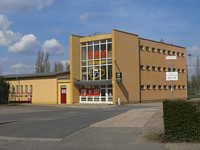1950 konnte das Areal durch die Mitglieder der zwei Jahre zuvor als BSG Reichsbahn neu gegründeten Sportgemeinschaft wiederhergestellt und schrittweise modernisiert werden. 1953 entstand ein Sportlerheim, 1955 eine Gymnastik- und ein Jahr später die große Loksporthalle, zum Zeitpunkt ihrer Eröffnung am 3. November 1956 größte Sporthalle Dresdens. Erweiterungen der Sportstätte, u.a. des heute als Sitz der Geschäftsstelle genutzten Mehrzweckgebäudes _(Foto)_, erfolgten in den 1960er und 1970er Jahren. Letzteres wurde am 7. Mai 1975 übergeben. Heute nutzt der Eisenbahner-Sportverein (ESV) Dresden die drei Natur- und Kunstrasenplätze sowie die beiden Sporthallen.

Die 1864 benannte Floßhofstraße erinnert an den einstigen Löbtauer Floßhof, in dem das auf der Weißeritz nach Dresden geflößte Holz sortiert und gelagert wurde. Später entstanden auf diesem Gelände Wohn- und Gewerbebauten. 1945 wurden große Teile der Bebauung der Floßhofstraße zerstört. Die verbliebenen Häuser stehen heute meist leer.

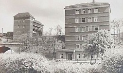Der Flügelweg entstand 1875 als Verbindung zwischen Cotta und der heutigen Hamburger Straße. Um 1903 wurde er bis zur Einfahrt des [König Albert-Hafens](../../../zentrum/friedrichstadt/alberthafen/) verlängert. Die ab 1880 nachweisbare Namensgebung stammt von einem Flurnamen ab. Ältestes Gebäude ist das 1894 als Beamtenwohnhaus des Rangier- und Werkstättenbahnhofes errichtete Wohngebäude Nr. 1.

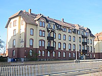Um 1900 entstand an der Ecke Flügelweg / Hamburger Straße eine aus drei Doppelhäusern bestehende Gebäudegruppe mit verschiedenen Klinker- und Holzelementen (Nr. 2-8 - _Foto_). Bauherr war die Eisenbahner-Wohnungsbaugenossenschaft, Bewohner vorrangig Arbeiter und Angestellte des nahen [Werkstättenbahnhofes](../../../zentrum/friedrichstadt/dresden_-_berlin/rangierbahnhof/) der Sächsischen Staatsbahn. Nach 1990 wurden die architektonisch interessanten Häuser saniert. Heute befindet sich im Haus Flügelweg 4-6 das Hotel “Aviv”, das benachbarte Wohnhaus Nr. 8 ist Sitz des Islamischen Zentrums Dresden. Der 1998 gegründete Verein war die erste eingetragene Islamische Vereinigung in Ostdeutschland.

Zur Verbesserung der Verkehrssituation am Knotenpunkt Flügelweg / Hamburger Straße wurde zwischen 2004 und 2006 ein umfassender Umbau der Kreuzung vorgenommen. Der Flügelweg wurde in diesem Zusammenhang abgesenkt und durch einen Tunnel geführt, um eine kreuzungsfreie Zufahrt zur Flügelwegbrücke zu ermöglichen. Die offizielle Einweihung des Baus erfolgte am 19. Juni 2006.

Die Fröbelstraße entstand 1887 zwischen Löbtauer Straße und Kohlenbahnhof und erhielt ihren Namen nach dem Pädagogen Friedrich Fröbel (1782-1852). Fröbel befasste sich als einer der ersten mit Aspekten der Vorschulerziehung von Kindern und gründete 1837 in Blankenburg/Thür. den ersten deutschen Kindergarten. 1838/39 weilte er in Dresden und initiierte die Einrichtung einer Spielanstalt in der Nähe des Postplatzes (Am See 22). Zehn Jahre später übernahm er hier die Leitung von Kursen für angehende Kindergärtnerinnen.

Bis 1945 befanden sich an der Fröbelstraße zwei [Schulen](../../../zentrum/friedrichstadt/) sowie ab 1896 die Kapelle der Apostolischen Kirche. Das Gemeindehaus im Hinterhof des Grundstücks Nr. 12 wurde von Theodor Lehmann erbaut, die Malereien im Innenraum stammten von der Firma Weinhold und Hetzel. Zudem besaß die Kirche eine Orgel aus der Werkstatt von Franz-Emil Keller aus Ostrau bei Riesa.

Ebenso wie die meisten Wohnhäuser der Fröbelstraße wurden auch diese Gebäude zerstört bzw. schwer beschädigt. Erhalten blieb die 1905 entstandene Wohnhausgruppe Fröbelstraße 51-57 im neobarocken Stil. Im Haus Nr. 30 befand sich zu DDR-Zeiten das Kulturhaus der Eisenbahner “Thomas Müntzer”. Weitere Grundstücke wurden nach 1990 mit Wohn- und Geschäftshäusern bebaut. Auf dem Areal der früheren “Drescherhäuser” an der Flurgrenze zu Löbtau befindet sich seit 1917 eine Kleingartenanlage. Beim Ausbau der Fröbelstraße in den Zwanziger Jahren wurde diese in zwei Hälften durchschnitten. Von Bedeutung ist die Fröbelstraße auch als Straßenbahntrasse. Am 4. Oktober 1995 erfolgte hier die Übergabe des ersten Abschnittes der neuen “Stadtbahn-Pilotlinie” für den Einsatz moderner Niederflurwagen.

Seit Ende des 19. Jahrhunderts hatten sich an der Fröbelstraße auf Friedrichstädter und Cottaer Flur zahlreiche Gewerbebetriebe angesiedelt. Erwähnenswert ist u.a. die Hoch, Tief- und Eisenbetonbaufirma von Albert Mannschatz (Nr. 42/44), zu deren wichtigsten Werken das AOK-Gebäude am Sternplatz gehörte. Auf dem benachbarten Grundstück (Nr. 48) betrieb Reinhard Klötzer ab 1877 eine Metallgießerei und Metallwarenfabrik.

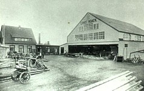Firma Ernst Noack: Zu den bedeutendsten Dresdner Bauunternehmungen der Zeit vor dem Zweiten Weltkrieg gehörte die Firma des Baumeisters Ernst Noack (1861-1924). Noack war ab 1905 Hofzimmermeister und ab 1912 Obermeister der Dresdner Baumeisterinnung. Sein Büro befand sich auf der Fröbelstraße 101, wo er an der Ecke zur Straße Drescherhäuser einen Werkplatz unterhielt _(Foto)_. Noack selbst wohnte bis 1903 auf der Meußlitzer Straße 67, danach in einer von ihm selbst entworfenen Villa auf der Holsteiner Straße 8 in Stetzsch. Zu seinen Schöpfungen gehörte u.a. die Interimsbrücke während des Neubaus der Augustusbrücke 1907, mehrere Villen und Wohnhäuser sowie temporäre Bauten für die Ausstellung "Die alte Stadt" (1896), die 3. Deutsche Kunstgewerbeausstellung (1906), die "Jahresschau Deutscher Arbeit 1925" sowie die Festhalle zum Deutschen Sängerbundfest 1925.

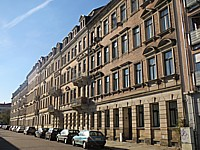Der Name Gambrinusstraße erinnert an die ehemalige Gambrinusbrauerei an der Einmündung Löbtauer / Altonaer Straße. Diese seit 1872 als Aktiengesellschaft fungierende Brauerei existierte noch bis nach dem Ersten Weltkrieg, musste jedoch 1923 aus wirtschaftlichen Gründen ihren Betrieb einstellen. Heute werden die noch vorhandenen Gebäude von verschiedenen Firmen genutzt.

Nach 1895 begann die Bebauung der Gambrinusstraße mit mehrgeschossigen Mietshäusern. Einige Gebäude besitzen im Inneren interessante Treppenhausgestaltungen der Entstehungszeit mit Stuckdecken und dekorativen Wandmalereien. Im Haus Nr. 6 befand sich noch bis in die Nachkriegszeit das Restaurant "Gambrinushof".

Max Wießner oHG: Das erste Bauunternehmen wurde 1881 von Ernst Wießner auf der Pillnitzer Straße 9/15 gegründet. 1895 entschied sich auch sein Sohn Max Wießner (1869-1954), gelernter Zimmermeister, für die Selbständigkeit. Am 10. Januar 1911 wurde das Baugeschäft Max Wießner oHG mit Sitz in der Gambrinusstraße 15 eingetragen. Die Firma zählte zeitweise ca. 200 Angestellte und war an zahlreichen Bauvorhaben in Dresden beteiligt. Zu den heute nur noch teilweise erhaltenen Gebäuden gehörten die Wohnhäuser Wilsdruffer Straße 21 und Gerokstraße 31, die Villa Goetheallee 37 und das Haus Waldparkstraße 6 in Blasewitz.

Auch nach dem Zweiten Weltkrieg blieb die Firma in Familienbesitz und wurde ab 1952 vom Baumeister Willy Wießner (1897-1967) geleitet. 1958 musste der Betrieb eine staatliche Beteiligung aufnehmen und wurde in eine Kommanditgesellschaft umgewandelt. 1965 erfolgte der Zusammenschluss mit dem Baugeschäft Baumann, 1972 die zwangsweise Verstaatlichung der Baumann & Wießner KG. Nach 1989 erhielten die Alteigentümer ihren Betrieb zurück und sind bis heute in der Baubranche tätig. Zu den bedeutendsten Arbeiten des Betriebes nach 1945 gehörte 1970 der Bau der Volksschwimmhalle Steinstraße.

Der nördlich des Alberthafen verlaufende Hafenweg ist bereits kurz nach 1900 in alten Stadtplänen verzeichnet, trug damals jedoch noch keinen Namen. Seit ca. 1910 wird er als Hafenweg bezeichnet.

Die am 1772 gegründeten [Freimaurerinstitut](../../../zentrum/friedrichstadt/) entlangführende Straße erhielt 1840 den Namen Institutsgasse. Ursprünglich als Armenschule gedacht, wandelte sich das Freimaurerinstitut im 19. Jahrhundert zu einer Internatsschule für höhere Kreise und wurde 1899 nach Striesen verlegt. Die früheren Schulgebäude wurden wenig später abgetragen. An ihrer Stelle entstanden viergeschossige Mietshäuser. Teile der Bebauung fielen den Bomben des Zweiten Weltkriegs zum Opfer.

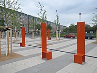Als Koreanischer Platz wird seit 2015 die Freifläche zwischen Adlergasse, Schäferstraße
und Weißeritzstraße bezeichnet. Ursprünglich standen hier einfache Arbeiterwohnhäuser, die jedoch bis 1989 abgerissen wurden. Danach diente die Fläche viele Jahre als Parkplatz. Erst
2014 begann eine Neugestaltung des Areals mit Steinplatten und Bäumen. Künstlerisch gestaltete “Stühle” tragen die Vornamen bekannter Persönlichkeiten, die einst in der Friedrichstadt lebten und arbeiteten.

2014 besuchte die Präsidentin Südkoreas, Park Geun-hye, Dresden. In diesem Zusammenhang kam die Idee auf, eine öffentliche Straßenfläche in der Stadt nach Korea zu
benennen und so an die vielfältigen Beziehungen zwischen dem Land und Dresden zu erinnern. Am 24. März 2015 erhielt der Platz deshalb den offiziellen Namen Koreanischer Platz.

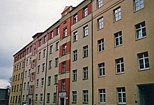Die Manitiusstraße wurde 1903 auf dem Gelände des zuvor abgerissenen ehemaligen [Freimaurerinstitutes](../../../zentrum/friedrichstadt/) angelegt und nach dessen ehemaligem Direktor August Sigismund
Manitius (1792-1861) benannt. Manitius übernahm das Amt des Schulleiters 1824 und übte es bis 1856 aus. Später arbeitete er noch einige Jahre als Religions- und
Sprachlehrer an diesem Institut. Sein Grab befindet sich auf dem Inneren Matthäusfriedhof.

Trotz einiger Kriegsverluste blieb die ursprüngliche Bebauung bis heute im wesentlichen
erhalten. 1905-08 entstanden die Wohnhäuser Manitiusstraße Nr. 7, 10 und 12, die Anklänge an den Jugendstil aufweisen. Die nach einheitlichen Gestaltungsprinzipien entworfene Wohnhausgruppe Nr 1-5 _(Foto)_
folgte um 1925 und weist Elemente des Expressionismus auf.

Die Menageriestraße erhielt ihren Namen um 1840 und erinnert an den ehemaligen Küchengarten des Ostravorwerks. Als
“Menagerie” wurde früher ein speziell zur Haltung von Kleintieren gedachtes Gehege bezeichnet. Hier züchtete man neben
Geflügel auch Schildkröten, Schnecken und Tauben für die kurfürstliche Tafel. Heute wird das Areal der früheren Menagerie als
Kleingartenanlage genutzt. Weitere Grundstücke wurden Ende des 19. Jahrhunderts mit Wohnhäusern bebaut. Außerdem
entstanden an der Menageriestraße 1892-95 die städtische Frauenklinik und das anatomische Institut des Friedrichstädter
Krankenhauses. 1994 errichteten private Investoren auf einem Grundstück am Hohenthalplatz die Wohnanlage “Marcolini” mit Eigentumswohnungen und Büros.

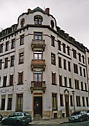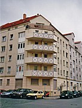

**_Fotos:_** _alte und neue Wohnhäuser an der Wachsbleich-/Ecke Menageriestraße_

1848/49 fand der revolutionäre russische Demokrat Bakunin unter dem falschen Namen “Dr. Schwarz” vorübergehend im Menageriegarten Unterschlupf . Bakunin gehörte zum Kreis um Richard Wagner und war aktiv am Dresdner Maiaufstand
beteiligt. Wagner nannte ihn in Anerkennung seiner Rolle den “Oberfeuerwerker” der Aufständischen.

Der Messering entstand 1909 im Zusammenhang mit dem Bau des neuen [Schlachthofes](../../../zentrum/friedrichstadt/ostragehege/schlachthof/) im Ostragehege und erhielt zunächst
den Namen Schlachthofring. Als Zufahrt diente die von der Friedrichstraße abgehende Schlachthofstraße mit Brücke über die
Flutrinne. Nach Umbau des Schlachthofes zum Messegelände wurde der Schlachthofring 2000 in Messering umbenannt. Zuvor waren auch die Namen Zur Messe bzw. Ostraring im Gespräch.

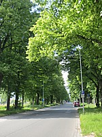
Die 1,8 km lange Pieschener Allee wurde im 18. Jahrhundert als Verbindungsweg zwischen Residenz und Ostragehege angelegt. Die mit einer Doppelreihe von Lindenbäumen flankierte Straße
führte in Richtung Pieschen bis zum Elbufer, war jedoch nicht auf ein bestimmtes Ziel ausgerichtet. Später gab es an ihrem nordwestlichen Ende eine Fährüberfahrt. Ihren heutigen Namen erhielt die
Pieschener Allee offiziell erst 1909. Zuvor wurde sie nach dem hier gelegenen Verladegleis am Elbkai “An der Kohlenbahn” genannt. An der Allee entstanden nach dem Ersten Weltkrieg die Sportstätten des DSC, darunter auch das heutige [Heinz-Steyer- Stadion](../../../zentrum/friedrichstadt/ostragehege/heinz-steyer-stadion/). Zu DDR-Zeiten wurde
dieser Komplex noch um eine Eishalle, eine Eisschnellaufbahn und weitere Sportstätten ergänzt. Andere Flächen wurden bis zum Hochwasser 2002 von mehreren Kleingartenanlagen eingenommen.

Unmittelbar am Elbufer lag einst die beliebte Gartenwirtschaft “Onkel Toms Hütte”. Die ursprünglich mit 1.340 Lindenbäumen besetzte Allee steht seit 1996 als Flächennaturdenkmal unter Schutz und wird schrittweise
rekonstruiert. In den kommenden Jahren soll an der Pieschener Allee ein moderner Sportkomplex entstehen, der die maroden
Gebäude aus DDR-Zeiten ersetzen wird. Zum Auftakt konnte am 31. August 2007 bereits die neue Eishalle (“Freiberger Arena”) übergeben werden.

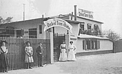

**_Foto:_** _Gartenwirtschaft “Onkel Toms Hütte”_

Die Preßlerstraße wurde 1903 als Verbindung zwischen Gambrinus- und Peterstraße (heute Behringstraße) angelegt, ist heute jedoch in den aktuellen Stadtplänen nicht mehr verzeichnet. Ihren Namen verdankte sie dem
Vermessungsingenieur Friedrich Karl Preßler (1809-1857), der Mitte des 19. Jahrhunderts ein Projekt zur Verlegung der Weißeritz und zum Bau eines
Elbhafens sowie eines Dresdner Zentralbahnhofes ausarbeitete. Preßler Vorstellungen wurden jedoch erst nach 1890 - mit einigen Veränderungen - in die Realität umgesetzt.

Die Roßthaler Straße entstand Ende des 19. Jahrhunderts am Weißeritzufer und wurde daraufhin mit Wohnhäusern bebaut.
Außerdem existierte hier zeitweise das Hotel “Roßthaler Hof” (Nr. 1). Im gleichen Haus hatte zeitweise die Fluss- und
Kanal-Schifffahrtsreederei Julius Krümmling ihre Büros. Ihren Namen erhielt die Straße 1903 nach dem Ort Roßthal, heute ein
Stadtteil von Dresden. Die Gebäude sind bis heute erhalten geblieben, befanden sich jedoch viele Jahre in ruinösem Zustand
und sollten deshalb abgerissen werden. Nach Protesten und einem Verkauf der Gebäude begann 2012 der Ausbau der Häuserzeile zu Wohnzwecken.

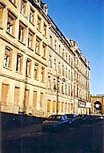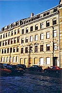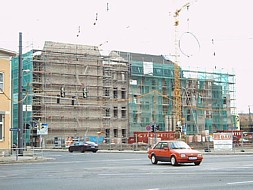

_Fotos:_ _Blick in die Roßthaler Straße mit dem ehemaligen Hotel “Roßthaler Hof” im Jahr 2008._

_rechtes Bild: Sanierung der Wohnhäuser Roßthaler Straße 2013_

Der zuvor namenlose ca. 350 Meter lange Verbindungsweg zwischen Pieschener Allee und Eishalle erhielt auf Beschluss des
Stadtrates im September 2013 offiziell den Namen Rudolf-Harbig-Weg. Rudolf Harbig (1912-1944) gehörte in den 1930er
Jahren zu den bekanntesten deutschen Leichtathleten. Der in Dresden aufgewachsene Sportler war zweifacher Europameister
(800-Meter-Lauf, 4x 400-Meter-Staffel) und siebenfacher deutscher Meister. 1944 fiel er an der Ostfront in der Ukraine.

Die Seminarstraße gehört zu den ältesten Straßen der Friedrichstadt und entstand 1678 als Badergasse, da sich hier eine vom kurfürstlichen Trabantenfeldscher Johann Meyer betriebene Baderei befand. Zu den Aufgaben des Baders gehörte neben der Körperreinigung auch der Haar- und Nagelschnitt, das Zähneziehen und kleinere chirurgische Eingriffe. Nach dem Tod Meyers wurde die Baderei ab 1726 von Maria Dorothea Frickin weitergeführt, die ihr Privileg zum Führen der Badestube 1739 an den Fußtrabantenfeldscher Haushalter verkaufte. Auch später wechselten mehrfach die Betreiber der Baderei. Erst Anfang des 20. Jahrhunderts musste das Gebäude einem 1945 zerstörten Wohnhaus (Nr. 18) weichen

1785 entstand an der Badergasse das erste Friedrichstädter [Schulhaus](../../../zentrum/friedrichstadt/), in dem die Kinder ärmerer Bevölkerungsschichten unterrichtet und in einfache Arbeiten eingewiesen wurden. Gleichzeitig war in dem Gebäude 1788 bis 1866 das erste sächsische [Lehrerseminar](../../../zentrum/friedrichstadt/lehrerbildungsseminar/) untergebracht. Diese Einrichtung war Grund für die Umbenennung der Badergasse in Seminarstraße im Jahr 1840.

Bereits im 18. Jahrhundert waren hier weitere Häuser entstanden, von denen jedoch keines die Zerstörungen des Jahres 1945 und der Nachkriegszeit überstand _**(Foto:**_ _Seminarstraße 2-6 um 1930)_. Heute dominieren mehrgeschossige Wohnhäuser der Gründerzeit das Straßenbild. Bemerkenswert sind das 1876 für den Holzhändler Hugo Vollert errichtete Mietshaus Nr. 9 mit Ausmalungen im Treppenhaus sowie das um 1910 entstandene Doppelhaus Nr. 10-12 mit Erkern und Stuckreliefs. Erst nach 1990 konnte mit der Sanierung der zuvor zum Abbruch vorgesehenen Gebäude begonnen werden.

Volksbad (Nr. 3): Da die meisten Wohnungen in der Friedrichstadt keine Bäder besaßen, entstand in der Nachkriegszeit das Volksbad an der Seminarstraße. Ursprünglich war dafür das Grundstück Adlergasse 4/6 vorgesehen. Letztlich entschied man sich jedoch für das 1945 zerbomte Areal Seminarstraße 2. Die Planungen übernahm der VEB Hochbauprojektierung Dresden mit der Architektin Sibylle Kriesche. Nach knapp zweijähriger Bauzeit wurde das Bad am 9. Januar 1964 eingeweiht. Hier befanden sich 19 Wannen- und 14 Brausebäder, getrennt nach Männern und Frauen, sowie ein größeres Brausebad für bis zu 15 Personen. Betreiber war der kommunale Dienstleistungsbetrieb Bäder, der pro Bad jeweils 35, pro Dusche 15 Pfennige kassierte. Das Volksbad blieb noch bis in die 1990er Jahre in Betrieb. 2005 wurde das Gebäude abgerissen.

Firma J. A. Urban (Nr. 5b / 5c): Auf dem Grundstück hatte früher die Stroh- und Rosshaarwarenmanufaktur J. A. Urban ihren
Sitz. Das Unternehmen wurde 1846 von Julius Adalbert Urban gegründet, der hier gemeinsam mit seiner Frau verschiedene
Modeartikel herstellte. Das Unternehmen besaß zeitweise bis zu 150 Webstühle, auf denen Bordüren und Litzen aus Stroh und
Pferdehaaren gefertigt wurden. Hinzu kamen in Handarbeit gefertigte Assecoires wie Strohblumen, Hanfbänder und Straußenfedern, die vor allem von Hutfabriken benötigt wurden. In Auftragsarbeit ließ das Paar auch Klöppelarbeiten im
erzgebirgischen Jöhstadt produzieren. Die Firma Urban gehörte zu den Vorreitern der Branche und existierte bis zum Ersten Weltkrieg.

Firma Exzellent:
Das Unternehmen wurde um 1870 von Carl Heinrich Schmieder in Strehlen gegründet und stellte zunächst Konserven mit Spreewaldgurken und Sauerkraut her. Nachdem sein Sohn um 1910 in der Schweiz die ursprünglich aus
England stammende Worcester-Sauce kennengelernt hatte, entschied er sich, diese nach eigenem Rezept zu verändern und baute darauf in der Friedrichstadt und in Coswig zwei neue Produktionsstätten auf. 1913 nahm der Betrieb auf der
Seminarstraße seine Arbeit auf. Neben der Würzsauce wurden auch Mixed Pickles und ähnliche Erzeugnisse hergestellt.

Nach dem Tod Schmieders 1945 übernahm zunächst seine Witwe das Unternehmen, musste dieses jedoch 1952 an den Staat übertragen. Unter dem Markennamen “Exzellent” wurden hier bis 1989 neben Worcestersauce auch Dosensuppen und
ähnliche Erzeugnisse produziert. Nach der Wende erhielt die Familie ihren Betrieb zurück und verkaufte ihn 1994 an einen Investor. Heute hat die Firma unter dem Namen Exzellent Feinkost GmbH ihren Sitz auf der [Liebigstraße](../../../zentrum/sudvorstadt/strassen_sudvorstadt/liebigstrasse/) in der Südvorstadt. Die alten Fabrikgebäude an der Seminarstraße wurden 2013 abgerissen.

Klavierbau Kaps: Das Unternehmen entstand 1859 auf der Seminarstraße 20/22 und befand sich im Besitz von Ernst Karl
Wilhelm Kaps (1826-1887). Während Kaps in der Friedrichstadt seine Produktionsräume hatte, erfolgte der Verkauf der
Instrumente in Filialen am Altmarkt 13 und der Schlossstraße 18 sowie über Niederlassungen in Paris, Irkutsk, St. Petersburg
und London. Nach seinem Tod übernahmen 1887 seine beiden Söhne Ernst Eugen und William Ernst das Geschäft. 1922 fusionierte die Firma Ernst Kaps mit dem Klavierbauunternehmen Johannes Kuhse zur Kaps-Kuhse AG. 1938 wurde die
Produktion eingestellt und der Betrieb aufgelöst. Ds Grab der Familie Kaps befindet sich auf dem Neuen Annenfriedhof.

Die Semmelweisstraße entstand 1908 und trug bis 1946 den Namen Marcolinistraße. Mit dieser Namensgebung sollte an den
sächsischen Kammerherrn Graf Camillo von Marcolini (1739-1814) erinnert werden, der vor allem als Besitzer des [Marcolinipalais](../../../zentrum/friedrichstadt/strassen_friedrichstadt/friedrichstrasse/marcolinipalais/)
an der Friedrichstraße bekannt ist. Marcolini leitete viele Jahre die königlichen Sammlungen und war zeitweise Direktor der Meißner Porzellanmanufaktur.

Da man diese Straßenbezeichnung in der Nachkriegszeit als “unzeitgemäߔ betrachtete, erfolgte 1946 die Umbenennung in Semmelweisstraße. Der Gynäkologe Ignaz Philipp Semmelweis (1818-1865) erkannte 1847 Ursache und
Vorbeugemaßnahmen des Kindbettfiebers und wurde als “Retter der Mütter” verehrt. Außerdem setzte er gegen den Widerstand vieler Berufskollegen moderne Hygiene- und Desinfektionsmaßnahmen im Gesundheitsbereich durch.

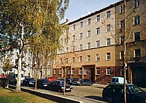
Die Gebäude Semmelweisstraße 2-6 entstanden 1906 gemeinsam mit den Wohnhäusern Fröbelstraße Nr. 47 und 49 und bilden eine einheitlich konzipierte Gebäudegruppe. Im
Eckhaus befindet sich die Gaststätte “Fröbeleck”. Weitere Wohnhäuser wurden 1927/28 errichtet (Nr. 13-21). Diese besitzen sparsam gestaltete Fassaden mit expressionistischen Anklängen _(Foto)_.

1912 gründete der aus Holland stammende Unternehmer Johann Steenbergen auf der Marcolinistraße 8 seine “Industrie- und Handelsgesellschaft mbH”, die später unter dem Namen [Ihagee](../../../ost/striesen/strassen_striesen/schandauer_strasse/ihagee/) zu den bekanntesten Dresdner Kameraherstellern gehörte und ihr
Stammwerk bis 1945 auf der Schandauer Straße besaß. Bekannt wurde die Firma durch die 1936 vorgestellte “Kine Exakta”, erste Kleinbild-Spiegelreflexkamera der Welt.

Der Name Vorwerkstraße erinnert an das frühere [Ostravorwerk](../../../zentrum/friedrichstadt/ostragehege/)
, welches 1568 von Kurfürst August gegründet wurde und bis 1917 bestand. Zwischen 1855 und 1895 unterschied man zwischen einer oberen und einer unteren Vorwerkstraße, bevor sich
der jetzige einheitliche Name durchsetzte. Die Wohnhäuser, meist viergeschossige Gebäude in geschlossener Bauweise, entstanden zwischen 1880 und 1910 für die Eisenbahner-Baugenossenschaft. Außerdem entstand 1935 ein Sauerstoffwerk,
welches zu DDR-Zeiten Betriebsteil des VEB Technische Gase Leipzig war und nach 1990 geschlossen wurde. Die ruinösen Fabrikgebäude wurden 2011 beseitigt.

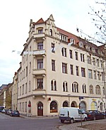Die Wachsbleichstraße wurde Mitte des 18. Jahrhunderts angelegt und nach dem Bauherren des ersten Wohngebäudes an dieser Straße, dem sächsischen Appellationsrat Dr. Heigius, zunächst Heigiusgasse genannt. 1718 entstand in der Nähe als eines der ersten gewerblichen Unternehmen der Friedrichstadt die Wachsbleiche des Kammerherrn Baron von Blumenthal. Dieser Betrieb zur Verarbeitung von Bienenwachs war 1840 Anlass für die Umbenennung der Gasse in Wachsbleichgasse. Zuvor waren auch die Namen Feldgasse bzw. Briesnitzer Straße gebräuchlich. 1894 erhielt sie ihren heutigen Namen.

Ab 1772 befand sich hier die von der Freimaurerloge “Zu den drei Schwertern” gestiftete Armenschule, aus der später das [Freimaurerinstitut](../../../zentrum/friedrichstadt/) hervorging. Nach Verlegung der Einrichtung und dem folgenden Abriss der Gebäude entstanden auf dem Grundstück die noch heute erhaltenen Wohnhäuser. Im Eckhaus Wachsbleichstraße 2/2b _(Foto)_ gab es von 1911 bis 1955 die Schankwirtschaft "Alter Dessauer".

Zu DDR-Zeiten waren die meisten Gebäude zum Abriss vorgesehen, so dass erst nach 1990 mit der Sanierung und der Schließung einiger Baulücken begonnen werden konnte. Neben einigen baukünstlerisch verzierten Häusern der Gründerzeit ist die 1881 vollendete frühere XVII. Bezirksschule bemerkenswert (Nr. 6 - heute 48. Grundschule). 2013 begann auf dem Grundstück Wachsbleichstraße 4a der Bau eines soziokulturellen Zentrums, welches seit 2015 vom Kulturverein “riesa efau” für Kurse und Veranstaltungen genutzt wird. Die ungewöhnliche Farbgestaltung der Fassade stammt von Claudia Freudenberg.

Nr. 26/28: Dieses Grundstück war ab 1916 Sitz der "Spezialfabrik elektrischer Steuerapparate Gebr. Cruse & Co.". Das Unternehmen war zwei Jahre zuvor von den Brüdern Johannes und Friedrich Cruse gegründet worden, die von 1911 bis 1914 Teilhaber der Firma [Rheostat](../../../neustadt/leipziger_vorstadt/leipziger_strasse/) waren.
Zugleich existierten auf dem Areal die Geldschrankfabrik Arnhold und Petzoldt, die Maschinenfabrik Kreiselrad und die Blumenfabrik Oscar Alexander & Co. Hergestellt wurden hauptsächlich Schalter, Regler und andere elektrische Zubehörteile. Die beengten Platzverhältnisse führten 1928 zur Verlegung nach Mickten, wo das Unternehmen, nach 1945 als [VEB Elektroschaltgeräte Dresden](../../../nordwest/mickten/strassen_mickten/), noch bis 1990 auf der Franz-Lehmann-Straße existierte.

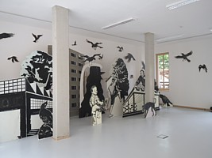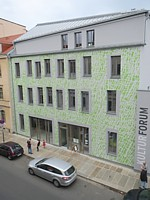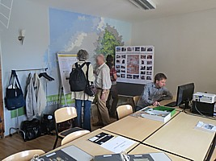

**_Fotos:_** _Kulturzentrum “riesa efau” an der Wachsbleichstraße 4a_

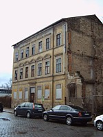Die Wölfnitzstraße entstand Mitte des 19. Jahrhunderts und wurde 1865 nach dem Dorf Wölfnitz
(heute Stadtteil von Dresden) benannt und mit Mietshäusern bebaut. Nach Kriegszerstörungen sind heute nur noch wenige, meist verfallene, Gebäude erhalten geblieben. Einige von Ihnen, darunter die
Wohnhäuser Wölfnitzstraße 4 und 17 stehen unter Denkmalschutz und sollen in den nächsten Jahren saniert werden.

1888 besaß der später durch sein [ODOL-Mundwasser](../../../zentrum/sudvorstadt/strassen_sudvorstadt/zwickauer_strasse/lingner-werke/) bekannt gewordene Unternehmer Karl
August Lingner ein kleines Labor auf der Wölfnitzstraße 16 (heute Nr. 11). Hier entwickelte er gemeinsam mit dem befreundeten Ingenieur Georg Wilhelm Kraft einfache Gebrauchsgegenstände.
Lingner selbst wohnte zu dieser Zeit im Vorderhaus des Grundstücks. Heute steht das Haus leer.

**_Foto:_** _ehemaliges Wohnhaus Karl August Lingners (Nr. 11)_

[Friedrichstadt auf OpenStreetMap](https://www.openstreetmap.org/search?query=Dresden+Friedrichstadt)

* * *

 \[ [Home](../../../index.html)\] \[ [Nord](../../../nord/)\] \[ [Nordwest](../../../nordwest/)\] \[ [Neustadt](../../../neustadt/)\] \[ [Nordost](../../../nordost/)\] \[ [West](../../../west/)\] \[ [Zentrum](../../../zentrum/)\] \[ [Südwest](../../../sudwest/)\] \[ [Süd](../../../sud/)\] \[ [Südost](../../../sudost/)\] \[ [Ost](../../../ost/)\] \[ [Register](../../../Register/register.html)\] \[ [Kontakt](../../../Kontakt/kontakt.html)\] \[ [Impressum](../../../impressum/)\]
