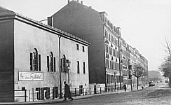
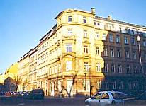
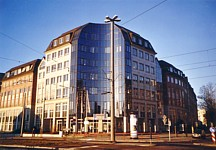
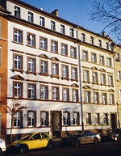
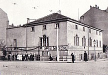
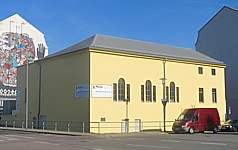

* * *

* * *

Die Berliner Straße geht auf einen im 19. Jahrhundert angelegten namenlosen
Wirtschaftsweg zurück. Neben Gärten  befanden sich hier die Pulvermagazine der sächsischen Armee, die man aus Sicherheitsgründen außerhalb des bebauten Gebietes konzentriert hatte. 1871-75 ließ die
private Berlin - Dresdner Eisenbahngesellschaft eine neue [Fernbahnstrecke](../../../../zentrum/friedrichstadt/dresden_-_berlin/)
nach Berlin über Elsterwerda erbauen. Ihren Ausgangspunkt hatte diese Linie am Berliner Bahnhof an der Waltherstraße (heute S-Bahn-Haltepunkt Friedrichstadt). Nach Eröffnung der Station erhielt der parallel zu den
Gleisanlagen verlaufende Weg 1875 den Namen Berliner Straße. Wenig später begann die Bebauung der Nordseite mit mehrgeschossigen Wohnhäusern _(Foto)_.

Die Gebäude erhielten zum Teil repräsentative Klinkerfassaden und sind typisches Beispiel für die vorstädtische Bautätigkeit der Gründerzeit. 1945 fielen einige
Häuser der Berliner Straße dem Luftangriff zum Opfer. Die so entstandenen Baulücken konnten erst in den 70er Jahren mit Neubauten geschlossen werden. Zwischen 1974 und 1984 erfolgte auch eine grundlegende Sanierung der
Altbausubstanz im Rahmen eines für die DDR untypischen städtebaulichen Modellprojekts. Dabei wurden die Wohnungen mit zeitgemäßen Sanitäranlagen ausgestattet und erhielten Anschluss an das Fernwärmenetz. Trotz einiger
Veränderungen der Fassaden blieb das historische Straßenbild dabei weitestgehend gewahrt. 1994 entstand an der Einmündung Löbtauer Straße ein Neubau für das Dresdner Arbeits- und Sozialgericht.

Einzelne Gebäude:

Amtsgericht: Der moderne Gebäudekomplex _(Foto)_ entstand bis 1994 als Büro- und Gewerbezentrum an der Ecke Berliner/ Löbtauer Straße. Entworfen wurde
das Haus von den Düsseldorfer Architekten Weidmann und Biedermann, die Grundsteinlegung erfolgte am 13. Dezember 1991. Das optisch in mehrere
Einzelgebäude gegliederte Haus besitzt eine teilweise mit Sandstein verkleidete Fassade sowie eine markante Glasfront im Eckbereich. Hier bezogen 1995 das
Amtsgericht sowie das Arbeits- und das Sozialgericht ihre Diensträume. Ende 2006 begann allerdings die Verlegung der Justizbehörden in das neue
Fachgerichtszentrum in der Albertstadt. Im Erdgeschoss befindet sich eine kleine Ladenpassage sowie ein Selbstbedienungsrestaurant.

Nr. 2 - 36:
Die Wohnhausgruppe entstand zwischen 1880 und 1895 in geschlossener Bauweise. Die viergeschossigen Mietshäuser zwischen Löbtauer und Behringstraße besitzen im Erdgeschoss Sandstein-, in den Obergeschossen
Klinker- bzw. Putzfassaden und weisen zum Teil plastischen Schmuck auf. Im Erdgeschoss des Eckhauses Nr. 26 befand sich vor dem Zweiten Weltkrieg die Gaststätte “Brandenburger Hof”.

1945 wurden die Eckhäuser zur Löbtauer Straße (Nr. 2-6) sowie die Nr. 14 zerstört. Im Zuge der Sanierung der
Berliner Straße entstanden an ihrer Stelle Plattenbauten, während die übrigen Häuser ab 1974 rekonstruiert wurden.
Dabei erhielten sie an Stelle des früheren Mansardgeschosses Dachschrägen mit Flächenfenstern. Trotz dieser Eingriffe
bildet der Häuserblock ein interessantes Beispiel für den Versuch, historische Bausubstanz zu erhalten, statt durch Neubauten zu ersetzen.

Nr. 31:
Auf dem ehemals gewerblich genutzten Grundstück entstand 2009 die neue Rettungswache Friedrichstadt mit Aufenthalts- und Ruheräumen für das Personal sowie Stellplätzen für Rettungswagen und Notarzt-Fahrzeuge. Die
Wache betreut große Teile der Innenstadt und ersetzt ein Provisorium in der Institutsgasse.

Nr. 50:
Das Grundstück war einst im Besitz des Großvaters von Ludwig Richter. Der später bekannte Maler verbrachte hier als Junge regelmäßig seine freien Stunden und setzte dem Areal in seinen Lebenserinnerungen ein
Denkmal. Ende des 19. Jahrhunderts entstand an dieser Stelle ein 1945 zerstörtes Wohnhaus (Ecke Menageriestraße) .

Nr. 60:
In diesem Ende des 19. Jahrhundert errichteten Wohnhaus lebte ab 1906 der Maler Karl Schmidt-Rottluff, der zu den Mitbegründern der Künstlergruppe “Brücke” gehörte. Ab 1905 besaßen die befreundeten Maler in
unmittelbarer Nachbarschaft ihr erstes Atelier. Später mieteten sie im Erdgeschoss einige Räume neben der früheren Gaststätte “Berliner Hof” und nutzten diese als Ladenatelier. Das Haus fiel 1945 den Bomben zum Opfer.

Nr. 65: Das einzeln stehende Klinkerhaus wurde als eines der wenigen Wohnhäuser auf der Südseite der Berliner
Straße errichtet und 1893 bezogen. Ursprünglich diente es als Wohnhaus für Bahnbeamte und befand sich im Besitz
der sächsischen Staatsbahn. 1904 bezog hier der Baurat Julius Heckel als Vorsteher der Eisenbahnbauinspektion Dresden seine Dienstwohnung. Dessen Sohn Erich, Mitbegründer der “Brücke”, wohnte während seines Studiums an
der Technischen Hochschule ebenfalls in der elterlichen Wohnung. Auch dessen Künstlerfreund Karl Schmidt-Rottluff fand hier zeitweise Unterkunft.

Nr. 78:
Dieses Wohnhaus, Teil einer Ende des 19. Jahrhunderts errichteten Blockbebauung, beherbergte im Erdgeschoss einst einen Schuhmacherladen. Die Räume wurden 1905 von
den “Brücke”-Künstlern Erich Heckel, Ernst Ludwig Kirchner, Karl Schmidt-Rottluff und Fritz Bleyl gemietet und waren erstes gemeinsames Atelier der Maler. Ein Jahr später fand in
den Räumen der Lampenfabrik Seifert auf der Löbtauer [Gröbelstraße](../../../../sudwest/lobtau/strassen_lobtau/) ihre erste Ausstellung statt.

Nr. 80:
Das Wohnhaus Berliner Straße 80 entstand ebenso wie die benachbarten Gebäude im letzten Viertel des 19. Jahrhunderts. Um 1910 lebte hier der Maler Ernst Ludwig
Kirchner, der zu den Mitbegründern der “Brücke” gehörte und auch einige Bilder der Friedrichstadt malte.

Balletablissement “Bellevue”:
Das ehemalige Tanz- und Vergnügungslokal entstand als eines der ersten Gebäude an der Berliner Straße /Ecke Waltherstraße 27 und war einer der beliebtesten Treffpunkte der Friedrichstädter Bevölkerung.
Zu den regelmäßigen Gästen gehörten die befreundeten Malerkollegen Ernst Ludwig Kirchner, Erich Heckel und Karl
Schmidt-Rottluff, die in unmittelbarer Nachbarschaft wohnten. Kirchner schuf auch ein Gemälde des Gasthauses.
Offiziell als “Konzert- und Ball-Etablissement Oswin Nitzsche” bezeichnet, wurde das “Bellevue” wegen häufiger Schlägereien im Volksmund auch “Blutiger Knochen” genannt. Nach 1945 schloss das Ballhaus seine Pforten und
diente als Parfümfabrik gewerblichen Zwecken, blieb jedoch in seiner Grundsubstanz bis heute erhalten. Zeitweise hatte
hier eine Außenstelle des Serumwerkes ihr Domizil. Heute wird das Gebäude von einem Handwerksunternehmen genutzt.

**_Fotos:_** _Das Ballhaus “Bellevue” auf einer Ansicht von 1910 und im Jahr 2013_

* * *

 \[ [Home](../../../../index.html)\] \[ [Nord](../../../../nord/)\] \[ [Nordwest](../../../../nordwest/)\] \[ [Neustadt](../../../../neustadt/)\] \[ [Nordost](../../../../nordost/)\] \[ [West](../../../../west/)\] \[ [Zentrum](../../../../zentrum/)\] \[ [Südwest](../../../../sudwest/)\] \[ [Süd](../../../../sud/)\] \[ [Südost](../../../../sudost/)\] \[ [Ost](../../../../ost/)\] \[ [Register](../../../../Register/register.html)\] \[ [Kontakt](../../../../Kontakt/kontakt.html)\] \[ [Impressum](../../../../impressum/)\]
