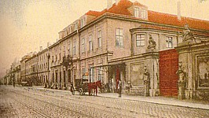Die Friedrichstraße ist die älteste Straße der Friedrichstadt und entstand
ursprünglich als Verbindungsweg zwischen der Innenstadt und dem [Ostravorwerk](../../../../zentrum/friedrichstadt/ostragehege/). Deshalb wurde sie zunächst Ostraer Gasse bzw.
Ostrastraße genannt. Ab 1670 wurden die Grundstücke links und rechts dieses Weges zur Bebauung freigegeben. Eigentlich sollten durch die kostenlose Überlassung der Flächen und weitere Vergünstigungen
Handwerker und Gewerbetreibende angelockt werden, was aufgrund des Widerstandes des städtischen Rates und der Dresdner Zünfte jedoch nur sehr eingeschränkt gelang. Stattdessen erwarben wohlhabende Adlige und
Hofbeamte die Grundstücke und legten hier ihre Sommergärten an. Bedeutendstes Anwesen war das Gartenpalais der
Gräfin Lubomirska, welches 1736 Heinrich von Brühl erwarb und erweitern ließ. Unter dem späteren Besitzer, dem
Leiter der Kunstsammlungen und Direktor der Meißner Porzellanmanufaktur Graf Camillo von Marcolini, wurde das Palais deutlich erweitert und gehört als [Marcolinipalais](../../../../zentrum/friedrichstadt/strassen_friedrichstadt/friedrichstrasse/marcolinipalais/) bis heute zu den wenigen erhaltenen Adelssitzen der Barockzeit in
Dresden. Seit 1849 befindet sich auf dem Gelände das [Stadtkrankenhaus](../../../../zentrum/friedrichstadt/strassen_friedrichstadt/friedrichstrasse/marcolinipalais/krankenhaus_friedrichstadt/) Friedrichstadt.

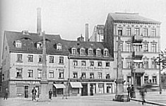
Bereits Anfang des 16. Jahrhunderts überquerte ein hölzerner Steg am Ende der heutigen Friedrichstraße die Weißeritz. 1645 wurde dieser durch eine Steinbrücke ersetzt, welche
lange Zeit einzige Verbindung zur Vorstadt war. Da die Brücke unmittelbar auf die angrenzende Ostrastraße führte, erhielt diese 1732 auf kurfürstlichen Befehl den Namen Brückenstraße. Nach dem Neubau
der Weißeritzbrücke im Jahr 1830 und der in diesem Zusammenhang erfolgten Namensgebung “Friedrichsbrücke” wurde die Brückenstraße auf Wunsch der
Anwohner in Friedrichstraße umbenannt.  Mit der Benennung sollte an Kurfürst Friedrich August I. erinnert werden, unter dessen Regierung die Vorstadt
ausgebaut worden war. 1893 wurde die Friedrichsbrücke nach Verlegung des Weißeritzbettes überflüssig und daraufhin
abgebrochen. Die historische Aufnahme zeigt die unmittelbar am Brückenkopf stehende Wohnhausgruppe Friedrichstraße 2-6 kurz vor ihrem Abbruch zugunsten des Kühlhauses.

Friedrich August I. (August der Starke) hatte für das neue Stadtviertel einen Bebauungsplan mit einem rechtwinkligen
Straßennetz entwerfen lassen. An dessen Hauptachse, der späteren Friedrichstraße, entstanden verschiedene öffentliche Gebäude und Einrichtungen. 1728-30 wurde nach Plänen Matthäus Daniel Pöppelmanns die [Matthäuskirche](../../../../zentrum/friedrichstadt/strassen_friedrichstadt/friedrichstrasse/matthauskirche/) gebaut, in
deren Gruft der Zwingerbaumeister 1736 auch beigesetzt wurde. Unmittelbar hinter der Kirche befindet sich seit 1725 der evangelische [Matthäusfriedhof](../../../../zentrum/friedrichstadt/strassen_friedrichstadt/friedrichstrasse/matthauskirche/matthausfriedhof/), auf der gegenüberliegenden Straßenseite der [Innere Katholische Friedhof](../../../../zentrum/friedrichstadt/strassen_friedrichstadt/friedrichstrasse/innerer_katholischer_friedhof/) mit den
Gräbern zahlreicher bekannter Dresdner Persönlichkeiten.

Nach Änderung der Bebauungsvorschriften durften ab 1734 in der Friedrichstadt neue Gebäude komplett in Stein
errichtet werden, was zu einer deutlichen Zunahme der Bautätigkeit führte. Aus dieser Phase stammen die noch erhaltenen
Barockhäuser Friedrichstraße 29 und 33 mit Laubengängen im Innenhof. Auch Pöppelmann ließ sich hier ein Wohnhaus
errichten, welches er seinem Sohn Johann Adolph zur Nutzung überließ. Hinzu kamen später verschiedene gewerbliche Betriebe wie die bekannte [Spirituosenfabrik Bramsch](../../../../zentrum/friedrichstadt/strassen_friedrichstadt/friedrichstrasse/bramsch-spirituosenfabrik/)
, die noch bis 1991 produzierte.

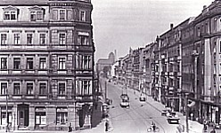Im 19. Jahrhundert erfolgten erste Eingriffe in das barocke Straßenbild, bei
denen mehrere Gebäude neuen Mietshäusern sowie dem Bau des Kühlhauses an der Weißeritzstraße weichen mussten. Ungefähr ein Drittel der vorhandenen Bebauung _(Foto von 1935)_
fiel 1945 den Bomben zum Opfer. Nur wenige Bauten konnten in der Nachkriegszeit wieder hergestellt werden. Stattdessen verfielen einige noch intakte Häuser dem Abbruch, da nichts zu ihrer
Unterhaltung unternommen wurde. Im Generalbebauungsplan der Stadt Dresden von 1967 war der Abriss großer Teile der historischen Friedrichstadt, darunter fast aller Häuser der Friedrichstraße,  vorgesehen. So
sollten auch die unter Denkmalschutz stehenden Wohnhäuser Friedrichstraße Nr. 25, 29, 33 und 35 beseitigt und durch
mehrgeschossige Neubauten ersetzt werden. Am Westende war ein Bürohochhaus vorgesehen. Diese Projekte wurden allerdings nicht realisiert.

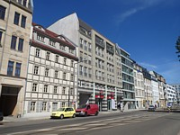Nach 1990 konnte mit der Rekonstruktion einiger Häuser und der Schließung von
Baulücken begonnen werden. Eine komplette Instandsetzung der Friedrichstraße steht jedoch noch aus. Ein bereits 1998 auf dem Areal des 1945 zerstörten
Baublocks Friedrichstraße / Weißeritzstraße / Seminarstraße vorgesehenes Stadtteilzentrum mit Kino, Hotel und einem Einkaufszentrum kam bislang nicht
zustande und soll künftig in reduzierter Form als Einkaufszentrum realisiert werden. Gegenüber befindet sich ein 2010 eröffnetes Hotel der französischen Hotelkette B&B.

Einzelne Gebäude:

Nr. 2-6: Die Wohnhausgruppe an der ehemaligen Friedrichsbrücke stammte aus dem 18. Jahrhundert. 1788 fanden vor den Gebäuden zwei ehemals im Herzogingarten befindliche Obelisken Aufstellung. 1910 wurden die Häuser zugunsten des Kühlhauses an der Weißeritzstraße abgerissen. Seit 2007 steht auf dem Grundstück ein Hotelneubau.

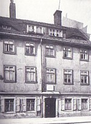Nr. 5 (Goethehaus):  Das Haus wurde in der ersten Hälfte des 18. Jahrhunderts vom Dresdner Amtsbaumeister Johann Georg Gebhardt errichtet und wies auf der Hofseite einen für den Stadtteil typischen Laubengang auf. Die Obergeschosse waren entsprechend den geltenden Bauvorschriften in Fachwerkbauweise errichtet. In diesem 1945 zerstörten Gebäude _(Foto)_ wohnte 1768 Johann Wolfgang von Goethe als Student. Goethe besuchte auf Anraten seines Lehrers Friedrich Oeser Dresden und fand hier bei dem Schuhmacher Haucke Quartier. Während seines Aufenthaltes besuchte der Dichter u.a. die Kunstsammlungen der Stadt. In Erinnerung an seinen Aufenthalt wurde am Haus später eine Gedenktafel mit der Inschrift: “Hier wohnte Goethe als Leipziger Student, März 1768” angebracht.

B & B-Hotel: Der moderne Hotelneubau an der Ecke Friedrichstraße / Weißeritzstraße 10 entstand 2009 und wurde am 9. August 2010 eröffnet. Das Zwei-Sterne-Hotel bietet 131 Hotelzimmer und wird vor allem von Dresden-Touristen gern besucht. Betreiber ist die Hotelkette “B & B”, welche sich auf preiswerte Übernachtungsmöglichkeiten konzentriert.

Nr. 7: Das heute nicht mehr vorhandene Gebäude diente seit Ende des 19. Jahrhunderts als Gasthaus "Zum Goldenen Löwen". Wechselnde Betreiber führten das Lokal, zeitweise unter dem Namen "Friedrichhof", bis zur Zerstörung 1945. Außerdem gab es auf dem Grundstück die Früchte- und Nahrungsmittel-Großhandlung von Arthur Schreiber.

Nr. 9: Das Haus gehörte zu den ältesten Gebäuden der Friedrichstadt und wurde 1673/74 vom Vorwerksverwalter Johann Gottfried Otto errichtet. 1674 erhielt er für sein Haus das Beherbergungs- und Schankrecht. Zunächst "die große Schänke" genannt, setzte sich später der Name Rote Schänke durch. Zuletzt wurde das Lokal bis zur Zerstörung 1945 "Friedrichstädter Hof" genannt.

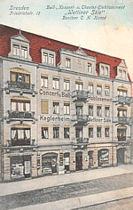Keglerheim (Nr. 12): Das “Dresdner Keglerheim” gehörte vor 1945 zu den traditionellen Versammlungsstätten der Friedrichstädter Arbeiterschaft. Bereits um 1707 ist an dieser Stelle eine kleine Gastwirtschaft mit dem Namen "Schmiede" erwähnt. 1895 entstand ein großzügiger Neubau mit Saal, der seitdem als "Konzert- und Ballhaus Wettiner Säle" firmierte. Inhaber war Gustav Adolf Thomas, ab 1914 Karl Adolf Hans Kunze. Seit den Zwanziger Jahren wurde das Lokal "Keglerheim" genannt. Im Vorfeld der Machtübernahme Hitlers kam es hier am 25. Januar 1933 zu einem tragischen Zwischenfall. Während einer von der KPD organisierten Kundgebung im Saal des Gebäudes _(Foto)_ besetzten Polizisten das Lokal, um die Versammlung aufzulösen. Die nur unzureichend ausgebildeten und mit der Lage völlig überforderten Polizeischüler aus Meißen schossen dabei in die Menge, wobei neun Arbeiter ums Leben kamen. Weitere Personen wurden zum Teil schwer verletzt.

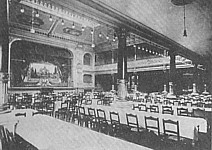Die Ereignisse im “Keglerheim” sorgten deutschlandweit für Aufsehen. Bereits wenige Tage später fanden in verschiedenen Dresdner Betrieben Warnstreiks, begleitet von Protestveranstaltungen im “Eldorado” auf der Steinstraße und im Zirkus Sarrasani statt. Die Beisetzung der neun Todesopfer auf dem Tolkewitzer Friedhof am 31. Januar 1933 war letzte legale Kundgebung der linken Dresdner Arbeiterschaft vor Machtübernahme Hitlers. Während der Nazizeit wurde das “Keglerheim” für Veranstaltungen des Winterhilfswerks und der NS-Organisation “Kraft durch Freude” genutzt und 1945 zerstört. Nach dem Zweiten Weltkrieg entstand in der Nähe eine kleine Erinnerungsstätte mit Gedenktafel für die Opfer. Wegen des Baus des B & B-Hotels musste diese 2009 entfernt und etwas versetzt wieder aufgebaut werden, befindet sich jedoch nicht am exakten Standort des Keglerheims.

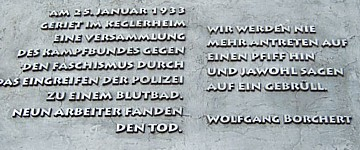

**_Foto:_** _Gedenktafel zur Erinnerung an die Ereignisse im Keglerheim 1933_

Nr. 14: Hier wohnte im 19. Jahrhundert der Kunstmaler Ernst Oehme (1797-1855), der mit dem Maler und Zeichner Ludwig Richter befreundet war. Richter besaß um 1836 ebenfalls eine Wohnung in diesem Haus, verzog jedoch wenig später zur Löbtauer Straße und schließlich nach Loschwitz. Beide Künstler gehörten der Dresdner Montagsgesellschaft an und schufen Werke im Stil der deutschen Romantik. Das Gebäude wurde um 1890 durch ein mehrgeschossiges Mietshaus ersetzt.

Nr. 18: Das viergeschossige Wohnhaus wurde 1905 erbaut und diente bis 2002 als Wohn- und Geschäftshaus. Charakteristisch sind die korbbogenartigen Schaufenster und Ladeneinbauten im Erdgeschoss. Ursprünglich gab es hier eine kleine Schankwirtschaft. Nach schweren Schäden beim Hochwasser 2002 wurde das Haus geräumt und wird seit seiner Sanierung als Ärztehaus genutzt.

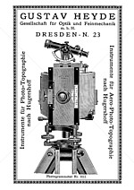Gustav Heyde KG: Im Hintergebäude von Nr. 18 hatte vor dem Ersten Weltkrieg die Firma "G. Heyde - mechanische und optische Präzisions-Werke" ihren Sitz. Gustav Heyde hatte den Betrieb 1872 gegründet. Hergestellt wurden verschiedene feinmechanische und optische Geräte, die vor allem für astronomische Forschungen in Verwendung kamen. Befreundet war Heyde mit dem Astronomen Basilius von Engelhardt, für den er auf dessen Grundstück auf der [Liebigstraße 1](../../../../zentrum/sudvorstadt/strassen_sudvorstadt/liebigstrasse/) ein Observatorium mit verschiedenen Geräten zur Himmelsbeobachtung ausstattete.

Nach dem Ersten Weltkrieg traten Heydes Nachkommen Julius Johannes August und Albin Ernst Johannes als Mitgesellschafter in den Betrieb ein und verlegten den Firmensitz zur Kleiststraße 10 nach Trachau. Die früheren Geschäftsräume auf der Friedrichstraße nutzte später u.a. eine Buchdruckerei. 1931 wurde die Firma Gustav Heyde in eine Kommanditgesellschaft umgewandelt, firmierte nach 1945 jedoch wieder als GmbH. Auf Grundlage des Volksentscheids in Sachsen 1946 wurde die Gustav Heyde GmbH enteignet und in Volkseigentum überführt. Ab 1948 gehörte sie zum volkseigenen Kombinat für feinmechanische und optische Geräte in Jena und erhielt ein Jahr später den VEB Feinmess Dresden.

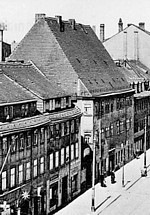Nr. 19: Das zu den markantesten älteren Wohngebäuden der Friedrichstraße gehörende Wohnhaus _(Foto)_ entstand um 1730 und blieb 1945 ohne größere Schäden. Ursprünglich beherbergte es eine Seidenmanufaktur des Kaufmanns Johann Daniel Kraft. Später gab es hier eine Niederlage zur Lagerung von Kühleis. 1895 entstand im Erdgeschoss die Gaststätte "Altes Eishaus". Zudem hatte hier vor dem Ersten Weltkrieg der "Eisverein Dresdner Gastwirte" seine Geschäftsräume. Das auch "Zum Eishaus" genannte Lokal existierte noch bis 1953. Danach wurde das Haus wegen seines schlechten Bauzustandes geräumt und zwei Jahre später abgerissen. Ein an dieser Stelle geplanter Neubau in Anlehnung an das historische Äußere kam nicht zustande.

Im hinteren Bereich des Grundstücks hatte einst die Konservenfabrik Dittrich ihre Produktionsräume. Nach jahrelangem Leerstand begann 2012 der Ausbau der Gebäude zu Wohnhäusen. Ergänzt wird der nach seinem früheren Besitzer “Dittrichpark” genannte Komplex zwischen Friedrich- und Seminarstraße um einen Neubau.

Nr. 20: Im Hintergebäude des Grundstücks befand sich einst die 1909 gegründete Maschinenfabrik Paul Troeltzsch Maschinenfabrik. Das auch nach 1945 noch bis in die 1960er Jahre existierende Unternehmen stellte u.a. Riemenscheiben für Transmissionsantriebe und ähnliche Maschinenteile her. Nach dem Abriss blieb das Areal bis heute unbebaut.

Nr. 23/25: Beide Häuser wurden zwischen 1734 und 1740 im Zuge des Ausbaus der Friedrichstadt errichtet. Während das Erdgeschoss bereits massiv gebaut war, bestanden die oberen Etagen noch aus verputztem Fachwerk. Erst ab 1734 waren komplett aus Stein errichtete Gebäude in der Vorstadt zulässig. Die beiden Wohnhäuser besaßen auf der Hofseite hölzerne Laubengänge, wie sie im 18. Jahrhundert bei vielen Gebäuden zu finden waren. 1981/82 wurden diese bei einem Brand beschädigt. Trotz ihrer historischen Bedeutung standen die Häuser viele Jahre in ruinösem Zustand leer und wurden nach 1990 abgerissen. Einer Legende nach sollen hier Mätressen August des Starken gewohnt haben, die durch einen unterirdischen Gang zum Marcolinipalais unbemerkt zum König gelangen konnten. Tatsächlich handelt es sich jedoch um frühe Mietshäuser für die in der Friedrichstadt beschäftigten Manufakturarbeiter.

Nr. 24: Auf diesem Grundstück befand sich bis zur Zerstörung 1945 die Firma O. & A. Weißpflog, die hier Fleisch- und Wurstwaren produzierte. Die 1945 schwer beschädigten und danach nur notdürftig wiederhergestellten Gebäude wurden später vom VEB Fleisch- und Wurstwarenfabrik Delicata und von der Konsumgenossenschaft genutzt. 1992/94 entstand an gleicher Stelle ein modernes Wohn- und Geschäftshaus.

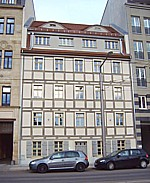Nr. 26: Das in Fachwerkbauweise errichtete Manufakturarbeiterwohnhaus entstand 1726 noch vor der planmäßigen Bebauung der Friedrichstadt und gehört zu den ältesten Arbeiterwohnhäusern Dresdens. Den damaligen Vorschriften entsprechend bestehen die Obergeschosse noch aus Fachwerk und Holz, da die Errichtung massiver Steinhäuser aus strategischen Gründen verboten war. Im Inneren gab es ursprünglich nur kleine Wohnungen mit Stube, Schlafalkoven und Kochnische, wobei die einzelnen Räume durch einen Laubengang miteinander verbunden waren.

Nach der Aufhebung des Verbots, steinerne Gebäude zu errichten, wurden die Obergeschosse verputzt und das Haus 1832 aufgestockt. Außerdem entstand ein Seitenflügel im Hof, der jedoch 1992 dem Bau des Nachbarhauses weichen musste. Als eines der wenigen Gebäude seiner Zeit überstand das Haupthaus alle Umbauten und den Zweiten Weltkrieg, stand später jedoch viele Jahre leer. 2011 wurde es umfangreich saniert, wobei man die Fassade weitgehend wieder in den Ursprungszustand versetzte. An der Rückseite wurde eine moderne Glas-Aluminium-Fassade integriert.

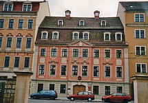Nr. 29: Das Wohngebäude Friedrichstraße 29 entstand im Kern bereits um 1670 und wurde um 1730 erweitert. Die Fassade ist im Barockstik ornamental gestaltet. Auch im Inneren sind noch Teile der ursprünglichen Ausstattung erhalten geblieben, u.a. eine mit Malereien versehene hölzerne Kassettendecke aus der Zeit um 1670. Beim Luftangriff 1945 wurde das Haus zum Teil beschädigt, konnte jedoch 1951 notdürftig wiederhergestellt werden. Um 1970 war der Abbruch vorgesehen, der erst durch den Einspruch der Denkmalpflege verhindert werden konnte. 1984 begann die Restaurierung des Gebäudes als Sitz des Institutes für Denkmalpflege. Nach 1990 bezog das Honorarkonsulat von Thailand einige Räume.

Nr. 31: Das fünfstöckige Wohnhaus wurde 1927 als Ersatz für einen Vorgängerbau aus dem 18. Jahrhundert errichtet. Das in Anlehnung an frühere Bautraditionen mit einer großen Durchfahrt gestaltete Gebäude stellt ein interessantes Zeugnis für die behutsame Erneuerung der Friedrichstraße dar.

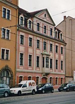Nr. 32: In dem heute nicht mehr vorhandenen Gebäude wohnte im 19. Jahrhundert der Kunstmaler Christian Friedrich Gille (1805-1899). Gille schuf zahlreiche Landschaftsdarstellungen der Dresdner Umgebung, die heute zum Großteil in der Galerie Neue Meister zu sehen sind. Sein Grab befindet sich auf dem Äußeren Matthäusfriedhof. 2009 entstand auf dem Grundstück ein moderner Neubau für das Kinderzentrum mit verschiedenen Arztpraxen (Nr. 32/34).

Nr. 33: Dieses repräsentative Wohnhaus _(Foto)_ mit Erker stammt aus der Zeit um 1740. Zum Komplex gehören neben dem Hauptbau an der Straße zwei Flügel- und ein Hintergebäude, die sich um einen quadratischen Innenhof gruppieren und durch einen geschlossenen Laubengang verbunden sind. Während im Vorderhaus überwiegend Wohnungen untergebracht waren, wurde das Hintergebäude teilweise gewerblich genutzt, u.a. von einer Büromöbeltischlerei und einer Kistenfabrik. Als eines der wenigen Barockhäuser der Friedrichstadt wurde das Haus bereits 1975 rekonstruiert und war danach Sitz des VEB Denkmalpflege. Heute haben hier verschiedene Firmen ihre Büros.

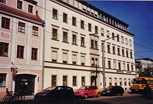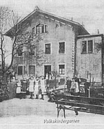 Nr. 34/36 (Duckwitzhaus): Das Gebäude Friedrichstraße 34 entstand 1845 und war gemeinsam mit dem Nachbarhaus Friedrichstraße 36 bis 1945 Domizil eines Altersheimes. Bis zu seinem Tod 1858 hatte der der Dresdner Bankier Heinrich Eduard Duckwitz in Nr. 34 seine Sommerwohnung. Er hinterließ eine größere Summe und mehrere Grundstücke, welche der 1866 unter städtische Verwaltung gestellten “Duckwitzstiftung” zugute kamen. Diese Stiftung ließ im gleichen Jahr das Haus Friedrichstraße 36 errichten. Gemäß dem Willen des Stifters fanden hier hilfsbedürftige Dresdner Bürger, vor allem verarmte Kaufleute im Alter Betreuung und Versorgung. Zusätzlich wurden einige Pflegebedürftige des Güntzheimes und des Johannstädter Bürgerhospitals aufgenommen. Zwischen 1893 und 1937 gab es außerdem einen Kindergarten des Fröbelschen Erziehungsvereins im Hintergebäude (ab 1931 städtischer Kindergarten - _Foto rechts_).

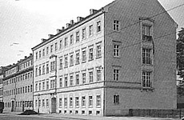1945 wurde das Duckwitzhaus durch Bomben schwer beschädigt. 1952 begann der Wiederaufbau nach Plänen des Architekten Arno Kießling _(Foto)_. Dabei nahm man Elemente der früheren Fassadenstruktur auf, bezog ein erhaltenes Portal ein und versah das Haus in Anlehnung an barocke Bautraditionen mit einem zweigeschossigen Erker. Beide Gebäude bilden seitdem baulich eine Einheit und wurden ab 7. September 1953 als Kindergarten genutzt. Zeitweise war die Einrichtung mit 230 Plätzen größte Kindertagesstätte der DDR. Im hinteren Teil des Grundstücks entstand 1955 ein Neubau für eine Kinderkrippe. Diese Bauten stellen ein interessantes Beispiel für den Wiederaufbau der ersten Nachkriegsjahre dar. 1998 wurde die Kita aus finanziellen und baulichen Gründen geschlossen. Nach Abschluss der Sanierung des Hauses wird dieses heute wieder als Seniorenzentrum genutzt.

Nr. 35:  Das frühere Wohnhaus Friedrichstraße 35 ist ein Beispiel für das Schicksal historischer Bausubstanz in der DDR-Zeit. Das in der zweiten Hälfte des 17. Jahrhunderts entstandene Gebäude überstand den Zweiten Weltkrieg ohne Schäden, verfiel jedoch dann mangels Werterhaltung zur Ruine. 1974 wurde das Haus abgerissen.

Weißes Röß\`l (Nr. 37): Das um 1870 errichtete Wohn- und Geschäftshaus an der Ecke zur Bräuergasse beherbergt bis heute im Erdgeschoss eine Gaststätte. Zunächst wurde diese "Weißes Roß" genannt, bevor sich später der Name "Weißes Röss´l" durchsetzte. 1910 ist das Lokal als "Restaurant Karl Moritz Senf", 1912 als "Deutsche Bierhalle" erwähnt. Das Gebäude überstand den Luftangriff ohne größere Schäden, so dass auch das Lokal bis 1990, zuletzt als HO-Gaststätte, geöffnet blieb. Später gab es hier zeitweise eine Spielothek. Heute setzt die "Rösselstube" die gastronomische Tradition fort.

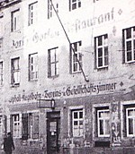Nr. 38/40: Die beiden Bürgerhäuser wurden vermutlich zwischen 1760 und 1780 erbaut. Zuvor dienten die Grundstücke als Gärten wohlhabender Dresdner Bürger. 1802 besaß der sächsische Hofschuhmacher Franz Anton Proksch das Areal. Zu den späteren Nutzern gehörten u. a. eine Wäscherei, eine Kolonialwaren- und Samenhandlung sowie die Glasmalerei Urban & Goller im Hintergebäude. Zeitweise gab es hier die Gastwirtschaft “Zur Sonne” sowie ab 1861 “Barths Gartenrestaurant” im Erdgeschoss von Nr. 38 _(Foto links)_. Besitzer des Hauses war im 19. Jahrhundert der katholische Vincentius-Verein, der sich der Unterstützung in Not geratener Katholiken widmete. In den 1920er Jahren wohnte die Malerin und Grafikerin Dore Mönkemeyer-Corty in der Friedrichstraße 40. Sie gehörte der Dresdner Ortsgruppe des Bundes der Deutschen Gebrauchsgraphiker an und arbeitete auch als Designerin.

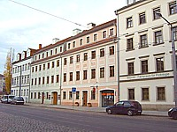Beide Häuser überstanden den Zweiten Weltkrieg ohne größere Schäden. 1997 begann die Sanierung der Gebäude und der Umbau zum Ärztehaus (Kinderzentrum). Neben Praxisräumen für mehrere Kinderärzte, einem therapeutischen Fitnessstudio und der Apotheke Friedrichstadt befindet sich hier seit 2001 das neue “Café Friedrichstadt” _(Foto rechts)_. Außerdem sind im Haus Nr. 40 einige Hotelzimmer untergebracht.

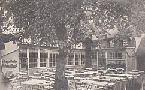Barths Gartenrestaurant (Nr. 38): Die Gastwirtschaft entstand Mitte des 19. Jahrhunderts und nutzte neben den Erdgeschossräumen des Hauses Friedrichstraße 38 auch den hinter dem Haus gelegenen Garten. Um 1900 warb das Lokal mit Vereins- und Gesellschaftszimmer und einer Asphalt-Kegelbahn. Außerdem gab es einen Schießstand sowie nach Überlieferungen älterer Dresdner einige Volieren und Tiergehege. Unter der Regie des Ehepaares Göldner erfreute sich die historische Gartenwirtschaft bis 1945 großer Beliebtheit. 1945 richteten Bomben erhebliche Schäden am Hintergebäude an. Dieses wurde nach 1960 zum Gartenheim "Stechmücke" ausgebaut. schloss jedoch in den 1970er Jahren seine Pforten. Heute nutzt das neue "Café Friedrichstadt" einen Teil der Gasträume im Hauptgebäude.

Im Garten des Grundstücks wurde 2002 eine vom ehemaligen Pionierdenkmal stammende Löwenplastik aufgestellt. Diese wurde 1922 als Kopie des berühmten “Braunschweiger Löwen” für ein Gefallenendenkmal geschaffen und am 16. Juni 1923 am Terrassenufer platziert. Da das Monument 1946 als ”militaristisch” eingestuft und ein Jahr später beseitigt wurde, verschwand auch der Löwe zunächst im Depot. Zeitweise fand diese Bronzeplastik an der Albertbrücke Aufstellung, musste dort jedoch 1969 nach einem Unfall entfernt werden. 1973 fertigte der Bildhauer E. Wolf ein Modell dieser Plastik an, nach dem 1986 in Lauchhammer ein Nachguss entstand. Dieser schmückt heute den Garten des Kinderzentrums, das Originaldenkmal befindet sich seit Oktober 2012 vor der Albertstadtkaserne an der [Stauffenbergallee](../../../../neustadt/albertstadt/strassen_albertstadt/stauffenbergallee/).

Glasmalerie Urban & Goller:  Das Unternehmen wurde Ende des 19. Jahrhunderts als Anstalt für Glasmalerei von Bruno Urban gegründet. Nach dem Eintritt des Glasmalers Josef Goller (1868-1947), der 1890 nach Dresden gekommen war, firmierte der Betrieb unter dem Namen “Urban & Goller”. Goller lebte zu diesem Zeitpunkt auf der Friedrichstraße 10 und übernahm die künstlerische Leitung der Firma. Als Mitglied des Deutschen Werkbundes und freier Mitarbeiter der Deutschen Werkstätten für Handwerkskunst war er zwischen 1906 und 1928 Lehrer (ab 1909 Professor für Glasmalerei an der Dresdner [Kunstgewerbeschule](../../../../zentrum/johannstadt/strassen_johannstadt/kunstgewerbeschule/). Zu den Schöpfungen der Firma Urban & Goller gehörten u.a. die Fenster des 1945 zerstörten Kaiserpalastes am Pirnaischen Platz, die Glasmalereien über dem Hochaltar der katholischen [Marienkirche](../../../../west/cotta/st__marien-kirche/) in Cotta sowie einige Glasfenster der Loschwitzer Schule. Auch an der Ausgestaltung der [Garnisonkirche](../../../../neustadt/albertstadt/strassen_albertstadt/stauffenbergallee/garnisonskirche/), des Kunstgewerbemuseums und des Neuen Rathauses war Goller beteiligt.

Nr. 42: Das dreigeschossige Wohnhaus mit einem niedrigeren Seitenflügel entstand um 1860. Bis 1933 hatte hier der Kunstmaler Richard von Hagn sein Atelier. Später nutzten die Restauratoren der Semperoper das Gebäude. 1985/86 wurde das Haus in Privatinitiative rekonstruiert und von den Künstlern Hans Riedel und Peter Taubert mit illusionistischer Fassadenmalerei farbig gestaltet. Die originellen Bilder zeigen u.a. verschiedene Tierdarstellungen.

Nr. 44: Das Wohnhaus Friedrichstraße 44 entstand 1772, wurde später jedoch mehrfach verändert. Zum Grundstück gehört auch ein noch heute vorhandenes Gartenhaus, einer der wenigen noch erhaltenen Sachzeugen für die einst zahlreichen Gartengrundstücke und Landhäuser in der Friedrichstadt. Am 28. September 1803 wurde hier der Maler Adrian Ludwig Richter geboren. Richter war Professor an der Dresdner Kunstakademie und schuf zahlreiche Landschaftsbilder und Kupferstiche, die ihn zu einem der wichtigsten Vertreter der Romantik machen. 1878 erhielt er die Dresdner Ehrenbürgerwürde. Seit 1984 erinnert am Haus eine von Martin Hänisch gestaltete Gedenktafel an Richter.

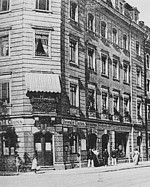Nr. 45: Das um 1888 errichtete Mietshaus an der Ecke zur Vorwerkstraße bildete bis zur Zerstörung 1945 den Auftakt für die Häuserzeile der sogenannten "Aktien-Häuser", einer Wohnanlage, die sich bis zur Waltherstraße erstreckte. Im Eckhaus befand sich im Erdgeschoss die Gaststätte "Friedrichs-Eck" (auch Friedrichs-Hof). Wegen seiner Nähe zum benachbarten Matthäusfriedhof wurde diese im Volksmund "Leichenschänke" genannt. Nach Zerstörung des Gebäudes nutzte der VEB Technische Gase das Grundstück bis zur Wende als Betriebsgelände. 2011 wurden die ruinösen Bauten abgerissen.

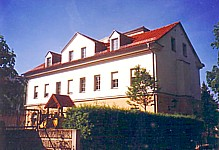Nr. 46: Das um 1840 vom Zimmermeister Gottlieb August Paulich erbaute Gebäude war zwischen 1842 und 1870 Wohnhaus und Arbeitsstätte von Johann Andreas Schubert, Konstrukteur des ersten Elbdampfers, der ersten deutschen Lokomotive sowie Erbauer der Gölzschtalbrücke. Schubert erwarb kurz darauf auch das benachbarte Grundstück Nr. 48 und gründete hier gemeinsam mit zwei Geschäftspartnern eine Dampfkesselfabrik. Allerdings musste diese wegen Lärmbelästigung wenig später nach Löbtau zum Reisewitzschen Garten verlegt werden.

Die von Schubert nicht benötigten Wohnräume im ersten Stock vermietete dieser ab 1846 an den Redakteur Dr. phil. Wilhelm Herz, Herausgeber des “Dresdner Morgenblattes” und Mitglied des sächsischen Landtages. Herz wurde wegen seiner Beteiligung an der Revolution von 1849 zum Tode verurteilt, wenig später jedoch begnadigt. Gemeinsam mit seiner Frau Auguste gründete er 1852 bei Meißen in Kinderheim. Auguste Herz war zugleich Vorsitzende des Demokratischen Dresdner Frauenvereins und als Schülerin Fröbels Initiatorin eines der ersten Dresdner Kindergärten.

Zeitweise lebte auch der Dresdner Hofkapellmeister August Röckel in diesem Gebäude. Röckel gehörte als Demokrat dem linken Flügel des sächsischen Landtags an und war aktiv an der Vorbereitung des Dresdner Maiaufstandes beteiligt. In seiner Wohnung traf sich 1848/49 wiederholt ein Kreis revolutionärer Demokraten, darunter der russische Revolutionär Michail Bakunin und der wegen seiner politischen Schriften verfolgte Volksschullehrer Johann Zschaler.

Nach dem Tod Johann Andreas Schuberts verkaufte dessen Witwe das Grundstück, welches nun ab 1886 als Heim für hilfsbedürftige und unbescholtene weibliche Dienstboten, ab 1935 als Altersheim (Carolastift) genutzt wurde. Nach 1945 befand sich hier eine Kinderkrippe für die Angehörigen des Friedrichstädter Krankenhauses. An Schubert und Richter erinnern Gedenktafeln an der Gartenmauer.

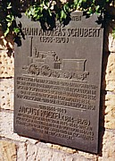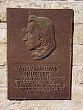

**_Fotos:_** _Gedenktafeln für Johann Andreas Schubert (links) und Adrian Ludwig Richter (rechts)_

_an der Gartenmauer des Grundstücks Friedrichstraße 44/46_

Nr. 46: In diesem Haus verbrachte die später als Malerin bekannte Paula Modersohn-Becker ihre Kindheit. Die 1876 in einem heute nicht mehr vorhandenen Haus auf der Schäferstraße geborene Tochter eines Bahnbeamten verzog noch im gleichen Jahr mit ihren Eltern zur Friedrichstraße 46. Später besuchte sie die Kunstakademie in Berlin und schloss sich der Künstlerkolonie Worpswede an. Mit nur 31 Jahren verstarb sie 1907 bei der Geburt ihres ersten Kindes. Bis 1945 befand sich hier ein Altersheim der katholischen Franceschi-Stiftung.

Nr. 50 (Esseniussches Haus): Das Gebäude entstand 1738 für den Hofzahlmeister August Franz Essenius und war erster vollständig in Stein errichteter Bau der Friedrichstadt. Über den drei Portalen ließ Essenius die Inschriften “Soli, Deo, Gloria” anbringen. Bereits 1742 verkaufte er das Anwesen an den Grafen Brühl, der es wenig später dem kurfürstlichen Kammerkollegium übereignete. Im Hintergebäude befand sich ab 1747 ein von Kurfürstin Maria Josepha eingerichtetes katholisches Krankenstift, während in das Vorderhaus eine katholische Schule zog. Für diese Einrichtungen wurde 1748/49 im Garten des Hauses die später zur Pfarrkirche erhobene katholische [Kapelle St. Michael](../../../../zentrum/friedrichstadt/strassen_friedrichstadt/friedrichstrasse/st_-michael-kapelle/) errichtet.

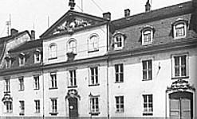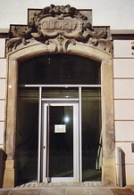

**_Foto:_** _Das Esseniussche Haus vor der Zerstörung 1945 - rechts das noch erhaltene Portal_

1945 fielen Kirche und die übrigen Gebäude dem Luftangriff zum Opfer. An das Esseniussche Haus erinnert heute noch der Rest des früheren Eingangsportals mit der Inschrift “GLORIA”, der in einen nach 1990 errichteten Neubau einbezogen wurde. Das Hintergebäude entstand 1991/92 in äußerlich historischer Form neu und beherbergt heute den Sitz des Diozösan-Caritasverbandes des Bistums Dresden-Meißen. Die übrigen Bauten dienen als katholisches Pflegeheim.

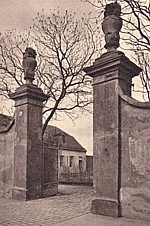Nr. 52: Dieses dreigeschossige Wohnhaus wurde 1730 vom Zwingerbaumeister Matthäus Daniel Pöppelmann für seinen Sohn, den Hofmaler Johann Adolph Pöppelmann errichtet. Ursprünglich erstreckte sich das Areal bis zur Friedrichstraße 56, wo heute noch ein mit zwei Sandsteinvasen verziertes Tor an den früheren Garten erinnert _(Foto)_. Zeitweise hatte hier der Kupfer- und Kanonenschmied Ludwig Wiedemann seine Werkstatt, in der u.a. das als “Goldener Reiter” bekannte Denkmal August des Starken entstand. 1749 erhielt Pöppelmann für sein Grundstück die Genehmigung, im Garten einen Bierschank einzurichten.

Teile der ehemals vorhandenen Gebäude fielen im 19. Jahrhundert der Erweiterung der [Spirituosenfabrik Bramsch](../../../../zentrum/friedrichstadt/strassen_friedrichstadt/friedrichstrasse/bramsch-spirituosenfabrik/) zum Opfer. Das Wohnhaus wurde später mehrfach verändert und mit Ladeneinbauten, einem neuen Dachgeschoss und Verglasungen an den Laubengängen der Hofseite versehen. Ab 1906 befand sich im Erdgeschoss das beliebte “Café Friedrichstadt”, welches 1988 jedoch geschlossen werden musste. Heute setzt eine gleichnamige gastronomische Einrichtung im Haus Friedrichstraße 38/40 die Tradition fort. Außerdem befand sich vor dem Zweiten Weltkrieg im Haus die Wein-, Bier- und Spirituosengroßhandlung Johann Rentsch Nachf. Das Unternehmen warb 1929 im Adressbuch mit "Spezialausschank, Klub- und Gesellschaftszimmern" und stand als Verkaufsniederlage in enger Verbindung mit der benachbarten Spiritusenfabrik Bramsch.

Gärtnerlehranstalt: Im Grundstück Nr. 52 (ehem.Friedrichstraße 26) nahm am 1. Oktober 1856 die erste Gärtnerlehranstalt des Landwirtschaftlichen Kreisvereins zu Dresden den Unterricht auf. Die Eröffnung war Ausgangspunkt der zielgerichteten schulischen Gartenbauausbildung. Unter Leitung des Vorsitzenden des Kreisvereins und drei weiterer Lehrer erhielten hier angehende Gärtner Kenntnisse im Obst- und Gemüsebau vermittelt. Ursprünglich sollten diese nach erfolgreichem Abschluss als Gartenbauexperten auf sächsische Landgüter vermittelt werden, was jedoch nicht gelang. Stattdessen suchten sich die meisten Arbeit in Gartenbaubetrieben der Umgebung, weshalb die Lehranstalt 1873 aufgelöst wurde. Stattdessen übernahm die Gartenbauvereinigung "Flora" den Betrieb und unterrichtete ab 1. November 1874 wieder Schüler in Botanik, Pflanzen- und Bodenkultur, Meteorologie und ähnlichen Fächern. 1875 verlegte man die Bildungseinrichtung in das "Flora"-Stammhaus auf der Brückenstraße 6 in Kemnitz.

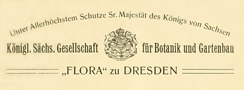

Turnlehrerbildungsanstalt (Nr. 56): Hier war zwischen 1850 und 1863 die Königliche Turnlehrerbildungsanstalt untergebracht, in welcher Volksschullehrer in mehrwöchigen bzw. ganzjährigen Kursen zu Turnlehrern ausgebildet wurden. Eröffnet wurde die Einrichtung am 16. Oktober 1850 und war erste ihrer Art in Deutschland. Geleitet wurde die Bildungsanstalt von Moritz Kloß (1818-1881). Kloß arbeitete ab 1840 als Lehrer in Zeitz und setzte sich nach einer Bekanntschaft mit dem deutschen “Turnvater” Friedrich Ludwig Jahn engagiert für die Förderung des Turnsports und dessen Einführung als Unterrichtsfach ein. Ab 1873 war Turnen obligatorisches Unterrichtsfach an allen sächsischen Volksschulen.

Zunächst stand die Turnlehrerbildungsanstalt ausschließlich männlichen Bewerbern offen, die hier zu “tüchtigen, pädagogisch vorgebildeten Männern” geschult werden sollten. Ab 1860 gab es jedoch auch Kurse im Mädchenturnen. Drei Jahre später erfolgte die Verlegung der Einrichtung zur Carusstraße in die Pirnaische Vorstadt. Hier existierte sie, ab 1925 als Teil der Technischen Hochschule, noch bis 1945. Die Bauten der Turnlehrerbildungsanstalt an der Friedrichstraße fielen um 1900 einer Erweiterung der Spirituosenfabrik Bramsch zum Opfer.

Nr. 57-63: Zwischen 1888 und 1893 errichtete der 1887 gegründete “Gemeinnützige Bauverein zu Dresden AG” die aus vier Einzelhäusern bestehende Wohnhausgruppe Friedrichstraße 57-63. Die Gebäude wurden als Arbeiterwohnungen vermietet und stellen ein frühes Zeugnis des sozialen Wohnungsbaus in Dresden dar. Die Entwürfe stammen vom Architekten Carl Heinrich Schubert, der 1901/02 mit den spiegelbildlich angeordneten Hinterhäusern die Wohnanlage der sogenannten “Aktienhäuser” komplettierte. 1945 fielen Teile des Wohnblocks den Bomben zum Opfer, die verbliebenen Reste blieben in verfallendem Zustand erhalten und wurden ab 2016 saniert.

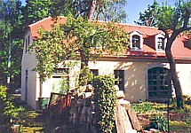 Nr 58 / 58a / 60b (Menageriegarten und kurfürstliche Wachsbleiche): Das zum ehemaligen Menageriegarten gehörende Grundstück war einst Standort der um 1718 gegründeten kurfürstlichen Wachsbleiche. Die Menagerie diente ursprünglich der Kleintier- und Bienenhaltung sowie dem Anbau von Nutzpflanzen. Im Zentrum der Anlage stand ein von Christian Wilhelm Pfund entworfenes, heute nicht mehr vorhandenes Landhaus, welches von zwei noch heute vorhandenen Nebengebäuden flankiert wurde. Erhalten blieben neben der Umfassungsmauer mit Eingangstor das Gebäude der früheren Wachsgießerei und Kerzenmanufaktur sowie das gegenüber stehende Imkerwohnhaus. Beide Häuser wurden 2009 saniert und dienen seitdem Wohnzwecken. 1849 soll sich in einem der Gebäude der russische Anarchist Bakunin, einer der Köpfe der Revolution, versteckt und mit Gleichgesinnten getroffen haben. An Stelle der einstigen Menageriegärten befindet sich heute eine Kleingartenanlage.

Nr. 60: Hier haben sich noch einige wenige Reste des früheren [Ostravorwerks](../../../../zentrum/friedrichstadt/ostragehege/) erhalten. Das 1559 von Kurfürst August erworbene und erweiterte Vorwerk diente einst zur Versorgung der Stadt Dresden, verlor jedoch nach 1730 an Bedeutung und war zuletzt noch bis 1917 als Gut der Milchwirtschaft in Betrieb. Die Gebäude dienten dann als Domizil einer Transport- und Lagerhaus-Gesellschaft und verschiedener gewerblicher Unternehmungen. In hinteren Teil des ausgedehnten Areals gab es bis 1965 die kleine Gartenwirtschaft "Zum Milchgarten".

1945 fielen große Teile des früheren Vorwerks dem Luftangriff zum Opfer. Erhalten sind heute noch die 1835 errichtete Pächtervilla (Friedrichstraße 62) sowie der frühere Kuhstall und eine Scheune. In den kommenden Jahren ist auf dem Grundstück der Bau einer kleinen Wohnanlage geplant.

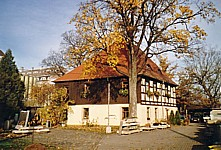Nr. 64 (Hegereiterhaus): Der schlichte Fachwerkbau am Ende der Friedrichstraße entstand als Wohn- und Dienstsitz des für das Ostragehege zuständigen Revierförsters, des sogenannten Hegereiters. Schon 1696 hatte August der Starke Teile der Fluren einzäunen und in ein Wildgehege umwandeln lassen. Das Gebäude dient heute als Wohnhaus und wurde vor einigen Jahren denkmalgerecht saniert. Bereits vor dem Zweiten Weltkrieg befand sich hier eine Bildhauerwerkstatt.

* * *

 \[ [Home](../../../../index.html)\] \[ [Nord](../../../../nord/)\] \[ [Nordwest](../../../../nordwest/)\] \[ [Neustadt](../../../../neustadt/)\] \[ [Nordost](../../../../nordost/)\] \[ [West](../../../../west/)\] \[ [Zentrum](../../../../zentrum/)\] \[ [Südwest](../../../../sudwest/)\] \[ [Süd](../../../../sud/)\] \[ [Südost](../../../../sudost/)\] \[ [Ost](../../../../ost/)\] \[ [Register](../../../../Register/register.html)\] \[ [Kontakt](../../../../Kontakt/kontakt.html)\] \[ [Impressum](../../../../impressum/)\]
