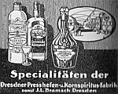
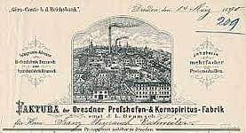
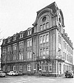
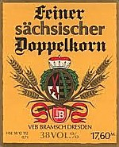
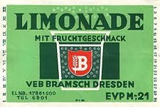

* * *

* * *

Die Geschichte des Unternehmens begann im Jahr 1820, als der
Unternehmer Heinrich Wilhelm Dursthoff das frühere Gräflich- Wallwitzsche Sommerpalais im [Menageriegarten](../../../../../zentrum/friedrichstadt/strassen_friedrichstadt/friedrichstrasse/) (Friedrichstraße 56)
erwarb und hier die erste sächsische Preßhefen- und Kornspiritusfabrik einrichtete. 1821 erhielt er die Genehmigung, nach einem streng geschützten Rezept Kunsthefe industriell herzustellen. Der wirtschaftliche
Erfolg erlaubte es ihm, bereits 1832 sein Unternehmen zu erweitern. Nach seinem Tod am 20. März 1837 übernahm Johann Ludwig
Bramsch (eigentl. Bramsche) das Werk und baute es zur führenden Spirituosenfabrik in Sachsen aus. Gemeinsam mit der
Witwe Dursthoffs, die Bramsch 1841 geheiratet hatte, leitete er den Betrieb bis 1870 selbst, wandelte ihn dann jedoch in
eine Aktiengesellschaft um. Unter dem Namen Dresdner Preßhefen- und Kornspiritusfabrik J. L. Bramsch produzierte
das Werk neben Rohstoffen wie künstlicher Hefe und Kornspiritus auch verschiedene Spirituosen und Liköre. 1856
kaufte Bramsch des frühere Löbtauer Stadtgut, um dort das Futter für seine Zugtiere zu erzeugen. Zehn Jahre zuvor hatte
er bereits auf der Wilsdruffer Straße eine Verkaufsstelle eingerichtet und 1848 ein Zweigwerk im böhmischen
Schönpriesen gegründet. 1860 entstand in Tepltz eine weitere Hefefabrik, geplante Filialen in England und der USA scheiterten hingegen

Um 1900 wurde das Betriebsgelände deutlich vergrößert. Dabei verschwanden die restlichen
noch erhaltenen Bauten der ehemaligen Menagerie. 1905 entstand an der Friedrichstraße ein großes Wohn- und Verwaltungsgebäude _(Foto)_, dem später verschiedene Produktionshallen
und Lagerräume folgten. Einbezogen wurde auch ein ursprünglich zum Pöppelmannschen Grundstück gehörendes Gartenhaus. Aus Anlass des 100. Betriebsjubiläums wurde im Juli
1920 im Hof ein Denkmal für den Firmengründer aufgestellt. Das aus einem ca. zwei Meter hohen Granitblock bestehende und mit einer Bronzeplakette versehene Denkmal fiel 1954
dem Bau des Speisesaales zum Opfer und wurde erst 2012 bei Bauarbeiten wieder entdeckt. Die Plakette befindet sich heute am Grabmal von Johann Ludwig Bramsch auf dem Inneren
Matthäusfriedhof. Eine Wiederaufstellung des Gedenksteins ist geplant.

1946 fiel die Fabrik unter die Enteigungsbestimmungen und wurde in einen volkseigenen Betrieb umgewandelt. Zu DDR-Zeiten gehörten auch der [“Briesnitzer Mineralbrunnen”](../../../../../west/cotta/strassen_cotta/meissner_landstrasse/) und die “Radeberger Likörfabrik” zum VEB Bramsch
Dresden. In den 1970er und 80er Jahren wurden jährlich ca. 5 Millionen Flaschen Spirituosen hergestellt. 1992 endete
die Produktion an der Friedrichstraße. Die maroden Gebäude wurden im Sommer 2005 fast vollständig abgerissen. An
ihrer Stelle sollen in den nächsten Jahren Wohnhäuser entstehen. Erhalten blieben das frühere Kontorhaus des Betriebes,
welches nach seiner Sanierung 2008 heute Wohnzwecken dient. In Erinnerung an das Unternehmen erhielt eine 2012
angelegte Erschließungsstraße den Namen Am Bramschkontor. Künftig soll hier eine kleine Neubausiedlung mit 49 Einfamilien- und Reihenhäusern entstehen.

_Etiketten des VEB Bramsch Dresden aus den 1980er Jahren_

* * *

 \[ [Home](../../../../../index.html)\] \[ [Nord](../../../../../nord/)\] \[ [Nordwest](../../../../../nordwest/)\] \[ [Neustadt](../../../../../neustadt/)\]
 \[ [Nordost](../../../../../nordost/)\] \[ [West](../../../../../west/)\] \[ [Zentrum](../../../../../zentrum/)\] \[ [Südwest](../../../../../sudwest/)\]
 \[ [Süd](../../../../../sud/)\] \[ [Südost](../../../../../sudost/)\] \[ [Ost](../../../../../ost/)\] \[ [Register](../../../../../Register/register.html)\] \[ [Kontakt](../../../../../Kontakt/kontakt.html)\] \[ [Impressum](../../../../../impressum/)\]
