* * *

Innerer katholischer friedhof  friedrichstr. 54 01067 dresden  tel. 0351/4 96 30 82

**Übersichtsplan:**

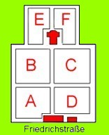

* * *

**Bedeutende**

**Grabstätten:**

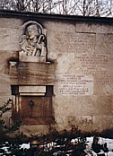

_Alte Priestergruft_

_(Priester der Hofkirche)_

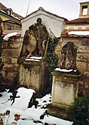

_Johannes R. Limpacher_

_(Bischof)_

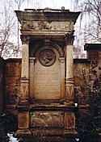

_Giovanni E. Torniamenti_

_(Besitzer des Café Reale)_

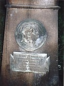

_Maciey Wodzinski_

_(polnischer Woiwode)_

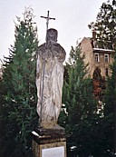

_Antonia von Grabowska_

_(polnische Emigrantin)_

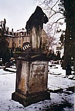

_Giovanni B. Casanova_

_(ehem. Direktor der Kunstakademie)_

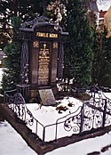

_Familiengrabstelle Mann_

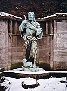

_Familiengrabstätte Henseler-Buntkirchen_

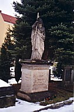

_Jadwiga This_

_(polnische Emigrantin)_

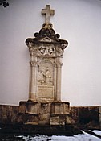

_Franz L. Mauermann_

_(Bischof)_

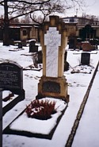

_Bartolomeo Bosco_

_(Zauberkünstler)_

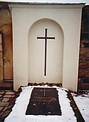

_Leonhard Fanto_

_(Bühnenbildner)_

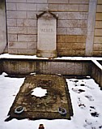

_Carl Maria von Weber_

_(Komponist)_

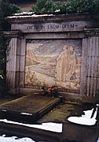

_Familiengrab Knauer_

Der Innere Katholische Friedhof, auch als Alter Katholischer Friedhof bezeichnet, wurde auf Grund eines Dekrets August des Starken vom 2. Oktober 1720 an der Friedrichstraße angelegt. Ursprünglich sollte er nur als Begräbnisplatz für die Angehörigen des Hofstaates der Gemahlin seines Sohnes, Maria Josepha von Österreich dienen, wurde jedoch 1723 für alle Katholiken des Hofes freigegeben. Die erste Beerdigung fand am 16. Februar 1724 statt. Ab 1738 durfte hier jeder Bürger katholischen Glaubens beerdigt werden. Deshalb machten sich bereits 1740 und 1742 Erweiterungen erforderlich.

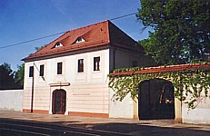Erst 20 Jahre nach der Einweihung des Friedhofs entstand um 1740 das Torhaus _(Foto links)_ an der Friedrichstraße 54, in dem sich auch die Wohnung des Totenbettmeisters befand. Der Bau einer Kirche oder Kapelle war in der Konzession des Kurfürsten zunächst ausdrücklich ausgeschlossen worden, um die protestantische Bevölkerungsmehrheit nicht zu provozieren. Erst nach Einbeziehung von Teilen des früheren Menageriegartens wurde eine kleine Kapelle errichtet, die am 7. September 1742 geweiht wurde. Ihr heutiges Aussehen erhielt sie bei einem Umbau 1914/17 _(Foto rechts unten)_. In der Apsis fand 1930 eine von Balthasar Permoser als eigenes Grabmal geschaffene Kreuzigungsgruppe Aufstellung. An der Außenfassade befinden sich weitere künstlerisch bedeutsame Grabplatten aus dem 19. Jahrhundert. Links und rechts des Haupteingangs erinnern Votivsteine an Angehörige des sächsischen Königshauses.

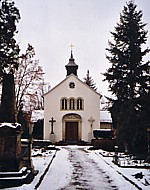
Wegen seiner zahlreichen künstlerisch bedeutsamen Grabplastiken sowie der Vielzahl hier beerdigter prominenter Persönlichkeiten stellt der Innere Katholische Friedhof heute ein
wertvolles historisches Denkmal dar. Neben Hofbeamten und katholischen Geistlichen fanden hier auch viele ausländische Katholiken, die mit Dresden in Verbindung standen, ihre
letzte Ruhestätte. Dazu gehören insbesondere italienische und französische Kaufleute sowie nach dem Aufstand von 1830/31 nach Sachsen emigrierte Polen. Hinzu kommen die Gräber
bedeutender Künstler wie Carl Maria von Weber und Gerhard von Kügelgen sowie des Bildhauers Franz Pettrich, der zahlreiche Grabsteine für den alten Katholischen Friedhof
schuf. Einige Grabstellen wurden in jüngster Zeit saniert. Hinzu kommen mehrere neu geschaffene Gedenksteine und -tafeln für verschwundene Gräber wie z.B. die der
Shakespeare-Übersetzerin Dorothea Tieck (1799-1841), des Bildhauers Lorenzo Matielli (1687-1748), der Komponisten Jan Dismas Zelenka und Francesco Maria Cattaneo (1698-1758) sowie des
Lautenisten der Hofkapelle Sylvius Leopold (1687-1750). Auch das in den 1930er Jahren eingeebnete Grab des Bildhauers Ernst Julius Hähnel soll künftig wieder hergestellt werden.

Bedeutende Grabstellen (Auswahl):

Aufgrund der Vielzahl von historisch interessanten Grabstellen kann hier nur eine Auswahl genannt werden. Die
Beschreibung erfolgt entsprechend den einzelnen Friedhofsbereichen, wobei die Felder A-D den älteren, die Felder E
und F den jüngeren Friedhofsteil bezeichnen (Übersichtsplan). Die mit (W) versehenen Gräber befinden sich an der Friedhofsmauer.

Feld A:
In diesem Bereich finden sich vor allem Gräber katholischer Geistlicher, die an der Hofkirche bzw. in der Friedrichstadt tätig waren. Eine Gemeinschaftsanlage an der westlichen Friedhofsmauer erinnert an einige von den
Nationalsozialisten ermordete bzw. beim Bombenangriff 1945 ums Leben gekommene Priester, unter ihnen der im KZ
Dachau verstorbene sorbische Kaplan der Hofkirche Alois Andritzki und der Jugendseelsorger Bernhard Wensch. Im
Zusammenhang mit der Seligsprechnung Andritzkis wurde dessen Urne am 5. Februar 2011 aus der Gruft entfernt und
in eine Seitenkapelle der Hofkirche überführt. Die Alte Priestergruft war in den 1920er Jahren als Grablege für
katholische Geistliche angelegt worden. Die Relieffigur des “guten Hirten” stammt vom Bildhauer Otto Zirnbauer.

**_Grabstätte_**

**_Todesjahr_**

Familiengrabstätte Elsner, eines der bemerkenswertesten Barockgräber des Friedhofes

um 1750

Ignatius Graf von Accoramboni, legte 1739 den Grundstein zur Katholischen Hofkirche (W)

1793

Johannes R. D. Limpacher, histor. bedeutsamer Grabstein, jetzt Grab des Kaplans Schlechter (W)

1798

Franz Herz, Jesuitenpater und Apostolischer Vikar (W)

1800

Ludwig de Sylvestre, Geistlicher, Grabmal von Franz Pettrich (W)

1816

Johannes Aloysius Schneider, Bischof, Apostol. Vikar und Kanonikus von Krakau und Posen (W)

1818

Denkstein mit Kruzifix  für Maria Kunigunde, Herzogin zu Sachsen, Tochter Friedrich August II. und Maria Josephas, Äbtissin zu Essen und Thorn

1826

Familiengrabstätte Longo, italienische Kaufleute

um 1750

Antonius Mende, Seelsorger der Prinzessin Kunigunde (W)

1839

Graf Franceschi del Campo, Pfarrer der Hofkirche, Stifter eines Altersheimes (W)

1844

Joseph Dittrich, Bischof von Corycus, Apostolischer Vikar im Königreich Sachsen (W)

1853

Josef Lorbacher, Gründerpräses der Kolpingsfamilie Dresden, Grabstein 1979 erneuert (W)

1863

Johannes Bellermann, Pfarrer zu Dresden-Friedrichstadt, Administrator des Krankenstifts (W)

1865

Ludwig Forwerk, Bischof von Leontopolis, Apostolischer Vikar und Domdechant zu Bautzen (W)

1875

Joseph Weis, Pater, Kaplan an der Katholischen Hofkirche (W)

1878

Hubert Ludwig Titlbach, Pfarrer und Administrator des kath. Krankenstifts der Friedrichstadt (W)

1880

Franz Bernert, Bischof von Azotus, Apostolischer Vikar im Königreich Sachsen, päpstlicher Hausprälat und Thronassistent, Dekan des Domstiftes zu Bautzen (W)

1890

Hermann Blumentritt, Direktor des katholischen Lehrerseminars zu Bautzen (W)

1900

Joseph Plewka, Prälat, königlicher Hofkaplan und Präses des Konsistoriums (W)

1911

Paul Richter, Pfarrer der St. Michaels-Kapelle zu Dresden-Friedrichstadt (W)

(Sarkophag vom Grab des Predigers Franz Kreitl (1775)

1922

Alexander Hartmann, Konsistorialpräses, Domdekan zu Bautzen, Apostolischer Pronotar (W)

1941

Priestergruft der Katholischen Hofkirche, u.a. mit den Gräbern der von den Nationalsozialisten ermordeten Priester Bernhard Wensch (1942), Aloys Scholze (1942) und Alois Andritzki (1943)

Josef Wagner, Organist der Hofkirche, Leiter des Kapellknabeninstitutes

1965

Georg Ahne, Prälat, Generalvikar des Bistums Dresden-Meißen (W)

1983

Familiengrabstätte von Oer, u.a. Alexander von Oer, Rektor des Polytechnikums

nach 1885

Feld B: Dieser Bereich schließt sich nördlich an Feld A an und liegt links vom Hauptweg vor der Friedhofskapelle.
Bemerkenswerteste Grabstelle ist der Sarkophag des Bildhauers Balthasar Permoser. Eine von ihm 1730/31 als eigenes Grabmal geschaffene Kreuzigungsgruppe befindet sich aus Witterungsgründen heute in der Friedhofskapelle.
Ursprünglich stand sie im Freien, wurde 1888 mit Mitteln der Dresdner Kunstgenossenschaft restauriert und 1914 in
einen eigens errichteten Anbau der Kapelle umgesetzt. Weitere Grabdenkmale erinnern an polnische Emigranten, die im 19. Jahrhundert nach Dresden gekommen waren.

**_Grabstätte_**

**_Todesjahr_**

Balthasar Permoser, Bildhauer (Sarkophag), Kreuzigungsgruppe in der Kapelle

1732

Johann Anton Dreissig, Hoforganist, Stifter und Direktor der Dreissigschen Singakademie (W)

1815

Dominikus von Rawicz-Ciecierski, Marschall des polnischen Gouvernements Bialystok (W)

1828

C. W. Friedrich von Schlegel, Historiker, Philosoph und Dichter (W)

1829

Polnisches Kriegergrabmal (W)

um 1840

Kazimierz Walewski Graf von Colonna

1847

Maciey Wodzinski, Senator und Woiwode des Königreiches Polen, Reliefbild von E. Rietschel

1848

Franz Joseph von Hann, Königlich-Sächsischer Rittmeister

1849

Josefa von Puchalska, polnische Emigrantin, Reliefbild von Ernst Rietschel

1849

Mieczyslaw Chodkiewicz, polnischer Eimigrant

1851

Adam von Bojanowicz, Oberst beim Stab des Generalquartieramtes des polnischen Heeres

1852

Franziska Sontag, Schauspielerin und Sängerin (W)

1865

Anton Pusinelli, Arzt, Freund Richard Wagners, Obelisk mit Bildmedaillon

1878

Joseph Tichatscheck, Kammersänger, Ehrenmitglied des Hoftheaters zu Dresden (W)

1886

Giovanni Ercole Torniamenti, Besitzer des “Café Reale” auf der Brühlschen Terrasse (W)

1890

Ferdinand Herschmann, österreichisch-ungarischer Konsul (W)

1923

Familiengrab Huberty, Wandgrab im Art-deco-Stil von Matthias Corr (W)

um 1925

Baron Georg O\`Byrn, Kgl.-Sächs. Generalmajor und Kabinettschef, Büste von Georg Wrba (W)

1942

Theo Bauer, Kammervirtuos und Vorsitzender des Tonkünstlervereins

1945

Rudolf Bockelmann, Wagner-Interpret (W)

1978

Willibrord Sprentzel, Prälat, Leiter des Wiederaufbaus der Hofkirche (W)

1978

Feld C: Hier befinden sich die Gräber einiger bekannter Dresdner Künstler, darunter das Grab des Bildhauer Franz
Pettrich (1770-1844), der zahlreiche Grabmale des Inneren Katholischen Friedhofes schuf. Pettrich gilt als bedeutendster Bildhauer des Klassizismus in Sachsen und war Lehrer von Ernst Rietschel. Zu seinen Schöpfungen
gehören die Grabplastiken für den von ihm hoch verehrten Lehrer Giovanni Battista Casanova, ein Bruder des bekannten Abenteurers, und der Sarkophag für seine beiden früh verstorbenen Ehefrauen mit Darstellung einer
schlafenden Frauengestalt.

Interessant ist auch das Grab Gerhard von Kügelgens (1772-1820). Der an der Kunstakademie tätige Maler wurde am
27\. März 1820 auf dem Heimweg von seinem Loschwitzer Weinberg nach Dresden ermordet und am 30. März im Beisein hunderter Trauergäste feierlich beigesetzt. Die Feierlichkeiten wurden von Caspar David Friedrich in einem
Gemälde festgehalten. Das vermutlich auf einen Entwurf Friedrichs zurückgehende Grabmal musste nach 1945 durch eine originalgetreue Kopie ersetzt werden.

**_Grabstätte_**

**_Todesjahr_**

Giovanni Battista Casanova, Direktor der Kunstakademie, Skulptur von Franz Pettrich

1795

Gerhard von Kügelgen, Historienmaler und Professor an der Kunstakademie

1820

Franz Anton Schubert, Kapellmeister und Kirchenkompositeur (Grabstein erneuert)

1827

Franz Seraph Pettrich und Familie, Bildhauer und Schöpfer zahlreicher Grabdenkmale

1844

Carl Borromäus Alexander von Miltitz, Königlich-Sächsischer Geheimrat und Oberhofmeister

1845

Franz Anton Fincenz von Lorgie, Puppenspieler, Grabstein im Stil des Klassizismus (W)

1853

Joseph Herrmann, Bildhauer, Grabmal mit Bronzemedaillon von C. Schlüter (W)

1869

Carl August Miedke, gen. Krebs, Königl.-Sächs. Hofkapellmeister (W)

1880

Mary Krebs-Brennimg, Pianistin, Kammervirtuosin (W)

1900

Bruno Mann, Architekt, bedeutendstes Jugendstil-Grabmal des Friedhofs

1910

Laura Rappoldi, Pianistin, Professorin der Musik, Liszt-Schülerin, Grab mit Bildnismedaillon

1925

Carl Richard Mebert, Maler, Professor an der Kunstakademie

1925

Johann Czaplewski, Fabrikbesitzer, Reliefbild “Wanderer bei der Rast” (W)

1941

Prof. Dr. Hans Martenstein, Direktor der Hautklinik des Krankenhauses Friedrichstadt (W)

1945

Felder D und G: Unmittelbar rechts des Haupteinganges befinden sich die Gräberfelder D und G mit einigen
interessanten Wandgräbern hochrangiger Militärs sowie Angehöriger polnischer Emigranten.

**_Grabstätte_**

**_Todesjahr_**

Johann Christian Götze, königlicher Bibliothekar, Entdecker der Maya-Handschrift (W)

1749

Johann George Chevalier des Saxe, Generalfeldmarschall, Sohn August des Starken (W)

1774

Johann Graf Renard, wertvolles Barockgrabmal mit militärischen Insignien (W)

um 1770

Franz Seydelmann, Kapellmeister und Komponist

1806

Friederike Louise Marquise Piatti, geb. von Erdmannsdorf, sowie weiterer Mitglieder der Familie, Grabsteine aus der Werkstatt von Franz Pettrich (W)

1825

Waleria Maria Gräfin Bielinska, Sarkophag mit schlafendem Kind von Franz Pettrich (W)

1830

Kazimierz Brodzinski, polnischer Nationaldichter (W)

1835

Stanislaw von Skarbek-Woyczynski, polnischer Divisionsgeneral (W)

1837

Jadwiga This, polnische Emigrantin, Grabplastik einer Frau von Franz Pettrich

1842

Hyppolit von Wilson, Oberst der polnischen Armee

1853

Joanna Cieszkowska, Sarkophag mit Porträtmedaillon

1854

Roman Zmorski, polnischer Dichter (W)

1867

Gioacchino Vestri, Sänger der Königlichen Hofkapelle

1883

Maximilian von Dziembowski, Königl.-Sächs. Generalleutnant, Grabplastik von Franz Pettrich (W)

1901

Ernst Hottenroth, Bildhauer und Professor, Sarkophag mit Inschrifttafel

1908

Familiengrabstätte Henseler-Buntkirchen, Wandgrab mit Plastik des “Guten Hirten” (W)

um 1920

Johann Georg von Sachsen, Historiker, Bruder des letzten sächs. Königs (W)

1938

Feld E: Gräberfeld E befindet sich auf der linken Seite der Friedhofskapelle. Bekanntestes Grab ist der Stein des
Zauberkünstlers Bartolomeo Bosco, der seit den 60er Jahren von Freunden der Zauberkunst erneuert und gepflegt wurde. Eine Gedenktafel zeigt die Insignien seiner Kunst, Becher, Kugel und Zauberstab.

**_Grabstätte_**

**_Todesjahr_**

Felicitas von Lubomirska, geb. Gräfin von Mniszek, gotisches Wandgrab mit Frauenfigur (W)

1855

Anna von Laszkiewicz, geb. Fürstin von Radziwill (W)

1857

Bartolomeo Bosco, Zauberkünstler (Grabstein 1963 erneuert und mit Gedenktafel versehen)

1863

Clemens Habdank Kolaczkowsky, General der polnischen Armee

1873

Ermanegildo Antonio Donadini, Königl.-Sächs. Hofrat, Professor an der Kunstakademie (W) und Ermanegildo Carlo Donadini, Maler und Bildhauer

1936

1955

Anton Konrad, Kunstschlosser und Fälscher historischer Waffen

1938

Leonhard Fanto, Bühnenbildner, schuf die Ausstattung für den “Rosenkavalier” (W)

1940

Bernhard Kubasch, Inspektor des alten Katholischen Friedhofes

1946

Bruno Seener, Maler, Grabstein mit betender Engelsfigur

1952

Feld F: Dieses Feld schließt sich auf der linken Seite der Kapelle an das Gräberfeld E an. Hier liegt u.a. die wohl
bedeutendste Persönlichkeit des Alten Katholischen Friedhofes begraben, der Komponist Carl Maria von Weber (1786-1826). Außerdem finden sich einige künstlerisch interessante Grabstellen im Stil des Art deco.

Die
Grabstätte der Familie Weber wurde 1844 von Gottfried Semper entworfen. Initiatoren waren Dresdner Künstler,
unter ihnen Richard Wagner, die sich für die Überführung des 1826 in London verstorbenen und in der dortigen St.-Mary-Kapelle der Moorfieldskirche beigesetzten Komponisten Carl Maria von Weber eingesetzt hatten. Nach
Eintreffen des Sarges konnte dieser am 15. Dezember 1844 auf dem Friedhof beerdigt werden. Später fand hier auch
Sohn Max seine letzte Ruhestätte. Der heutige Grabstein ist eine Kopie, das Original befindet sich im Garten der [Webergedenkstätte](../../../../../nordost/hosterwitz/dresdner_strasse/webergedenkstatte/) in Hosterwitz. 2010 wurde zusätzlich eine Gedenktafel für Gottfried Semper angebracht.

2012 fand in unmittelbarer Nachbarschaft der letzte lebende Enkel des sächsischen Königs, Albert Prinz von Sachsen
(1934-2012) seine letzte Ruhestätte. Die Grabplatte aus Cottaer Sandstein trägt seine Titel und Lebensdaten und wurde am 16. Mai 2015 feierlich eingeweiht.

**_Grabstätte_**

**_Todesjahr_**

Martin von Zbroski, Churfürstlich-Sächsischer Cavallerie-Capitain

1792

Auguste Charlotte Gräfin von Kielmannsegge, Agentin und Geliebte Napoleons (W)

1863

Max Maria von Weber, Eisenbahningenieur, Biograph seines Vaters (W)

1881

Wilhelm Ferdinand Pauwels, Geheimer Hofrat und Maler, Professor an der Kunstakademie

1904

Familiengrabstätte Liebsch - Seibt - Beger, Jugendstilgrabstein mit Madonnenrelief

um 1910

Wenzel Poech, Königlich-Sächsischer Bergrat, spätklassizistischer Grabstein

1918

Familiengrab Nägele, Wandgrab im Art-deco-Stil mit weiblicher allegorischer Figur (W)

um 1925

Familiengrab Knauer, Wandgrab mit Mosaikbild “Zum Licht wanderndes Paar” im Art-deco-Stil

um 1925

Familiengrab Hofmann - Wagner, Wandgrab mit Pflanzenornamenten

um 1925

Familiengrab Knauer, u.a. Heinrich Knauer, Pauker der Staatskapelle; Bruno Knauer, Musiker

1947/1977

Kurt Striegler, Kapellmeister und Komponist, Grabmal mit weiblicher Figur (um 1900)

1958

Theodor Blumer, Kapellmeister, Komponist und Musikpädagoge (W)

1964

Albert von Sachsen (Enkel des letzten sächsischen Königs)

2012

* * *

 \[ [Nord](../../../../../nord/)\] \[ [Nordwest](../../../../../nordwest/)\] \[ [Neustadt](../../../../../neustadt/)\] \[ [Nordost](../../../../../nordost/)\] \[ [West](../../../../../west/)\] \[ [Zentrum](../../../../../zentrum/)\] \[ [Südwest](../../../../../sudwest/)\]
 \[ [Süd](../../../../../sud/)\] \[ [Südost](../../../../../sudost/)\] \[ [Ost](../../../../../ost/)\] \[ [Register](../../../../../Register/register.html)\]
 \[ [Kontakt](../../../../../Kontakt/kontakt.html)\] \[ [Impressum](../../../../../impressum/)\]
