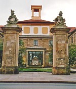
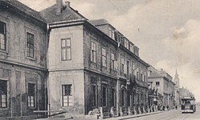
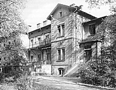
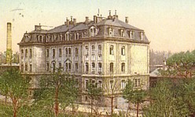
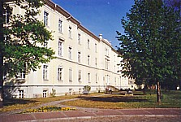
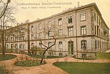
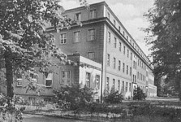
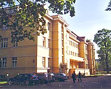
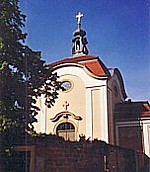
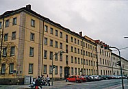

* * *

* * *

Nachdem die Krankenfürsorge in Dresden jahrhundertelang überwiegend in der Hand
kirchlich-karitativer Einrichtungen lag, machten sich im 19. Jahrhundert dringend Reformen notwendig. Zu diesem Zeitpunkt stand der Stadt lediglich das bereits 1568 errichtete
frühere “Pestilenzhaus” an der Grünen Straße zur Verfügung. Dieses bot nach einer Erweiterung im 18. Jahrhundert Platz für ca. 140 Kranke und Pflegebedürftige, genügte
jedoch längst nicht mehr den hygienischen Anforderungen der wachsenden Großstadt. Nach mehrjähriger Suche und mit Hilfe einer großzügigen Spende des Stifters August von
Hühnerbein entschied man sich schließlich für einen Umzug des Hospitals in das ehemalige [Marcolinipalais](../../../../../../zentrum/friedrichstadt/strassen_friedrichstadt/friedrichstrasse/marcolinipalais/) an der Friedrichstraße.

**_Foto:_** _Haupteingang zum Friedrichstädter Krankenhaus_

Nach dem erfolgreichen Abschluss der Verkaufsverhandlungen mit dem Besitzer des Areals, dem Dresdner Stadtrat
Carl Ernst Werner, konnte 1847 mit dem Umbau begonnen werden. 1849 richtete die Stadt Dresden in einigen Räumen des Marcolinipalais ein Lazarett für Verwundete des Dresdner Maiaufstandes ein. Am 27. November 1849
konnte das neue Stadtkrankenhaus offiziell eingeweiht werden. Zunächst gab es hier nur zwei Abteilungen, die von
Hofarzt Dr. Hermann Walther (Innere Abteilung) und Prof. Dr. Eduard Zeis (Chirurgie) geleitet wurden. Für diese standen anfangs 52 Krankenzimmer mit 260 Betten zur Verfügung. Außerdem fanden pathologische Untersuchungen
zur Aufklärung von Todesursachen statt. Zur seelsorgerischen Betreuung der Patienten wurde eine Krankenhauskapelle im ehemaligen Festsaal eingerichtet.

Unter Einbeziehung weiterer Gebäude, u.a. des ehemaligen Manteuffelschen
Brauhauses wurde das Friedrichstädter Krankenhaus mehrfach erweitert. 1865/67 entstand auf dem Gelände die organisatorisch zunächst getrennte königliche Frauenklinik. 1870 folgte das “Mutterhaus”, ergänzt um drei
baulich mit ihm verbundene Pavillons. Hinzu kamen verschiedene Wirtschaftsgebäude und andere für den Krankenhausbetrieb notwendige Einrichtungen, die das historische Bild der Gartenanlage stark
beeinträchtigten. Zu den bedeutenden Medizinern, die am Friedrichstädter Krankenhaus tätig waren, gehören Albert Zenker (entdeckte 1860 den
Erreger der Trichinenkrankheit), Maximilian Nitze (entwickelte 1877 den Blasenspiegel) und der Pathologe Schmorl, der 1897 das erste Röntgengerät in Dresden anschaffen ließ.

Bereits um 1900 erwies sich die Klinik trotz mehrfacher Erweiterung und ihren insgesamt 1.085 Betten als zu klein,
weshalb man sich mit dem Gedanken einer Verlagerung des Krankenhauses befasste. Bedingt durch den Ersten Weltkrieg und die folgende schwierige finanzielle Lage kam dieser jedoch nicht zustande. Stattdessen wurden in den
Zwanziger Jahren weitere Ergänzungsbauten errichtet, u.a. eine Hals-Nasen-Ohren-Klinik und ein Neubau für die Chirurgie. Nach 1933 folgten zudem umfassende Modernisierungen der vorhandenen Gebäude.

Die Kriegszerstörungen des Jahres 1945 überstand das Friedrichstädter Krankenhaus ohne größere Schäden.. Nach
Verstaatlichung des Gesundheitswesens wurde hier am 15. August 1947 die zweite Poliklinik Sachsens eingeweiht. Im gleichen Jahr richtete man im Haus R die neue Augenklinik ein. Nachdem die Wahl zur Einrichtung einer
Medizinischen Akademie auf das Johannstädter Krankenhaus gefallen war, wurde das Krankenhaus Friedrichstadt 1957 zum Bezirkskrankenhaus erklärt und entsprechend ausgestattet. In diesem Zusammenhang entstand 1961 ein
Schwesternwohnheim in einem Neubau am Hohenthalplatz. Am 27. November 1989 kamen im Friedrichstädtzer Krankenhaus erstmals in der DDR 25 freiwillige Zivildienstleistende zum Einsatz, eine Umsetzung eines vor allem von
kirchlichen Kreisen geforderten Pilotprojekts als Alternative zum Wehrdienst. Nach 1990 konnten verschiedene Gebäude rekonstruiert und mit moderner Technik ausgestattet werden.

Einzelne Gebäude (ab 1849):

Haus A: Das Hauptgebäude des Krankenhauses befindet sich im ehemaligen Marcolinipalais und seinen Anbauten. In den früheren
Wohnungen entstanden ab 1847 53 Krankenzimmer, 10 Wärterzimmer, die Krankenhausapotheke sowie Wirtschafts- und Verwaltungsräume. Der bestehende Festsaal diente bis 1939 als Krankenhauskapelle. Im Zuge des
Umbaus wurde dem Ehrenhof ein zweigeschossiger Anbau vorgesetzt, um die Zimmer durch Flure zu erschließen. Ursprünglich bezeichnete man das Gebäude als “Altes Haus”, bevor sich der heute übliche Name Haus A durchsetzte.

Mehrfach erfolgten Umbauten, so 1884, als das ehemalige Manteuffelsche Brauhaus angegliedert und zum Beamtenwohnhaus umgestaltet wurde. 1930 öffnete man den Ehrenhof zur Friedrichstraße. Das beim Bombenangriff
1945 unbeschädigt gebliebene Gebäude beherbergte ab 15. August 1947 die erste Dresdner Poliklinik, welche bis
1990 ihre Patienten in acht Fachabteilungen ambulant betreute. Der frühere Festsaal dient heute als Konzertsaal für
gelegentliche Veranstaltungen. In den Räumen der ehemaligen Apotheke im Westflügel befindet sich seit 2011 die Bibliothek, welche derzeit ca. 15.000 Bände umfasst.

Haus B:
Das moderne Gebäude entstand 2002 und beherbergt die Klinik für Psychiatrie und Psychotherapie.

Haus C:
Auch dieses Haus gehört zu den Neubauten der Nachwendezeit und wird als interdisziplinäres Operationszentrum der Klinik genutzt. Die Grundsteinlegung erfolgte am 8. Dezember 2004, die Übergabe am 30.
Mai 2007. Der moderne Neubau besitzt insgesamt sieben Etagen, davon zwei unter der Erde, und beherbergt mehrere Operationssäle. Im Erdgeschoss sind die Notaufnahme und eine Cafeteria untergebracht. Auf dem Dach des
25 Meter hohen Hauses befindet sich ein Landeplatz für Rettungshubschrauber.

Haus G: Der moderne Neubau wurde 1998 als Klinik für Strahlentherapie errichtet. Nach schweren Schäden beim
Hochwasser 2002 musstedie Klinik 2003 vollständig erneuert werden.

Haus H: Ursprünglich befanden sich an diesem Standort westlich des “Mutterhauses” (Haus N) vier pavillonartige
Gebäude, welche als Bettenhäuser genutzt wurden und durch Wandelgänge miteinander verbunden waren. Von den
geplanten sechs Gebäuden  wurden bis 1876 vier realisiert. In den Pavillons gab es jeweils einen Schlafsaal mit 30
Betten sowie einfache Personal-, Küchen- und Sanitärräume. Drei dieser Pavillonbauten fielen 1945 den Bomben zum
Opfer und wurden in der Nachkriegszeit durch Baracken ersetzt, der vierte diente nach 1945 bis 1957 als urologische
Station genutzt. Das heutige Haus H entstand 1996 für die  internistische Intensivstation und Klinik für Gefäßchirurgie.
Nach Fertigstellung des neuen Hauses C zog hier die HNO-Klinik ein, außerdem gibt es mehrere Operationssäle.

Isolierhäuser (Häuser I und K): Die beiden Gebäude _(Foto)_ wurden 1885/86 zur Unterbringung von Personen mit ansteckenden Krankheiten erbaut. Ursprünglich
handelte es sich dabei nur um einstöckige Bauten, welche jedoch schon 1901 um jeweils ein weiteres Stockwerk erhöht werden mussten. Grund war der zunehmende
Platzmangel im Krankenhaus. 1891 und 1899 entstanden in der Nachbarschaft zudem vier Wellblechbaracken, um alle Patienten unterbringen zu können.

Beim Luftangriff am 13./14. Februar wurden beide Gebäude von Bomben getroffen und brannten aus. Die Ruine des Hauses I beseitigten Klinikangehörige 1949. Auf
dem erhaltenen Sockelgeschoss entstand im Anschluss eine Baracke, welche zunächst die Apotheke, Büroräume und die Patientenbücherei aufnahm. 1956 erfolgte ein Wiederaufbau zum Schwesternwohnheim. 1984 wurde das Haus
erneut umgebaut und dabei mit dem benachbarten Haus L verbunden.

Im Zuge der Angliederung der Wachwitzer [Helios-Klinik](../../../../../../nordost/wachwitz/strassen_wachwitz/weidners_sanatorium/) gab es 2009 umfassende Sanierungsarbeiten an diesem
Gebäude. Heute hat hier die Fachabteilung für Internistische Onkologie ihr Domizil und nutzt die Räume für die Behandlung von Krebspatienten.

Fachklinik-Zentrum (Haus K):
Das moderne Klinikzentrum wurde 2010/11 an Stelle eines abgerissenen Vorgängergebäudes erichtet. Dieses diente bis zur Zerstörung 1945 als Isolierstation für Infektionskranke. Nach dem
Wiederaufbau 1949 zogen die Stationen 43 (Typhuskranke) und 44 ein. 2009 erfolgte der Abbruch des Hauses K. Am 8. Februar 2010 wurde der Grundstein für einen Nachfolgebau gelegt. Die Projektierung übernahm das Leipziger
Büro TMK Architekten und Ingenieure. Seit Eröffnung am 5. September 2011 hat hier die Pflegestation der Augenklinik, die HNO-Klinik und die Dermatologische und Allergologische Abteilung ihren Sitz. Verbunden ist das
Gebäude mit dem benachbarten Haus H, in welchem sich die Operationssäle befinden.

Hautklinik (Haus L):
Das 1848 erbaute Gebäude an der Bräuergasse 1 diente ursprünglich als Schulhaus für die [III. Bezirksschule](../../../../../../zentrum/friedrichstadt/). Nach deren Verlegung zur Wachsbleichstraße (1881) und zur Fröbelstraße (1888)  gliederte man den
Bau an das Friedrichstädter Krankenhaus an und nutzte ihn für die II. Äußere Abteilung als Klinik für Haut- und Geschlechtskrankheiten.
Die Einrichtung war die fünfte Hautklinik im damaligen Deutschen Reich nach München, Würzburg, der Charité in Berlin und Straßburg. 1918 richtete man zusätzlich eine städtische Beratungsstelle für
Geschlechtskranke an. In den Dreißiger Jahren bezog die Hautklinik neue Räumlichkeiten im Klinikgelände, woraufhin
im Haus L 1937 das Ärztekasino und 1938 eine Schwesternschule einzogen. Zwischen 1950 und 1958 diente das Gebäude als Krankenpflegeschule für angehende Schwestern und Pfleger. Seit Verlegung dieser Schule zur [Bodelschwinghstraße](../../../../../../zentrum/friedrichstadt/strassen_friedrichstadt/) ist hier wieder die Hautklinik untergebracht. Eine umfassende Sanierung erfolgte zwischen 1988 und 1991.

Neue Frauenklinik (Haus M):
Der stilistisch an die vorhandene Bebauung des 18. Jahrhunderts angeglichene Dreiflügelbau entstand 1893 an der Menageriestraße als Erweiterungsbau für die I. Äußere Abteilung und wird
seit seiner Fertigstellung als Frauen- und Geburtsklinik genutzt. Anfangs standen hier 106 Betten zur Verfügung. Die Geburtsstation mit Entbindungs-, Wöchnerinnen- und Säuglingszimmer war im Dachgeschoss
untergebracht. 1898 richtete die Stadtverwaltung außerdem eine spezielle Abteilung für Frauenkrankheiten ein.

Zwischen 1926 und 1929 erfolgte der Anbau zweier Seitenflügel, welche sich stilistisch an der vorhandenen Bausubstanz orientierten und zusätzliche Betten- und Entbindungskapazitäten schufen. Ein weiterer Anbau kam
1935/37 hinzu. Das beim Luftangriff durch Brandbomben getroffene Gebäude konnte Dank des Einsatzes des Klinikpersonals gerettet werden. Unter Leitung des 1947 berufenen Chefarztes Robert Ganse erfolgte in den 1950er
Jahren eine Neugestaltung des Außengeländes, wobei Teile der Menagerie- und der Wachsbleichstraße sowie der Hohenthalplatz für den Straßenverkehr gesperrt und in eine kleine Parkanlage umgestaltet wurden.

Mutterhaus (Haus N): Das sogenannte “Mutterhaus”, auch als “Neues Haus” bezeichnet, wurde 1870-74 im ehemaligen Garten des Marcolinipalais errichtet.
Architekt war Stadtbaudirektor Theodor Friedrich. Durch den Bau des architektonisch an das Palais angeglichenen Gebäudes verschwand die frühere Blickbeziehung zwischen Marcolinipalais und Neptunbrunnen. In Inneren
befanden sich zwei Treppenhäuser für Frauen und Männer sowie die Krankenzimmer mit insgesamt 124 Betten.

Unmittelbar mit dem Hauptgebäude waren vier pavillonartige Nebenbauten
verbunden, die zwischen 1866 und 1878 entstanden und jeweils einen Krankensaal mit 30 Betten nebst Sanitäranlagen aufnahmen. Diese Lösung galt seinerzeit als fortschrittlich im Krankenhausbau und findet sich in
abgewandelter Form auch beim Neustädter Krankenhaus an der Industriestraße in Trachau. An Stelle der 1945 zerstörten Pavillons steht heute die neue HNO-Klinik (Haus H). Das 1882 und 1926 durch Anbauten erweiterte
“Mutterhaus” wird heute von der Chirurgischen Abteilung genutzt.

Ehemalige Frauenklinik (Haus P): Das Gebäude entstand 1867/69 im südöstlichen Teil des Parks nach Plänen von Carl Moritz Haenel als Königliche
Frauenklinik und Landesentbindungsschule. Am 17. Oktober 1869 wurde die unabhängig vom Stadtkrankenhaus bestehende Einrichtung eröffnet. 1887 erfolgte die Umbenennung in Königliche Frauenklinik. Ein Ergänzungsgebäude
wurde 1893 an der Menageriestraße gebaut. Nach Verlegung der Frauenklinik in die Johannstadt 1901 wurde der an der Dinterstraße gelegene klassizistische
Dreiflügelbau auch organisatorisch in das Stadtkrankenhaus eingegliedert und von der II. Inneren Abteilung genutzt. Neben den Krankenzimmern mit 272
Betten befanden sich hier auch Wirtschafts- und Wohnräume für Ärzte und Pfleger.

Haus Q:
Als Haus Q wird der 1963 errichtete Neubau zwischen Hohenthalplatz und Matthäusfriedhof bezeichnet. Der achtstöckige Plattenbau entstand auf dem Grundstück des 1945 zerstörten Pfarrhauses der Matthäuskirchgemeinde
und war erster Neubau auf dem Klinikgelände nach 1945. Zunächst befanden sich hier Wohnungen für Schwestern des Krankenhauses. Später wurde das Gebäude für Verwaltungszwecke genutzt.

Augenklinik (Haus R): Das Gebäude wurde 1922/23 als Hals-Nasen-Ohren-Klinik errichtet, wobei die Planungen dem Städtischen Hochbauamt oblagen. Das Äußere ist in schlichten Formen gestaltet und nimmt
ebenfalls Elemente des Marcolinipalais auf. Nach Fertigstellung standen hier 93 Betten zur Verfügung. In einem 1945 zerstörten Anbau befand sich eine zahnmedizinische Abteilung.

In der Nachkriegszeit diente das Gebäude vorübergehend als Wohnheim für Krankenschwestern, bevor es am 26. April 1947 als Augenklinik eingeweiht
werden konnte. Erster Leiter war der Dresdner Augenarzt Dr. Geis, der während der NS-Zeit zahlreichen Juden geholfen hatte und deshalb 1969 von Israel postum als “Gerechter unter den Völkern” ausgezeichnet wurde. 1950
richtete man im Haus R zusätzlich eine internistische Bettenstation der Poliklinik Friedrichstadt mit 10 Betten ein. Da
das Haus nach 1990 nicht mehr den modernen Anforderungen des Klinikbetriebs entsprach, begann 2012 der Umbau zum Herz-Kreislauf-Zentrum.

Haus S:
Der zwischen 1926 und 1928 entstandene dreigeschossige Erweiterungsbau der Chirurgischen Abteilung, heute als Haus S bezeichnet, durchbricht als einziges
Vorkriegsgebäude die Traditionen der Barockzeit. Das Haus wurde vom Städtischen Hochbauamt entworfen und zeigt Anklänge an Bauten des Expressionismus und der
neuen Sachlichkeit. Im mittleren Teil des Gebäudes findet sich im Erdgeschoss eine vorgelagerte Terrasse, im 1. Obergeschoss ein  durchgehender Balkon. Mit Haus S
erhielt die Klinik zwei neue Stationen, einen zusätzlichen OP-Saal sowie mehrere Krankensäle.

Pathologie und Kapelle (Haus U): Die aus mehreren verbundenen Einzelbauten bestehende Gebäudegruppe entstand  um 1895 und schließt das Krankenhausgelände zur
Friedrichstraße und zum Matthäusfriedhof ab. In Anlehnung an die vorhandenen Gebäude wurde auch das Institut für Pathologische Anatomie im neobarocken Stil gestaltet. Im
Mittelbau befindet sich ein Hör- und Sektionssaal für angehende Mediziner, im südlich anschließenden Gebäudeteil die ehemalige Krankenhauskapelle mit verglaster Kuppel und Zwiebeltürmchen _(Foto)_
. Im Inneren der Kapelle sind verschiedene Reliefs mit Symbolen der vier Evangelisten zu sehen. Wegen der wachsenden Anzahl an Obduktionen teilte man
den Sektionssaal später durch eine Zwischendecke in zwei Etagen, wodurch Platz für weitere Tische und die medizinische Sammlung entstand.

Seit 2010 stehen die zuletzt als Lagerraum genutzte Kapelle und einige Nebenräume als “Haus der Stille” für Andachten und Seelsorge zur Verfügung. In diesem Zusammenhang erhielt die Krankenhauskapelle einen neuen
Zugang von der Gartenseite. Durch eine Wandelgang, welcher für gelegentliche Ausstellungen genutzt wird, betritt man
den zentralen Raum mit einer umlaufenden Sitzbank aus Holz. Bemerkenswert ist die künstlerisch gestaltete Rahmenkonstruktion des Oberlichtes. In den Anbauten befinden sich die Seelsorgeräume der katholischen und der
evangelischen Krankenhausseelsorge. Für die Umgestaltung der Kapelle erhielt das ausführende Architektenbüro Matthias Horst 2012 den Erlweinpreis der Stadt Dresden verliehen.

Haus Z:
Das Gebäude an der Dinterstraße wurde 1987 als Typenbau mit Elementen der DDR-Wohnungsbauserie WBS 70 errichtet und diente nach seiner Fertigstellung als Station 15 der I. Medizinischen Klinik. Seit 1994 hat hier
die gesamte I. Medizinische Klinik ihr Domizil

Küchengebäude: Der zur Versorgung des Krankenhauses erforderliche Küchentrakt entstand 1876, wurde jedoch
mehrfach modernisiert und erweitert. Das heutige Erscheinungsbild stammt vom letzten größeren Umbau 1925/26. In diesem Zusammenhang wurde auch das benachbarte zweigeschossige Wirtschaftsgebäude gebaut.

Ärztehaus:
Das viergeschossige Gebäude entstand 1884 auf dem Grundstück des früheren [Manteuffelschen Brauhauses](../../../../../../zentrum/friedrichstadt/strassen_friedrichstadt/) als Beamtenwohnhaus für leitende Angestellte
des Krankenhauses (Friedrichstraße 39). 1945 brannte es aus und wurde 1953 nach Plänen von Werner Poppe wiederhergestellt. Beim Ausbau der Ruine wurden die
Fassaden in Anlehnung an das benachbarte Marcolinipalais farblich neu gestaltet. Heute befindet sich hier die III. Medizinische Klinik sowie das Zentrum für Reisemedizin.

Krankenhausapotheke:
Ursprünglich befand sich die zum Krankenhaus gehörende Apotheke im Westflügel des Marcolinipalais. 1949 wurde sie in eine auf den Fundamenten des kriegszerstörten Isolierhauses I errichtete Baracke
verlegt und wwei Jahre später zur Vollapotheke erhoben. Damit war sie erste Poliklinikapotheke in Dresden. 1956 erfolgte ein erneuter Umzug in ein früher als Röntgenstation genutztes Gebäude auf der Bräuergasse 6. Im
Zusammenhang mit einer umfassenden Rekonstruktion des Hauses entstand in den Räumen das Wandbild “Lebenstanz” des Künstlers Siegfried Schade.

* * *

 \[ [Home](../../../../../../index.html)\] \[ [Nord](../../../../../../nord/)\] \[ [Nordwest](../../../../../../nordwest/)\] \[ [Neustadt](../../../../../../neustadt/)\]
 \[ [Nordost](../../../../../../nordost/)\] \[ [West](../../../../../../west/)\] \[ [Zentrum](../../../../../../zentrum/)\] \[ [Südwest](../../../../../../sudwest/)\]
 \[ [Süd](../../../../../../sud/)\] \[ [Südost](../../../../../../sudost/)\] \[ [Ost](../../../../../../ost/)\] \[ [Register](../../../../../../Register/register.html)\] \[ [Kontakt](../../../../../../Kontakt/kontakt.html)\] \[ [Impressum](../../../../../../impressum/)\]
