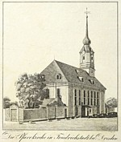
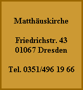
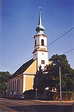
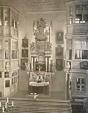
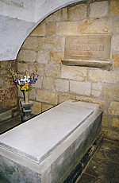

* * *

Mit zunehmender Besiedlung der Friedrichstadt wuchs bei der hier ansässigen Bevölkerung der Wunsch nach einem eigenen Gotteshaus. 1722 richtete man deshalb ein Gesuch an den sächsischen Landtag, um eine Kirche mit Pfarrhaus sowie eine eigene Schule errichten zu dürfen. Nach Bewilligung des Antrags und der Durchführung einer Landeskollekte wurden das Kammergut Ostra und die angrenzende Vorstadt Neustadt-Ostra 1725 aus ihren bisherigen Kirchgemeinden (Briesnitz bzw. Annenkirche) herausgelöst. Am 28. Mai 1728 erfolgte schließlich durch den Dresdner Superintendenten Valentin Ernst Löscher die Grundsteinlegung für die Matthäuskirche. Bereits 1725 hatte es an dieser Stelle einen kleinen Friedhof gegeben, der heute als Alter bzw. Innerer [Matthäusfriedhof](../../../../../zentrum/friedrichstadt/strassen_friedrichstadt/friedrichstrasse/matthauskirche/matthausfriedhof/) bezeichnet wird. Hier liegen einige bedeutende Persönlichkeiten begraben, darunter der Erbauer der ersten deutschen Dampflokomotive Johann Andreas Schubert.

Die Pläne für den Kirchenneubau, der am 11. Juni 1730 geweiht wurde, stammen vom Zwingerbaumeister Matthäus Daniel Pöppelmann. In der Familiengruft dieser Kirche fand er am 20. Januar 1736 auch seine letzte Ruhestätte. Wahrscheinlich waren auch Johann Georg Gebhardt und George Bähr am Bau beteiligt. Die Zimmerarbeiten übernahm Abraham Krümmer, die Steinmetzarbeiten Johann Heinrich Petersill. 1737 erhielt die Kirche die Orgel der Schlosskapelle, 1768 den ursprünglich aus der alten Frauenkirche stammenden Altar der Annenkirche. Das ursprüngliche Altargemälde schuf Pöppelmanns Sohn Johann Adolph Pöppelmann.

1882 erfolgten Renovierungsarbeiten im Innenraum durch Christian Friedrich Arnold, die die barocke Raumfassung spürbar veränderten _(Foto)_. 1887 erwarb die Gemeinde eine Figur des Bildhauers Martin Engelke, 1890 ein neues Altarbild "Christus am Kreuz" von Karl Gottlob Schönherr. Seit 1883 trägt die Friedrichstädter Pfarrkirche nach dem Evangelisten Matthäus offiziell den Namen Matthäuskirche. Ein weiterer Umbau erfolgte 1928 durch Walter Raum. Dabei wurden die Fenster der Ostseite vermauert, die Kanzel und die beiden von Permoser geschaffenen Altarfiguren versetzt und ein Teil des Innenraumes für Wirtschaftszwecke abgeteilt. Der verbliebene Kirchenraum erhielt dabei seine schlichte barocke Gestaltung zurück.

Beim Luftangriff auf Dresden wurde auch die Matthäuskirche schwer beschädigt und brannte
aus. Der wertvolle Altar wurde dabei zerstört. Trotz Bemühungen der Kirchgemeinde konnten in der Nachkriegszeit lediglich Sicherungsarbeiten vorgenommen werden. 1956
erfolgte eine Renovierung der Pöppelmann-Gruft, ab 1965 weitere Arbeiten an der Ruine. 1974 konnte mit dem Wiederaufbau unter Leitung von Christian Möller begonnen werden,
der 1978 vollendet war. Während das Äußere heute wieder weitgehend dem ursprünglichen Aussehen von 1730 entspricht, ist der beim Umbau deutlich verkleinerte Innenraum modern
gestaltet. Ein Altartisch aus Metall, ein metallenes Kreuz mit rotem Glasstein sowie eine Kupferstele stammen von Werner Juza. Durch den Einbau von Zwischenwänden und
 -decken entstandene neue Räume dienen der Verwaltung und als Archiv. Eine kleine Treppe führt vom Kirchenraum in die Gruft mit dem steinernen Sarkophag des Baumeisters Matthäus Daniel Pöppelmann _(Foto)._
Heute gehört die Matthäuskirche als Filiale zur Annenkirchgemeinde.

* * *

 \[ [Home](../../../../../index.html)\] \[ [Nord](../../../../../nord/)\] \[ [Nordwest](../../../../../nordwest/)\] \[ [Neustadt](../../../../../neustadt/)\]
 \[ [Nordost](../../../../../nordost/)\] \[ [West](../../../../../west/)\] \[ [Zentrum](../../../../../zentrum/)\] \[ [Südwest](../../../../../sudwest/)\]
 \[ [Süd](../../../../../sud/)\] \[ [Südost](../../../../../sudost/)\] \[ [Ost](../../../../../ost/)\] \[ [Register](../../../../../Register/register.html)\] \[ [Kontakt](../../../../../Kontakt/kontakt.html)\] \[ [Impressum](../../../../../impressum/)\]
