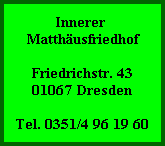
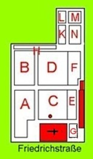
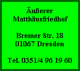
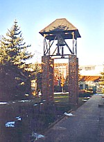
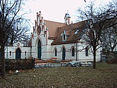
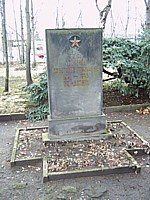

* * *

* * *

* * *

**Übersichtsplan**

**Innerer Matthäusfriedhof:**

* * *

* * *

Innerer Matthäusfriedhof:

Der Innere Matthäusfriedhof wurde 1725 noch vor dem Bau der Matthäuskirche als
evangelischer Friedhof der damals noch Neustadt-Ostra genannten späteren Friedrichstadt angelegt. Grund war die Herauslösung der Vorstadt aus ihrer bisherigen Zugehörigkeit zur
Briesnitzer bzw. zur Annenkirchgemeinde und der geplante Bau eines eigenen Gotteshauses. Entsprechend der sozialen Struktur des Viertels entstanden auf der nur 1,14 Hektar großen
Anlage fast ausschließlich schlichte Gräber. An der westlichen Umfassungsmauer sind noch Reste einer früheren Schwibbogengruft erhalten. Da auf dem gleichen Grundstück 1730 die
Matthäuskirche errichtet wurde, verzichtete die Gemeinde auf eine Friedhofskapelle. Hinter der Kirche befindet sich ein hölzerner freistehender Glockenturm _(Foto)_.

Zu den hier beigesetzten Persönlichkeiten gehören neben einigen Friedrichstädter Unternehmerfamilien der Ingenieur Johann Andreas Schubert, Konstrukteur der ersten
deutschen Dampflokomotive und Erbauer der Göltzschtalbrücke, sowie der Schöpfer des “Fürstenzuges” Wilhelm
Walther. Einige Grabdenkmale aus dem 18. und 19. Jahrhundert stehen unter Schutz. Da der Innere Matthäusfriedhof um
1875 nicht mehr ausreichte, entstand an der Bremer Straße der heute nicht mehr genutzte Äußere Matthäusfriedhof.

_Bedeutende Grabstätten:_

**_Grabstätte_**

**_Todesjahr_**

**_Standort\*_**

Johann Gottlieb Felgenhauer, Gründer der Real- und Armenschule Friedrichstadt

1787

Familiengrabstätte Schmid - Hohlfeld - Manitius, Grabplastik von F. A. Ullrich

1804

D 16.2-3

Carl Samuel Wilhelm Heinze, Seilermeister, Gerichtsschöppe der Friedrichstadt

1836

B 3./4.2J

Heinrich Wilhelm Dursthoff, Gründer der Preßhefe- und Kornspiritusfabrik Bramsch

1837

August Sigismund Manitius, Direktor des Freimaurerinstitutes

(Grabskulptur von Andreas Ullrich)

1852

Johann Andreas Schubert, Ingenieur, Professor an der TH

1870

W 62

Karl Wilhelm Clauss, Gründer der Technischen Lehranstalten, Erfinder des “hitzefrei” an den sächsischen Schulen

1894

B 6.1-3

J. K. Ernst Wauer, Pfarrer der Matthäuskirche

1901

W 63

Wilhelm Walther, Professor an der Kunstakademie, Schöpfer des Fürstenzuges

1913

C 6.8

Fritz Reinhold & Anna Kiefer, Kaufmann; Grabkreuz von Friedrich Press

1932/1956

N 1.3

Carl Ludwig Großmann, Museumsdirektor

1946

D 10.5-6

Familiengrabstätte Bramsch, Unternehmer (Spirituosenfabrik Bramsch)

Familiengrabstätte König, Sandsteinplastik “Trauernde” von H. Pohlmann

1891/93

W 54

Familiengrabstätte Schlechter, Lebkuchenhersteller

1890-1966

W 55

Familiengrabstätte Reissig - Hofmann - Paul, klassizist. Säulengrab Anfang 19. Jh.

1761-1915

C 5.5.

\\* Die Buchstaben kennzeichnen die entsprechenden Gräberfelder des Friedhofs. Gräber mit der Kennzeichnung “W” sind Wandgräber.

    Die erwähnten Wandgrabstellen befinden sich sämtlich an der östlichen Friedhofsmauer (Grenze zum Krankenhausgelände)

* * *

Äußerer Matthäusfriedhof:

Nach Einrichtung des Friedrichstädter Krankenhauses im Marcolinipalais umd dem weiteren Ausbau der Vorstadt erwies sich der alte Matthäusfriedhof als zu klein.
Deshalb wurde an einem in westlicher Richtung führenden Weg (heute Bremer Straße) 1851 der Äußere Matthäusfriedhof angelegt. Das benötigte Grundstück war zuvor aus
dem Ostravorwerk herausgelöst worden. 1861 entstand nach Plänen von Carl Adolf Canzler eine im neugotischen Stil gestaltete Parentationshalle mit Kapelle _(Foto)_. Drei
Jahre später machte sich eine erste, 1880 eine zweite Erweiterung des Friedhofes erforderlich. 1905 folgte schließlich ein zweigeschossiges Beamtenwohnhaus  und
Verwaltungsgebäude mit Friedhofsgärtnerei an der Bremer Straße. Gleichzeitig wurde der Friedhof mit einer massiven Mauer abgeschlossen.

Neben einigen künstlerisch bemerkenswerten Wandgräbern befinden sich auch mehrere Gemeinschaftsgräber bzw. -denkmale auf dem Äußeren Matthäusfriedhof. Diese erinnern an
während der Zweiten Weltkriegs ums Leben gekommene sowjetische Kriegsgefangene _(Foto)_ sowie an deutsche Kriegsopfer des Ersten und Zweiten Weltkriegs. Ein Granitstein
kennzeichnet das Grab des 1933 im KZ Hohnstein ermordeten Widerstandskämpfers Emerich Ambros. Eine weitere Grabstelle birgt die sterblichen Überreste der Opfer des ersten
Luftangriffs auf Dresden vom 7. Oktober 1944. Diese wurden vier Tage später unter Ausschluss der Öffentlichkeit im Beisein von Gauleiter Mutschmann in einem
Gemeinschaftsgrab beigesetzt. Seit den 1970er Jahren wurde der Äußere Matthäusfriedhof kaum noch genutzt, so dass weite Teile heute nicht mehr mit Grabstätten belegt sind. Die letzte
Beisetzung erfolgte 1983. Seit einigen Jahren bemühen sich verschiedene Vereine um den Erhalt wichtiger historischer Grabstellen und die Umgestaltung in eine öffentliche Parkanlage.

* * *

 \[ [Nord](../../../../../../nord/)\] \[ [Nordwest](../../../../../../nordwest/)\] \[ [Neustadt](../../../../../../neustadt/)\] \[ [Nordost](../../../../../../nordost/)\] \[ [West](../../../../../../west/)\] \[ [Zentrum](../../../../../../zentrum/)\] \[ [Südwest](../../../../../../sudwest/)\]
 \[ [Süd](../../../../../../sud/)\] \[ [Südost](../../../../../../sudost/)\] \[ [Ost](../../../../../../ost/)\] \[ [Register](../../../../../../Register/register.html)\]
 \[ [Kontakt](../../../../../../Kontakt/kontakt.html)\] \[ [Impressum](../../../../../../impressum/)\]
