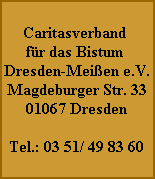
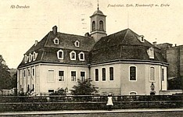
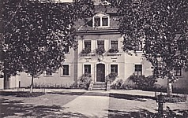
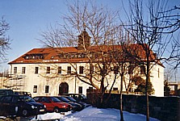

* * *

* * *

* * *

* * *

* * *

* * *

Die kleine Kapelle St. Michael geht auf ein 1747 von Kurfürstin Maria Josepha gestiftetes katholisches Krankenstift in der Friedrichstadt zurück. Nach einer kurfürstlichen Resolution vom 8. Juli 1726 war katholischen Patienten sowie Priestern der Besuch protestantischer Krankenhäuser nicht mehr erlaubt, was die Schaffung einer solchen konfessionsgebundenen Einrichtung erforderlich machte. Vermutlich wurden bereits kurz darauf die ersten Patienten in einem vom königlichen Heiducken Christian Braune errichteten Gebäude versorgt. Letztlich strebte man jedoch eine offizielle katholisch geführte Krankeneinrichtung an. Zu diesem Zweck erwarb 1747 der sächsische Kurfürst das frühere [Esseniussche Haus](../../../../../zentrum/friedrichstadt/strassen_friedrichstadt/friedrichstrasse/) aus dem Besitz des Grafen Brühl und ließ es an seinen Beichtvater, den Jesuitenpater Ludwig Liegeritz übergeben.

Das als “Königliches Krankenhaus” bezeichnete Stift bot pflegebedürftigen Männern und Frauen Unterkunft und wurde
1748 um eine Kapelle ergänzt. Bereits am Dreikönigstag des Folgejahres konnte diese dem Patronat des Erzengels Michael geweiht werden. Die Nebenräume der Kapelle beherbergten die Krankenzimmer, die allerdings nicht nur
Katholiken, sondern auch andersgläubigen Patienten offenstanden. Das Vorderhaus nahm die Verwaltung des Krankenstiftes, zeitweise auch eine katholische Schule, auf. 1823 wurde die Stiftskapelle von Bischof Mauermann zur
katholischen Pfarrkirche der Friedrichstadt erhoben. Diese war nach der Hofkirche zweite katholische Pfarrei in Dresden.

Zwischen 1848 und 1856 wirkte Joseph Lorbacher (1796-1863) als Pfarrer an dieser Kirche. Lorbacher engagierte sich
auf wohltätigem Gebiet und gründete gemeinsam mit Adolph Kolping 1854 den Dresdner Gesellenverein. Aus diesem
ging später das Kolpingwerk hervor. Auch als Initiator eines Waisenhauses, welches 1849 auf der Weißeritzstraße
eröffnet wurde, erwarb er sich Verdienste. Lorbachers Grab befindet sich auf dem Alten Katholischen Friedhof.

Durch großzügige Spenden konnte das Krankenstift mehrfach erweitert werden. Zeitweise gehörte auch das ehemalige Wohnhaus Johann Andreas Schuberts [(Friedrichstraße 46)](../../../../../zentrum/friedrichstadt/strassen_friedrichstadt/friedrichstrasse/) dazu. 1842 wurde ein Seitenflügel angebaut, der bevorzugt
zur Behandlung erkrankter Hofangestellter gedacht war. Die Betreuung der Kranken oblag ab 1860 den Ordensfrauen der “Grauen Schwestern” von der Kongregation der Heiligen Elisabeth. 1886/87 erfolgten nochmals umfassende
Modernisierungsarbeiten, u.a. der Einbau von Operationsräumen, einer neuen Küche und eines Badezimmers.

Auch nach der Abdankung der Wettiner 1918 blieb das Königliche Krankenhaus
als Familienstiftung bestehen und diente bis zur Zerstörung im Zweiten Weltkrieg seinem Zweck. 1945 fielen Stift und Kapelle dem Luftangriff zum Opfer und brannten aus. Während die Mauern des Esseniusschen Hauses in der
Nachkriegszeit bis auf einen geringen Rest abgetragen wurden, blieb die Kirche als Ruine erhalten. Für die Gottesdienste nutzte man fortan die Kapelle des Alten Katholischen Friedhofs.

Per 1. Mai 1983 wurde die stark geschrumpfte Friedrichstädter Gemeinde der Pfarrei der Hofkirche angeschlossen. 1991/92 erfolgte im Auftrag des Bistums Dresden-Meißen ein Wiederaufbau des
hinteren Stiftsgebäudes, der sich äußerlich am historischen Stil des Vorgängerbaus orientiert _(Fotos)_. Seit 1992 wird das
frühere Krankenstift vom Caritas-Verband des Bistums Dresden-Meißen als Geschäftsstelle und Altersheim genutzt. Im Inneren befindet sich heute eine der heiligen Hedwig geweihte Kapelle.

* * *

 \[ [Home](../../../../../index.html)\] \[ [Nord](../../../../../nord/)\] \[ [Nordwest](../../../../../nordwest/)\] \[ [Neustadt](../../../../../neustadt/)\]
 \[ [Nordost](../../../../../nordost/)\] \[ [West](../../../../../west/)\] \[ [Zentrum](../../../../../zentrum/)\] \[ [Südwest](../../../../../sudwest/)\]
 \[ [Süd](../../../../../sud/)\] \[ [Südost](../../../../../sudost/)\] \[ [Ost](../../../../../ost/)\] \[ [Register](../../../../../Register/register.html)\] \[ [Kontakt](../../../../../Kontakt/kontakt.html)\] \[ [Impressum](../../../../../impressum/)\]
