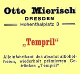
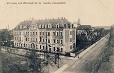
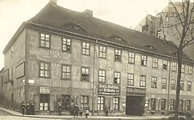
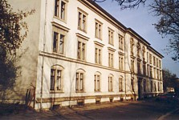
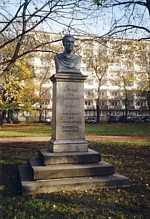

Der Hohenthalplatz wurde 1729 als Marktplatz der Friedrichstadt angelegt. Die ursprünglichen Planungen, von August dem Starken initiiert und von Ingenieur-Hauptmann Erndl umgesetzt, sahen diesen Platz als Zentrum des Stadtteils sowie Standort eines Rathauses vor. Bedingt durch den Einspruch des Dresdner Rates konnte die Friedrichstadt jedoch weder Stadt- noch Marktrechte erlangen, so dass auch der Marktplatz unvollendet blieb. Lediglich Vieh- und Roßmärkte fanden hier bis 1870 statt. Hinzu kamen gelegentliche öffentliche Veranstaltungen wie die Einweihung der ersten Real- und Armenschule. Nachdem der Platz seine Funktion als Markt endgültig verloren hatte, richtete man im Jahr 1872 auf dem Gelände eine Baumschule ein. Hier wurden vorrangig Gehölze für neu anzulegende Parkanlagen und Grünflächen der wachsenden Stadt gezogen. Fünf Jahre später zog diese aus Platzgründen in die Seevorstadt um.

1877 erhielt der Friedrichstädter Markt offiziell den Namen Hohenthalplatz. Namenspate war der sächsische Konferenzminister Karl Wilhelm Graf von Hohenthal-Königsbrück, der sich Verdienste um die Sozialfürsorge in Dresden erwarb. Hohenthal stiftete 1774 eine Armenschule und gründete fünf Jahre später in der Friedrichstadt ein Amtskrankenhaus, aus dem 1849 das Hohenthalhaus hervorging _(Foto)_.

1888 wurde der Hohenthalplatz umgestaltet und erhielt in diesem Zusammenhang öffentliche Grünflächen sowie einen Kinderspielplatz. An der Nordseite errichtete die Gemeinde der Matthäuskirche 1892/93 ihr 1945 zerstörtes Gemeindehaus _(Foto)_. 1915 fand hier auch ein Denkmal für König Anton seinen Platz. Da die Namensgebung nach einem adligen Stifter in der Nachkriegszeit als unpassend angesehen wurde, beschloss der Rat der Stadt 1946 die Umbenennung in Christian-Beham-Platz. Christian Beham (1906-1945) war ab 1928 als KPD-Funktionär in der Friedrichstadt tätig, wurde während der NS-Zeit mehrfach verhaftet und 1945 im KZ “Dora” bei Nordhausen ermordet. 1993 erhielt der Hohenthalplatz seinen früheren Namen zurück. Das architektonische Bild prägen heute das erhaltene Hauptgebäude des früheren Hohenthalstiftes sowie ein 1963 Jahren errichtetes Wohnheim. Neue Wohngebäude aus den 1990er Jahren ersetzen an der Südseite die zerstörte Vorkriegsbebauung. Die Grünanlagen wurden in den letzten Jahren in Anlehnung an das historische Vorbild neu gestaltet.

Einzelne Gebäude:

Nr. 1-4: Die Wohnhäuser zwischen Menagerie- und Vorwerkstraße entstanden Ende des 19. Jahrhunderts und bildeten bis 1945 die südliche Begrenzung des Hohenthalplatzes. Im Eckhaus zur Menageriestraße (Nr. 1) gab es das Restaurant "Zur Schmiede", während sich in der Nr. 3 eine kleine Getränkefabrik angesiedelt hatte. Besitzer war Otto Mierisch, der 1901 gemeinsam mit dem aus Ludwigslust in Mecklenburg stammenden Dr. Otto Eberhard ein Verfahren zur Herstellung eines Milchextrakts zum Patent angemeldet hatte. Mierisch besaß zudem ein Patent auf ein Verfahren zur Herstellung alkoholfreier gegorener Getränke unter Verwendung eines speziellen Pilzes. Unter dem Namen "Tempril" wurde dieses als alkoholfreies Getränk verkauft. Zugleich war er Teilhaber der Deutschen Röhrenreinigungs-Gesellschaft, die die Vermarktung eines ebenfalls von ihm entwickelten Gerätes zur Rohrreinigung mit Hilfe von Druckluft bzw. Wasserdampf übernahm. 1945 fielen die Häuser dem Luftangriff zum Opfer und wurden Mitte der 1990er Jahre durch Neubauten ersetzt.

Nr. 5: In diesem Haus gründete 1874 der königlich-sächsische Hofschmiedemeister Dietrich Conrad Kelle gemeinsam mit seinem Geschäftspartner Adolf Hermann Hildebrandt eine Eisengießerei _(Foto)_, die sich später auf den Bau von Brücken und Stahlkonstruktionen spezialisierte. Platzgründe führten Ende des 19. Jahrhunderts zur Aufgabe des Standortes und der Verlagerung der Firma nach Großzschachwitz, wo der Betrieb unter dem Namen Kelle & Hildebrandt Weltruf erlangte. Heute produziert die Firma als "Sächsischer Brücken- und Stahlhochbau" vor allem Bühnentechnik und ähnliche Stahlkonstruktionen.

Hohenthalhaus (Nr. 7): Das frühere Amtskrankenhaus, auch als “Versorghaus” bezeichnet, wurde 1779 von Karl Wilhelm Graf von Hohenthal-Königsbrück gestiftet und bot pflegebedürftigen Frauen und Männern Unterkunft und Betreuung. In dem bescheidenen Gebäude befanden sich neben den Wohn- und Schlafräumen auch eine Hausmannsstube, ein Waschhaus sowie ein Wannenbad. Zur Versorgung der Patienten mit frischer Milch gab es außerdem einen Kuhstall.

Nach der Umwandlung des benachbarten Marcolinipalais zum Städtischen Krankenhaus wurde das Stift unter dem Namen Hohenthalhaus ab 1849 als Altersheim für betagte Frauen genutzt. 1855 entstand das noch heute vorhandene Hauptgebäude. Die übrigen Bauten mussten um 1890 einem Neubau weichen. 1928 wurde das Hohenthalstift mit dem benachbarten Duckwitzstift auf der Friedrichstraße zusammengelegt und in das neue [Güntzheim](../../../../nordwest/trachau/guntzheim/) in Dresden-Trachau verlegt. Heute befinden sich in dem Gebäude Verwaltungsräume.

Antonsdenkmal: Das Denkmal wurde 1835 aus Anlass der Eingemeindung der Friedrichstadt nach Dresden in den Grünanlagen am Weißeritzufer in der Nähe des heutigen Bahnhofes Mitte aufgestellt. Schöpfer der Bronzeplastik war Ernst Rietschel, gegossen wurde sie im Dölzschener [Eisenhammerwerk](../../../../sud/plauen/plauenscher_grund/eisenhammerwerk/). Mit der nach antiken klassischen Vorbildern gestalteten Büste sollte an den seinerzeit regierenden sächsischen König Anton (1755-1836) erinnert werden, der sich für den Anschluss der Friedrichstadt an Dresden eingesetzt hatte.

Nach Verlegung der Weißeritz und der Verfüllung des ehemaligen Flußbettes ließ man das Antonsdenkmal 1915 zum Hohenthalplatz versetzen, wo es alle Wirren der Zeit überstand. 1999/2000 erfolgte eine umfassende Sanierung. Die Inschrift am Sockel lautet: _“Anton dem Guetigen von den Bewohnern der Friedrichstadt d. XXVII Dec. MDCCCXXXV”_.

* * *

 \[ [Home](../../../../index.html)\] \[ [Nord](../../../../nord/)\] \[ [Nordwest](../../../../nordwest/)\] \[ [Neustadt](../../../../neustadt/)\] \[ [Nordost](../../../../nordost/)\] \[ [West](../../../../west/)\] \[ [Zentrum](../../../../zentrum/)\] \[ [Südwest](../../../../sudwest/)\] \[ [Süd](../../../../sud/)\] \[ [Südost](../../../../sudost/)\] \[ [Ost](../../../../ost/)\] \[ [Register](../../../../Register/register.html)\] \[ [Kontakt](../../../../Kontakt/kontakt.html)\] \[ [Impressum](../../../../impressum/)\]
