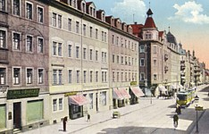
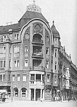
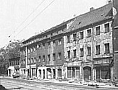
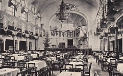
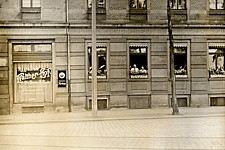

Die Schäferstraße entstand im letzten Viertel des 17. Jahrhunderts und wurde zunächst Meißner Straße genannt, bevor sie im 18. Jahrhundert ihren heutigen Namen erhielt. Bereits 1614 war hier der Fronhof zur Unterbringung der auf dem Ostravorwerk beschäftigten Arbeitskräfte eingerichtet worden. Gleichzeitig befanden sich dort die Ställe für die benötigten Zugtiere sowie eine Schäferei. Dieser Name setzte sich später für den gesamten Gebäudekomplex durch. Zuletzt dienten die Gebäude als Hoffuttermagazin. 1903 wurde der an der Einmündung Schäferstraße / Löbtauer Straße gelegene alte Fronhof abgerissen, um Platz für neue Wohnhäuser zu machen. Außerdem entstand 1907 auf dem Grundstück das von Hans Erlwein entworfene [Stadthaus Friedrichstadt](../../../../sudwest/lobtau/strassen_lobtau/lobtauer_strasse/).

Neben der Schäferei existierten an der Schäferstraße noch weitere gewerbliche Unternehmungen. 1692 ließ Kurfürst Johann Georg IV. eine Salpeterhütte errichten, der um 1770 die Brauerei “Bayrisches Brauhaus” folgte. Am westlichen Ende befanden sich bis 1875 die militärischen [Pulvermagazine](../../../../neustadt/albertstadt/strassen_albertstadt/), die dann dem Eisenbahnbau weichen mussten und an den
Rand des Prießnitzgrundes in der Albertstadt verlegt wurden. Aus dem im 19. Jahrhundert entstandenen Gasthof “Zum
Elephanten” entwickelte sich der zu den größten Ballsälen des Dresdner Westens gehörende “Kristallpalast”. 1945 fiel das Haus neben zahlreichen weiteren Gebäuden den Bomben zum Opfer.

Obwohl die Straße bereits 1730 ausgebaut und gepflastert worden war, blieb sie doch zunächst von relativ geringer
Verkehrsbedeutung, da eine durchgängige Verbindung zur Innenstadt fehlte. Lediglich ein schmaler Steg führte seit 1827
über die Weißeritz, der 1856 durch eine steinerne Brücke ersetzt wurde. Diese endete an der Stiftsstraße und wurde
deshalb bis zu ihrem Abbruch 1893 Stiftsbrücke genannt. Mit dem Durchbruch der Wettiner Straße entstand 1873-75 eine später auch von der Straßenbahn genutzte durchgehende Verbindung zum Postplatz. Heute gehört die
Schäferstraße zu den wichtigsten westlichen Ausfallstraßen Dresdens.

Von der ursprünglich dichten Bebauung sind heute nur noch wenige Reste erhalten geblieben. Vor allen an der Südseite
wurden zahlreiche Gebäude bei den Luftangriffen im Februar und April 1945 zerstört. Weitere Häuser, darunter auch einige kulturhistorisch wertvolle aus dem 18. Jahrhundert,
riss man nach jahrzehntelanger Vernachlässigung in den 1970er und 80er Jahren ab, um Platz für eine geplante Neubebauung zu machen. Allerdings wurde diese lediglich in
Form mehrgeschossiger Plattenbauten an der Südseite realisiert, während die nördliche Seite bis heute unbebaut blieb. Auch ein geplantes Hochhaus an der Ecke Löbtauer Straße kam nicht zustande.

Einzelne Gebäude:

Adler-Apotheke: Das repräsentative Geschäftshaus Nr. 1 entstand kurz nach Abbruch der alten
Schäferei an der Ecke Schäfer- / Löbtauer Straße. Die repräsentative Fassade wies Jugendstilformen auf und bildete den Auftakt für die Bebauung der Südseite. Im Erdgeschoss
befand sich die nach der gegenüberliegenden Adlergasse benannte Adler-Apotheke. 1945 wurde das Haus durch Bomben zerstört. Die noch nutzbaren Erdgeschossräume dienten später
noch als Eisdiele und Friseursalon, bevor die Ruine 1965 beseitigt wurde.

“Zum schwarzen Adler”: Das Gasthaus entstand Ende des 18. Jahrhunderts auf dem Eckgrundstück zur 1725
angelegten Neuen Gasse. 1840 wurde diese Gasse deshalb in Adlergasse umbenannt. Im Garten des Lokals wohnte in
einem einfachen Holzhäuschen viele Jahre der als Dresdner Original bekannt gewordene Geiger Franz Timmler. Als
Musiker trat er regelmäßig mit selbstgeschriebenen Liedern in Friedrichstädter Gastwirtschaften auf und wurde nach
dem von ihm eingeforderten Lohn “Mei Sechser” genannt. 1831 verstarb er an Cholera. Das Gasthaus fiel später der Neubebauung der Schäferstraße mit Wohn- und Geschäftshäusern zum Opfer.

Nr. 2-8: Die Ende des 19. Jahrhunderts entstandenen Wohn- und Geschäftshäuser überstanden den Zweiten Weltkrieg
ohne größere Schäden, verfielen dann jedoch. Hier befanden sich bis Mitte der 80er Jahre einige bekannte Geschäfte
wie die Drogerie Schreiter, Kinderwagen-Vogel sowie “Höhles Bierstuben” (Nr. 4 - ehemals Speisehaus des Vereins
“Volkswohl”). 1910 bezog das Lehrerbildungsseminar einen größeren Gebäudekomplex am Weberplatz in Strehlen, der
heute von der Technischen Universität - Fakultät Erziehungswissenschaften genutzt wird. Am 24. Mai 1989 wurden die
leerstehenden Gebäude gesprengt, um Platz für eine geplante Bebauung mit WBS-70-Plattenbauten zu schaffen. Die Sprengungen waren Auftakt zum letzten größeren Flächenabriss in Dresden.

Nr. 10-14:  Diese Gebäudegruppe _(Foto)_ stammte aus dem 18. Jahrhundert und stellte bis zu ihrem Abriss 1989 ein interessantes Zeugnis der vorstädtischen Bebauung der Friedrichstadt dar. Einige Gebäude wiesen auf der Hofseite Laubengänge und Galerien auf. Im Mietshaus Nr. 10 (ganz rechts) verstarb am 12. August 1865 der als Dresdner Original bekannt gewordene “Bildermann der Vogelwiese” Karl Gottfried Rehhahn, der sich viele Jahre als Trödelhändler, Uhrmacher und Verkäufer selbst entworfener Bilderbögen seinen Lebensunterhalt verdiente.

Brauerei Bayrisch Brauhaus (Nr. 20):Die 1872 als Aktiengesellschaft gegründete Brauerei geht auf das bereits Mitte des 18. Jahrhunderts entstandene Offenhauersche Brauhaus zurück, welches sich später im Besitz der Witwe Kurfürst Friedrich Christians, Maria Antonia von Bayern, befand. Das dreigeschossige Gebäude war ursprünglich mit den Wappen Sachsens, Polens und Bayerns versehen und gehörte zu den größeren Gebäuden der Vorstadt. Im 19. Jahrhundert kam die Brauerei in Privatbesitz von C. G. Brabandt. Zum Unternehmen gehörte auch die Gastwirtschaft "Zum Brabandter Hof", die bis zur Zerstörung 1945 existierte.

Der neu gebildeten Aktiengesellschaft war jedoch kein wirtschaftlicher Erfolg beschieden. Trotz Kapitalerhöhung musste 1878 ein Konkursverfahren eingeleitet werden. Nach Einigung mit den Gläubigern setzte man den Braubetrieb fort, stellte jedoch ab 1879 nur noch untergäriges Bier her. Fortan verließen bis zu 23.000 Hektoliter Bier pro Jahr das Brauhaus. Nach dem Einstieg mehrerer Großaktionäre erwarb die Bayrisch Brauhaus AG 1895 das in Konkurs gegangene "Bürgerliche Brauhaus Plauen" und verlegte im Januar 1899 den Firmensitz nach Plauen. Am 26. September 1899 wurde die AG für aufgelöst erklärt und bis 1903 liquidiert. Die Räumlichkeiten auf der Schäferstraße nutzten später u.a. eine Möbelhandlung und eine Kistenfabrik.

Nr. 24: Das heute nicht mehr vorhandene Mietshaus in der Nähe der Behringstraße beherbergte im Erdgeschoss seit 1921 die Gaststätte A.Z., benannt nach ihrem ersten Besitzer Arno Zöllner. Nach 1945 hieß das Lokal bis zur Schließung Hilberts Gaststätte. Danach nutzte die Volkssolidarität die ehemaligen Gasträume noch mehrere Jahre als Begegnungsstätte, bevor das Haus geräumt und im Zuge der Flächenabrisse an der Schäferstraße Ende der 1980er Jahre abgetragen wurde.

Nr. 42 (ehem. 59):  Hier, im Eckhaus zur Menageriestraße wurde am 8. Februar 1876 Paula (Modersohn-) Becker als Tochter eines Eisenbahnbeamten geboren. Bekannt wurde sie als Malerin und Mitglied der Künstlergruppe um Otto Modersohn in Worpswede. Die Familie verzog kurz nach ihrer Geburt nach der [Friedrichstraße](../../../../zentrum/friedrichstadt/strassen_friedrichstadt/friedrichstrasse/) 46 und zog 1888 nach Bremen. Das Wohnhaus wurde in den 1950er Jahren abgerissen und nach 1990 durch einen Neubau ersetzt. Hier erinnert seit wenigen Jahren eine Gedenktafel an die Künstlerin.

Kristallpalast (Nr. 45):
Der Kristallpalast gehörte vor dem Zweiten Weltkrieg zu den beliebtesten Tanz- und Vergnügungslokalen der Friedrichstadt. Ursprünglich wurde das Gebäude mit dem größten Dresdner Ballsaal als
Gasthof  “Zum Elephanten” errichtet. Seinen Namen erhielt das Lokal nach einem über dem Eingang angebrachten Hauszeichen. 1810 kam hier der Landschaftsmaler Robert Kummer, Enkel des Wirtes, zur Welt.

Um 1860 befand sich im Haus das private Theater der Witwe Magnus. Amalie Auguste Magnus, Tochter eines sächsischen Marionettenspielers,
gründete im ersten Drittel des 19. Jahrhunderts eine Wanderbühne, mit der sie u.a. regelmäßig auf der Vogelwiese
auftrat. Zu ihren berühmtesten Gästen gehörte der Schriftsteller Friedrich Gerstäcker, der auch ein Theaterstück für die
Bühne schrieb (“Kunibert von Eulenhorst”). 1945 fiel das Gebäude dem Luftangriff zum Opfer. Der Varietébetrieb wurde noch einige Jahre in den Kellerräumen der Gaststätte “Lyra” fortgesetzt.

Nr. 69-73: Die zwischen 1885 und 1895 errichteten Mietshäuser überstanden als einige der wenigen Bauten der Südseite die Zerstörungen des Zweiten Weltkrieges. Nach 1989 konnten die Gebäude saniert werden. Auf dem
Nachbargrundstück Nr. 67 öffnete bereits 1981 eine Konsum-Kaufhalle zur Versorgung des Wohngebietes.

Nr. 75/77:
Die Wohnhausgruppe Schäferstraße 75/77 wurde 1910 gemeinsam mit dem Wohnblock Vorwerkstraße 30 und dem Doppelhaus Schäferstraße 81/83 nach einem einheitlichen Konzept für die Eisenbahnerbaugenossenschaft
errichtet. Die Fassaden weisen Ornamente des Jugendstils und des Art-deco auf.

Nr. 101: Das viergeschossige Eckhaus an der Kreuzung Waltherstraße entstand
1899 und schließt die Bebauung der Friedrichstadt nach Westen ab. Ein ursprünglich vorhandener Eckturm wurde 1945 zerstört. Im Erdgeschoss betrieb der Gastwirt Ernst Rudolf Fischer bis zum Kriegsende die Gastwirtschaft
“Walther-Hof” _(Foto)_. Heute befindet sich hier die Wohngebietsgaststätte “Schwarzes Schaf”.

* * *

 \[ [Home](../../../../index.html)\] \[ [Nord](../../../../nord/)\] \[ [Nordwest](../../../../nordwest/)\] \[ [Neustadt](../../../../neustadt/)\] \[ [Nordost](../../../../nordost/)\] \[ [West](../../../../west/)\] \[ [Zentrum](../../../../zentrum/)\] \[ [Südwest](../../../../sudwest/)\] \[ [Süd](../../../../sud/)\] \[ [Südost](../../../../sudost/)\] \[ [Ost](../../../../ost/)\] \[ [Register](../../../../Register/register.html)\] \[ [Kontakt](../../../../Kontakt/kontakt.html)\] \[ [Impressum](../../../../impressum/)\]
