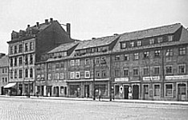
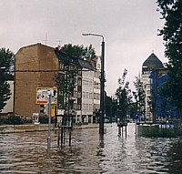
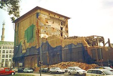
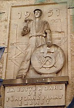
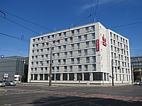
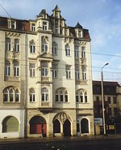

Die Weißeritzstraße wurde Ende des 17. Jahrhunderts am Ufer der Weißeritz
angelegt und trug ursprünglich den Namen An der Wasserseite. Später bezeichnete man sie zeitweise auch als Wasserstraße bzw. An der Weißeritz, bevor sich
schließlich der Name Weißeritzstraße durchsetzte. Wegen des Flussbettes konnte sie zunächst nur an der Westseite _(Foto vor 1945)_ bebaut werden. Die östliche
Straßenseite zum Flussufer zu gestaltete man zwischen 1742 und 1747 als Grünanlage mit Alleebäumen, Rabatten und steinernen Schmuckvasen. Hier fand ab 1835 auch das 1915 zum [Hohenthalplatz](../../../../zentrum/friedrichstadt/strassen_friedrichstadt/hohenthalplatz/) umgesetzte Denkmal König Antons Aufstellung.

Ursprünglich befand sich die Mündung der Weißeritz in der Nähe der heutigen Marienbrücke. Im Zuge der Umgestaltung
der Dresdner Bahnanlagen, dem Bau des Alberthafens und des Rangierbahnhofes erfolgte zwischen 1891-93 die Verlegung
der Weißeritzmündung nach Cotta. Dabei wurde zwischen Löbtau und Cotta ein neues Flussbett geschaffen und eine
Uferstraße angelegt (heute Emerich-Ambros-Ufer).  Das alte Bett entlang der Weißeritzstraße verfüllte man daraufhin. In
diesem Zusammenhang verschwanden auch die beiden Brücken an der Schäfer- und der Friedrichstraße.

Auf dem auf dem ehemaligen Flusslauf gewonnenen Grund entstanden um 1900 verschiedene gewerbliche Einrichtungen, darunter die [Großmarkthalle](../../../../zentrum/friedrichstadt/strassen_friedrichstadt/weisseritzstrasse/grossmarkthalle/), das Kühlhaus und die [Zigarettenfabrik Yenidze](../../../../zentrum/friedrichstadt/strassen_friedrichstadt/weisseritzstrasse/yenidze/). Hinzu kamen die Hochgleisanlagen der Staatsbahn mit dem 1897 eröffneten Bahnhof Wettiner Straße (heute Bahnhof Mitte). Parallel dazu verband bis 1992 die 1859 eröffnete [Elbezweigbahn](../../../../Zentrum/Friedrichstadt/Dresden_-_Berlin/Anschlussbahn_Kohlebahnhof/Anschlussbahn_Kohlebahnhof.html) den Kohlenbahnhof an der Freiberger Straße mit dem Umschlaganlagen am Altstädter Elbkai.

Trotz Kriegszerstörungen und einiger Abrisse in den 1970er und 80er Jahren blieb das Straßenbild der Weißeritzstraße bis heute zumindest in den Grundzügen erhalten. Für
Schäden sorgten mehrfach Hochwasserfluten, bei denen sich die Weißeritz ihr altes Bett zurückeroberte. So überflutete der Fluss im Sommer 1897, 1958 und zuletzt im August 2002 _(Foto)_
die Weißeritzstraße und große Teile der angrenzenden Friedrichstadt.

Einzelne Gebäude:

Kühlhaus:
Das monumentale Gebäude entstand 1910/11 an der Einmündung Weißeritzstraße / Magdeburger Straße für die
Dresdner Kristalleisfabrik und Kühlhalle und diente hauptsächlich der Lagerung von Lebensmitteln. 1928-32 wurde das
Haus durch einen Ergänzungsbau mit einem neuen Kühlturm ergänzt. Der Entwurf dafür stammte von Hans Max Kühne,
Mitinhaber des bekannten Dresdner Architektenbüros Lossow & Kühne. Kühne gliederte den Neubau mit einfachen
Mitteln unter Verwendung von Elementen der Neuen Sachlichkeit sowie des Art-deco-Stils. Ein ursprünglich geplanter Büroflügel auf dem Nachbargrundstück wurde nicht realisiert.

1945 fiel das Kühlhaus teilweise dem Luftangriff zum Opfer. Zerstört wurde vor allem der Mittelteil sowie der ältere Bau an
der Magdeburger Straße 1. Bis 1951 erfolgte der Wiederaufbau. An diesen erinnerte an der Fassade ein monumentales
Reliefbild mit Darstellung eines Arbeiters und dem Logo des ersten DDR-Fünfjahrplanes. Fortan diente das Gebäude bis
1990 als Lagerhaus, vor allem für Obst und Eier. 1993 verkaufte die Treuhandanstalt das Gebäude an eine bayrische
Immobilienfirma, welche 1998 in Konkurs ging. Auch nach weiteren Besitzerwechseln blieb das Kühlhaus eine Ruine und
wurde 2005 abgerissen. Das beim Abriss beschädigte Relief konnte geborgen und für eine spätere Wiederverwendung
eingelagert werden. An Stelle des Kühlhauses entstand bis Ende 2006 ein Parkhaus, der Bau eines Hotels begann 2007.
Das neue Haus besitzt 162 Zimmer wird von der Leonardo-Gruppe unter dem Namen “L Hotel Dresden Altstadt” als Drei-Sterne-Hotel superior betrieben.

**_Fotos:_** _Abriss des Kühlhauses im Dezember 2005 - Relieftafel an der Fassade - Hotelneubau 2007_

Nr. 10:
2010 entstand auf dem gegenüber liegenden Eckgrundstück zur Friedrichstraße ein weiterer Hotelneubau. Das
vierstöckige Haus besitzt 131 Zimmer und bietet preisgünstige Übernachtungsmöglichkeiten in Innenstadtnähe. Betreiber ist die 1990 gegründete französische Hotelkette B & B.

Nr. 17:
1853 wurde in diesem heute nicht mehr vorhandenen Gebäude das Kinder- und Waisenhaus des katholischen
Vinzentius-Vereins eröffnet. Initiator war der Theologe Joseph Lorbacher, der 1848 zum Pfarrer der Pfarrei St. Michael in
der Friedrichstadt berufen worden war. Lorbacher engagierte sich stark für soziale Zwecke und war auch Gründer des
Dresdner Gesellenvereins, einem Vorläufer des Kolping-Werkes. Die Finanzierung des Heims übernahmen teilweise die beiden Töchter König Johanns, Prinzessin Sidonie und Prinzessin Sophie.

Nr. 40:
Das Wohn- und Geschäftshaus entstand 1895 in einer geschlossenen Baufront und wurde in historisierenden
Architekturformen ausgeführt. Interessant ist die farbige Gestaltung des Hausflures mit Stuckdecken, Karyatiden und bunten Mosaikfliesen. Eine ähnliche Ausgestaltung findet sich auch im Nachbarhaus Weißeritzstraße 42.

Nr. 50: Das eigenwillige kubusförmige Gebäude mit Dachterrasse und großen Glasfenstern zur Weißeritzstraße entstand
2014/15 an Stelle eines zerstörten Vorgängerbaus. Bauherr und Architekt war Peter Kulka.

Nr. 52:
Die Gebäudegruppe Weißeritzstraße 52, Adlergasse 13 und Wachsbleichstraße 2/2a wurde 1898 vom Architektenbüro Lätzig & Clages errichtet und gehört zu den repräsentativsten
Wohn- und Geschäftshäusern in der Friedrichstadt. Für die Fassadengestaltung wählte man spätgotische Elemente mit Spitzbogenfenstern und Reliefschmuck im Stil des 15. Jahrhunderts.
Im Erdgeschoss befinden sich Ladeneinbauten, die oberen Etagen dienen Wohnzwecken.

Nr. 62: Das um 1870 erbaute Gebäude an der Weißeritzstraße überstand als eines der wenigen
älteren Wohngebäude sowohl die Zerstörungen 1945 als auch die späteren Abbrüche in den 1970er Jahren. Das Erdgeschoss beherbergte einst eine “Oelmühle”, während die
Obergeschosse zu Wohnzwecken genutzt wurden. 2009 stürzten Teile des stark verfallenen Gebäudes ein, was zum Abbruch des denkmalgeschützten Hauses führte.

Nr. 72:
Das aus zwei später vereinigten Einzelgebäuden bestehende Fachwerkhaus überstand als einziges einer Gruppe von
Wohnhäusern des 18. Jahrhunderts die Zerstörungen des Jahres 1945. Errichtet wurde es 1724/25 vom Amtszimmerpolier
Christian Schieritz, der in die Fassade das ehemalige Eingangsportal des “Trompeterschlösschens” einfügte. Zuletzt befanden sich hier eine Papierwarenhandlung mit Leihbücherei sowie eine Messerschleiferei.

Obwohl das Gebäude seit 1975 auf der Denkmalliste stand, wurde es 1987 für eine vorgesehene, aber nie realisierte
Neubebauung des Areals zwischen Weißeritzstraße und Adlergasse abgerissen. Lediglich das wertvolle Renaissanceportal konnte geborgen und für eine spätere Verwendung eingelagert werden.

* * *

 \[ [Home](../../../../index.html)\] \[ [Nord](../../../../nord/)\] \[ [Nordwest](../../../../nordwest/)\] \[ [Neustadt](../../../../neustadt/)\] \[ [Nordost](../../../../nordost/)\] \[ [West](../../../../west/)\] \[ [Zentrum](../../../../zentrum/)\] \[ [Südwest](../../../../sudwest/)\] \[ [Süd](../../../../sud/)\] \[ [Südost](../../../../sudost/)\] \[ [Ost](../../../../ost/)\] \[ [Register](../../../../Register/register.html)\] \[ [Kontakt](../../../../Kontakt/kontakt.html)\] \[ [Impressum](../../../../impressum/)\]
