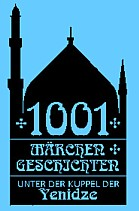
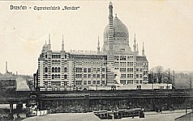
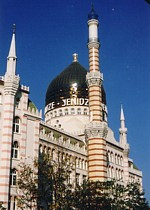
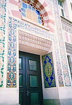
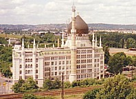

* * *

* * *

* * *

* * *

* * *

* * *

Die durch ihre bauliche Gestaltung in Form einer Moschee auffällige
Zigarettenfabrik “Yenidze” entstand 1907/09 im Auftrag des Unternehmers Hugo Zietz. Zietz gehörte zu den führenden Vertretern der seinerzeit bedeutenden [Dresdner Zigarettenindustrie](../../../../../ost/striesen/striesener_zigarettenfabriken/) und wählte für seinen Fabrikbau
bewusst eine Gestaltung im orientalischen Stil. Im zehngeschossigen Hauptgebäude befanden sich die Produktions-, Lager- und Verwaltungsräume, außerdem Sanitär- und Sozialräume und ein im byzantinischen Stil gestalteter
Speisesaal. Unter der farbig verglasten Kuppel gab es einen Ruhe- und Aufenthaltsraum für die Angestellten. Neben einigen kleineren Türmchen erhielt
der Bau auch einen als “Minarett” verkleideten Schornstein. Architekt war der damals 27-jährige Martin Hammitzsch, der
wegen dieses umstrittenen Gebäudes zeitweise aus der Architektenkammer ausgeschlossen wurde. Hammitzsch heiratete
1936 Angela Raubal, eine Halbschwester Adolf  Hitlers und beging wenige Tage nach Ende des Zweiten Weltkriegs
Selbstmord. Für die Gestaltung der Zigarettenfabrik griff er auf orientalische Vorbilder wie die Grabmoschee Khair Bak in Kairo zurück.

Technisch interessant ist die “Yenidze” als eines der ersten in Stahlbeton-Skelettbauweise
errichteten Hochhäuser Deutschlands. Das Bauwerk misst vom Straßenniveau bis zur Kuppel 62 Meter, die Kuppel selbst ist 18 Meter hoch. Konstruiert wurde sie aus Eisenträgern, die
mit farbigem Glas ausgelegt sind. Die mit orientalischen Stilelementen und Mosaiken gestaltete Fassade wurde dem eigentlichen Bau vorgehängt. Das gesamte Gebäude konnte innerhalb von
nur knapp zwei Jahren realisiert und am 11. Januar 1909 seiner Bestimmung übergeben werden.

Im Inneren des Monumentalbaus befanden sich alle für die Produktion und den Versand der
Tabakwaren notwendigen Anlagen. Das Untergeschoss diente als Lager für den Rohtabak, der mit Hilfe von elektrischen Aufzügen in die oberen Geschosse transportiert werden konnte.
Während im zweiten und dritten Obergeschoss vorrangig manuell gedrehte Zigaretten gefertigt wurde, befand sich im vierten Geschoss der Maschinensaal für die maschinelle Herstellung preiswerter Massenware. In
der ersten Etage wurden im Anschluss Etiketten und Banderolen angebracht, bevor die fertigen Zigaretten im Erdgeschoss für den Versand fertig gemacht wurden. Weitere Räume beherbergten die Verwaltung sowie Sozial- und
Ruheräume für die Beschäftigten. Zu Spitzenzeiten waren über 1.700 Arbeiter, unter ihnen viele Frauen, in der “Tabakmoschee” beschäftigt. Bekannte Marken des Unternehmens waren “Salem” und “Yenidze”. 1925 übernahm eine
holländische Firma, zwei Jahre später der Hamburger Reemtsma-Konzern das Unternehmen.

Beim Luftangriff auf Dresden fielen 1945 Teile des Gebäudes sowie die Verglasung der
Kuppel den Bomben zum Opfer. Zunächst wegen des geplanten Abbruchs nur notdürftig wieder nutzbar gemacht, entschloss man sich 1966 zu einer Teilrekonstruktion und einer
farblich veränderten Neuverglasung der Kuppel in Braun-Gold-Tönen. Eine umfassende Rekonstruktion unter Wiederherstellung des ursprünglichen Aussehens konnte jedoch erst 1993 realisiert werden.

Seinen Namen verdankt das Gebäude einem kleinen Ort in der Nähe von Xanthi im früheren Osmanischen Reich (heute Giannitsa / Griechenland), in dem Hugo Zietz einen Großteil seines
Tabaks bezog. Dieser wurde per Schiff bzw. Eisenbahn nach Dresden transportiert und hier zu Zigarren und Zigaretten verarbeitet. Auch nach Verstaatlichung des Unternehmens nutzte man
die “Yenidze” noch bis 1953 als Produktionsstätte, im Anschluss als Lager. 1976 zog schließlich die Verwaltung des VEB Tabakkontor in den historischen Bau.

1991 wurde das Gebäude an eine private Investorengemeinschaft verkauft und zum
Bürohaus umgewandelt. Der teilzerstörte Südflügel konnte in diesem Zusammenhang wieder hergestellt werden. Ursprünglich war als Ergänzung ein moderner Hotelkomplex
geplant, auf dessen Dach eine Freitreppe bis zur Kuppel führen sollte. Dieser wurde jedoch nicht realisiert. Heute dient die Yenidze als Domizil verschiedener Unternehmen.
In einem der Obergeschosse befindet sich eine öffentliche Gaststätte mit Dresdens höchst gelegenem Biergarten. Von der Dachterrasse aus bietet sich ein schöner Blick
über die Innenstadt. Unter der Kuppel finden regelmäßig Veranstaltungen statt. Besonders beliebt sind die hier angebotenen Märchenlesungen mit bekannten Schauspielern.

* * *

 \[ [Home](../../../../../index.html)\] \[ [Nord](../../../../../nord/)\] \[ [Nordwest](../../../../../nordwest/)\] \[ [Neustadt](../../../../../neustadt/)\]
 \[ [Nordost](../../../../../nordost/)\] \[ [West](../../../../../west/)\] \[ [Zentrum](../../../../../zentrum/)\] \[ [Südwest](../../../../../sudwest/)\]
 \[ [Süd](../../../../../sud/)\] \[ [Südost](../../../../../sudost/)\] \[ [Ost](../../../../../ost/)\] \[ [Register](../../../../../Register/register.html)\] \[ [Kontakt](../../../../../Kontakt/kontakt.html)\] \[ [Impressum](../../../../../impressum/)\]
