* * *

* * *

* * *

**Kulturstätten in der Johannstadt**

[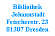](http://www.bibo-dresden.de)

* * *

**Schulen in der Johannstadt**

[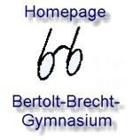](http://www.bebe-dresden.de)

Die Geschichte der heutigen Johannstadt begann im Jahr 1874, als das zuvor für dieses zur Äußeren Pirnaischen Vorstadt gehörende Gebiet geltende Bauverbot aufgehoben wurde. Bis dahin gab es hier lediglich Wiesen und landwirtschaftlich genutzte Flächen sowie einige Ziegeleien und Vorwerke. Im Mittelalter gehörten Teile des Areals zur Siedlung [Ranvoltitz](../../zentrum/johannstadt/ranvoltitz/), welche jedoch im 14. Jahrhundert unter ungeklärten Umständen zur Wüstung wurde. Fortan besaßen das Dresdner Maternihospital, das Neustädter Augustinerkloster und das dem städtischen Rat unterstehende Brückenamt hier Grundstücke, darunter die bewaldeten Flächen des [Blasewitzer Tännichts](../../ost/) und einige Weinberge am Tatzberg. Von wirtschaftlicher Bedeutung war die in der Nähe des heutigen [Sachsenplatzes](../../zentrum/johannstadt/strassen_johannstadt/sachsenplatz/) gelegene Ratsziegelei, in der ein Großteil der in Dresden benötigten Ziegel hergestellt wurde. Im Zuge der Reformation übernahm die Stadt die Flächen des aufgelösten Klosters und nutzte sie als Weideland. 1683 waren diese Schauplatz eines großen Heerlagers der sächsischen Armee unter Kurfürst Johann Georg III. Bis 1873 fand hier in der Nähe des Güntzplatzes die Dresdner [Vogelwiese](../../zentrum/johannstadt/vogelwiese/) statt.

Noch bis ins 19. Jahrhundert führten nur wenige Straßen und Wege durch diese Fluren und verbanden die hier
gelegenen Anwesen mit der nahegelegenen Residenzstadt. Ursprünglich landwirtschaftlichen Zwecken dienend, entwickelten sich die Vorwerke [“Lämmchen”](../../zentrum/johannstadt/strassen_johannstadt/blasewitzer_strasse/), [“Hopfgartens”](../../zentrum/johannstadt/strassen_johannstadt/hopfgartenstrasse/) und [“Stückgießers”](../../zentrum/johannstadt/strassen_johannstadt/blumenstrasse/) später zu beliebten Ausflugszielen. Zu den Wahrzeichen des Gebietes gehörte auch das 1754 an Stelle eines früheren Kalkwerkes entstandene Schlösschen [“Antons”](../../zentrum/johannstadt/antons/), dessen angeschlossene Gaststätte mit Elbebad noch bis 1945 gern von den Dresdnern besucht wurde. Schwer getroffen wurde das Gebiet der heutigen Johannstadt, als 1813 französische Soldaten die vorhandenen Vorwerke besetzten und diese durch Kampfhandlungen zerstörten. Auch die vier Bockwindmühlen am Windmühlenberg brannten nieder und wurden nicht wieder aufgebaut.

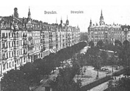1813 erwarb die Stadt Dresden eine größere Fläche an der nach Blasewitz führenden Chaussee, um hier einen neuen Friedhof anzulegen. Ab 1834 wurde dieser [Trinitatisfriedhof](../../zentrum/johannstadt/trinitatisfriedhof/) genannt. 1866 folgte unmittelbar daneben der [Neue Jüdische Friedhof](../../zentrum/johannstadt/neuer_judischer_friedhof/) für die Mitglieder der Israelitischen Gemeinde. Ab 1872 verkehrte Dresdens erste Pferdestraßenbahn vom Schloßplatz nach Blasewitz. Zu diesem Zeitpunkt waren große Teile der späteren Johannstadt noch unbebaut. Erst mit Verabschiedung eines Bebauungsplanes 1874 begannen mehrere Baugesellschaften mit der Erschließung der Flächen. So ließ die Dresdner Ostend-Gesellschaft nördlich der Stübelallee villenartige Wohnhäuser errichten. An der zwei Jahre später angelegten Pfotenhauerstraße entstanden mehrgeschossige Mietshäuser für die Aktiengesellschaft Germania. Nach dem Konkurs der 1872 gegründeten “Zentralbank für Landerwerb und Bauten” übernahm der Bauverein Johannstadt deren Grundstücke und ließ auch hier neue Gebäude errichten. Am 6. November 1877 erhielt das
neue Stadtviertel in Erinnerung an den 1873 verstorbenen sächsischen König Johann offiziell den Namen Johannstadt.

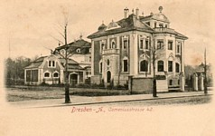Bis zur Jahrhundertwende war fast die gesamte Johannstadt bebaut und mit dem benachbarten Striesen zusammen gewachsen. Da das Stadtviertel von Beginn an vorrangig als Wohnstandort konzipiert war, gab es hier meist geschlossene Quartiere mit vier- bis fünfgeschossigen Mietshäusern. Im Umfeld des Großen Gartens prägten Villen das Straßenbild ( _**Foto:** Comeniusstraße 42_). Lediglich zwischen Blasewitzer und Blumenstraße siedelten sich einige industrielle Unternehmen an, die die zuvor hier befindlichen Gärtnereien weiter nach Osten verdrängten. Später entstanden kleinere Handwerks- und Gewerbebetriebe in den Hinterhöfen der Wohnblocks. Zu den bekanntesten Johannstädter Unternehmen gehörten die Kunst- und Lichtdruckanstalt [Römmler & Jonas](../../zentrum/johannstadt/strassen_johannstadt/blasewitzer_strasse/rommler___jonas/) und die Karosseriebaufirma Gläser an der Arnoldstraße. Hinzu kamen eine Reihe von [Zigarettenfabriken](../../ost/striesen/striesener_zigarettenfabriken/) an der Pfotenhauer-, Blasewitzer und Fürstenstraße. Eine durch die Gesellschaft “Prinzenaue” geplante Bebauung der Elbwiesen in Verbindung mit einer Hochuferstraße kam nicht zustande. Stattdessen nutzte man das Gelände für verschiedene Großveranstaltungen (Turnfest, Sängerbundfest) sowie als Schauplatz der Vogelwiese.

Im Zusammenhang mit dem Ausbau der Vorstadt wurden bis zum Ersten Weltkrieg eine Reihe öffentlicher Gebäude gebaut. So erhielt die Johannstadt 1891 in unmittelbarer Nachbarschaft des Trinitatisfriedhofes die [Trinitatiskirche](../../zentrum/johannstadt/trinitatiskirche/). 1902/04 folgte am Stephanienplatz die 1945 zerstörte [Andreaskirche](../../zentrum/johannstadt/andreaskirche/). Hinzu kamen vier Volksschulen, vier höhere Schulen sowie eine 1934 übergebene Berufsschule an der Gerokstraße. Zur Verbesserung der Verkehrsanbindung wurde 1875-77 die [Albertbrücke](../../zentrum/johannstadt/albertbrucke/) errichtet. In ihrem Umfeld folgten nach der Jahrhundertwende weitere Gebäude wie das 1913 übergebene Stadthaus Johannstadt (heute Sparkasse), die [Kunstgewerbeschule](../../zentrum/johannstadt/strassen_johannstadt/kunstgewerbeschule/) mit angeschlossenem Museum, mehrere Bauten für die Gewerbeschule und die Technischen Lehranstalten und das Postamt auf der Gerokstraße.

Auch auf dem Gebiet des Gesundheitswesens entstanden einige bedeutende Einrichtungen. Nachdem bereits 1878 an der Gerokstraße das [Carolahaus](../../zentrum/johannstadt/carolahaus/) errichtet worden war, entstand 1894 das katholische [St.-Joseph-Stift](../../zentrum/johannstadt/st__joseph-stift/). Vier Jahre später wurde im Birkenwäldchen mit dem Bau des Johannstädter Krankenhauses begonnen. Gemeinsam mit der früheren Städtischen Frauenklinik dient dieser mehrfach erweiterte und modernisierte Gebäudekomplex heute als [Universitätsklinikum](../../zentrum/johannstadt/universitatsklinikum/).

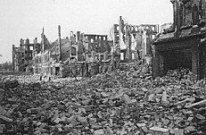1945 gehörte die Johannstadt zu den am schwersten vom Luftangriff betroffenen Stadtteilen Dresdens. Mit Ausnahme einiger Wohnblöcke am Elbufer (Thomas-Müntzer-Platz), am Bönischplatz und nördlich des Großen Gartens fielen fast alle Gebäude den Bomben zum Opfer, so dass die Einwohnerzahl zeitweise auf 4000 Menschen sank. Bereits im Januar 1946 begann die großflächige Beräumung der Ruinenfelder. Während wieder verwendbares Material in einer Trümmerverwertungsanlage am Dürerplatz und im späteren Betonplattenwerk auf dem Areal des Carolahauses an der Gerokstraße für den Wiederaufbau aufbereitet wurde, nutzte man das Gelände am Elbufer als Deponie für den übrig bleibenden Schutt. Ende der 50er Jahre entstanden dann an der Striesener und der Fetscherstraße die ersten neuen Wohnungen. Die Pläne für diesen noch in klassischer Ziegel- und Großblockbauweise errichteten Wohnkomplex stammen von Wolfgang Hänsch und Johannes Rascher.

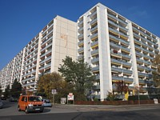Ende der 1960er begann dann der planmäßige Wiederaufbau der zerstörten Johannstadt. An Stelle der vernichteten Gründerzeitbauten und zum Teil unter Missachtung des vorgegebenen Straßennetzes entstanden in zwei Bauabschnitten ab 1969 über 6300 Neubauwohnungen, meist in Form mehrgeschossiger Plattenbauzeilen und 17-geschossiger Hochhäuser. Hinzu kamen einige öffentliche Gebäude wie Schulen, Einkaufszentren und Polikliniken. Diese Gebäude prägen bis heute große Teile der Johannstadt und wurden nach 1990 modernisiert. Heute befinden sich die Häuser meist im Besitz der Wohnungsgenossenschaft Johannstadt e.G. Einige Baulücken, u.a. am Fetscherplatz wurden nach 1990 mit modernen Wohn- und Geschäftshäusern geschlossen bzw. warten noch auf ihre Neugestaltung. Seit 2012 verbindet die neue [Waldschlösschenbrücke](../../zentrum/johannstadt/waldschlosschenbrucke/) den Stadtteil mit der gegenüberliegenden Neustadt.

Schulen in der Johannstadt:

Im Zusammenhang mit der Erschließung der Johannstadt als neues Wohngebiet entstanden hier ab 1876 mehrere Schulbauten. Diese wurden bis zum Ende des Ersten Weltkriegs als Bezirks- bzw. Bürgerschulen bezeichnet, bevor sich 1919 das System der durchnummerierten Volksschulen durchsetzte. Hinzu kamen als Höhere Schulen eine Realschule für Jungen, eine Höhere Mädchenschule sowie das 1903 gegründete [König-Georg-Gymnasium](../../zentrum/johannstadt/strassen_johannstadt/konig-georg-gymnasium/). 1945 fielen fast alle Schulbauten der Johannstadt den Bomben zum Opfer. Nachdem bereits 1958 ein Schulneubau an der Fetscherstraße entstanden war, folgten in den 1960er und 70er Jahren weitere Schulen an der Dürer-, Pfotenhauer- und Georg-Nerlich- Straße. Heute werden diese als Grund- und Oberschulen bzw. vom Bertolt-Brecht-Gymnasium genutzt. Außerdem gibt es auf der Hopfgartenstraße 11 seit einigen Jahren eine vom Verein “Huckepack” betriebene Freie Montessorischule.

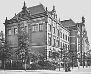Oberrealschule für Jungen: Die Schule wurde 1890 als 1. Städtische Realschule mit vorerst drei Klassen gegründet und nutzte zunächst das Gebäude der XX. Bezirksschule auf der Dürerstraße. Da die Schülerzahl schon wenig später deutlich gestiegen war, bezog sie 1895 das in zweijähriger Bauzeit eigens errichtete Schulhaus Marschnerstraße 18 (Ecke Pillnitzer Straße). Das neue Gebäude entstand nach Plänen von Stadtbaurat Bräter und Stadtbaumeister Möbius und erhielt neben Klassenräumen, Aula und Bibliothek auch eine Turnhalle.

1908-10 erfolgten Strukturveränderungen, so dass die Schule nun mit insgesamt neun Klassenstufen als Oberrealschule für Jungen weiter geführt wurde. Am 11. Dezember 1935 erhielt sie den Namen Dietrich-Eckart-Schule verliehen. Mit dieser Namensgebung sollte der Journalist und Publizist Dietrich Eckart (1868-1923) geehrt werden, der zu den Wegbereitern des Nationalsozialismus gehörte und ab 1921 Chefredakteur der antisemitischen Zeitung “Völkischer Beobachter” war. 1945 fiel das Gebäude der Oberrealschule den Bomben zum Opfer.

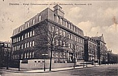Höhere Schule für Mädchen: Diese staatliche Bildungseinrichtung wurde am 18. März 1802 als private Töchterschule vom Theologen Pretzsch gegründet und ab 1859 von Bernhard Dietrich weitergeführt. Ihr Domizil hatte sie ursprünglich auf der Großen Zwingerstraße 5. Im Dezember 1874 wurde Bernhard Dietrich vom sächsischen Kultusministerium mit der Einrichtung eines Lehrerinnen-Seminars beauftragt, wobei die bestehende Mädchenschule als Übungsschule angegliedert werden sollte.

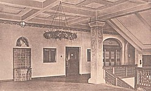Am 5. April 1875 begann an der nun als Königliches Lehrerinnen-Seminar bezeichneten Schule die Ausbildung weiblichen Lehrpersonals. Diesem war eine Höhere Mädchenschule angeschlossen, welche jungen Frauen nach dem Abschluss der Volksschule eine Fortsetzung ihrer Schulbildung ermöglichte. Dafür wurde ein am 16. April 1898 eingeweihtes neues Schulhaus an der Marschnerstraße 8-10 errichtet, dem 1912/14 ein Ergänzungsbau an der angrenzenden Dinglingerstraße folgte. Architekt des Neubaus war Adolph Canzler, den baukünstlerischen Schmuck an der Fasade und im Inneren schufen Alexander Höfer, Rudolf Born, Karl Hausmann und Johannes Gerold. 1922 erfolgte die Umwandlung des Seminars in eine neunstufige Deutsche Oberschule,welche ab 1925 als Staatliche Höhere Mädchenbildungsanstalt Dresden-Johannstadt geführt wurde. Nach dem Machtantritt der Nationalsozialisten wurde sie 1934 mit der “Frauenschule” vereinigt und 1945 zerstört.

Die ausgebrannten Gebäude konnten in der Nachkriegszeit in leicht veränderter Form wiederaufgebaut werden. Heute ist in dem 1998 rekonstruierten Haus Dinglingerstraße 4 die Dinglinger-Schule für lernbehinderte Kinder untergebracht.

4\. Katholische Volksschule: Die ursprünglich als IV. Katholische Bezirksschule gegründete Einrichtung befand sich bis zur Zerstörung 1945 auf der Schumannstraße 21. Das am 5. Oktober 1896 eingeweihte Schulhaus besaß neben Klassen- und Lehrerzimmern auch eine Turnhalle sowie einen als Kapelle genutzten Saal. Um 1900 mussten wegen der hohen Schülerzahl zusätzliche Räume auf der Dürerstraße 100 angemietet werden. Die 1919 in eine Volksschule umgewandelte Bildungsstätte existierte bis 1937 und wurde dann mit der 6. Katholischen Schule zusammengelegt.

6\. Grundschule: Das Gebäude der heutigen 6. Grundschule wurde 1957/58 auf einem Ruinengrundstück an der Fetscherstraße 2 als Ersatz für die zerstörten Schulgebäude des Stadtteiles erbaut. Nach Plänen von Gottfried Kintzer
und Ehrenfried Kubin entstand ein pavillonartiger Schulkomplex mit Haupt- und Nebengebäuden. Architektonisch ist diese Schule interessant, da sie noch als klassischer Einzelbau errichtet wurde, bevor man auch bei Schulgebäuden zur weitverbreiteten Typenbauweise überging. Bis 1990 wurde sie als 6. POS “Otto Grotewohl” bezeichnet. Danach bezog die 6. Mittelschule “J. A. Comenius” das Gebäude. Seit deren Schließung im Jahr 2008 nutzt heute die 6. Grundschule “Am Großen Garten” das Haus. Vor dem Gebäude steht seit 1958 eine Metallstele. Das Kunstwerk mit dem Titel "Weltfrieden" zeigt eine Weltkugel mit Friedenstauben und wurde 1958 von Wilhelm Landgraf geschaffen.

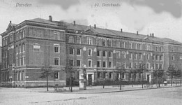20\. Volksschule: An der Dürerstraße 62 in Höhe des Zöllnerplatzes stand einst die 20. Volksschule, bis 1919 als XX. Bezirksschule bezeichnet. Bis 1892 war in diesem Gebäude auch die IX. Bürgerschule, zeitweise auch die 1890 gegründete 1. Städtische Realschule untergebracht. Zudem befand sich im Haus die 9. Städtische Volksbibliothek. Die Turnhalle diente ab 1888 bis zur Fertigstellung der [Trinitatiskirche](../../zentrum/johannstadt/trinitatiskirche/) 1894 zugleich als Betsaal der
neugebildeten Trinitatisgemeinde. Neben Sonntagsgottesdiensten fanden hier auch Taufen und das heilige Abendmahl statt. Ab 1941 war die Schule als Notunterkunft für Flüchtlinge und Ausgebombte vorgesehen und wurde 1945 zerstört.

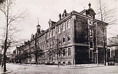51\. Volksschule: Das Gebäude an der Silbermannstraße 5 wurde zwischen 1891 und 1893 für die bereits 1878 gegründete IX. Bürgerschule errichtet. Nach dem Ersten Weltkrieg übernahm die 51. Volksschule den Bau. Zwischen 1921 und 1936 nutzte auch die als Staatliche Höhere Versuchsschule gegründete Dürerschule einige Räume. Mit Machtantritt der Nazis endeten alle humanistischen Reformversuche und die Dürerschule wurde bis zu ihrer Auflösung 1936 als “Deutsche Oberschule” weitergeführt. 1945 fiel das Schulhaus den Bomben zum Opfer.

52\. Grundschule: Das Gebäude der 52. Polytechnischen Oberschule entstand im Zusammenhang mit dem Wiederaufbau der Johannstadt an der Dürerstraße 82. In Anlehnung an den Straßennamen und die frühere “Dürerschule” erhielt sie 1970 den Namen “Albrecht Dürer” verliehen und wird heute von der 52. Grundschule genutzt.

53\. Volksschule: 1901/02 entstand am Fiedlerplatz ein weiteres Schulhaus für die damalige XII. Bürgerschule. Zeitweise nutzte auch das 1903 gegründete erste humanistische Reformgymnasium Sachsens dieses Gebäude, bevor 1908 das auf dem Nachbargrundstück neu errichtete König-Georg-Gymnasium bezogen werden konnte. 1919 wurde die frühere Bürgerschule zur 53. Volksschule umgewandelt. Das Schulhaus fiel 1945 dem Bomben zum Opfer. In der Nachkriegszeit bezog die 53. Volksschule zeitweise einige Räume des Berufsschulzentrums an der Gerokstraße.

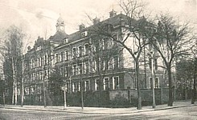

**_Foto:_** _Schulhaus der 53. Volksschule am Fiedlerplatz 2 vor der Zerstörung_

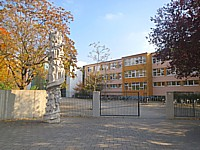101\. Mittelschule: Die in den 1970er Jahren entstandene 101. Polytechnische Oberschule auf der Pfotenhauerstraße 42 trägt heute den Namen “Johannes Gutenberg” nach dem Erfinder des Buchdrucks _(Foto)_. An diesen erinnert auch die unweit der Schule gelegene Gutenbergstraße.

102\. Grundschule: Die seit einigen Jahren als “Johanna” bezeichnete Grundschule (früher 102. Polytechnische Oberschule) wurde im Zuge des Wiederaufbaus an der Pfotenhauerstraße 40 erbaut.

Bertolt-Brecht-Gymnasium: Die Schule wurde 1952 als Erweiterte Oberschule Reick gegründet, jedoch bereits 1963 wegen Schülermangels wieder geschlossen. Erst 1967 erfolgte ein etappenweiser Neuanfang im Gebäude des heutigen [Julius-Ambrosius-Hülße-Gymnasiums](../../sudost/reick/) in Reick. 1971 erhielt diese EOS mit Zustimmung von Helene Weigel den Namen des Dichters Bertolt Brecht verliehen. Seit 1988 hat sie ihren Sitz auf der Lortzingstraße 1 in der Johannstadt und wird seit 1992 Bertolt-Brecht-Gymnasium genannt. Die Bronzeplastik „Kletternde Kinder“ vor dem Schulgebäude stammt von August Martin Hoffmann und wurde von ihm 1969 geschaffen.

Gewerbeschule: Die [Städtische Gewerbeschule](../../zentrum/johannstadt/strassen_johannstadt/durerstrasse/), später als Städtische Ingenieurschule bzw. Technische Lehranstalt bezeichnet, entstand 1901 auf dem Grundstück zwischen Dürer-, Marschner-, Elisen- und Gerokstraße. Hier wurden vorrangig Jugendliche in technischen Berufen ausgebildet. Seit 1986 gehört die zu DDR-Zeiten als Ingenieurhochschule bezeichnete Einrichtung zur Technischen Universität.

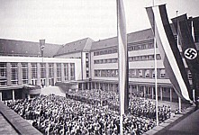Berufsschulzentrum für Technik: Der heute vom Berufsschulzentrum für Technik genutzte Gebäudekomplex entstand zwischen 1928 und 1934 auf einem ehemaligen Sportplatz zwischen Gerok-, Silbermann-, Dürer- und Wintergartenstraße. Die Pläne für das Schulzentrum stammen von Stadtbaurat Paul Wolf, der in dem modernen Gebäude die drei Altstädter Knabenberufsschulen, die metallgewerblichen Klassen der Neustädter Berufsschulen sowie alle kaufmännische Ausbildungsgänge unterbrachte. Bereits 1928 war mit dem Rohbau begonnen worden, welcher jedoch bedingt durch die Weltwirtschaftskrise erst
1934 vollendet werden konnte. Im gleichen Jahr wurde die Schule an der Gerokstraße 22 am 17. September unter dem Namen “Horst-Wessel-Schule” (nach einem 1930 ermordeten SA-Führer) eingeweiht _(Foto)_.

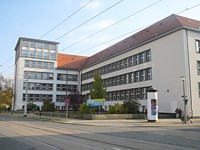Der zu den modernsten Schulbauten Deutschlands gehörende Gebäudekomplex bestand aus vier Trakten mit 37 Klassenräumen und zwei Turnhallen sowie einem sechsgeschossigen Turm an der Gerokstraße. Außerdem gab es verschiedene Werkstätten, Büroräume und einen 1945 zerstörten Fest- und Veranstaltungssaal mit 600 Plätzen. Die
übrigen Gebäudeteile überstanden als einziges Schulgebäude der Johannstadt den Zweiten Weltkrieg und werden heute vom Berufsschulzentrum “Gustav Adolf Zeuner” genutzt. 2001-05 erfolgte eine umfassende Sanierung sowie ein Neubau der Aula. Teile der Innenausstattung, darunter einige Reliefplatten mit Darstellungen verschiedener Berufe im Foyer, sind noch erhalten. Lediglich die einstige nationalsozialistische Symbolik wurde nach 1945 entfernt.

Elbfähren:

Die Geschichte der Johannstädter Elbfähren, welche einst an verschiedenen Standorten den Fluss überquerten, reicht bis
ins 18. Jahrhundert zurück. Die älteste nachgewiesene Fährstelle befand sich in der Nähe des Vorwerks [“Anton´s”](../../zentrum/johannstadt/antons/) und
wurde vor allem von Ausflüglern gern genutzt. Eine weitere Fähre gab es ab 1875 in Höhe der Gneisenaustraße -
Löwenstraße. Hier wurde von Anfang an ein Dampffährboot statt der bis dahin üblichen Gierseilfähren eingesetzt, um
dem hohen Verkehrsbedürfnis Rechnung zu tragen. Die dritte Überfahrtmöglichkeit gab es ab 1840 in Verlängerung der Schubertstraße zur [Saloppe](../../nordost/loschwitz/strassen_loschwitz/saloppe/). Alle drei Fähren wurden noch bis in die Nachkriegszeit von der Dresdner Fischerinnung
betrieben.

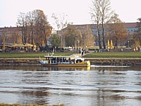
Obwohl diese Elbfähren vorrangig Reisenden, Fuhrleuten und den Anwohnern dienen sollten, entwickelten sie sich schnell zu wichtigen Verkehrsmitteln im Ausflugsverkehr.
Dazu trugen sowohl die am Elbufer gelegenen Ausflugslokale, aber auch die ab 1873 in Johannstadt veranstaltete alljährliche Vogelwiese bei. Nach 1945 führten wirtschaftliche
Gründe sowie die Auflösung der Fischerinnung zur Einstellung des Fährbetriebs an der Saloppe (1953) und bei “Anton´s” (1957). Erhalten blieb hingegen die in der
Nachkriegszeit an ihren heutigen Standort am Fährgarten verlegte Elbfähre zur Drachenschänke am Diakonissenweg _(Foto)_.

[_Weiterführende Literatur und Quellen_](../../impressum/quellenverzeichnis/)

 \[ [Home](../../index.html)\] \[ [Nord](../../nord/)\] \[ [Nordwest](../../nordwest/)\] \[ [Neustadt](../../neustadt/)\] \[ [Nordost](../../nordost/)\] \[ [West](../../west/)\] \[ [Zentrum](../../zentrum/)\] \[ [Südwest](../../sudwest/)\] \[ [Süd](../../sud/)\]
 \[ [Südost](../../sudost/)\] \[ [Ost](../../ost/)\] \[ [Register](../../Register/register.html)\] \[ [Kontakt](../../Kontakt/kontakt.html)\] \[ [Impressum](../../impressum/)\]
