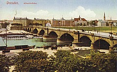
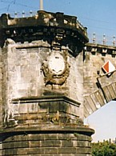
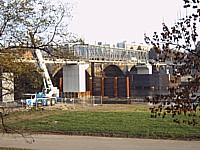
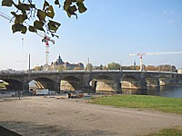

* * *

* * *

Erste Planungen für eine Elbbrücke an dieser Stelle kamen bereits 1839 auf. Damals erwog man den Bau einer Eisenbahnstrecke vom [Leipziger Bahnhof](../../../neustadt/leipziger_vorstadt/dresden_-_leipzig/leipziger_bahnhof/) über die Glacisstraße, am Großen Garten vorbei und von dort weiter in Richtung Böhmen. Spätestens mit Eröffnung der Marienbrücke 1852 wurden diese Pläne jedoch zu den Akten gelegt, da sie einen zu großen Eingriff in die gewachsene Bebauung auf Neustädter Seite gebracht hätten. Später versuchten der Bankier Kaskel und der Advokat Oskar Teucher, zumindest eine Straßenbrücke an dieser Stelle zu realisieren, allerdings ohne Erfolg. Stattdessen richtete man 1865 eine Fährverbindung zwischen Bohrwerk- und Glacisstraße ein. Betreiber war die Dresdner Fischerinnung, welche traditionell das Privileg für alle Fährstellen im Innenstadtbereich besaß und diese dampfbetriebene Wagenfähre bis 1877 unterhielt.

Erst mit Aufhebung des Bebauungsverbotes für die spätere Johannstadt und
dem Ausbau der Uferstraße wurde der Bau einer Elbquerung wieder aktuell. 1875 erhielt Stadtbaudirektor Karl Manck den Auftrag, eine neue Brücke als
Verbindung zwischen dem neuen Stadtviertel und der Antonstadt zu errichten. Bereits im gleichen Jahr begannen am 14. Juni die Arbeiten. Erstmals in Dresden
kam hier ein neuartiges Bauverfahren zum Einsatz, bei welchem für die Pfeiler Betongründungen verwendet wurden. Die 316 Meter lange Brücke mit drei Strom- und zehn Landbögen besteht aus Elbsandstein und besitzt zwei
Fahrbahnen, Fußwege an beiden Seiten sowie in der Mitte den Gleiskörper für die Straßenbahn. Als baukünstlerischen Schmuck brachte man am Mittelpfeiler ein Medaillon König Alberts (von Adolf
Donndorf) sowie das Dresdner Stadtwappen _(Foto)_ an. Am 19. November 1877 konnte das Bauwerk als König- Albert-Brücke, benannt nach dem damals regierenden König Albert, dem Verkehr übergeben werden.

Zur Finanzierung der Baukosten und des Unterhaltes wurden in den Anfangsjahren Brückenzölle erhoben, welche von allen Passanten gezahlt werden mussten. Diese betrugen jeweils 10 Pfennige pro Person, Fahrzeuge mussten 40 Pfennige bezahlen. Bis zur Aufhebung dieses Brückengeldes war die Albertbrücke mit bis zu 65.000 Reichsmark im Jahr ”ertragreichste” Elbquerung in der Stadt. Im Zusammenhang mit der gärtnerischen Gestaltung des Königsufers erhielt sie zwischen 1936 und 1938 am Neustädter Brückenkopf zwei Sandsteinreliefs von Hermann Alfred Raddatz und Edmund Moeller. Die Reliefs zeigen Fischer, Schiffer und Treidler und erinnern an die schwere Arbeit dieser Menschen am Fluss.

Kurz vor Ende des Zweiten Weltkrieges sprengten abrückende Wehrmachtstruppen auch die Albertbrücke, wobei sechs der insgesamt 13 Bögen zerstört wurden. Ab Februar 1946 konnte die Brücke mit Hilfe einer provisorischen Holzkonstruktion zumindest für Fußgänger wieder passierbar gemacht werden. Im April begann dann der reguläre Wiederaufbau, welcher am 20. Juli 1946 abgeschlossen war. In diesem Zusammenhang erfolgte die Umbenennung in “Brücke der Einheit”. Erst 1990 erhielt die Albertbrücke ihren ursprünglichen Namen zurück.

Wegen erheblicher baulicher Schäden fanden zwischen 2011 und 2016 umfangreiche Erneuerungsarbeiten statt. In diesem Zusammenhang entstand Ende 2011 eine provisorische Fußgängerbrücke unmittelbar neben der Albertbrücke. Bei der Sanierung wurde die Brücke um 3,60 m verbreitert, um Platz für breitere Fuß- und Radwege zu schaffen. Außerdem erhielt sie ein zusätzliches Geländer. Am 5. September 2016 konnte die Albertbrücke wieder für den Verkehr freigegeben werden. Im Anschluss erfolgte die Demontage des Provisoriums. Auf den Freiflächen oberhalb der Brücke, welche zu DDR-Zeiten zeitweise als Busabstellplatz dienten, findet heute an den Wochenenden einer der größten Trödelmärkte Deutschlands statt.

**_Foto:_** _Sanierung der Albertbrücke 2011-2016,_

_links die provisorische Fußgänger- und Radfahrerbrücke im November 2011_

* * *

 \[ [Nord](../../../nord/)\] \[ [Nordwest](../../../nordwest/)\] \[ [Neustadt](../../../neustadt/)\] \[ [Nordost](../../../nordost/)\]
 \[ [West](../../../west/)\] \[ [Zentrum](../../../zentrum/)\] \[ [Südwest](../../../sudwest/)\] \[ [Süd](../../../sud/)\] \[ [Südost](../../../sudost/)\] \[ [Ost](../../../ost/)\] \[ [Register](../../../Register/register.html)\] \[ [Kontakt](../../../Kontakt/kontakt.html)\] \[ [Impressum](../../../impressum/)\]
