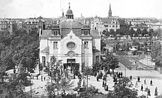
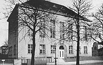

* * *

* * *

* * *

* * *

* * *

* * *

Die Andreaskirche entstand 1901/02 am Stephanienplatz, nachdem der Vorstand der Trinitatiskirchgemeinde 1898 die Abspaltung des Südteils der Johannstadt und die Bildung einer eigenständigen Gemeinde
beschlossen hatte. Grund war der starke Zuzug in diesem Gebiet, durch den die bisher genutzte [Trinitatiskirche](../../../zentrum/johannstadt/trinitatiskirche/) zu klein geworden war. Für die Planung des Gebäudes, welches mit nur 850 Plätzen lediglich als Filialkirche der Trinitatisgemeinde gedacht war, wurde der Baumeister Oskar Kaiser verpflichtet. Im Sommer 1901 erfolgte die Grundsteinlegung  für das Gotteshaus.

**_Foto:_** _die 1945 zerstörte Andreaskirche am Stephanienplatz_

Innerhalb von zwei Jahren entstand ein in Neobarockformen gestalteter Zentralbaubau, welcher am 8. Juni 1902 als
Andreaskirche geweiht wurde. Ursprünglich plante man diesen später durch einen repräsentativeren Kirchenbau zu
ersetzten. Letztlich verhinderte der Erste Weltkrieg und die folgende wirtschaftlich schwierige Zeit dieses Vorhaben.
Am 1. Oktober 1904 erhielt die Andreaskirchgemeinde ihre Selbständigkeit und mietete ein Jahr später das Wohnhaus
Haydnstraße 23 als Pfarrhaus und Verwaltungssitz an. 1932 folgte die Einweihung eines eigenen Gemeindehauses auf der Canalettostraße.

Die Andreaskirche wurde bis 1945 von der Gemeinde genutzt und fiel dann den
Bomben zum Opfer. Auch das Gemeindehaus Canalettostraße _(Foto)_ und das Pfarrhaus Haydnstraße wurden zerstört. Da an einen Wiederaufbau der Kirche
nicht zu denken war, fanden die Gottesdienste zunächst in angemieteten Räumen, ab 1957 im wiederhergestellten Pfarrhaus statt. Bereits Ende 1945 hatte sich die stark dezimierte Gemeinde mit der Striesener [Erlöserkirchgemeinde](../../../ost/striesen/erloserkirche/), deren Gotteshaus an der Wittenberger Straße ebenfalls beim Luftangriff zerstört worden war, vereinigt.
Die Kirchenruine wurde im Zuge der Enttrümmerung des Gebietes wenig später abgerissen. Heute erinnert nur noch eine gerettete Glocke vor dem Pfarrhaus an die ehemalige Andreaskirche. Am 1.
Januar 2000 vereinigten sich Erlöser-Andreas und Trinitatisgemeinde zur neuen Johanneskirchgemeinde Dresden-Johannstadt/Striesen.

* * *

 \[ [Home](../../../index.html)\] \[ [Nord](../../../nord/)\] \[ [Nordwest](../../../nordwest/)\] \[ [Neustadt](../../../neustadt/)\] \[ [Nordost](../../../nordost/)\] \[ [West](../../../west/)\] \[ [Zentrum](../../../zentrum/)\] \[ [Südwest](../../../sudwest/)\] \[ [Süd](../../../sud/)\] \[ [Südost](../../../sudost/)\] \[ [Ost](../../../ost/)\] \[ [Register](../../../Register/register.html)\] \[ [Kontakt](../../../Kontakt/kontakt.html)\] \[ [Impressum](../../../impressum/)\]
