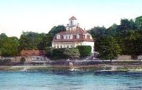
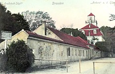
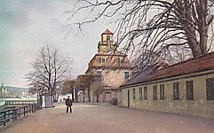
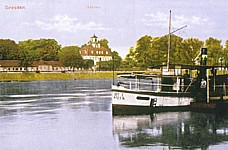

* * *

* * *

* * *

* * *

* * *

* * *

* * *

Das schlossartige Anwesen “Antons” wurde 1754 an Stelle einer stillgelegten Kalkbrennerei gebaut und befand sich zunächst im Besitz des Steuerrates und Oberinspektors der erzgebirgischen Elsterflößerei Johann Christian Gottlob Anton. Dieser nutzte den spätbarocken Bau als Alterswohnsitz. Architekt des Gebäudes war Simon Gottlieb Zug. Im Inneren des Hauses befanden sich mehrere Wohn- und Salonräume, teilweise mit wertvollen Täfelungen und Stuckverzierungen. Zur Finanzierung des Unterhalts bemühte sich Anton um das Schankrecht, welches er auch wenig später erhielt. Fortan durften hier “einheimische und fremde Biere und Weine” verzapft werden, außerdem erhielt Anton die Erlaubnis zum Schlachten, Backen, Schnapsbrennen sowie zur Beherbergung von Gästen. Lediglich die Genehmigung für eine Badeanstalt am Elbufer wurde aus sittlichen Gründen und wegen der befürchteten Gefährdung des Schiffsverkehrs untersagt. Dafür gab es hier vermutlich schon damals eine Elbfähre, welche im 19. Jahrhundert in den Besitz der Dresdner Fischerinnung überging und erst am 15. September 1957 ihren Betrieb einstellte.

Ab 1801 besaß der Geheime Kriegsrat von Broizem das Grundstück, welches nun auch “Lerchenfeld” genannt wurde. 1813 wüteten in unmittelbarer Nähe Kämpfe zwischen russischen und napoleonischen Soldaten, welche das Vorwerk am 26. August besetzt hatten. Zwischen 1814 und 1832 gehörte das Areal dem Herrn von Limburger. 1828 wurde das Haus umgebaut und befand sich ab 1832 im Besitz der Bankiersfamilie Kaskel. In diesem Zusammenhang erhielt das Gebäude sein charakteristisches Uhrtürmchen sowie eine nach englischem Vorbild gestaltete Gartenanlage.

Das reizvoll in den Elbauen unterhalb der Hertelstraße gelegene Vorwerk entwickelte sich schnell zu einem beliebten Ausflugslokal der Dresdner Bevölkerung. Vor allem in den Sommermonaten besuchten viele Leute die Schänke mit einer Kegelbahn, angeschlossener Bäckerei und Schlachterei. Zu den Gästen gehörte auch der Schriftsteller E. T. A. Hoffmann, welcher dem Schlösschen ein literarisches Denkmal setzte. Mehrfach wechselten die Besitzer, bevor 1898 die Stadt Dresden “Antons” für 300.000 Mark erwarb. Wegen seiner reizvollen Lage entschloss man sich, die ursprünglichen Abbruchabsichten nicht weiter zu verfolgen, sondern das Gebäude weiterhin gastronomisch zu nutzen. Als besondere Attraktion richtete man hier 1922 ein Elbebad ein. Bereits ab 1873 hatte es an wechselnden Standorten der Johannstadt kommunale Badestellen gegeben. Die Umkleidekabinen befanden sich im Park, von wo aus ein Tunnel zum Elbufer führte. Außerdem gab es ausgedehnte Liegewiesen und eine kleine Kegelbahn. Mit bis zu 60.000 Besuchern im Jahr gehörte “Antons” zu den beliebtesten Freibädern der Stadt. Hier hatte auch der Oberbademeister aller städtischen Bäder seinen Dienstsitz.

Bereits in den Dreißiger Jahren mussten aus hygienischen Gründen Einschränkungen für die Badenden verhängt werden. Beim Luftangriff auf Dresden trafen die Bomben auch das Ausflugslokal “Antons” und zerstörten es. Die Ruine und Reste der noch vorhandenen Nebenanlagen verschwanden in der Nachkriegszeit. Damals wurde hier eine Kleingartenanlage angelegt, die den Namen “Elbfrieden II” erhielt. In den 1970er Jahren war an deren Stelle die Einrichtung eines internationalen Campingplatzes vorgesehen. Trotz des Baus eines Schutzdammes war die Sparte immer wieder vom Hochwasser betroffen und wurde nach ihrer völligen Verwüstung bei der Elbeflut 2002 aufgegeben und beseitigt. Heute erinnern nur noch einige alte Bäume an das einstige Ausflugsziel.

* * *

 \[ [Home](../../../index.html)\] \[ [Nord](../../../nord/)\] \[ [Nordwest](../../../nordwest/)\] \[ [Neustadt](../../../neustadt/)\] \[ [Nordost](../../../nordost/)\] \[ [West](../../../west/)\] \[ [Zentrum](../../../zentrum/)\] \[ [Südwest](../../../sudwest/)\] \[ [Süd](../../../sud/)\] \[ [Südost](../../../sudost/)\] \[ [Ost](../../../ost/)\] \[ [Register](../../../Register/register.html)\] \[ [Kontakt](../../../Kontakt/kontakt.html)\] \[ [Impressum](../../../impressum/)\]
