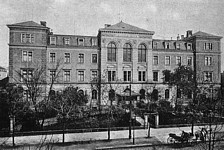
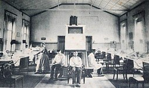
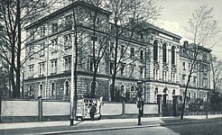

* * *

* * *

* * *

* * *

* * *

* * *

Das Carolahaus entstand 1878 als erstes öffentliches Krankenhaus der
Johannstadt und wurde von den Schwestern des Albertvereins betrieben. Dieser wohltätige Verein war 1867 als Frauenverein der sächsischen Rot-Kreuz-
Gesellschaft gegründet worden und widmete sich der Versorgung und Betreuung von Kranken und Pflegebedürftigen. Zugleich wurden freiwillige Krankenpflegerinnen für den zivilen und militärischen Einsatz ausgebildet.
Schirmherrin und Namenspatronin war König Alberts Gemahlin Carola. Insgesamt standen hier 225 Betten und ab 1906 zusätzlich eine Fürsorgestätte für
Lungenkranke zur Verfügung. Da es sich beim Carolahaus um ein privat geführtes Krankenhaus handelte, mussten Aufenthalt und Behandlung von den Patienten selbst bezahlt werden. Für bedürftige
Personen standen jedoch auch Freistellen zur Verfügung, über deren Vergabe die Direktion des Carolahauses entschied.

Das insgesamt ca. 41.000 m² große Gelände des Carolahauses nahm das gesamte Straßengeviert zwischen
Gerokstraße, Stephanienstraße, Tatzberg und Arnoldstraße ein. Neben dem Hauptgebäude an der Gerokstraße gab es insgesamt elf weiter Häuser, welche teilweise durch Wandelgänge miteinander
verbunden waren. Das gesamte Areal war mit Blumenrabatten und Sträuchern parkartig gestaltet, so dass den Kranken ausreichende Möglichkeiten für Spaziergänge zur Verfügung standen. Finanziert wurde der
Bau vorrangig aus Spenden und Lotteriegeldern. Die architektonische Gestaltung übernahm der Dresdner Stadtbaumeister Theodor Friedrich.
Zwischen 1884 und 1894 folgten noch einige Ergänzungsbauten, u.a. ein Isolierhaus für Diphtheriekranke und ein mit Bädern und Übungsgeräten ausgestattetes Rehabilitationszentrum.

Mit Einweihung des Johannstädter Krankenhauses (heute [Universitätsklinikum](../../../zentrum/johannstadt/universitatsklinikum/)) 1901 spezialisierte sich das Carolahaus auf die Behandlung von Tuberkulose-
Erkrankungen und die entsprechende Fürsorge. Die wirtschaftliche Situation nach dem Ersten Weltkrieg führte jedoch zu finanziellen Problemen, so dass der Albertverein die Klinik am 1. August 1920 an die Stadt Dresden
verkaufte, jedoch auch weiterhin nutzen durfte. Während der Nazizeit wurde das Krankenhaus 1934 geschlossen und durch eine Führerschule der SA
belegt. Mit Beginn des Zweiten Weltkriegs nutzte man das Gebäude bis zur Zerstörung 1945 als Lazarett.

Nach Beräumung des ehemaligen Krankenhausgeländes entstand
auf der Fläche das Plattenwerk Johannstadt. Unter Verwendung von zermahlenem Trümmerschutt wurden hier seit Ende der 1950er Jahre Großplatten für den
Wohnungsbau hergestellt, welche im Neubaugebiet Johannstadt und anderen Dresdner Wohngebieten Verwendung
fanden. Erst 1990 stellte der Betrieb mit dem Ende der DDR-Wohnungsbaupolitik seine Produktion ein. Teile des Areals
dienten zeitweise als “Museum zur Geschichte des Plattenbaus”. Künftig sollen auf dem Grundstück Wohnhäuser errichtet werden. Außerdem befindet sich hier seit 2014 eine moderne Rettungswache.

* * *

 \[ [Home](../../../index.html)\] \[ [Nord](../../../nord/)\] \[ [Nordwest](../../../nordwest/)\] \[ [Neustadt](../../../neustadt/)\] \[ [Nordost](../../../nordost/)\] \[ [West](../../../west/)\] \[ [Zentrum](../../../zentrum/)\] \[ [Südwest](../../../sudwest/)\] \[ [Süd](../../../sud/)\] \[ [Südost](../../../sudost/)\] \[ [Ost](../../../ost/)\] \[ [Register](../../../Register/register.html)\] \[ [Kontakt](../../../Kontakt/kontakt.html)\] \[ [Impressum](../../../impressum/)\]
