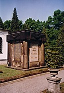
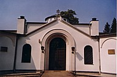

* * *

* * *

* * *

Der Neue Jüdische Friedhof wurde 1866 an der Fiedlerstraße unmittelbar angrenzend an den
Trinitatisfriedhof angelegt. Zwei Jahre zuvor hatte die jüdische Gemeinde hier ein Grundstück erworben, nachdem der bislang genutzte alte jüdische Friedhof in der Äußeren Neustadt zu klein
geworden war. Die Planungen für den am 2. Juni 1867 offiziell eröffneten Friedhof oblagen dem Architekten Ernst Giese, welcher auch die Totenhalle entwarf. Im Gegensatz zu traditionellen
jüdischen Begräbnisplätzen finden sich hier auch eine Reihe künstlerisch aufwendig gestaltete Grabstätten, z.T. sogar mit deutschen Inschriften und christlicher Symbolik. 1915 entstand auf Initiative des damaligen Gemeindevorstehers Max Elb ein Denkmal für die im Ersten Weltkrieg gefallenen Dresdner Juden _(Foto),_
erstes seiner Art in Deutschland. Schöpfer des Ehrenmals war der Leipziger Architekt Wilhelm Haller.

Auch nach Machtübernahme der Nationalsozialisten blieb der Neue Jüdische Friedhof geöffnet, wurde jedoch durch
gezielten Vandalismus schwer beschädigt. Hier fanden zahlreiche Dresdner Juden, die den Misshandlungen durch die
Nazis zum Opfer gefallen waren bzw. wegen ihrer aussichtslosen Lage den Freitod gewählt hatten, ihre letzte Ruhestätte.
Weitere Zerstörungen richteten die Bomben des 13. Februars 1945 an, vor allem im älteren Teil des Friedhofs. Hier
erinnert seit 1951 ein Gedenkstein an das Schicksal der jüdischen Bevölkerung während der NS-Herrschaft. Dort sind
auch die Urnen mit den sterblichen Überresten ausländischer Juden beigesetzt, welche zwischen 1933 und 1945 im Hof des Landgerichts am Münchner Platz hingerichtet wurden.
1994 entstand ein weiteres Ehrenmal für die Opfer des Nationalsozialismus am Ende des Friedhofs. Dieses schuf der ungarische Künstler Matyas Varga.

Nach Zerstörung der Synagoge am Hasenberg während der “Kristallnacht” am 9.
November 1938 gab es in Dresden kein jüdisches Gebetshaus mehr. 1950 entschlossen sich die wenigen noch in der Stadt lebenden Gemeindemitglieder, die
beschädigte Friedhofshalle des Neuen Jüdischen Friedhofes zur Synagoge umzuwandeln _(Foto)_. Da die jüdischen Glaubensregeln die Einrichtung einer Synagoge
auf einem Friedhof nicht zuließen, mussten bauliche Änderungen vorgenommen werden. Das Gebäude wurde außerdem durch eine Hecke vom eigentlichen Friedhof abgetrennt
und diente bis zur Weihe der Neuen Synagoge am Hasenberg als Domizil der Gemeinde. Leiter des Umbaus war der Dresdner Maler und Architekt Edmund Schuchardt. Auf dem Dach fand ein von
der abgebrannten Semper-Synagoge geretteter vergoldeter Davidstern seinen neuen Platz. Dieser befindet sich heute über dem Eingang der Neuen Synagoge und wurde durch eine Kopie ersetzt.

Insgesamt gibt es heute auf dem Neuen Jüdischen Friedhof ca. 2.500 Grabstellen. Ältestes Grabmal ist das des am 4. Januar 1868 verstorbenen Salomon Gabriel Wallerstein mit einem imposanten Mamorgrabstein. Hinter der Totenhalle befindet sich ein Urnengemeinschaftsgrab für 20 Personen, deren Gräber durch die Bombardierung 1945 zerstört worden waren. Außerdem entstand 1975 ein Grab für Thorarollen, die durch Nazis geschändet und damit unbrauchbar geworden waren.

Auf dem Friedhof befinden sich auch einige Grabstätten bedeutender Persönlichkeiten. Zu ihnen gehören der zweite Oberrabbiner der jüdischen Gemeinde Dr. Wolf Landau, welcher bis zu seinem Tod 1886 ein geachtetes Mitglied der Dresdner Gesellschaft und als Ritter erster Klasse Mitglied des sächsischen Albrechtordens war. Außerdem finden sich hier die Grabstellen der Bankiersfamilie Arnold (entworfen von Martin Pietzsch), die u.a. das nach Georg Arnold benannte Bad an der Lennéstraße stifteten sowie des Stadtverordneten und Landtagsabgeordneten Emil Lehmann (1829-1898), welcher sich aktiv für die Gleichstellung von Christen und Juden einsetzte. Ferner ruhen der Grafiker Bruno Gimpel (1886-1943), die Grafikerin Chane Goldhammer,der frühere Leiter des Goethe-Schiller-Archivs Prof. Julius Wahle (+ 1940) und Helmut Aris, Vorsitzender der jüdischen Gemeinde der DDR (+ 1987) auf diesem Friedhof. An den 1933 im Polizeigefängnis zu Tode misshandelten KPD-Funktionär Rudolf Aksen, Bruder des DDR-Politikers Hermann Axen, erinnern gleich zwei
Grabsteine. Hermann Axen hatte den alten Stein in den 1970er Jahren aus politischen Gründen gegen einen neuen Stein austauschen lassen. Erst 1994 kehrte der alte Grabstein an seinen ursprünglichen Standort zurück.

* * *

 \[ [Nord](../../../nord/)\] \[ [Nordwest](../../../nordwest/)\] \[ [Neustadt](../../../neustadt/)\] \[ [Nordost](../../../nordost/)\]
 \[ [West](../../../west/)\] \[ [Zentrum](../../../zentrum/)\] \[ [Südwest](../../../sudwest/)\] \[ [Süd](../../../sud/)\] \[ [Südost](../../../sudost/)\] \[ [Ost](../../../ost/)\] \[ [Register](../../../Register/register.html)\] \[ [Kontakt](../../../Kontakt/kontakt.html)\] \[ [Impressum](../../../impressum/)\]
