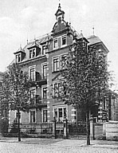

* * *

* * *

* * *

* * *

* * *

* * *

Die Geschichte des St. Joseph-Stiftes begann 1895, als das ursprünglich in der Friedrichstadt
gegründete Königliche Krankenstift eine umgebaute Villa auf der Wintergartenstraße 17 bezog _(Foto)_. Grund war der Wunsch des katholischen Königshauses, im Krankheitsfalle
von Schwestern der eigenen Konfession gepflegt zu werden. Eigens für diese Aufgabe wurden Angehörige des seit 1842 in Schlesien beheimateten Ordens der Heiligen Elisabeth
nach Sachsen verpflichtet. Nach ihrer Ordenstracht wurden diese “Graue Schwestern” genannt und übernahmen nun die Pflege der Patienten des Krankenstiftes. Zuvor hatten die
Schwestern bereits ab 1882 auf der Käufferstraße 2 eine kleine Privatklinik betrieben. Die Einrichtung stand von Beginn an allen Patienten, unabhängig von ihrer Religionszugehörigkeit,
zur Verfügung. Gab es zunächst nur 50 Betten, wuchs deren Anzahl bis 1945 auf 160 an.

Im Laufe der Zeit erwarb das St. Joseph-Stift mehrere Nachbargrundstücke und errichtete hier neue Gebäude. Der
letzte größere Umbau erfolgte zwischen 1930-32. Dabei wurde das bestehende Gebäude mit einem weiteren Bau auf
dem Nachbargrundstück mittels eines Verbindungsbaus zu einer Klinik vereinigt. Fortan standen im St.-Joseph-Stift
Abteilungen für Chirurgie, Frauenheilkunde, Orthopädie, HNO und eine Augenklinik zur Verfügung. Während des Zweiten Weltkrieges diente das Krankenhaus als Lazarett und wurde beim Luftangriff schwer beschädigt.

Unmittelbar nach Kriegsende begann der Wiederaufbau der zerstörten Gebäude, so dass bereits Anfang 1946 die ersten Kranken aufgenommen werden konnten. 1957 entstand außerdem ein Schwesternhaus für die Angestellten der
Klinik. Auch zu DDR-Zeiten behielt das katholische Krankenhaus seinen guten Ruf und ist bis heute als Geburtsklinik
beliebt. Mehrfach erfolgten Umbauten und Modernisierungen, so dass inzwischen über 200 Patientenbetten zur
Verfügung stehen. Dem 1989 fertig gestellten neuen Südflügel folgte 1995 ein weiteres Schwesternhaus, 2000 das nach
der Ordensgründerin benannte Clara-Wolff-Haus mit Palliativstation sowie 2003/04 ein weiterer Funktionstrakt sowie
der neue Nordflügel. Abgeschlossen wurden die Arbeiten im Herbst 2005 mit der Übergabe eines Ärztehauses an der Georg-Nerlich-Straße. Hier befindet sich auch eine Ausbildungsstätte für angehende Krankenpfleger.

Für die medizinische Betreuung gibt es im St. Joseph-Stift derzeit fünf Abteilungen: Innere Medizin, Chirurgie, Gynäkologie und Geburtshilfe, Anästhesie und Intensivmedizin sowie Orthopädie. 2009 wurde ein weiterer Ergänzungsbau an der Ecke Wintergarten-/Dinglingerstraße errichtet, 2012 erfolgte die Eröffnung einer Station für Akutgeriatrie.

* * *

 \[ [Home](../../../index.html)\] \[ [Nord](../../../nord/)\] \[ [Nordwest](../../../nordwest/)\] \[ [Neustadt](../../../neustadt/)\] \[ [Nordost](../../../nordost/)\] \[ [West](../../../west/)\] \[ [Zentrum](../../../zentrum/)\] \[ [Südwest](../../../sudwest/)\] \[ [Süd](../../../sud/)\] \[ [Südost](../../../sudost/)\] \[ [Ost](../../../ost/)\] \[ [Register](../../../Register/register.html)\] \[ [Kontakt](../../../Kontakt/kontakt.html)\] \[ [Impressum](../../../impressum/)\]
