* * *

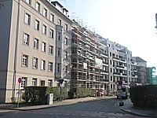Die heutige Alfred Schrapel-Straße wurde ab 16. Dezember 1926 Schillstraße genannt. Mit dieser Namensgebung sollte der preußische Major und Patriot Ferdinand von Schill (1776-1809) geehrt werden, welcher zu den wichtigsten Persönlichkeiten der antinapoleonischen Befreiungsbewegung gehörte. Am 1. Juli 1946 erfolgte die Umbenennung in Alfred-Schrapel-Straße. Der Lehrer Alfred Schrapel (1885-1945) gehörte seit 1921 als Mitglied und zeitweise als Vorsitzender der KPD-Fraktion dem Dresdner Stadtrat an. 1933 wurde er von den Nazis mit Berufsverbot belegt und war einige Wochen im KZ inhaftiert. Am 13. Februar 1945 kam er beim Luftangriff ums Leben.

Die Anton-Graff-Straße im Wohnviertel um den Stresemannplatz wurde um 1900 angelegt und im Anschluss mit villenartigen
Mehrfamilienhäusern bebaut. Der Name erinnert an den Kunstmaler Anton Graff (1736-1813), der ab 1766 als Professor an der
Dresdner Kunstakademie wirkte und vor allem durch seine Porträtbilder bekannt wurde. Trotz Kriegsschäden sind noch einige
architektonisch interessante Gebäude erhalten geblieben, darunter die Villa Anton-Graff- Straße 22. Das Gebäude entstand 1905
im Jugendstil und besitzt eine bemerkenswerte Innenausstattung. 1995/96 wurde das Haus denkmalgerecht saniert. Jugendstilelemente weisen auch die Häuser Nr. 8, 15, 19, 26 und 28 auf. Im Wohnhaus Anton-Graff-Straße 10b lebte ab 1928
die Reformpädagogin Else Sander, die sich in den Zwanziger Jahren für die Berufsausbildung junger Frauen einsetzte und nach 1945 Dozentin der Pädagogischen Hochschule war.

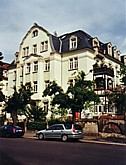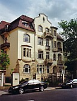

**_Fotos:_** _Stadtvillen auf der Anton-Graff-Straße (Nr. 26 und Nr. 28)_

Die Arnoldstraße verbindet seit Ende des 19. Jahrhunderts den Feldherrenplatz (heute Thomas-Müntzer- Platz) mit der
Gerokstraße. Ihren Namen erhielt sie nach dem Dresdner Buchhändler und Verleger Johann Christoph Arnold (1763–1847),
welcher auch als Stadtverordneter und Stifter tätig war. Von 1937 bis 1945 wurde der nördliche Straßenabschnitt nach dem
NSDAP-Reichstagsabgeordneten und General Karl Litzmann (1850-1936) Litzmannstraße benannt. Bereits am 24. Juli 1945 erfolgte die Rückbenennung der kompletten Straße.

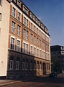Von den einst vorhandenen Mietshäusern sind nur wenige erhalten geblieben, darunter das 1910 in
Anklängen an den Jugendstil entstandene Wohnhaus Arnoldstraße 29. Unweit davon hatte ab 1913 die bekannte [Karosseriebaufirma Gläser](../../../zentrum/johannstadt/strassen_johannstadt/karosseriebaufabrik_glaser/) ihre Produktions- und Verwaltungsräume. Zuvor hatte ab 1882 die
von Georg Marwitz gegründte Bleicherei und Appreturanstalt hier ihren Sitz. Aus dem Unternehmen ging später die [Dresdner Gardinen- und Spitzenmanufaktur](../../../ost/dobritz/strassen_dobritz/) mit Sitz in Dobritz hervor.

Weitere Gebäude der Arnoldstraße beherbergten früher kleinere Handwerksbetriebe, Geschäfte und Gaststätten, so dass ab 1913  nachweisbare Restaurant “Blumenau” (Nr. 27). Das noch erhaltene
Gebäude steht ebenso wie die um die Jahrhundertwende entstandenen Wohnhäuser Nr. 29 und 31  unter Denkmalschutz.
Im Erdgeschoss des Hauses Nr. 16 befindet sich seit 2002 die Spielekneipe “Triangel” _(Foto)_. Das 1998 in Trachenberge gegründete Lokal bietet eine Auswahl von über 600 Karten- und Brettspielen zur Ausleihe an.

Säuglingsheim:

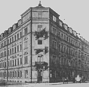Die Einrichtung wurde am 1. August 1898 vom jüdischen Arzt Dr. Arthur Schloßmann auf der
Arnoldstraße 1 _(Foto)_ gegründet und war erste Kinderklinik der Welt, welche ausschließlich Säuglinge aufnahm. Schloßmann, der bereits vier Jahre zuvor eine Kinderpoliklinik zur Versorgung
ärmerer Bevölkerungsschichten eingerichtet hatte, widmete sich hier speziell der Betreuung von Neugeborenen und gilt als einer der Begründer einer spezialisierten Kinderheilkunde. Anfangs
standen hier fünf, später 23 Bettchen zur Verfügung. Hinzu kamen Behandlungs- und Laborräume für wissenschaftliche Untersuchungen. Außerdem wurden hier erstmals spezialisierte
Kinderkrankenschwestern ausgebildet. Dank der Initiative des Arztes gelang es, die Säuglingssterblichkeit innerhalb weniger Jahre von 42 auf 23 Prozent zu senken. Die Finanzierung
der Kinderklinik übernahm ein Verein, dem neben Schloßmann u.a. Karl August Lingner, der Dresdner Oberbürgermeister Otto Beutler und der Rektor der Technischen Hochschule Prof. Ernst von Meyer angehörten.

Ursprünglich plante Arthur Schloßmann, seine Säuglingsklinik an das nahegelegene Johannstädter Krankenhaus anzuschließen, was jedoch von der Stadtverordnetenversammlung aus Kapazitätsgründen abgelehnt wurde.
Die zunächst in einer Mietwohnung im ersten Stock untergebrachte Einrichtung bezog im April 1904 das Haus Wormser Straße 4. Eine für die Ausstattung der neuen
Klinik ins Leben gerufene Spendensammlung brachte über 30.000 Mark ein. Nach Schloßmanns Wechsel nach Düsseldorf übernahm 1907 die Stadt die Verwaltung des Säuglingsheims, welches nach dem Ersten Weltkrieg um eine Kinderpoliklinik
erweitert wurde.  Das Dresdner Säuglingsheim wurde 1945 zerstört.

Die 1899 angelegte Bertheltstraße erhielt ihren Namen nach dem Pädagogen August Berthelt (1813-1896). Berthelt war ab 1833
in Dresden als Lehrer, später als Schuldirektor und königlicher Schulinspektor tätig und gehörte 22 Jahre dem Stadtrat an.
Außerdem zählte er zu den Mitbegründern des deutschen Lehrervereins und war Herausgeber der “Sächsischen Schulzeitung”. Sein Grab befindet sich auf dem [Trinitatisfriedhof](../../../zentrum/johannstadt/trinitatisfriedhof/). Im Haus Nr. 1 befand sich ab 1916 die “Frauenschule für christlichen
Frauendienst” mit angeschlossenem Internat. In der 1945 teilzerstörten und noch erhaltenen Villa Bertheltstraße 3 wohnte zwischen 1915 und 1938 der Dresdner Oberbürgermeister Bernhard Blüher (1864-1938).

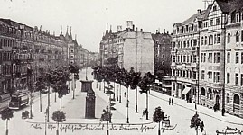Der an der Abzweigung Blumen-/ Pfotenhauerstraße gelegene Bönischplatz entstand Ende des 19. Jahrhunderts im Zuge der Bebauung der Johannstadt. Zuvor hatte es hier eine von mehreren Sandgruben in diesem Gebiet sowie das Rappoldische Gartenvorwerk gegeben. Die dreieckige Grundfläche, welche sich früher auch an anderen Johannstädter Plätzen fand, geht auf die Einbeziehung bereits vorhandener Wege in das neue Straßennetz zurück. Wie die meisten Plätze des Stadtteils wurde auch der von Wohn- und Geschäftshäusern umgebene Bönischplatz mit kleinen Grünflächen versehen, um die dichte Bebauung der Umgebung etwas aufzulockern _(Foto)_. Seinen Namen erhielt er 1897 nach dem Kommunalpolitiker Karl Friedrich Emil Bönisch (1832 -1894), welcher seit 1871 Stadtrat in Dresden und bis 1894 als Zweiter Bürgermeister tätig war. Nach seinem Ausscheiden übernahm Otto Beutler, späterer Oberbürgermeister Dresdens, das Amt.

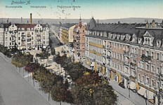In den meist dreistöckigen Gebäuden befanden sich zahlreiche Geschäfte und Lokale, die den Bönischplatz zu einem Zentrum der umliegenden Wohnviertel machte. So gab es im Haus Nr. 9 bereits vor dem Ersten Weltkrieg das Hotel und Restaurant Quack, welches sich 1911 im Besitz von Adolf Koch befand. 1945 wurde der Bau, ebenso wie die Nachbarhäuser Nr. 1 bis 7 zerstört. Auf der gegenüberliegenden Südseite _(Foto)_ befand sich u.a. eine Niederlassung der stadtbekannten Fischhandlung Paschky (Nr. 2) und eine eine Filiale des “Görlitzer Waaren-Einkaufs-Vereins”, einer nach Art der Konsum-Genossenschaften organisierten Ladenkette (Nr. 12). Im Eckhaus zur Wintergartenstraße (Bönischplatz 16) gab es die Schankwirtschaft “Elisens Ruhe”, deren Name an das gleichnamige Grundstück erinnerte, welches auch der [Elisenstraße](../../../zentrum/johannstadt/strassen_johannstadt/elisenstrasse/) ihren Namen gab.

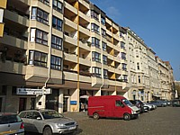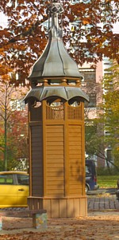Während die meisten Straßenzüge der Umgebung 1945 in Schutt und Asche versanken, blieben an der Nordseite des Bönischplatzes bis heute Reste der Vorkriegsbebauung erhalten. Diese wurden ab 1981 rekonstruiert und vermitteln so einen Eindruck vom früheren Straßenbild der Johannstadt. Die vorhandenen Baulücken (Nr. 1 bis 9) schloss man zwischen 1982 und 1986 mit Neubauten _(Foto)_. Im Rahmen eines aus Anlass des Pioniertreffens in Dresden ins Leben gerufenen Projektes entstanden diese als Einzelbauten in Anlehnung an die vorhandene Vorkriegsbebauung und wurden durch Lehrlinge des Bauhandwerks realisiert. Im Erdgeschoss gab es einige bis heute genutzte Ladenlokale. Die gegenüberliegende Seite prägen hingegen zehngeschossige Plattenbauten aus den 1970er Jahren.

2003 kam eine Holz-Keramik-Plastik der Künstler Andreas Rode und Thomas Wieduwilt hinzu. Außerdem befindet sich hier ein Holzhäuschen mit Einstieg in Kanalisation. Das um 1901 aufgestellte und 1945 Schutzhaus wurde 2015 durch eine historisch getreue Kopie ersetzt _(Bild rechts)_. Ein ähnliches Haus dieser Art steht hinter der Semperoper.

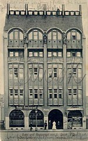Bönischhof (Nr. 9):
Das Gebäude mit einer repräsentativen Jugendstilfassade entstand um 1905 und beherbergte zunächst das Hotel und Restaurant Quack. Ab 1911 befand es sich im Besitz von Adolf
Koch. Nach dem Ersten Weltkrieg übernahm 1922 der Gastronom Emil Max Rahm den Betrieb und benannte sein Restaurant in Bönischhof um. Rahm hatte zuvor im Basteihotel und in einer Gastwirtschaft
in Rathen als Oberkellner gearbeitet und war ein begeisterter Bergsteiger. Auf  ihn geht die Erstbegehung des noch heute als “Rahm-Hanke” bekannten Klettersteiges unterhalb der Bastei zurück.
1933 verließ Rahm den Bönischhof und übernahm drei Jahre später die Leitung des Ratskellers in [Dresden- Coschütz](../../../sud/coschutz/). Das Haus wurde 1945 zerstört und in den 1980er Jahren durch einen Neubau
ersetzt.

**_Foto:_** _Hotel- und Restaurant Quack auf einer Postkarte von ca. 1910_

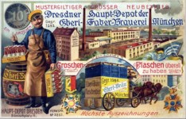Depot der Eberl-Faber-Brauerei (Nr. 11): Das 1897 errichtete Gebäude war früher Sitz
des Dresdner Hauptdepots der Eberl-Faber-Brauerei aus München. Das bayrische Großunternehmen hatte bereits 1894 auf der Holbeinstraße 115 ein Bierverlags-Depot
eingerichtet, welches Biere verschiedener Brauereien in Flaschen abfüllte und an Großabnehmer verkaufte. Aus Platzgründen verlegte die Firma ihr Depot 1897 zum
Bönischplatz 11. Hier standen neben dem Vorderhaus ein rückwärtiges Betriebsgebäude, Kessel- und Maschinenhaus sowie ein Kühlhaus zur Verfügung. In den sechs
Flaschenfüllanlagen konnten pro Schicht bis zu 10.000 Flaschen abgefüllt und etikettiert werden. Wichtigster Kunde war die [Felsenkellerbrauerei](../../../sud/plauen/plauenscher_grund/felsenkellerbrauerei/), die ihr Pils- und Lagerbier am
Bönischplatz in „Liter- und Groschenflaschen“ abfüllen ließ. Neben Dresdner Brauereien nutzten aber auch bayrische,
österreichische und Berliner Brauereien die Dienste des Unternehmens. Das ab 1920 zur Paulaner AG gehörende Bierdepot blieb auch nach 1945 erhalten und stellte erst Ende 1980 seine Produktion ein.

Elektra-Theater (Nr. 19): Das Kino mit ca. 200 Plätzen wurde 1908 als Lichtbildtheater “Elektra” im Haus Bönischplatz 19
eröffnet. Betreiber war zunächst die Firma Fritsch & Co., später wechselnde private Betreiber. 1920 ist das Kino letztmals unter
dem Namen Lichtbild-Theater Elektra im Adressbuch erwähnt. Im Anschluss nutzte die Firma Fiedler & Radestock die Räumlichkeiten. Das Gebäude im Eckhaus zur Gneisenaustraße (heute Bundschuhstraße) wurde 1945 zerstört.

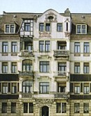Die 1901 nach dem preußischen Generalfeldmarschall August Graf Neithardt von Gneisenau
(1760-1831) benannte Gneisenaustraße wurde per 1. Juli 1946 in Bundschuhstraße umbenannt. Der Bundschuh, im Mittelalter ein typisches Bekleidungsstück bäuerlicher Schichten, gilt als ein Symbol des
Bauernkrieges und war zugleich Name der revolutionären Bauernbünde in Südwestdeutschland.

Im Gegensatz zum größten Teil der Johannstadt blieben an der Bundschuhstraße die meisten Gebäude bis
heute erhalten. Bemerkenswert sind die viergeschossigen Wohnhäuser Nr. 5 _(Foto)_ und 7, welche Fassaden im Stil des Historismus aufweisen. Die Häuser wurden 1903 vom Baumeister Carl Clemens
Türke erbaut. Im Treppenhaus der Bundschuhstraße 5 sind auch ein Zierbrunnen und die Ausmalung im Stil der Entstehungszeit erhalten. An der Ecke zur Feldherrenstraße (heute Florian-Geyer-Straße) gab es
das  Restaurant “Zum Gneisenauer Hof” (Nr. 12), eine der zahlreichen Eckkneipen des Stadtviertels.  Vor 1945 befand sich in Verlängerung der Gneisenaustraße die später zum Fährgarten verlegte Anlegestelle der Elbfähre.

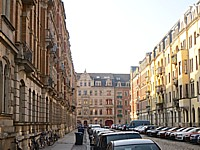Die Namensgebung der Burckhardtstraße erfolgte 1895 in Erinnerung an den Kürschnermeister Gottlob Samuel Burckhardt (1784-1849). Burckhardt regte als Stadtverordneter 1841 die Gründung eines Städtischen Bürgerhospitals an, in welchem alte und pflegebedürftige Menschen versorgt werden sollten. Das 1890 von der Friedrichstadt zur Pfotenhauerstraße verlegte [Bürgerhospital](../../../zentrum/johannstadt/strassen_johannstadt/pfotenhauerstrasse/) dient heute als Seniorenheim “Clara Zetkin”. Mit ihrer geschlossenen Bebaung der Gründerzeit erinnert die Burckhardtstraße noch heute an das ursprünglich in großen Teilen des Stadtteils zu findende Straßenbild mit mehrgeschossigen Mietshäusern _(Foto)_.

Die vom Straßburger Platz zum Stephanienplatz führende Canalettostraße verdankt ihren Namen dem italienischen Barockmaler
Canaletto (eigentlich Bernardo Belotto, 1720-1780). Canaletto gilt als einer der bedeutendsten Künstler seiner Zeit und schuf zahlreiche Stadtansichten von Dresden und Umgebung. Die offizielle Namensgebung erfolgte 1891.

Ab 1890 entstanden an der Canalettostraße meist Villen und einzeln stehende Wohnhäuser. Bemerkenswert war das 1891/92 von
Schilling & Graebner entworfene villenartige Doppelhaus Canalettostraße 5/7. Hier wohnte vor dem Ersten Weltkrieg der
Architekt und Teilhaber des Büros Julius Graebner (1858-1917). Wie alle Gebäude der Straße wurde auch diese Villa 1945 zerstört. Das gleiche Schicksal traf das erst in den 1930er Jahren errichtete Gemeindehaus der nahegelegenen [Andreaskirche](../../../zentrum/johannstadt/andreaskirche/). Zu den früheren Bewohnern der Canalettostraße (Nr. 11) gehörte auch die Schriftstellerin Marie Schramm-Macdonald (1846-1908),
die sich als Mitbegründerin der Dresdner Frauengruppe des Allgemeinen Deutschen Schulvereins für die Förderung der Literatur
einsetzte. Die Schriftstellerin und Journalistin Elisabeth Castonier (1894-1975) verbrachte in einer Villa der Comeniusstraße ihre
Kindheit. Später lebte die Familie in Paris und in England, wo Elisabeth Castonier als Autorin verschiedener Emigrantenzeitungen tätig war.

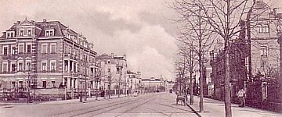

**_Foto:_** _Blick in die Canalettostraße vor 1945_

Der Comeniusplatz an der Einmündung der Fetscherstraße in die Stübelallee erhielt seinen Namen, ebenso wie die nördlich des
Platzes verlaufende Comeniusstraße, nach dem tschechischen Pädagogen Jan Amos Komensky (Comenius). Comenius lebte von
1592 bis 1670 und verfasste zahlreiche theologisch-pädagogische Lehrbücher. Als einer der ersten Pädagogen setzte er sich für
die Schulbildung von Mädchen und das Erlernen von Fremdsprachen ein. Von der Vorkriegsbebauung in der Umgebung des
1893 erstmals in den Adressbüchern verzeichneten Comeniusplatzes blieb nach den Bombenangriffen von 1945 lediglich die
sogenannte “Mutschmann-Villa” an der Comeniusstraße erhalten. Der südliche Bereich wird vom Großen Garten begrenzt.

Als Cranachstraße wird seit den 1970er Jahren ein Teilabschnitt der früheren Zöllnerstraße zwischen Striesener und Holbeinstraße
bezeichnet. Dieser war durch den Bau eines Sportplatzes vom übrigen Straßenverlauf abgetrennt worden. Benannt wurde die
Straße nach dem Maler und Grafiker Lucas Cranach d. Ä. (1472-1553), der ab 1505 als Hofmaler Friedrich des Weisen in
Wittenberg wirkte. Auch sein Sohn und Schüler Lucas Cranach d. J. (1515-1586) wurde als Maler bekannt. Einige Werke der beiden Künstler befinden sich in der Gemäldegalerie Alte Meister.

Die Dinglingerstraße verdankt ihren Namen dem Goldschmied und kurfürstlichen Hofjuwelier Johann Melchior Dinglinger
(1664-1731). Dinglinger lebte ab 1692 in Dresden und schuf in seiner Werkstatt zahlreiche Kunstwerke, die sich heute zum
Großteil im Grünen Gewölbe befinden. Zu den bekanntesten Stücken gehören der “Hofstaat zu Delhi am Geburtstag des Großmoguls Aureng-Zeb”, das “Goldene Kaffeezeug” und das “Bad der Diana”. Dinglinger befasste sich außerdem mit
technischen Problemen und ließ in seinem Wohnhaus auf der Frauengasse eine Sternwarte, eine Wetteruhr und eine mechanische Feuerspritze installieren.

Die offizielle Namensgebung der Dinglingerstraße erfolgte 1898. Nach Zerstörung der Vorkriegsbebauung entstanden Ende der
1950er Jahre an der Dinglingerstraße mehrgeschossige Wohnbauten mit Läden im Erdgeschoss. Außerdem gibt es hier eine Schule (Nr. 4), eine Kindertagesstätte (Nr. 12) und verschiedene Bauten des St. Joseph-Stifts.

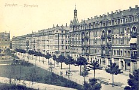Der Ende des 19. Jahrhunderts angelegte Dürerplatz war mit fast 2 Hektar größte
Platzanlage der Johannstadt. Die von Dürer-, Schumann-, Holbein- und Reißigerstraße begrenzte Fläche besaß ein sternförmiges Wegenetz und war entsprechend gärtnerisch
gestaltet. Um den Platz standen meist vierstöckige Wohnhäuser, oft mit Ladengeschäften im Erdgeschoss. Hier gab es vor 1945 u.a. vier Schuhmacher, eine öffentliche
Waschanstalt, das Textilhaus Mohrenberg und die Kinderwagenhandlung Rüger, außerdem mehrere Lebensmittelgeschäfte, drei Bäckereien und die Schankwirtschaft
Weinhold. Am Dürerplatz 6 existierte bereits 1906 das “Johannstädter Bad” mit mehreren Wannenbädern. Im Haus Dürerplatz 10 betrieb Karl Emil Oskar Beier die bekannte
Kunstglaserei Beier & Walther, wenige Häuser weiter befand sich im Eckhaus zur Dürersstraße (Nr. 13) das Restaurant “Zum
Badischen Hof”. Im Haus Nr. 22 gab es bis kurz nach dem Ersten Weltkrieg das kleine “Zentral-Kino“ mit 180 Plätzen.

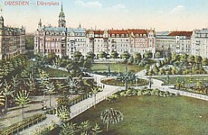Neben Spiel- und Ruheplätzen wurde in den Dreißiger Jahren auf dem Dürerplatz sogar
eine kleine Freilichtbühne für verschiedene Veranstaltungen angelegt. Eine geplante Umgestaltung des Platzes für nationalsozialistische Großveranstaltungen verhinderte der
Zweite Weltkrieg. Lediglich ein Löschwasserbecken entstand im Rahmen der Luftschutzmaßnahmen während des Krieges. 1945 wurden sämtliche Gebäude am Dürerplatz zerstört und wenig später abgerissen.

In der Nachkriegszeit befand sich hier der Standort einer Trümmerverwertungsanlage zur Aufbereitung von Ziegelsteinen für den Wiederaufbau. Heute findet man an Stelle des einstigen Dürerplatzes die Außenanlagen des
Bertolt-Brecht-Gymnasiums. Die Platzbezeichnung selbst wurde mit Beschluss des Stadtrates vom 5. August 1971 aufgehoben.

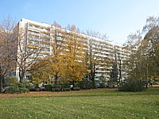Die Elsasser Straße entstand im Zusammenhang mit dem Bau der [Jägerkaserne](../../../zentrum/johannstadt/strassen_johannstadt/sachsenplatz/) und erhielt ihren Namen nach dem seit dem Deutsch-Französischen Krieg 1870/71 wieder zum Deutschen Reich gehörenden Elsaß, einer Region westlich des Rheins. Neben der 1881 eingeweihten Kaserne prägten bis 1945 repräsentative Wohnhäuser das Straßenbild. Im Haus Nr. 2 wohnte einige Jahre der Dresdner Stadtbaurat Hermann Klette, der am Bau der Augustus- und der Carolabrücke beteiligt war. Unweit davon gab es an der Einmündung der heute nicht mehr vorhandenen Hammerstraße die “Hammerschänke”, die sich bis 1912 im Besitz von Louis Kempter, danach von Franz Hermann Thierfelder befand. Heute stehen dieser Stelle Hochhäuser aus den 1970er Jahren. An der Fassade eines dieser Gebäude erinnert das Wandbild “Weltfestspielblumen” an die 1973 in Ostberlin veranstalteten Weltfestspiele der Jugend und Studenten.

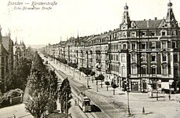Ebenso wie der angrenzende Fetscherplatz wurde auch die frühere Fürstenstraße 1946 umbenannt. Namensgeber war der Dresdner Arzt Dr. Rainer Fetscher (1895-1945), welcher in den Zwanziger Jahren als Mediziner auf dem Gebiet der Erbbiologie forschte. Nach seiner Entlassung durch die Nationalsozialisten praktizierte er ab 1934 als niedergelassener Arzt und bewohnte ein Haus auf der Rungestraße in Zschertnitz. Am 8. Mai 1945 wurde Fetscher beim Versuch, die Stadt kampflos an die Rote Armee zu übergeben von SS-Leuten auf der Prager Straße erschossen.

Die Fetscherstraße, die heute meist als östliche Grenze der Johannstadt nach Striesen
angesehen wird, wurde Ende des 19. Jahrhunderts mit mehrgeschossigen Mietshäusern, aber auch einigen Stadtvillen bebaut. Zu den Bewohnern dieser Häuser gehörten u.a. die Pianistin Marie Wieck (Nr. 69), Halbschwester Clara Wiecks, und die Familie Nowka (Nr. 89), deren Tochter Margarethe in den Zwanziger Jahren unter dem Künstlernamen Grethe Weiser als Schauspielerin berühmt wurde. Einige Hintergebäude wurden gewerblich genutzt, u.a. von den Zigarettenfabriken “Kosmos” (Nr. 70) und “Tuma” (Nr. 72).

Große Teile der Bebauung der Fürstenstraße fielen 1945 den Bomben zum Opfer. 1957 begann hier und an der Striesener Straße der Neuaufbau der Johannstadt, zunächst in Großblockbauweise. In diesem Zusammenhang entstand 1958 auch das Gebäude der [6\. POS “Otto Grotewohl”](../../../zentrum/johannstadt/) (heute 6. Grundschule). Architektonisch interessant ist der 1958 von Wolfram Starke entworfene Wohnblock Fetscherstraße 33-37, welcher eine Lücke in der erhaltenenen Gründerzeit- Bausubstanz schließt.

Nr. 42: In diesem Haus an Ecke zur Holbeinstraße befand sich vor dem Zweiten Weltkrieg das Marienheim II, eine Heimstätte für alleinstehende Damen. Die Einrichtung nutzte neben diesem auch das Nachbargebäude Holbeinstr. 121. Solche Einrichtungen, von denen es in der Johannstadt mehrere gab, boten Unterkunft für meist ältere, pflegebedürftige und alleinstehende Damen, wobei neben zahlenden Bewohnern auch günstige Plätze für minderbemittelte Frauen zur Verfügung standen. Ein ähnliches Heim befand sich mit dem Diakonissenhaus und Alterspensionat "Tabea" auf der Fürstenstraße 46. Alle drei Gebäude fielen 1945 dem Luftangriff zum Opfer.

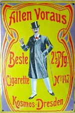Zigarettenfabrik “Kosmos” (Nr. 70): Das Unternehmen wurde von Heinrich Fürchtegott Wolf gegründet und am 1. Oktober 1886 unter dem Namen “Kosmos-Tabak- & Cigarettenfabrik H. F. Wolf” ins Handelsregister eingetragen. Ursprünglich hatte die Firma ihren Sitz im Stadtzentrum, bevor Wolf sie 1890 in ein eigenes Gebäude auf der Fürstenstraße 70 verlegte. Zunächst verarbeitete man überwiegend Rauchtabak, spezialisierte sich jedoch zunehmend auf die Herstellung von Zigaretten mit Hohlmundstück.

1901 wurde der Betrieb von Alexander Ewald Carl Felix Wolf übernommen. Die hier gefertigten Zigaretten verkaufte man unter Markenbezeichnungen wie “Kairo”, “Khedive exquisit”, “Kleine Prinzen” oder “Stern”. Bekannt wurde die Fabrik als Hersteller der ersten deutschen Filterzigarette “F 58” (1934). Um möglichst unabhängig von Zulieferern agieren zu können, errichtete man 1920 ein Hintergebäude für die Aufstellung moderner Kartonagenmaschinen, so dass das benötigte Verpackungsmaterial selbst produziert werden konnte. Umfangreiche Erweiterungen der Betriebsgebäude erfolgten ab 1922.

Ab 1927 firmierte die Zigarettenfabrik als "Kosmos" AG und befand sich im Besitz zweier Aktionäre. 1930 wandelte man den Betrieb jedoch wieder in eine GmbH um. Gleichzeitig schloss "Kosmos" einen Kooperationsvertrag mit einer Rotterdamer Tabakhandelsgesellschaft, um seinen Rohtabakbedarf überwiegend bei einem Lieferanten befriedigen zu können. Trotz schwerer Bombenschäden gelang es bereits im März 1945, die Produktion mit ausgelagerten Maschinen im Keller des Werkes wieder aufzunehmen. Im Zusammenhang mit dem Gesetz zur Enteignung von Großbetrieben sowie des Besitzes von Nazi- und Kriegsverbrechern erfolgte 1946 die Verstaatlichung zum VEB Kosmos. Neben Filterzigaretten verließen in den ersten Nachkriegsjahren auch die bei den russischen Besatzern beliebten "Papirossi, Zigaretten mit einem speziellen Pappmundstück, den Betrieb. Ab 1959 gehörte die Firma als Werk IV zum VEB Dresdner Zigarettenfabriken, bevor 1968 wirtschaftliche Gründe zur Aufgabe der Produktion führten. Heute nutzt eine Orthopädie- und Rehatechnik-Firma die Betriebsgebäude.

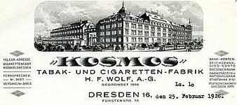

Der beim Luftangriff auf Dresden erheblich beschädigte Betrieb konnte nach Reparatur bzw. Rückführung des zum Teil ausgelagerten Maschinenbestands Ende Juni 1946 die Produktion wiederaufnehmen. Im gleichen Jahr erfolgte auf Grundlage des Volksentscheids die Enteignung des Betriebes zugunsten des Landes Sachsen. Ab 1959 gehörte “Kosmos” als Werk IV zum VEB Dresdner Zigarettenfabriken. Da inzwischen ausreichend modernere Zigarettenhersteller vorhanden waren, stellte man die Produktion jedoch bereits 1960 ein. Die noch vorhandenen Gebäude werden heute von einer Orthopädietechnik-Firma genutzt.

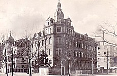Feinkostfachschule C. Beyer (Nr. 97): In diesem 1945 zerstörten Eckhaus an der Trinitatisstraße (Fiedlerstraße), unmittelbar gegenüber dem Jüdischen Friedhof, befand sich in den 1930er Jahren die Feinkostfachschule C. Beyer. Die private Bildungseinrichtung widmete sich der Ausbildung von Fachpersonal auf dem Gebiet der Lebensmittelherstellung und war auch Herausgeber entsprechender Literatur wie des “Deutschen Dekorations-Fachkalenders für Lebensmittel” und des Magazins “Das Lebensmittel-Fenster”. Hier wurden mit Hilfe illustrierter Beschreibungen Informationen über die Gestaltung von Schaufenstern sowie über Verkaufstechniken, Kalte Küche und hochwertige Lebensmittel vermittelt.

Die heutige Fiedlerstraße trug ab 1888 den Namen Trinitatisstraße, da sich an ihrem Anfang die [Trinitatiskirche](../../../zentrum/johannstadt/trinitatiskirche/) und angrenzend der [Trinitatisfriedhof](../../../zentrum/johannstadt/trinitatisfriedhof/) befinden. Ursprünglich war sie Teil eines alten Verbindungsweges aus der Innenstadt nach Blasewitz und
wurde noch bis 1880 Blasewitzer Straße genannt. Der jetzige Name wurde 1938 eingeführt und erinnert an den Oberarzt Prof.
Dr. med. Carl Ludwig Alfred Fiedler (1835-1921), welcher sich als königlicher Leibarzt und Oberarzt der Inneren Abteilung des
Städtischen Krankenhauses Friedrichstadt große Verdienste um das Gesundheitswesen der Stadt erwarb. 1894 erhielt Fiedler für sein Wirken den Ehrenbürgertitel der Stadt verliehen.

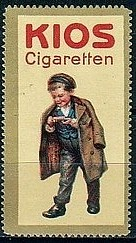Gleicher Herkunft ist die Bezeichnung Fiedlerplatz, welcher diesen Namen bereits seit 1899 trug. In die
großzügige Platzanlage wurde das sogenannte “Birkenwäldchen”, ein Rest des einstigen [Blasewitzer Tännichts](../../../ost/), einbezogen. Zu den markantesten Gebäuden des Areals gehörten die 1945 zerstörte 53.
Volksschule sowie das heute als Zahnklinik genutzte ehemalige [König-Georg-Gymnasium](../../../zentrum/johannstadt/strassen_johannstadt/konig-georg-gymnasium/). In den 1960er
Jahren wurde der Fiedlerplatz in das Gelände der Medizinischen Akademie einbezogen. Hier befindet sich u.a. das Rektoratsgebäude (Nr. 27).

Vor 1945 gab es an der Fiedlerstraße neben Wohnhäusern auch eine Reihe gewerblicher Betriebe. So befand sich auf dem Grundstück Fiedlerstraße
28 die “Kios”-Zigarettenfabrik von E. Robert Böhme. In unmittelbarer Nachbarschaft gab es mit der Zigarettenfabrik Josetti (Nr. 32) einen weiteren
Tabakwarenhersteller, während Nr. 34 Sitz der Saxonia-Getriebewerke Paul Heuer und Nr. 36 von Lippolds Reiseutensilien- und Lederwarenfabrik war. Im Haus Nr. 46 befand sich eine Niederlassung
der Firma Holzamer & Co., welche unter dem Markennamen “Esta” Schokoladen- und Zuckerwaren vertrieb. Nach 1945 nutzte ein Betriebsteil des VEB Präcitronic die Räume. Diese meist aus Handwerksbetrieben hervorgegangen
Kleinunternehmen prägten bis 1945 große Bereiche der Johannstadt.

Engelhardt´s: Die nach ihrem Besitzer benannte Gutswirtschaft entstand nach dem Siebenjährigen Krieg auf dem Areal des
aufgeteilten Vorwerks Tatzberg. 1813 fielen die Gebäude den Kampfhandlungen im Zusammenhang mit der Schlacht bei Dresden
zum Opfer. Daraufhin erwarb die Kirchgemeinde der Johanniskirche das Areal und ließ hier 1815 nach Plänen Thormeyers den Trinitatisfriedhof anlegen.

Die im Zuge des Ausbaus der Johannstadt angelegte Feldherrenstraße erhielt 1893 ihren Namen und bildete die Verlängerung der bereits 1877 entstandenen [Marschallstraße](../../../zentrum/pirnaische_vorstadt/strassen_pirnaische_vorstadt/marschallstrasse/) in der Pirnaischen Vorstadt. Am 27. September 1945 wurde sie wegen ihres “militaristischen Namens” in Florian-Geyer-Straße umbenannt. Der aus Franken stammende Ritter Florian Geyer von Giebelstadt (1490-1525) unterstützte während des Bauernkrieges mit seiner “Schwarzen Schar” die Aufständischen und vereinte die zuvor unorganisierten Bauerntruppen zu einer schlagkräftigen Armee. Nach deren Niederlage wurde Geyer 1525 von seinen Gegnern ermordet. Sämtliche Gebäude, darunter die Chemische Fabrik Gebrüder Korn (Nr. 39), fielen 1945 den Bomben zum Opfer.

1971 bezog man auch den verbliebenen Abschnitt der ab 1946 Rathenaustraße genannt, in die Florian-Geyer-Straße ein. Seit 2012 trägt dieser Straßenteil nach dem Architekten des Gerichtsgebäudes am Sachsenplatz den Namen Roßbachstraße. Das Straßenbild der Florian-Geyer-Straße prägen heute vorrangig Plattenbauten aus den 1970er Jahren. Im Wohnblock Nr. 43 befand sich viele Jahre ein Ausländerwohnheim für DDR-Gastarbeiter aus Ungarn und Mocambique.

Zwillingsbrunnen: An der Ecke Florian-Geyer-/ Elsasser Straße befindet sich seit 2006 der aus zwei quadratischen Becken
bestehende “Zwillingsbrunnen”. Diese 1959 entstandene Brunnenanlage stand ursprünglich vor dem Ring-Café in der Innenstadt,
wurde dort jedoch 2000 bei Bauarbeiten beseitigt. Bei der Neugestaltung der Brunnen rekonstruierte man auch die farbigen
Bodenmosaiken, welche dem Wasserspiel ein farbenprächtiges Bild verleihen. Die Originalschöpfungen von Kurt Sillack und Hermann Naumann waren beim Abriss zerstört worden.

Die nach 1945 teilweise überbaute Gabelsbergerstraße verband einst den Dürerplatz in der Johannstadt mit dem Wormser Platz in
Striesen. Benannt wurde sie 1889 aus Anlass des 100. Geburtstages des Erfinder der Stenografie Franz Xaver Gabelsberger
(1789-1849). 1911 und 1926 erfolgte eine Verlängerung bis auf Striesener Flur. Zu den wenigen erhaltenen Gebäuden der
Vorkriegszeit gehört das unter Denkmalschutz stehende Mietshaus Nr. 13. Im Haus Nr. 25 wohnte zeitweise der Psychologe und
TH-Professor Gustav Kafka. Kafka hatte 1923 seine Berufung zum Professor für Philosophie, Psychologie und Pädagogik
erhalten und war Mitbegründer des angeschlossenen Institutes. 1934 erwirkte er aus Protest gegen die Ausgrenzung seiner jüdischen Kollegen die Emeritierung.

Als Georg-Nerlich-Straße wird seit 1993 ein Teilabschnitt der früheren [Elisenstraße](../../../zentrum/johannstadt/strassen_johannstadt/elisenstrasse/) (später Hans-Grundig-Straße) zwischen
Canaletto- und Striesener Straße bezeichnet. Der Maler Georg-Nerlich (1892-1982) ließ sich 1948 in Dresden nieder und war
hier als Professor für Malerei und Grafik an der Architektur-Fakultät der Technischen Hochschule tätig. Zahlreiche seiner Werke gehören noch heute zum Kunstbestand der Universität.

Markantestes Gebäude ist die hier befindliche Canaletto-Grundschule (Nr. 1), benannt nach dem italienischen Maler Bernardo
Bellotto (1721-1780). Gegenüber erinnern vor dem Haus Nr. 2 vier Stolpersteine an das Schicksal der jüdischen Familie Fantl, die nach ihrer Deportation in Auschwitz ermordet wurde
. 2005 entstand ein architektonisch interessanter Mehrzweckbau nach Plänen des Büros Kilian Architekten. Das mit Glas, Klinkern und Aluminiumlamellen gestaltete Gebäude beherbergt neben einem Ärztehaus des [St.-Joseph-Stifts](../../../zentrum/johannstadt/st__joseph-stift/) auch eine Apotheke sowie eine Kindertagesstätte. Im Obergeschoss nutzt die Akademie für
Palliativmedizin einige Schulungsräume und Gästewohnungen.

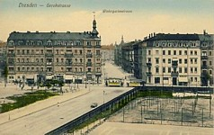Die Ende des 19. Jahrhunderts ausgebaute Gerokstraße ist Teil des alten Verbindungsweges zwischen Dresden und Blasewitz. Ihren Namen erhielt sie 1894 nach dem evangelischen Theologen und Kirchenliederdichter Karl von Gerok (1815-1890). Zuvor hieß sie von 1850 bis 1893 amtlich Blasewitzer Straße. Neben Wohn- und Geschäftshäusern befanden sich hier bis 1945 auch zahlreiche Geschäfte, Gaststätten und ein Kino. Bekannteste Lokale waren das “Gerokschlösschen” (Nr. 17), der “Carolagarten” (Nr. 27) und das Restaurant “Reichsbau” in der Nr. 56. Auch die Gebäude Nr. 5 (“Zum sächsischen Jäger”), Nr. 7 und Nr. 19 sowie Nr. 63 an der Ecke zur Stephanienstraße ("Turmhaus") beherbergten einst Schankwirtschaften. Außerdem befand sich an der Gerokstraße 65 das [Carolahaus](../../../zentrum/johannstadt/carolahaus/), erstes Krankenhaus der Johannstadt. In 1945 zerstörten Häusern lebten u.a. die Maler und Kunstprofessoren Karl Groß (Gerokstraße 4) und Otto Lange (Nr. 47) sowie der Architekt Robert Born (Nr. 51).

Zu den wenigen erhaltenen Gebäuden aus der Vorkriegszeit gehören das 1927-29 errichtete Postamt 16 (Gerokstraße 18) und die 1934 eröffnete [Städtische Berufsschule](../../../zentrum/johannstadt/) (Nr. 22). Die zerstörten Wohnbauten wurden ab 1969 durch mehrstöckige Wohnblocks ersetzt. Der markante Zehngeschosser an der linken Straßenseite entstand 1973. 2013 erfolgte der Abriss des Gebäudes (Nr. 5-11). Im gleichen Jahr begann der Bau einer neuen Rettungswache auf dem Gelände des früheren Plattenwerkes.

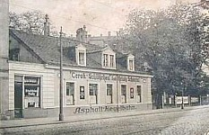Gerokschlösschen (Nr. 17):Die an der stadtauswärts linken Straßenseite gelegene Gartenwirtschaft entstand bereits Mitte des 19. Jahrhunderts als Ausflugslokal. Zu den Besuchern des wegen seines große Wirtshausgartens beliebten Restaurants gehörten viele Gäste der bis 1874 in unmittelbarer Nähe veranstalteten Vogelwiese sowie Künstler und Studenten der Kunstakademie. Mehrfach wechselte der Name der Gaststätte, die u.a. als “Brechling”, “Gerokschlösschen” und “Priebers Restaurant” in den Adressbüchern verzeichnet ist. Noch vor dem Beginn des Zweiten Weltkriegs musste die Wirtschaft schließen und einer Neubebauung des Grundstücks weichen.

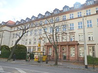Postamt (Nr. 18): Das im Stil der neuen Sachlichkeit gestaltete Gebäude wurde zwischen 1927 und 1929 errichtet und am 29. September 1930 eröffnet. Als eines der wenigen Gebäude der Gerokstraße überstand es den Luftangriff 1945, wurde dabei jedoch schwer beschädigt. Bereits Ende 1945 begann der Wiederaufbau als Postamt und zugleich Sitz der Oberpostdirektion Dresden.Nach 1990 übernahm die Direktion Postdienst der Deutschen Post das Gebäude, welches bis heute seinem Zweck dient.

Carolagarten (Nr. 27): Das Restaurant mit angeschlossenem Ballsaal entstand um 1880 an der Gerokstraße 27 in unmittelbarer Nähe des Carolahauses. Nach den “Blumensälen” war es zweitgrößtes Vergnügungslokal der Johannstadt. Neben Gast- und Vereinszimmern gab es einen Speise- und einen großen Ballsaal. Ab 1933 war im Saal des Carolagartens das Lichtspieltheater “National” untergebracht. Die Planungen für den Umbau stammten von Max Grübler. Am 4. Oktober 1933 konnte das Kino mit einer Vorführung historischer Filme aus dem Privatarchiv des Schriftstellers Walter Steinhauer eröffnet werden. 1945 wurde das Gebäude wie fast alle Häuser der Umgebung zerstört.

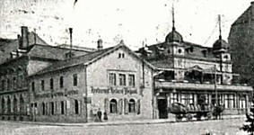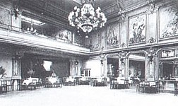

**_Fotos:_** _Ansicht das “Carolagartens” aus der Zeit vor dem Ersten Weltkrieg, rechts der große Ballsaal_

Elisencafé (Nr. 41): Im Erdgeschoss des 1945 zerstörten Wohnhauses Gerokstraße 41 befand sich bis Anfang der 1960er Jahre das stadtbekannte “Elisencafé”, beliebter Treffpunkt für Künstler und Studenten. Die Kneipe war durch Ausbau der Ruine entstanden und erinnerte an frühere Johannstädter Gaststätten wie den “Elisenhof” (Gerokstraße 69) und “Elisenruh” am Bönischplatz. Im Zuge der Neubebauung des Areals wurde das Haus um 1960 abgerissen.

Nr. 52: Die 1945 zerstörte Zigarettenfabrik “Persia” war einer der kleineren Dresdner Hersteller von Tabakwaren, die sich in den Hinterhöfen Johannstädter und Striesener Grundstücke befanden. Das 1897 gegründete Unternehmen im Besitz der Gebrüder Stade stellte Zigaretten der Marken "Persia" und "Stambul Extra" her.

Nr. 62-64: In diesem Gebäude hatte bis 1945 die Firma ERFO Fabrik sanitärer Anlagen ihren Sitz. Das 1910 im Handelsregister als Großhandlung sanitärer lnstallationsartikel G.m.b.H. eingetragene Unternehmen befand sich im Besitz des Kaufmanns Reinhard Ferdinand Oehme und stellte unter dem patentierten Warenzeichen "Erfo" Abort-Anlagen und Installationseinrichtungen für Spülbecken und Badewannen in verschiedenen Varianten her. Eine Filiale befand sich in Chemnitz.

Plattenwerk Johannstadt:

Das Ziegel- und Betonwerk ging aus einer 1945 auf dem Gelände des früheren [Carolahauses](../../../zentrum/johannstadt/carolahaus/) entstandenen Trümmerverwertungsanlage hervor. Zunächst wurden hier Ziegel aufgearbeitet, bevor man sich ab 1960 der Herstellung von Großplatten für den Wohnungsbau widmete. Der Betrieb gehörte bis 1990 zum Wohnungsbaukombinat Dresden und war Produzent verschiedener Fertigteilelemente und Naßzellen, die in Dresdner Neubaugebieten verwendet wurden.

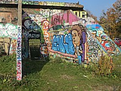Zwischen 1991 und 1995 setzte die Johannstadt Bau GmbH die Tätigkeit des Betonwerkes mit verändertem Profil fort, musste jedoch schließlich Insolvenz anmelden. Pläne für die Errichtung eines Wohn- und Gewerbepark scheiterten mehrfach, ebenso der Bau eines Kinder- und Jugendzentrums. Nach Beräumung des Betriebsgeländes wurde hier 2004 das Plattenbaumuseum “Betonzeitschiene” eingeweiht, welches mit verschiedenen Exponaten die Geschichte der Betonplattenfertigung und des Wohnungsbaus in der DDR dokumentierte. Idee und Konzept stammten vom irischen Künstler Ruairi O´Brian. 2007 musste die Schau nach Auslaufen des Nutzungsvertrages das Areal verlassen und soll künftig an anderer Stelle zu sehen sein. Auf einem Teil des Grundstücks wurde 2013/14 eine neue Rettungswache errichtet. Die Wache bietet Platz für zwei Rettungs- und zwölf Krankentransportfahrzeuge und sichert den Rettungsdienst für Johannstadt und die Altstadt ab.

Die Gluckstraße im östlichen Teil der Johannstadt wurde Ende des 19. Jahrhunderts angelegt und verdankt ihren 1878 verliehenen Namen dem deutschen Komponisten Christoph Willibald Gluck (1714-1787), welcher als Reformator der Oper im Geiste der Aufklärung gilt. Zu seinen bekanntesten Schöpfungen gehören u.a. “Orpheus und Eurydike” und “Iphigenie in Aulis”. Die meisten Wohnhäuser stammen aus der Zeit um 1900.

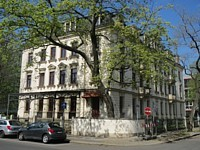Gasthaus “Zum Windmühlenberg” (Nr. 3): Die historische Gastwirtschaft verdankt ihren Namen den einst hier befindlichen vier Bockwindmühlen. Diese wurden zwischen 1784 und 1788 auf Befehl Kurfürst Friedrich August III. errichtet, um eine bessere Versorgung seiner Residenz zu sichern. Vor allem Striesener Bauern brachten ihr Getreide nun zu diesen Mühlen. Windmühlen, Wohnhäuser und Nebengebäude wurden 1813 von französischen Soldaten niedergebrannt und nicht wieder aufgebaut. Das freie Gelände war später zeitweise Standort einer kleinen Kaffeewirtschaft, bevor an deren Stelle 1895 das noch heute existierende Gebäude entstand. Im Erdgeschoss befand sich jahrzehntelang bis nach 1990 das Restaurant "Zum Windmühlenberg". Als eines der wenigen Häuser der Johannstadt überstand der "Windmühlenberg" im Eckhaus Dürer- / Gluckstraße die Zerstörungen von 1945 und dient bis heute gastronomischen Zwecken.

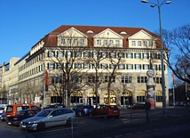Die früher Eliasplatz genannte Anlage entstand 1875 und sollte ursprünglich als halbkreisförmige Fläche mit einem Denkmal den repräsentativen Auftakt zur Sachsenallee bilden. Da man für den Ausbau jedoch Teile des historischen Eliasfriedhofes hätte beseitigen müssen, gab man diesbezügliche Planungen später auf. Stattdessen entstanden auch hier mehrstöckige Wohn- und Geschäftshäuser. Zuvor hatte es lediglich einige als “Wolfs Ruhe” bezeichnete Gebäude gegeben, welche an Stelle einer alten Schanze aus den Napoleonischen Kriegen errichtet worden waren.

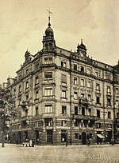Im Eckhaus Güntzplatz 1 an der Ecke zur Lothringer Str. befand sich vor dem Zweiten Weltkrieg die Elias-Apotheke, im Nachbarhaus Nr. 3 das Restaurant "Zur Eliasburg". Ab 1927 nutzte eine Filiale der Dresdner Handelsbank das 1945 zerstörte Gebäude _(Foto rechts)_. 1913 folgte auf dem Grundstück zwischen Gerok- und Blumenstraße das von Hans Erlwein entworfene Stadthaus Johannstadt. Als einziges Bauwerk überstand dieses Haus die Enttrümmerung der Nachkriegszeit als Ruine und beherbergt heute den Hauptsitz der Dresdner Sparkasse. Außerdem ist der Güntzplatz Schnittpunkt mehrerer Straßenbahnlinien. Am 19. März 1872 war hier der erste Spatenstich für die erste Dresdner Pferdebahn vom Böhmischen Bahnhof nach Blasewitz erfolgt.

Seinen heutigen Namen erhielt der Güntzplatz nach dem Unternehmer und Stifter Dr. Justus Friedrich Güntz (1801-1875). Der promovierte Jurist gehörte ab 1836 dem Dresdner Stadtrat an und war ab 1837 Herausgeber und Redakteur des “Dresdner Anzeigers”. Dessen Erlöse flossen später in die von ihm begründete Güntz-Stiftung zur Förderung sozialer und kultureller Projekte. Das Grab von Justus Friedrich Güntz befindet sich auf dem angrenzenden Eliasfriedhof.

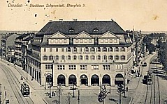Stadthaus Johannstadt: Das Gebäude wurde 1913/14 nach Plänen des Dresdner Stadtbaurates Hans Erlwein errichtet. Für den Bau musste ein bereits zuvor als Sitz der Städtischen Sparkasse genutzter Vorgängerbau weichen. Das neue Stadthaus beherbergte nach seiner Eröffnung am 3. Juli 1914 ebenfalls eine Zweigstelle der Sparkasse und mehrere Läden, die Obergeschosse dienten als Büros verschiedener städtischer Dienststellen, u.a. des Steuer-, Versicherungs- und Armenamtes sowie der Wohlfahrtspolizei _(Foto um 1915)._

1945 wurde das Haus schwer beschädigt, konnte jedoch durch den Ausbau der Erdgeschossräume schon ab Mai 1949 behelfsmäßig nutzbar gemacht werden. 1950/51 erfolgte der Wiederaufbau unter weitgehender Wahrung des historischen Aussehens. Zeitweise war hier das Dresdner Schulamt untergebracht. Heute nutzt die Ostsächsische Sparkasse das 1995/97 komplett neu aufgebaute und sanierte Gebäude als Hauptsitz. Beim Umbau wurde der Komplex um einen modernen Anbau an der Gerok- und Elsasser Straße erweitert. An der Fassade erinnert seit 2015 eine Gedenktafel an den Architekten Hans Erlwein und den Bankier Curt Kirschner. Kirschner hatte als erster Sparkassendirektor nach 1945 den Abriss des Hauses verhindert und dafür gesorgt, dass das Stadthaus nach dem Wiederaufbau zum Hauptsitz der Sparkasse wurde. Vor dem Haus steht eine historische Litfaßsäule vom Beginn des 20. Jahrhunderts.

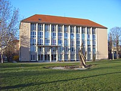Die Güntzstraße erhielt ihren heutigen Namen ebenso wie der an ihrem nördlichen Ende angrenzende Güntzplatz nach dem Unternehmer und Stifter Dr. Justus Friedrich Güntz (1801-1875). Teilweise folgt sie in ihrem Verlauf dem ehemaligen Akzisering. Dieser von Friedrich August dem Gerechten 1823 veranlasste Rundweg umschloss einst den abgabepflichtigen Stadtbereich und verband die an den Einfahrtsstraßen nach Dresden befindlichen Mautstationen.

Ursprünglich hieß diese Straße Eliasstraße, benannt nach dem hier gelegenen, um 1680 angelegten Eliasfriedhof. Dessen Namenspatron war der israelitische Prophet Elija, der der Legende nach Tote wieder zum Leben erwecken konnte. Da die Namensgebung nach einem jüdischen Propheten in der Nazizeit als unpassend galt, erfolgte kurz nach den Pogromen 1938 die Umbenennung von Eliasplatz und -straße in Güntzplatz bzw. Güntzstraße.

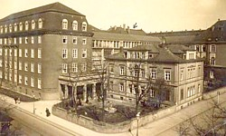Bis 1945 prägten neben Wohnhäusern und dem markanten Gebäude der [Kunstgewerbeschule](../../../zentrum/johannstadt/strassen_johannstadt/kunstgewerbeschule/) verschiedene öffentliche Einrichtungen das Straßenbild. So nahmen die Bauten der [Ehrlichschen Schulstiftung](../../../Zentrum/Pirnaische_Vorstadt/Strassen_Pirnaische_Vorstadt/Ehrlichsches_Gestift/ehrlichsches_gestift.html) und der zugehörigen Kirche das gesamte Areal zwischen Güntz-, Grunaer, Blochmann- und Comeniusstraße ein. Im Haus Nr. 4 an der Ecke zur Comeniusstraße gab es eine Staatliche höhere Mädchenbildungsanstalt, im Haus Nr. 24 das Henriettenstift, ein von der jüdischen Gemeinde unterhaltenes Altenheim. Auf dem Grundstück Nr. 30/32 hatte die Landesversicherungsanstalt Sachsen ihren Sitz _(Foto rechts)_. Zu den Bewohnern der Eliasstraße gehörten u.a. der Tier- und Landschaftsmaler Johann Friedrich Wilhelm Wegener (1812-1879) (Nr. 6), der Bildhauer Rudolf Born (1882-1969) (Nr. 22) und der Architekt Ernst Giese (1832-1903) (Nr. 26).

Mit Ausnahme der Kunstgewerbeschule und eines gegenüberliegenden Wohnhauses wurden sämtliche Gebäude 1945 zerstört. Zwischen 1953 und 1956 entstanden an deren Stelle Studentenwohnheime der Technischen Universität und Gebäude für die Ingenieurhochschule. An der Fassade des von Wolfgang Rauda entworfenen Wohnheims _(Foto)_ zeigen Relieftafeln von Reinhold Langner Darstellungen zur Geschichte Dresdens. Die Themen der elf Relieffelder erstrecken sich dabei von der Gründung der Stadt im Mittelalter bis zum
sozialistischen Aufbau nach 1945. Nach dem Tod Langners 1957 übernahm Walter Hempel die Fertigstellung der Kunstwerke.

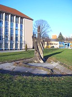An der Einmündung der Pillnitzer Straße erinnert ein Denkmalbrunnen an den uralten Menschheitstraum vom Fliegen _(Foto)_. Die Plastik “Flugwille des Menschen” wurde 1958 von Max Lachnit geschaffen. Für den Brunnen nutzte man teilweise die Fundamente und
Technik eines früheren Gartenbrunnens an dieser Stelle. Der aus einer aufstrebenden Figurengruppe inmitten eines ovalen Beckens bestehende Brunnen besitzt acht Fontänen und kann nachts auch beleuchtet werden. Eine umfassende Sanierung erfolgte 2014.

Nr. 22: Das 1945 zerstörte Gebäude an der Pillnitzer Straße unmittelbar gegenüber der Johanneskirche wurde zeitweise von verschiedenen Künstlern als Wohn- und Atelierhaus genutzt. 1898 wohnte hier der Bildhauer Rudolf Born (1882-1969). Als Schüler von Robert Diez und Georg Wrba schuf er verschiedene Bauplastiken und gehörte der Dresdner Sezession 1925 an. Ab 1940 war er Professor für Plastik am Bau an der Kunstakademie. Auch Heinrich Epler (1846-1905), Bildhauer und ab 1897 Professor der Kunstakademie, besaß einige Jahre sein Atelier im Haus.

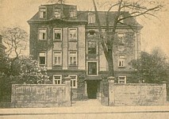Henriettenstift (Nr. 24): Das Henriettenstift wurde 1852 vom jüdischen Bankiersehepaar Henriette und Wilhelm Schie gestiftet, die damit bedürftigen Gemeindemitgliedern einen Altersruhesitz schaffen wollten. Wilhelm Schie war viele Jahre Vorsteher der israelitischen Gemeinde Dresdens und gehörte als erster jüdischer Abgeordneter überhaupt dem Stadtrat an. Das Paar finanzierte auch einen Großteil des Baus der Synagoge am Hasenberg. Den zunächst neun Bewohnern des Altersheimes _(Foto)_ standen kleine separate Wohnungen mit Küche, Bad, Stube und Kammer zur Verfügung. Die Finanzierung der Betriebskosten und die Zahlung einer kleinen Rente in Höhe von 30 Reichsmark erfolgte aus den Zinserträgen der Stiftung. 1904 erfolgte eine Erweiterung des Stifts nach Plänen des Architekten Paul Marcus.

Nach Überwindung der wirtschaftlichen Probleme der Inflation und der Weltwirtschaftskrise plante man Ende der Zwanziger Jahre eine erneute Erweiterung des Henriettenstiftes. Mit Machtübernahme der Nazis konnten diese Absichten jedoch nicht mehr realisiert werden. Stattdessen wurde das Heim 1940 in ein “Judenhaus” umgewandelt und diente der Zwangseinquartierung von aus ihren Wohnungen vertriebenen Juden. Am 14. Juli 1942 wurden die verbliebenen Bewohner deportiert und nach Theresienstadt verbracht, wo nur wenige die Nazizeit überlebten. Das Gebäude des Henriettenstiftes wurde 1945 zerstört. An gleicher Stelle entstand in den 1950er Jahren ein Studentenwohnheim (Güntzstraße 26-28). Hier erinnert seit 1966 eine Gedenktafel von Werner Hempel an das Schicksal des Altersheimes und seiner Bewohner.

Goldener Ring (Nr. 23): Das Gebäude an der Kreuzung zur Dürerstraße beherbergte bis zu seiner Zerstörung 1945 das Restaurant "Goldner Ring", nach dem Ersten Weltkrieg auch "Zum goldnen Ring" genannt. Von den zahlreichen Wohn- und Geschäftshäusern der Westseite der Güntzstraße überstand lediglich ein einziges Haus (Nr. 31), unmittelbar am [Eliasfriedhof](../../../Zentrum/Pirnaische_Vorstadt/Eliasfriedhof/eliasfriedhof.html) gelegen, die Zerstörungen des Zweiten Weltkriegs.

Nr. 30/32: In diesem nach dem Ersten Weltkrieg abgebrochenen Haus hatte einst der Bildhauer Ernst Hähnel sein Atelier. Dieses übernahm später Johannes Schilling, der hier zahlreiche seiner Werke schuf und am 17. September 1882 sogar Kaiser Wilhelm I. zur Besichtigung seines Entwurfs für das Niederwalddenkmal begrüßen durfte. Nach dem Abriss entstand auf dem Grundstück ein Neubau für die Landesversicherungsanstalt, welcher 1945 den Bomben zum Opfer fiel.

Die Gutenbergstraße wurde Ende des 19. Jahrhunderts angelegt und trägt seit 1897 ihren Namen nach dem Erfinder des Buchdrucks, Johannes Gutenberg (1394-1468). Johannes Gensfleisch zu Gutenberg erfand den Buchdruck mit beweglichen metallischen Lettern und revolutionierte damit das Druckgewerbe.

Vor 1945 produzierte im Grundstück Nr. 11 / Blumenstraße 70 die Chemische Farbenfabrik E. T. Gleitsmann verschiedene Farbstoffe und Lacke. In der Nr. 5 war das Speisenhaus des Vereins Volkswohl untergebracht. Das heute nicht mehr vorhandene Gebäude entstand, ebenso wie das Nachbarhaus Nr. 3, um 1900 für den Dresdner Spar- und Bauverein. Architekt war Hermann Thüme, benannt wurden die Häuser nach ihren Stiftern "Silomon- Sulzberger-Haus" (Nr. 3) bzw. "Marwitzhaus" (Nr. 5).

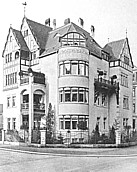Die Ende des 19. Jahrhunderts in der Nähe des Großen Gartens angelegte Hähnelstraße erhielt ihren Namen 1892 nach dem Bildhauer Ernst Julius Hähnel (1811-1891). Hähnel, Professor an der Kunstakademie, war u.a. an der künstlerischen Ausgestaltung der ersten Semperoper und der Gemäldegalerie beteiligt und schuf das Körnerdenkmal am Georgplatz sowie das Denkmal Friedrich August II. am Neumarkt. Sein Grab befindet sich auf dem [Alten Katholischen Friedhof](../../../zentrum/friedrichstadt/strassen_friedrichstadt/friedrichstrasse/innerer_katholischer_friedhof/).

Das Straßenbild prägten bis zur Zerstörung 1945 vorrangig großbürgerliche Villen und Landhäuser, die zum Teil von renommierten Dresdner Architekten entworfen wurden. Zu den schönsten Bauten gehörte das Eckhaus zur Bertheltstraße _(Nr. 13 - Foto)_, welches 1901 nach einem Entwurf des Architekturbüros Schilling & Gräbner für den Konzertmeister Professor Henri Wilhelm Petri entstand. Die Bildhauer Friedrich Offermann und Karl Groß schufen den plastischen Schmuck. Auch dieses Gebäude wurde 1945 zerstört, ebenso das frühere Wohnhaus des Juristen Dr. Johannes Müller (Nr. 9). Der nach dem Angriff in die Nähe von Berggießhübel geflüchtete Müller kehrte im Juni 1945 nach Dresden zurück und übernahm am 5. Juli das Amt des Oberbürgermeisters. Im Oktober 1945 wurde er auf Betreiben Kurt Fischers und Walter Weidauers abgelöst. 1898 hatte in diesem Gebäude der Bildhauer Hans Hartmann-MacLean (1862-1946) gelebt. Hartmann war ein Schüler von Johannes Schilling und Mitglied der Künstlergruppe "Grün-Weiß". Von ihm stammen einige Plastiken an der Nordfassade der [Kunstgewerbeschule](../../../zentrum/johannstadt/strassen_johannstadt/kunstgewerbeschule/) sowie der 1945 zerstörte Stübelbrunnen am Stübelplatz. Sein Grab befindet sich auf dem Trinitatisfriedhof.

Die heute nicht mehr vorhandene Hammerstraße lag im Quartier zwischen Elsasser, Florian-Geyer- und Elisenstraße und wurde 1896 nach dem Dichter Julius Hammer benannt. Nach Zerstörung sämtlicher Wohnhäuser blieb sie noch bis 1968 im Stadtplan verzeichnet, wurde dann jedoch überbaut.

Im Hintergebäude Hammerstraße 8 befand sich um 1930 die Werkstatt von Hans Schütze. Unter dem Namen HASCHÜT Motorradbau stellte er zwischen 1929 und 1931 einfache und kostengünstige Motorräder sowie Seitenwagengespanne her, die mit Motoren des britischen Herstellers Villiers ausgestattet wurden. Wirtschaftliche Gründe beendeten die Fabrikation jedoch schon nach wenigen Jahren. Im Hintergebäude der Nr. 16 lebte und arbeitete 1940 der Bildhauer Kurt Loose (1913-2011). Loose studierte an der Kunstakademie und war ein Schüler Georg Wrbas. Zu seinen noch heute im Stadtbild zu findenen Werken gehört die Figurengruppe "Junge Pioniere" an der Grunaer Straße (1953/54).

Die Hans-Grundig-Straße entstand in den 1960er Jahren durch Umbenennung der früheren Elisenstraße. Ihren Namen erhielt sie nach dem Maler und Grafiker Hans Grundig (1901-1958), der nach seinem Studium an der Dresdner Kunstgewerbeschule 1929 die Künstlervereinigung ASSO (Assoziation Revolutionärer Bildender Künstler) gründete. Wegen seiner Mitgliedschaft in der KPD wurde er in der NS-Zeit verfolgt und war zeitweise im KZ Sachsenhausen inhaftiert. Nach seiner Rückkehr nach Dresden wurde Hans Grundig 1948 Rektor der Kunstakademie.

1993 erfolgte eine teilweise Rück- bzw. Neubenennung der Hans-Grundig-Straße. Während der mittlere Teil zwischen Gerok- und Striesener Straße seinen Namen behielt, werden die nördlichen und südlichen Abschnitte heute wieder [Elisenstraße](../../../zentrum/johannstadt/strassen_johannstadt/elisenstrasse/) bzw. Georg-Nerlich-Straße genannt. 2009 entstand auf einer Freifläche ein moderner Neubau für die Staatliche Studienakademie Dresden und die Evangelische Hochschule für Soziale Arbeit. Künftig sollen hier die Bibliotheken der beiden Hochschulen, die Mensa und die Holzwerkstätten der Studienakademie untergebracht werden. Auch die zuvor von der Fakultät Informatik der Technischen Universität genutzten Altbauten werden in den Komplex einbezogen. Diese waren 1930 bzw. 1958 als Lehrgebäude errichtet und später aufgestockt worden.

Die Hassestraße verdankt ihren Namen dem Komponisten und sächsischen Hofkapellmeister Johann Adolf Hasse (1699-1783). Hasse lebte ab 1733 gemeinsam mit seiner Frau Faustina, einer bedeutenden Opernsängerin, in Dresden und schuf zahlreiche kirchenmusikalische Werke und über 100 Opern. Außerdem leitete er bis 1763 die Hofkapelle und führte dort eine neue musikalische Stilrichtung ein, die den Gesang der Solisten in den Vordergrund stellte. Benannt wurde sie 1891.

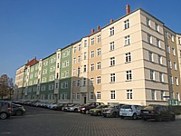Die ab 1904 bis 1946 nach dem preußischen General und Militärreformer Gerhard Johann von Scharnhorst (1755-1813) benannte Scharnhorststraße in der Nähe des Thomas Müntzer-Platzes erhielt im Zuge der Tilgung aller Straßennamen mit militärischem Bezug in diesem Gebiet am 1. Juli 1946 den Namen Heinrich-Beck-Straße. Heinrich Beck (1865-1945) war Lehrer an der 1. Bezirksschule in Dresden und gehörte ab 1900 als Abgeordneter dem Dresdner Stadtrat an. Als Kommunalpolitiker war er zugleich Vorstandsmitglied des Allgemeinen Mietbewohner-Vereins und zeitweise Vorsitzender der Freisinnigen Volkspartei (ab 1919 Deutsche Demokratische Partei). Nach Machtübernahme der Nationalsozialisten musste Beck sein Mandat 1933 niederlegen und verstarb im Februar 1945 in Dresden.

Die Henzestraße entstand um 1900 im südlichen Teil der Johannstadt im Zusammenhang mit der Bebauung des Areals mit Villen und Landhäusern. Ihren Namen verdankt sie dem Bildhauer Robert Henze (1827-1906), welcher ab 1881 Ehrenmitglied der Dresdner Kunstakademie war. Henze schuf u. a. das nach 1945 abgerissene Germania-Denkmal auf dem Altmarkt, die Nike-Figur auf der Kunstakademie und den [Müllerbrunnen](../../../sud/plauen/strassen_plauen/mullerbrunnen/) in Dresden-Plauen.

Zu den Bewohnern der Henzestraße gehörten der Kommunalpolitiker und Dresdner Oberbürgermeister Bernhard Blüher, der 1933 von den Nazis aus dem Amt gedrängte DNN-Chefredakteur Julius Wolff (beide Nr. 10) und Blühers Nachfolger im Oberbürgermeisteramt Wilhelm Külz (Nr. 12). Beide Gebäude fielen 1945 den Bomben zum Opfer.

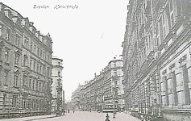Die Ende des 19. Jahrhunderts angelegte Hertelstraße verdankt ihren Namen dem früheren Dresdner Ratsherren und Bürgermeister Theodor Julius Hertel (1807-1880). Hertel übte dieses Amt von 1853 bis zu seinem Tod aus. Benannt wurde sie 1893.

Bis heute haben sich an der Hertelstraße zahlreiche Gebäude der zwischen 1895 und 1900 errichteten Vorkriegsbebauung erhalten. In vielen dieser Häuser gab es einst kleine Lokale, Läden oder Handwerksbetriebe. So befand sich im heute nicht mehr vorhandenen Eckhaus zur Terscheckstraße (Nr. 8) früher das Restaurant und Café von Bruno Weichert. Gegenüber hatte um 1900 die Eiskellerei Paul Schramm ihr Domizil, die vor dem Ersten Weltkrieg mit dem Titel "Königlicher Hoflieferant" warb. Später nutzten eine Firma für Sanitärinstallationen und eine Kfz-Werkstatt die Räume. Eine weitere Gaststätte befand sich mit der "Hertelklause" (zeitweise "Zum Goldenen Hufeisen") auf der Hertelstraße 29. Das Lokal kam 1958 unter Verwaltung der HO und existierte noch bis nach 1990.

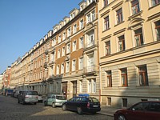Da die Hertelstraße 1945 von größeren Kriegsschäden verschont blieb, vermittelt sie noch heute weitgehend das Bild eines geschlossenen Straßenzugs der Gründerzeit, wie er vor 1945 für weite Teile der Johannstadt typisch war. Neben den mit aufwendigen Schmuckelementen gestalteten Fassaden besitzen einige Häuser auch wertvolle Durchfahrt- und Treppenhausgestaltungen. Zum Einsatz kamen neben Stuckarbeiten und Deckenmalereien auch künstlerisch gestaltete Fliesen, Treppengeländer und Ziergitter. Architektonisch bemerkenswert sind u.a. die Häuser Nr. 18, 1895/96 für Beamte und Offiziere der nahegelegenen Jägerkaserne errichtet, Nr. 20 (1895), Nr. 23 (1895) mit Landschaftsdarstellungen und bemalten Decken im Hausflur, Nr. 25 (1895) mit Bildmedaillons von Dürer und Raffael und Nr. 33 (1895) im Stil der deutschen Renaissance mit einer aufwendigen Sandsteinfassade. Wegen ihrer architektonisch-künstlerischen Bedeutung stehen diese Gebäude seit 1992 unter Denkmalschutz und wurden in den vergangenen Jahren saniert.

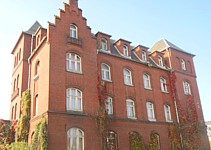Ostkraftwerk: 1892 entstand an der Hertelstraße ein Kraftwerk zur Stromerzeugung für Dresdens erste elektrische Straßenbahnlinie. Diese wurde am 6. Juli 1893 eröffnet und führte vom Schloßplatz über den Sachsen- und Eliasplatz nach Blasewitz. Das Werk befand sich ungefähr in der Mitte der Strecke und gehörte zunächst der Dresdner Straßenbahn-Gesellschaft. In unmittelbarer Nachbarschaft lag der Straßenbahnhof zur Unterstellung und Wartung der Fahrzeuge. Bereits zwei Jahre später erwarb die Stadt Dresden das Kraftwerk und baute es, um den wachsenden Stromverbrauch zu decken, weiter aus. 1898 verfügte es über insgesamt acht Dampfmaschinen und besaß eine Gesamtleistung von 4900 PS.
Zur Unterscheidung zum DREWAG-Kraftwerk an der Wettiner Straße wurde das Johannstädter Werk als Ostkraftwerk bezeichnet. 2012 erfolgte mit Ausnahme des Verwaltungsgebäudes _(Foto)_ der Abriss alle Gebäude für ein geplantes Hightech-Zentrum.

Die 1880 auf dem Gelände der ehemaligen Kunstgärtnerei Lüdicke angelegte Straße erinnerte an die einstige Kamelienzucht des Gärtnermeisters Lüdicke, der 1813 einen Teil des Vorwerks [“Hopfgartens”](../../../zentrum/johannstadt/strassen_johannstadt/hopfgartenstrasse/) erworben hatte. Nach Zerstörung sämtlicher
Wohnhäuser der Kamelienstraße wurde diese im Zuge der Neubebauung des Areals zwischen Pfotenhauer- und Gerokstraße überbaut und teilweise in die Hopfgartenstraße einbezogen.

Die bereits im 19. Jahrhundert angelegte und 1880 amtlich benannte Kreutzerstraße verdankt ihren Namen dem deutschen Komponisten Conradin Kreutzer (1780-1849), der u. a. Hofkapellmeister in Stuttgart und Donaueschingen war und ein Vertreter der Frühromantik in der Musik ist. Kreutzer schuf u.a. mehrere Opern, Schauspiel- und Chormusik. Die Wohngebäude der Kreutzerstraße wurden 1945 sämtlich zerstört und in den 1960er Jahren durch Neubauten ersetzt.

Die Lipsiusstraße wurde kurz vor dem Ersten Weltkrieg angelegt und verbindet die Stübelallee mit dem nahegelegenen
Stresemannplatz. Ihren Namen erhielt sie nach dem deutschen Architekten Konstantin Lipsius (1832-1894), welcher u.a. Erbauer der Kunstakademie auf der Brühlschen Terrasse und des [Fabrice-Mausoleums](../../../neustadt/albertstadt/strassen_albertstadt/stauffenbergallee/) an der Stauffenbergallee war. An Lipsius erinnert
auch die an der Einmündung Lipsiusstraße / Stübelallee stehende [Lipsiussäule](../../../zentrum/johannstadt/strassen_johannstadt/stubelallee/). Zahlreiche Gebäude der Lipsiusstraße fielen 1945
den Bomben zum Opfer und wurden in den 1970er Jahren durch zehngeschossige Wohnblocks ersetzt.

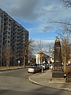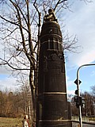

**_Foto:_** _Blick in die Lipsiusstraße - rechts die 1912 aufgestellte Lipsiussäule_

Die Lortzingstraße entstand Ende des 19. Jahrhunderts in der Nähe des heute nicht mehr vorhandenen Dürerplatzes und wurde nach dem Komponisten Albert Lortzing (1801-1851) benannt. Zu seinen bekanntesten Schöpfungen gehören die volkstümlichen Opern “Zar und Zimmermann” und “Der Wildschütz”. Bis zur Zerstörung 1945 befand sich an der Lortzingstraße neben Wohnhäusern ein städtisches Volksbad.

Schuhwaren-Fabrik Heysing: Der Betrieb wurde um 1890 von Carl Curt Heysing auf der Lortzingstraße 38 (Ecke Fiedlerstraße) gegründet. Der aus einfachen Verhältnissen stammende Unternehmer war zunächst als Porzellankaufmann tätig, bevor er sich in der Johannstadt niederließ und hier elegante Damenschuhe produzierte. Ein Großteil der Waren wurde exportiert, vor allem nach Frankreich. Für sein soziales Engagement erhielt Heysing kurz vor Beginn des Ersten Weltkrieges den Titel Hofrat verliehen. 1923 verlor er durch die Inflation einen Großteil seines Vermögens, womit auch die Geschichte der Schuhwarenfabrik Heysing endete.

Altissa-Camera-Werk:Die bis zur Zerstörung 1945 existierende Firma geht ursprünglich auf die 1902 als Werkstatt für Kameraverschlüsse und andere photographische Bedarfsartikel gegründete "Photographische Manufaktur Ingenieur Richard Knoll" zurück. 1928 übernahm Emil Hofert den Betrieb und benannte ihn 1931 in Anlehnung an seinen Namen in "EHO-Kamera-Fabrik-Emil Hofert GmbH" um. Der Firmensitz befand sich ursprünglich auf der Eilenburger Straße 6 in Striesen. Hergestellt wurden vorrangig preiswerte Boxkameras für den privaten Gebrauch.

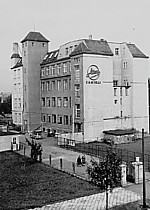Nach Hoferts Tod und Übernahme des Betriebes durch den damaligen Geschäftsführer Berthold Altmann 1935 bezog die Firma 1937 neue Räume auf der Lortzingstraße 38. Ab 1940 wurde der Betrieb Amca-Camera-Werk, ab 1941 Altissa-Camera-Werk genannt. Auch die hier hergestellten Modelle trugen in Anlehnung an den Firmenbesitzer die Bezeichnungen "Altiflex" bzw. "Altissa". Letzte Neuentwicklung vor dem Zweiten Weltkrieg war die 1939 vorgestellte Kleinbildkamera "Altix", deren Produktion jedoch schon wenig später zugunsten der Rüstungsindustrie eingestellt wurde. Beim Luftangriff im Februar 1945 wurden die Produktionsgebäude völlig zerstört.

Nach Kriegsende gründete Berthold Altmann gemeinsam mit seinem Geschäftspartner Fritz von Dosky ein weiteres Unternehmen, welches sich unter dem Namen ALDO-Feingeräte-Bau GmbH der Herstellung von Mikroskopen widmete. Das Altissa-Camera- Werk bezog 1947 neue Räume auf der Blasewitzer Straße 17. Hier versuchte Altmann zunächst mit der Wiederaufnahme derVorkriegsbaureihen, ab 1949 auch mit Neuentwicklungen an einstige Erfolge anzuknüpfen. Die politische Situation in der DDR veranlasste ihn jedoch 1951 zur Flucht in die Bundesrepublik, was zur Enteignung und Umwandlung des Betriebes in den VEB Altissa-Camera-Werk führte. 1959 wurde dieser in die vereinigten Kamera- und Kino-Werke Dresden eingegliedert und 1961 geschlossen.

Die heute nicht mehr in den Stadtplänen verzeichnete Manteuffelstraße verlief parallel zur Elsasser Straße an der Rückseite der 1945 zerstörten [Jägerkaserne](../../../zentrum/johannstadt/strassen_johannstadt/sachsenplatz/). Benannt wurde sie nach Edwin Karl Rochus Freiherr von Manteuffel, einem 1809 in Dresden
geborenen preußischen General (+ 1885). Als Kommandeur nahm er am Deutsch-Französischen Krieg 1870/71 teil und und wurde nach Kriegsende
Oberbefehlshaber der Okkupationsarmee in Frankreich und Statthalter des Deutschen Reiches in Elsaß-Lothringen.

1946 erfolgte die Umbenennung der Manteuffelstraße in Karsthansstraße. Karsthans war der volkstümliche Name des Arztes und religiösen Schwärmers
Johannes Murer oder Maurer (+ 1525). Der Freiburger Bauernagitator gehörte zu den wichtigen Propagandisten des Bauernkrieges und starb nach seiner Gefangennahme im Kerker des Schlosses Reichenberg bei Backnang.
Im Zuge der Neubebauung wurde der Straßenname Anfang der 1970er Jahre aufgehoben.

Erst seit 1993 trägt der nördliche Teilabschnitt der Reißigerstraße den Namen Maria-Cebotari-Straße. Zuvor war der
Straßenverlauf in den 70er Jahren durch einen Schulneubau unterbrochen worden. Mit der Namensgebung wird an die aus
Bessarabien (Moldawien) stammende Opernsängerin Maria Cebotari (1910-1949) erinnert, welche zwischen 1931 und 1943 an
der Semperoper engagiert war. Zugleich wirkte sie in mehreren Filmen mit und hatte zahlreiche Gastauftritte an internationalen Bühnen.

Die Marschnerstraße entstand Ende des 19. Jahrhunderts und verbindet die Gerokstraße mit der Comeniusstraße. Ursprünglich
befand sich in diesem Bereich in der Nähe des Straßburger Platzes der heute verschwundene Kranichsee, welcher noch 1370 als
Gewässer, 1539 jedoch nur noch als Ackerfläche in den Urkunden verzeichnet ist. Neben Wohnhäusern entstanden ab 1898 an der Marschnerstraße die Bauten der [Höheren Mädchenschule](../../../zentrum/johannstadt/) Johannstadt und des Königlichen Lehrerinnenseminars. Die
ausgebrannten Gebäude konnten in der Nachkriegszeit in leicht veränderter Form wiederaufgebaut werden. Heute ist hier die Dinglinger-Schule für lernbehinderte Kinder untergebracht.

Mit der Namensgebung wird an die Frauenrechtlerin Amalie Marschner (1794-1883) erinnert. 1846 gründete sie in Dresden den
“Verein zum Frauenschutz”, welcher sich der Förderung und Unterstützung von Waisenkindern widmete. Seit Mitte des 19.
Jahrhunderts besaß der Verein eine aus mehreren Gebäuden bestehende Erziehungsanstalt mit angeschlossenem Kindergarten an
der Georgenstraße in der Neustadt. Dort erinnert seit einigen Jahren eine Gedenktafel an Amalie Marschner (Georgenstraße 3).

Nickelodeon:
Das kleine Kino entstand ursprünglich aus dem Filmclub der Ingenieurhochschule Dresden und nahm in den 1970er Jahren im Hörsaal 172 den Spielbetrieb auf. Dieser befand sich im Eckgebäude Marschner-/Dürerstraße und zeigte vor allem
künstlerisch anspruchsvollere Filme. 1990 wurde auf Initiative von Frank Apel in den Räumen das “Nickelodeon” als erstes
Programmkino in den neuen Bundesländern eröffnet. Zu den Besuchern gehörten vor allem Studenten der Dresdner Hochschulen.
Wegen zunehmendem Besucherrückgangs und steigender Mieten wurde das Filmtheater  im November 2000 geschlossen.

Die Mildred-Scheel-Straße wurde als bislang jüngste Straße der Johannstadt erst 2004 angelegt. Sie befindet sich auf dem Gelände des [Universitätsklinikums](../../../zentrum/johannstadt/universitatsklinikum/) und erhielt ihren Namen nach der Röntgenärztin Dr. med. Mildred Scheel (1932-1985). Als
Ehefrau des Bundespräsidenten Walter Scheel gründete sie 1974 die “Deutsche Krebshilfe” und setzte sich bis zu ihrem Tod für verschiedene Projekte zur Bekämpfung der Krebskrankheiten ein.

Die Neubertstraße entstand 1893 und erhielt den Namen des Kommunalpolitikers Heinrich Moritz Neubert (1809-1881). Neubert gehörte ab 1851 dem Dresdner Stadtrat an war von 1853 bis zu seinem Eintritt in den Ruhestand Bürgermeister. Für seine Verdienste, insbesondere auch auf dem Gebiet der Erforschung der älteren Stadtgeschichte, wurde ihm am 31. Dezember 1875 die Ehrenbürgerwürde verliehen.

Die Nicolaistraße im südlichen Teil der Johannstadt verdankt ihren Namen dem Architekten Georg Hermann Nicolai
(1812-1881), einem Schüler Gottfried Sempers. Nicolai wurde 1850 dessen Nachfolger als Hochschullehrer an der Kunstakademie und entwarf zahlreiche qualitätvolle Villenbauten, von denen jedoch nur wenige erhalten blieben. Vor der
Zerstörung 1945 besaß der Maler Otto Griebel auf der Nicolaistraße 30 seine Wohnung, im Haus Nr. 4 hatte zeitweise die bekannte Dresdner [Klavierbaufirma Rosenkranz](../../../zentrum/johannstadt/strassen_johannstadt/klavierbaufirma_rosenkranz/) ihren Sitz.

Wie an vielen Johannstäder Straßen erfolgte auch an der Nicolaistraße in den 1960er und 1970er Jahren der Wiederaufbau mit mehrgeschossigen Wohnblocks. Im Zuge des Stadtumbaus nach 1990 wurden die Häuser Nr. 17-21 2012 abgerissen.

Seit den 1970er Jahren trägt ein durch Neubebauung unterbrochener Teilabschnitt der Wintergartenstraße zwischen Striesener
und Gerokstraße den Namen Permoserstraße. Eine gleichnamige Straße hatte es vor 1945 bereits in der Wilsdruffer Vorstadt
(heute Areal Haus der Presse) gegeben. Ihren Namen verdankt sie dem Barockbildhauer Balthasar Permoser (1651-1732),
welcher ab 1689 als Hofbildhauer in Sachsen tätig war. Permoser schuf u.a. zahlreiche Figuren für den Dresdner Zwinger, die Kanzel der Hofkirche und die Herkulesfiguren im Großen Garten.

Die Pfeifferhannsstraße im nördlichen Teil der Johannstadt erhielt ihren jetzigen Namen erst 1946\. Zuvor gehörte diese Straße zur
später durch Überbauung unterbrochenen Stephanienstraße. Der Name knüpft an die volkstümliche Bezeichnung für den “Vater
des Deutschen Bauernkrieges” Hans Böhm (1458-1476) an. Böhm verdiente sich seinen Lebensunterhalt zunächst als Schafhirt
und Instrumentenbauer, bevor er sich nach einer angeblichen Marienerscheinung zum Wanderprediger berufen fühlte. In diesem
Zusammenhang setzte er sich für mehr Rechte der Bauern ein und forderte diese zur Verweigerung von Frondiensten und
Zehntzahlung auf. Wegen seiner revolutionären Ideen wurde Hans Böhm am 19. Juli 1476 als Ketzer auf dem Scheiterhaufen verbrannt.

Die Pöppelmannstraße entstand erst im Zuge des Ausbaus des Neubaugebietes Johannstadt in den 1970er Jahren und folgt in
ihrem Verlauf einem früheren Teilabschnitt der Stephanienstraße. Bereits vor 1945 hatte es in der Wilsdruffer Vorstadt eine
Pöppelmannstraße gegeben, welche jedoch 1965 beim Bau des “Hauses der Presse” verschwand. Ihren Namen verdankt sie dem
berühmten Barockbaumeister Matthäus Daniel Pöppelmann (1662-1736), welcher vor allem durch die Anlage des Zwingers
bekannt ist. Pöppelmann schuf aber auch zahlreiche Bürgerhäuser, entwarf das Japanische Palais sowie die Schlösser in Pillnitz und Großsedlitz. Sein Grab befindet sich in der Friedrichstädter [Matthäuskirche](../../../zentrum/friedrichstadt/strassen_friedrichstadt/friedrichstrasse/matthauskirche/).

Seit August 2010 erinnert ein Gedenkstein vor dem Gebäude der Geschäftsstelle des Sächsischen Bergsteigerchores “Kurt
Schlosser” an dessen Namensgeber (Pöppelmannstraße 2). Das Denkmal befand sich ursprünglich vor der Betriebsberufsschule
des Energiekombinates Dresden auf der Gasanstaltstraße und wurde nach deren Schließung abgebaut. Kurt Schlosser gehörte während der NS-Zeit
einer Widerstandsgruppe an (“Rote Bergsteiger”) und wurde am 16. April 1944 im Hof des Landgerichts Münchner Platz hingerichtet. Seit 1949 trägt der Bergsteigerchor seinen Namen.

Die Reinickstraße entstand 1903 im Gebiet um den damaligen Walderseeplatz an der Grenze zwischen Johannstadt und Striesen.
Ihren Namen verdankt sie dem Schriftsteller und Maler Robert Reinick (1805-1852), der ab 1844 in Dresden lebte und zu den
Mitgliedern des Künstlerkreises “Montagsgesellschaft” gehörte. Zu den erhaltenen Gebäuden aus der Entstehungszeit des
Wohnviertels gehören die Häuser Reinickstraße 8 bis 13 mit aufwendigen Jugendstil-Dekorationen an der Fassaden und in den Treppenhäusern.

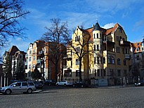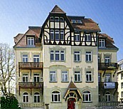

**_Fotos:_** _Blick in die Reinickstraße - rechts das Wohnhaus Nr. 2, erbaut 1903_

Die Reißigerstraße wurde 1875 angelegt und führte vor 1945 durchgehend von der Blasewitzer bis zur Comeniusstraße. Mit der
Namensgebung wird an den Komponisten und Dirigenten Carl Gottlieb Reißiger (1789-1859) erinnert, der nach seiner Tätigkeit
als Musikdirektor der Hofoper 1828 zum Nachfolger Carl Maria von Webers als Hofkapellmeister ernannt wurde. Reißiger war
zugleich Leiter des Konservatoriums und Dirigent der Dresdner Liedertafel. 1838 führte er zum ersten Mal in Dresden Beethovens Neunte Sinfonie auf. Sein Grab befindet sich auf dem [Trinitatisfriedhof](../../../zentrum/johannstadt/trinitatisfriedhof/).

Das Straßenbild prägten bis zur vollständigen Zerstörung der Bebauung 1945 mehrgeschossige Wohn- und Geschäftshäuser. Im
Haus Nr. 25 gab es ab 1911 das kleine Triumph-Kino, welches seinen Spielbetrieb Anfang der 1920er Jahre einstellte. In der
Nachkriegszeit wurde die Reißigerstraße durch den Bau einer Schule unterbrochen, beide Abschnitte behielten jedoch zunächst ihren Namen. Erst 1993 wurde der nördliche Teil in Maria-Cebotari-Straße umbenannt.

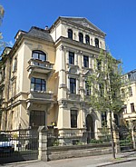Die Schubertstraße im östlichen Teil der Johannstadt begrenzt das Gelände des [Universitätsklinikums](../../../zentrum/johannstadt/universitatsklinikum/) und bildet sogleich die östliche Grenze des Stadtteils zu Blasewitz. Hier befinden sich vor allem
Gebäude der Klinik, darunter das 1996 entstandene Herzzentrum. Nach dessen Auszug war dort eine Poliklinik für Neurologie untergebracht. Heute wird der Fertigteilbau für den Geschäftsbereich Bau und
Technik der Klinik genutzt. 2012 entstand in der Nachbarschaft ein Neubau für die Abteilung Protonentherapie. Im Wohnhaus Schubertstraße 29 _(Foto)_ wohnte bis zu seinem Tod 1932 der
Heimatkundler Theodor Schäfer, Mitbegründer des Vaterländischen Gebirgsvereins und Verfasser zahlreicher Wanderführer.

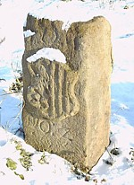In der Nähe der Schubertstraße endete einst auch das städtische Weichbild,
das heißt die Dresdner Stadtflur. Markiert wurde diese Grenze mit Weichbildsteinen, von denen einer auf den Elbwiesen am Käthe-Kollwitz-Ufer gegenüber der Einmündung der Schubertstraße erhalten
geblieben ist. Der Stein trägt die Nummer 2 und zeigt das Dresdner Stadtwappen sowie die Jahreszahl 1729. Ab 1911 befand er sich im Stadtmuseum im Lichthof des Rathauses, wurde später eingelagert
und 1993 in der Nähe seines früheren Standortes wieder aufgestellt. Ein weiterer Weichbildstein mit der Nr. 4 ist an der Südostecke der Straßenkreuzung Schubertstraße / [Goetheallee](../../../ost/blasewitz/strassen_blasewitz/goetheallee/) zu sehen.

**_Foto:_** _Weichbildstein Nr. 2 auf den Elbwiesen gegenüber der Schubertstraße_

Die Schumannstraße wurde 1875 angelegt und nach dem Komponisten Robert Schumann (1810-1856) benannt. Der zu den
bedeutendsten Musikern des 19. Jahrhunderts gehörende Komponist lebte von 1844 bis 1850 in Dresden und verfasste hier einen
Großteil seines Gesamtwerkes, u.a. seine einzige Oper “Genoveva”. Zeitweise war er auch Leiter der “Dresdner Liedertafel” und Gründer der Singakademie.

1945 wurden die meisten Gebäude der Schumannstraße, darunter die [IV. Katholische Bezirksschule](../../../zentrum/johannstadt/) in der Nähe der Wallotstraße, zerstört. Diese war 1896 entstanden und besaß in der angeschlossenen Kapelle die erste katholische Kirche der
Johannstadt. Im Wohnhaus Schumannstraße 2 b lebte um 1892 der dänische Schriftsteller und spätere Literaturnobelpreisträger
Karl Gjellerup. Der Wiederaufbau der Johannstadt unterbrach 1970 den ursprünglichen Verlauf. Um Verwechslungen zu vermeiden, erhielt der Abschnitt zwischen Striesener Straße und Trinitatisplatz 1993 den Namen Thomaestraße.

Die Silbermannstraße verband vor 1945 die Striesener mit der Gerokstraße und ist heute nur noch auf einem kurzen Restabschnitt
erhalten. Ihren Namen erhielt sie nach dem sächsischen Orgelbauer Gottfried Silbermann (1683-1753), welcher u.a. die Instrumente der Hofkirche, der Frauenkirche und der Sophienkirche schuf. Neben Wohnhäusern und einem Sportplatz am
nördlichen Ende befanden sich an der Silbermannstraße bis zur Zerstörung 1945 die Bauten der IX. Bürgerschule (später [20\. Volksschule](../../../zentrum/johannstadt/)) und der 51. Volksschule. Das letztgenannte Gebäude diente ab 1923 bis zur Schließung durch die
Nationalsozialisten 1935 als staatliche Versuchsschule [(Dürerschule)](../../../zentrum/johannstadt/strassen_johannstadt/durerschule/).

Sowohl der Stephanienplatz wie auch die von ihm abzweigende Stephanienstraße verdanken ihren Namen der Mutter Königin
Carolas, Luise Amalie Stephanie von Baden (1811-1854). Die Tochter des Großherzogs Karl von Baden und seiner Gemahlin
Stéphanie de Beauharnais - einer Adoptivtochter Napoleons - hatte 1830 in Karlsruhe ihren Cousin Gustav von Holstein-Gottorp
geheiratet. 1833 kam die gemeinsame Tochter Carola von Wasa-Holstein zur Welt, welche später den sächsischen Kronprinzen Albert heiratete.

Vor 1945 verlief die Stephanienstraße vom Stephanienplatz ausgehend in nördlicher Richtung bis zum Elbufer (heute Käthe-Kollwitz-Ufer). Im Zusammenhang mit dem Neuaufbau der Johannstadt wurde nach 1970 ein Großteil der ehemaligen
Straßenführung überbaut. Neben dem noch heute benannten kurzen Reststück an der Striesener Straße gingen Teile der Stephanienstraße in der Pöppelmannstraße sowie der Pfeifferhannsstraße auf.

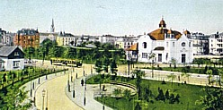

**_Foto:_** _Stephanienplatz und Andreaskirche um 1910_

Rund um den Stephanienplatz standen einst mehrgeschossige Wohn- und Geschäftshäuser, in deren Erdgeschossen kleine Läden
untergebracht waren. Hinzu kamen einige Kleingärten und Holzhäuser, welche kurz vor Beginn des Zweiten Weltkrieges durch ein
großes Mietshaus ersetzt wurden. Die Platzfläche selbst war gärtnerisch gestaltet und bepflanzt. Sämtliche Gebäude fielen 1945 den Bomben zum Opfer, darunter auch die 1902 eingeweihte [Andreaskirche](../../../zentrum/johannstadt/andreaskirche/). Der ursprünglich nur als Provisorium geplante
Neobarockbau besaß 850 Plätze und wurde im Zuge der Enttrümmerung Anfang der 1950er Jahre abgerissen. Das gleiche Schicksal traf die Ruinen der den Platz umgebenden Wohnhäuser, so dass heute nur noch das kleine Umspannhäuschen der
Drewag an die Vorkriegszeit erinnert. Teilweise erhalten blieben hingegen die Gebäude der ehemaligen [Schokoladenfabrik Clauß](../../../zentrum/johannstadt/strassen_johannstadt/hopfgartenstrasse/)
(ehemals Stephanienstraße 49). Hier und auf der benachbarten Hopfgartenstraße 28 wurden bis zum Kriegsende Schokolade und andere Süßwaren produziert.

Zu DDR-Zeiten war der Stephanienplatz in den Stadtplänen nicht namentlich verzeichnet. In einem 1959 errichteten Flachbau befand sich bis 1989 das polnische Spezialitätengeschäft “HORTEX”, welches wegen seines Angebotes an Obst und
Gemüsekonserven stadtweit bekannt war. Erst 1991 erhielt der Stephanienplatz seinen früheren Namen zurück. In jüngster Vergangenheit entstanden einige moderne Wohnhäuser.

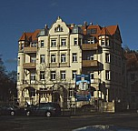Der Stresemannplatz entstand um 1904 als Mittelpunkt einer kleinen Wohnsiedlung im südlichen Teil
der Johannstadt an der Flurgrenze zu Striesen. Das Straßenbild um die parkartig gestaltete Anlage prägen bis heute Villen und Einzelhäuser. Ursprünglich wurde dieser Platz als Walderseeplatz
bezeichnet, womit an den preußischen Generalfeldmarschall Alfred Heinrich Karl Ludwig Graf von Waldersee (1832-1904) erinnert werden sollte. Waldersee war von 1888 bis 1891 Chef des
Generalstabs und um 1900 Oberbefehlshaber eines multinationalen Truppenkontingents, welches zur Niederschlagung des chinesischen Boxeraufstandes entsandt worden war.

1930 wurde der Platz in Stresemannplatz umbenannt. Mit dieser Namensgebung sollte der zwischen 1903 und 1918 in Dresden
lebende und auch als Stadtrat aktive Nationalökonom und Politiker Gustav Stresemann (1878-1929) geehrt werden. Stresemann
war ab 1903 Syndikus des Verbandes der Schokoladenfabrikanten, später Leiter des Bundes der Sächsischen Industriellen und
Gründer der Deutschen Volkspartei. 1923 übernahm er vorübergehend das Amt des Reichskanzler und war bis zu seinem Tod Außenminister der Weimarer Republik. Für seine Verdienste um einen Ausgleich zwischen den einstigen Kriegsgegnern
Deutschland und Frankreich erhielt er 1926 den Friedensnobelpreis.

1933 hoben die Nationalsozialisten diese Benennung wieder auf und nannten den Platz fortan wieder Walderseeplatz, bevor 1945 erneut die Bezeichnung Stresemannplatz eingeführt wurde.
1962 wurde der Platz in Johannes-R.-Becher-Platz umbenannt. Der Dichter Johannes R. Becher (1891-1958) übernahm 1954 das Amt des DDR- Kulturminister und war außerdem erster
Präsident des Kulturbundes. Bekannt ist er als Verfasser des Textes der Nationalhymne der DDR. 1992 wurde der Platz wieder in Stresemannplatz zurückbenannt und gehört damit zu den
Straßen und Plätzen mit am häufigsten veränderten Straßennamen in Dresden.

Der Striesener Platz wurde 1870 an der Striesener Straße zwischen Elisen- und Wintergartenstraße angelegt und sechs Jahre
später offiziell benannt. Zuvor befand sich hier der Holzlagerplatz der Dampfschneidemühle des Baumeisters Julius Gebler. Die
Villa Geblers diente später viele Jahre als Wohnsitz des bekannten Opernsängers Scheidemantel. Die rechteckige Platzfläche
wurde nach Plänen des Stadtgärtnermeisters Degenhardt parkartig gestaltet und bepflanzt. Im Mittelpunkt befand sich ein 1878 von Prof. Weisbach entworfener Delphinbrunnen mit mehreren Brunnenschalen.

Foto: _Der Striesener Platz mit dem Delphinbrunnen nach der Zerstörung 1945_

Um den Platz entstanden kurz darauf repräsentative Villen und Wohnhäuser. Zu den wenigen gewerblichen Einrichtungen gehörten
mehrere Arztpraxen, eine Rechtsanwaltskanzlei, die Rudolphsche Verlagsbuchhandlung sowie die Büros der Deutschen Kraftfutterfabrik im Eckhaus zur Wintergartenstraße. Sämtliche Gebäude fielen 1945 den Bomben zum Opfer. Im Zuge des
Wiederaufbaus wurden Platz und Brunnenanlage Ende der 1960er Jahre beseitigt und teilweise mit Wohnblocks überbaut.

Die 1870 ausgebaute Striesener Straße geht auf einen bereits im 16./17. Jahrhundert vorhandenen Verbindungsweg zwischen der
Innenstadt und dem benachbarten Dorf Striesen zurück. Dieser begann am Pirnaischen Tor und führte zum sogenannten
Rampischen Schlag und von dort weiter in östlicher Richtung über Striesen zur Pillnitzer Fähre. Noch um 1890 gab es hier vor
allem Gartengrundstücke und Wiesen, bevor um die Jahrhundertwende auch in diesem Teil der Johannstadt Wohn- und Geschäftshäuser entstanden. Während die Obergeschosse der Gebäude vorrangig Wohnungen beherbergten, gab es in den
Erdgeschosszonen zahlreiche Läden, Gaststätten und kleine Handwerksbetriebe. Zu diesen gehörte die am 6. August 1910 eröffnete Bäckerei Wippler an der Ecke zur Schumannstraße. Das 1945 ausgebombte Unternehmen wird heute von den
Nachkommen desGründers Max Wippler im Raum Loschwitz - Pillnitz fortgeführt, wo seit 2010 auch ein kleines Museum an die
Geschichte der Firma erinnert (Söbrigener Straße 1). Auf der Striesener Straße 32 befand sich ab 1920 das von Martin Pietzsch
errichtete Filmtheater “Fürstenhof-Lichtspiele” (Fü.-Li.). Im westlichen Teil dominierten hingegen freistehende Wohnhäuser das Straßenbild.

Die Gebäude der Striesener Straße fielen mit wenigen Ausnahmen in der Nähe des Fetscherplatzes 1945 den Bomben zum
Opfer. 1957 begann hier der Wiederaufbau der Johannstadt. Bis 1960 entstanden zwischen Striesener, Comenius-, Fetscher- und Marschnerstraße ca. 1.760 Wohnungen in Großblockbauweise, wobei für diese Gebäude im Gegensatz zu späteren
Neubauvierteln das alte Straßennetz beibehalten wurde. In diesem Zusammenhang wurde auch der östlich der Güntzstraße
gelegene Abschnitt der Pillnitzer Straße in die Striesener Straße einbezogen. Auf einer der letzten verbliebenen Baulücken entstand 1996/97 das Verwaltungsgebäude der ADAC-Zweigstelle Sachsen.

Fürstenhof-Lichtspiele: Das von den Anwohnern meist kurz “Fü-Li” genannte Kino entstand 1919 im Saal des Hotels “Zum
Fürstenhof” auf der Striesener Straße 32. Die Planung und Bauausführung des Filmtheaters stammte vom Dresdner Architekten
Martin Pietzsch und Baumeister Richard Fülle. Die offizielle Einweihung erfolgte am 28. August 1920. Mit ca. 600 Plätzen und
modernster Kinotechnik gehörten die Fürstenhof-Lichtspiele bis zur Zerstörung 1945 zu den beliebtesten Vergnügungsstätten der
Johannstadt. Betreiber war zunächst die Firma Langer & Co., ab 1932 die Gloria-Palast-Lichtspiele G.m.b.H., welche ein weiteres Filmtheater in Striesen besaß.

Als Tatzberg wurde einst eine ursprünglich sandige und teilweise bewaldete Erhebung genannt, welche heute jedoch kaum noch wahrnehmbar ist.
Noch um 1800 nutzte man dieses Areal als Sandgrube zur Gewinnung von Baustoffen. An den Hängen des Tatzberges befanden sich bis ins 19. Jahrhundert die Weinberge des früheren Neustädter Augustinerklosters. Bereits der Dresdner
Chronist Daniel Wintzenberger erwähnt im 16. Jahrhundert in seinen Aufzeichnungen den wohlschmeckenden “Datzberger Wein”,
welcher auch im städtischen Ratskeller ausgeschenkt wurde. 1370 war dieser als “vinea Tazceanberge” erstmals in den Urkunden
verzeichnet. Die Bezeichnung Tatzberg ist wahrscheinlich vom slawischen Wort “taca” (= der Zehnte) abgeleitet und weist auf einstige Abgabepflichten hin.

1640 bestand am Tatzberg ein gleichnamiges Vorwerk, welches ab 1742 [“Lämmchen”](../../../zentrum/johannstadt/strassen_johannstadt/blasewitzer_strasse/) genannt wurde. Die Straße selbst erhielt ihren Namen offiziell 1861 und verlief bis 1945 durchgängig
vom Bönischplatz bis zur Fürstenstraße (heute Fetscherstraße). An der Südseite befinden sich der 1815 eingeweihte [Trinitatisfriedhof](../../../zentrum/johannstadt/trinitatisfriedhof/) und der [Neue Jüdische Friedhof](../../../zentrum/johannstadt/neuer_judischer_friedhof/). 1893 richtete die Stadt
Dresden am Tatzberg ihre Stadtgärtnerei ein. Im gleichen Jahr entstand das Elektrizitätswerk Tatzberg zur Versorgung der ersten elektrischen Straßenbahnlinie der Stadt. Später übernahm
der VEB Technische Gebäudeausrüstungen (TGA) das Grundstück. Reste der historischen Industriebauten verschwanden erst 2014. 2003 wurde auf dem Areal der früheren
Stadtgärtnerei das moderne BioInnovationsZentrum als Sitz verschiedener Unternehmen der Bio- und Nanotechnologie eingeweiht _(Foto)._ Weitere Forschungseinrichtungen der Biotechnologie sind geplant.

Stadtreinigung Dresden: Die Geschichte des Unternehmens begann Mitte des 19. Jahrhunderts, als sich die Stadt Dresden entschloss, die wachsenden Abfallberge in den früheren Sandgruben am Tatzberg zu verkippen. Später deponierte hier die “Dünger Exportgesellschaft zu Dresden AG” auch Fäkalien, was jedoch wegen des Gestanks zu Protesten der Anwohner führte. Im Zuge der Bebauung des Areals wandelte sich das Grundstück am Tatzberg nach 1900 zur Zentrale des Entsorgungsbetriebes, welcher hier Pferdeställe, Remisen, Verwaltungs- und Wirtschaftsgebäude errichtete. Vom Tazberg aus verkehrten die Abfalltransporter zu den am Stadtrand gelegenen Müllkippen und zu den insgesamt neun Außenstellen in den Stadtbezirken.

Ab 1928 wurde das Unternehmen als Dresdner Müllabfuhr Gesellschaft bezeichnet. Nach Beseitigung der Kriegsschäden und mehrfachen Modernisierungen und Erweiterungen nutzte der VEB Stadtreinigung Dresden das Grundstück, das heute Sitz des nach 1990 in eine GmbH umgewandelten kommunalen Unternehmens ist. Hier werden Müllfahrzeuge gewartet und abgestellt. Außerdem befindet sich am Tatzberg die zentrale Annahmestelle für Sperrmüll und umweltschädliche Abfälle.

Die Terscheckstraße wurde nach dem sächsischen Hofgärtner Carl Adolf Terscheck (1782-1869) benannt, der 1809 als
Nachfolger seines Vaters Johann Matthäus Terscheck nach Dresden berufen wurde. Hier oblag ihm die Pflege und Gestaltung des
Palaisgartens. Außerdem war Terscheck an der Anlage des Botanischen Gartens und der Grünanlagen am Zwinger sowie an der
Bürgerwiese beteiligt. In der Nachkriegszeit wurden Teile der Terscheckstraße überbaut bzw. in das Gelände der Medizinischen Akademie (Universitätsklinik) einbezogen.

Als Thomaestraße wird seit 1993 der nördliche Teilabschnitt der früheren Schumannstraße bezeichnet, welcher durch Überbauung in den 1960er und 1970er Jahren abgetrennt worden war. Der Name erinnert an den Bildhauer Johann Benjamin Thomae (1682-1751). Zu seinen Hauptwerken gehören der Altar der Dreikönigskirche, die Brunnen am Neustädter Markt sowie einige Plastiken in Moritzburg, am Wallpavillon des Zwingers und der Pillnitzer Weinbergskirche.

Der heute Thomas-Müntzer-Platz genannte halbkreisförmige Platz an der Uferstraße zur Elbe schließt die Bebauung der Johannstadt in Richtung Norden ab und sollte einst als Brückenkopf einer hier geplanten Elbbrücke dienen. Nach längeren Diskussionen beschloss der Stadtrat 1896 dafür diesen Standort. Kurz vor dem Ersten Weltkrieg entstanden an der damals noch Feldherrenplatz genannten Fläche die ersten Wohnhäuser. Während die repräsentativen Wohnungen in bester Lage an gutsituierte Beamte, Akademiker und Militärs vermietet werden konnten, kam es nicht zur Umsetzung des Brückenbaus.

1945 blieb das Viertel um den kurz nach Kriegsende umbenannten Thomas-Müntzer-Platz als eines der wenigen in der Johannstadt von der totalen Zerstörung verschont und konnte deshalb bis heute sein ursprüngliches Bild wahren. Nach 1990 gab es erneut Pläne für eine Elbbrücke an dieser Stelle, welche jedoch später zugunsten der [Waldschlösschenbrücke](../../../zentrum/johannstadt/waldschlosschenbrucke/) aufgegeben wurden.

Der Trinitatisplatz entstand 1891 im Zusammenhang mit dem Bau der [Trinitatiskirche](../../../zentrum/johannstadt/trinitatiskirche/). Benannt wurde er, wie auch die hier von der
Gerokstraße abzweigende Trinitatisstraße (heute Fiedlerstraße) nach dem 1813 angelegten [Trinitatisfriedhof](../../../zentrum/johannstadt/trinitatisfriedhof/). Zuvor befand sich an
dieser Stelle das Vorwerk “Engelhardts”, welches im August 1813 Kampfhandlungen im Zusammenhang mit der Schlacht bei Dresden zum Opfer fiel.

Die Wallotstraße erhielt ihren Namen nach dem deutschen Architekten Paul Wallot (1841-1912), der von 1894-1911 als Professor für Baukunst an der Dresdner Kunstakademie und der Technischen Hochschule lehrte. Sein bekanntestes Bauwerk ist das Reichstagsgebäude in Berlin. In Dresden entwarf er 1901 das Ständehaus an der Brühlschen Terrasse. Ursprünglich trug die Wallotstraße den Namen Ludwig-Richter-Straße, wurde jedoch nach der Eingemeindung von Loschwitz 1921, wo es bereits eine gleichnamige Straße gab, umbenannt.

Von der ursprünglichen Bebauung **_(Foto:_** _Ecke Anton-Graff-Straße)_ sind lediglich einige Häuser in der Umgebung des Stresemannplatzes erhalten geblieben, darunter die unter Denkmalschutz stehenden Wohnhäuser Nr. 20 (erbaut 1902), Nr. 27 (1903) und Nr. 29 (1903). Im 1945 zerstörten Haus Wallotstraße 19 wohnte bis 1945 der Ingenieur Alfred Bockemühl, Konstrukteur der Straßenbahnwagen “Großer” und “Kleiner Hecht”. Unweit davon hatte bis zu seinem Tod am 3. Oktober 1922 der Dresdner Historiker Prof. Dr. Otto Richter seinen letzten Wohnsitz. Richter arbeitete u.a. als Archivar und erster Direktor des Stadtmuseums und war Vorsitzender des Vereins für Geschichte der Stadt Dresden. Auf ihn geht auch die Praxis der “gruppenweisen” thematischen Vergabe von Straßennamen in den einzelnen Stadtvierteln zurück.

An Stelle der zerstörten Gebäude entstanden in den 1960er Jahren mehrgeschossige Wohnblocks, welche heute zur WGJ (Wohnungsgenossenschaft Johannstadt) gehören. Weitere Baulücken (Wallotstraße 1-5) wurden 2013/14 geschlossen.

Der Name der im 19. Jahrhundert angelegten Wintergartenstraße erinnert an die einst auf dem Areal des früheren Vorwerks [“Hopfgarten´s”](../../../zentrum/johannstadt/strassen_johannstadt/hopfgartenstrasse/) bestehenden Gärtnerei Lüdicke. Lüdicke hatte die Fläche 1813 erworben und ließ hier einen ausgedehnten
Blumengarten anlegen und für exotische Pflanzen 1859 ein Winterhaus errichten. Nach Aufgabe der Gärtnerei entstanden auf dem
Grundstück ab 1878 Wohnhäuser. 1895 bezogen die “Grauen Schwestern” des katholischen Ordens der heiligen Elisabeth eine Villa auf der Wintergartenstraße (Nr. 17) und richteten hier das bis heute bestehende [St.-Joseph-Stift](../../../zentrum/johannstadt/st__joseph-stift/) ein.

Im Zusammenhang mit der Errichtung von Plattenbauten
wurde die ursprünglich bis zum Bönischplatz führende Wintergartenstraße nach 1970 unterbrochen und teilweise überbaut. Heute trägt nur noch der südliche Teilabschnitt zwischen Stübelallee und
Dinglingerstraße seinen ursprünglichen Namen. Ein weiterer Teil wurde Mitte der 70er Jahre nach dem bedeutenden Bildhauer Balthasar Permoser Permoserstraße benannt.

Nr. 63:
In diesem Gebäude hatte bis zu seinem Tod 1908 der Bildhauer und Rietschel-Schüler Gustav Adolph Kietz seine
Wohnung und sein Atelier. Kietz schuf u.a. ein 1942 eingeschmolzenes Denkmal des früheren Kreuzkantors Julius Otto (Standort
vor der alten Kreuzschule), das Gustav-Nieritz-Denkmal in der Neustadt und plastischen Schmuck für die Semperoper.

Zigarettenfabrik “Patras”:
Auf der Wintergartenstraße 76 hatte ab 1890 die Zigarettenfabrik “Patras” ihre Produktionsräume. Das Unternehmen gehörte zu den zahlreichen kleineren Herstellern von Tabakwaren in der Johannstadt und im angrenzenden Striesen.

Die Zeschaustraße im südlichen Teil der Johannstadt erhielt ihren Namen nach einem alten meißnischen Adelsgeschlechts, dessen
Vertreter vorrangig in Sachsen und Preußen, aber auch in Russland, Italien und Südamerika ansässig waren. Erstmals taucht der
Name dieser Familie in der Ersterwähnungsurkunde Dresdens von 1206 auf, in welcher u.a. ein Bernhard de Sessowe genannt ist.
Bedeutende Vertreter waren u.a. der sächsische Generalleutnant und Gouverneur von Dresden Heinrich Wilhelm von Zeschau (1760–1832) sowie der sächsische Finanzminister Heinrich Anton von Zeschau (1789–1870).

Der heute nicht mehr vorhandene Zöllnerplatz lag bis zur Zerstörung des Stadtviertels an der Abzweigung Dürer-/ Blasewitzer
Straße und war mit mehrgeschossigen Wohn- und Geschäftshäusern umgeben, von denen jedoch keines die Bomben des 13. Februars 1945 überstand. An der Südseite befand sich die [XX. Bezirksschule](../../../zentrum/johannstadt/) (später 20. Volksschule). Die dreieckige
Platzanlage war ursprünglich gärtnerisch gestaltet und diente als Ruhefläche in der dichtbebauten Johannstadt.

Im Zuge der Neubebauung der Johannstadt wurde der Zöllnerplatz überbaut und die Namensgebung aufgehoben. Heute erinnert
lediglich das kurze Reststück der Zöllnerstraße an die frühere Struktur. Der südliche Teil dieser ursprünglich von der Gerokstraße bis zum Stephanienplatz durchführenden Straße trägt seit den 1970er Jahren den Namen Cranachstraße.

Werkstatt für Elektrotechnik, Mechanik und Maschinenbau: Das Kleinunternehmen wurde 1906 von Oskar Ludwig Kummer
(1848-1912) auf der Zöllnerstraße gegründet und widmete sich der Herstellung von elektrischen und mechanischen Geräten. Kummer war bis zum Konkurs 1901 Besitzer der Kummer-Werke in Niedersedlitz, aus denen 1903 das [Sachsenwerk](../../../ost/niedersedlitz/sachsenwerk/) hervorging. Ab 1908 entstand in der Johannstädter Werkstatt unter größter Geheimhaltung ein Versuchswagen für eine geplante
Einschienen-Schnellbahn. Auftraggeber war der Berliner Verleger August Scherl, der unter Umgehung bestehender britischer
Patente die Erfindung des Iren Louis Brennan in die Realität umsetzen wollte. Die Erprobung des Fahrzeugs erfolgte im
“Birkenwäldchen” am Tatzberg. Am 1. 11. 1909 wurde die Bahn erstmals in Berlin öffentlich vorgeführt. Klagedrohungen britischer Rechtsanwälte und ein missglückter Probebetrieb in New York bereiteten dem Projekt letztlich ein Ende.

[Johannstadt auf OpenStreetMap](https://www.openstreetmap.org/search?query=Dresden+Johannstadt)

* * *

 \[ [Home](../../../index.html)\] \[ [Nord](../../../nord/)\] \[ [Nordwest](../../../nordwest/)\] \[ [Neustadt](../../../neustadt/)\] \[ [Nordost](../../../nordost/)\] \[ [West](../../../west/)\] \[ [Zentrum](../../../zentrum/)\] \[ [Südwest](../../../sudwest/)\] \[ [Süd](../../../sud/)\] \[ [Südost](../../../sudost/)\] \[ [Ost](../../../ost/)\] \[ [Register](../../../Register/register.html)\] \[ [Kontakt](../../../Kontakt/kontakt.html)\] \[ [Impressum](../../../impressum/)\]
