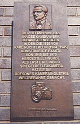
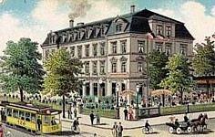
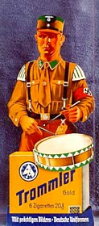
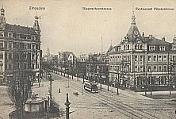
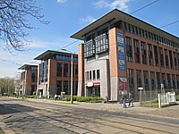
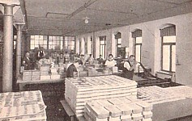

Die Blasewitzer Straße gehört zu den ältesten Verkehrsverbindungen der Johannstadt und verband bereits im 18. Jahrhundert Dresden mit dem benachbarten Dorf Blasewitz. Ihren Ausgangspunkt nahm sie am
Ziegelschlag in der Nähe des Eliasfriedhofes und durchquerte anschließend das Waldgebiet des heute fast völlig verschwundenen [Blasewitzer Tännichts](../../../../ost/). Eine Gabelung gab es am
heutigen Trinitatisplatz, woraus die 1850 erstmals offiziell benannte Blasewitzer Straße sowie die heutige Fiedlerstraße (ab 1880 Trinitatisstraße) hervorgingen. Am 25. September 1872 fuhr hier die erste Dresdner
Straßenbahnlinie, noch von Pferden gezogen, zum Schillerplatz nach Blasewitz. 1894 erhielt der westliche Abschnitt zwischen Sachsenplatz und Trinitatiskirche den Namen [Gerokstraße](../../../../zentrum/johannstadt/strassen_johannstadt/), der östliche Abschnitt heißt bis zur Flurgrenze der Johannstadt noch heute Blasewitzer Straße. Hier geht sie am [Königsheimplatz](../../../../ost/blasewitz/strassen_blasewitz/konigsheimplatz/) in die [Loschwitzer Straße](../../../../ost/blasewitz/strassen_blasewitz/loschwitzer_strasse/) über.

Im Gegensatz zu den meisten Straßen der Johannstadt, welche nach städtischem Regulativ nur Wohnhäuser zuließen, entstanden Ende des 19. Jahrhunderts an der Blasewitzer Straße
einige gewerbliche Unternehmen. Zu diesen gehörten u.a. die Zigarettenfabriken Kunze (Nr. 10), [Jasmatzi & Söhne](../../../../ost/striesen/striesener_zigarettenfabriken/) (Nr. 17), Sulima (Nr. 49) und Monopol (Nr. 68-70), die Sächsische
Cartonnagen-Maschinenfabrik AG  (Nr. 21) sowie die [Kunstdruckerei Römmler & Jonas](../../../../zentrum/johannstadt/strassen_johannstadt/blasewitzer_strasse/rommler___jonas/) (Nr. 27). Nr. 66 beherbergte eine Niederlassung der [Großmolkerei DREMA](../../../../sud/plauen/strassen_plauen/) mit Sitz in
Dresden-Plauen. Hinzu kamen Wohn- und Geschäftshäuser. In einem dieser Gebäude (Nr. 51) hatte bis 1907 der Kunstmaler und Professor der Kunstakademie Otto Gußmannseinen Wohnsitz.
In einer früheren Zigarettenfabrik (Blasewitzer Straße 41) siedelte sich 1940 ein Zweigwerk der Zeiss Ikon AG an, welches 1946 der Kamerahersteller [Ihagee](../../../../ost/striesen/strassen_striesen/schandauer_strasse/ihagee/) übernahm. Am Nachfolgebau erinnert seit 2006 eine Gedenktafel an den Konstrukteur Karl
Nüchterlein (1904-1945), der als Werkmeister der Ihagee 1936 die weltweit erste Kleinbild- Spiegelreflexkamera “Kine Exakta” entwickelt hatte _(Foto)_.

1945 wurden zahlreiche Gebäude an der Blasewitzer Straße durch Bomben zerstört. Die Neubebauung erfolgte in den
1960er bis 1980er Jahren. Erst im Oktober 1990 wurden hier die letzten in Dresden errichteten Plattenbauten vom Typ WBS 70 an die Mieter übergeben.

Einzelne Gebäude:

Vorwerk Lämmchen: Das Grundstück war ursprünglich Teil des [Vorwerkes Tatzberg](../../../../zentrum/johannstadt/strassen_johannstadt/) und befand sich im Besitz des
sächsischen Kurfürsten Johann Georg I. Dieser übereignete es 1640 seinem Oberamtmann Johann Michael Leistner zur
Bewirtschaftung mit der Genehmigung, hier einen Ausschank zu betreiben. 1742 ist erstmals der Name “Lämmgen” in
den Urkunden verzeichnet. Mit zurückgehender Bedeutung der Landwirtschaft und des Weinbaus verkauften spätere Besitzer Teile der Flächen, auf denen die Vorwerke “Engelhardts”, [“Hopfgartens”](../../../../zentrum/johannstadt/strassen_johannstadt/hopfgartenstrasse/) und [“Stückgießers”](../../../../zentrum/johannstadt/strassen_johannstadt/blumenstrasse/) entstanden. 1758
und 1813 richteten Kampfhandlungen erhebliche Schäden an. Diesen fiel auch eine 1804 auf einem Teil des Grundstücks gegründete Glashütte zum Opfer.

1825 übernahm der Landwirt Carl August Meißner das “Lämmchen”, welches sich in der Nähe der heutigen Blumen-
und Hertelstraße befand. Meißner ließ die vorhandenen Gebäude um ein Landhaus erweitern und machte das zugehörige
Bier- und Gartenlokal zu einem beliebten Ausflugsziel der Dresdner Bevölkerung. Im Landhaus wohnte zeitweise
Meißners Schwiegersohn, Wirt des renommierten Hotels “Zum Goldenen Engel” in der Altstadt. 1830 verbrachte Carl Maria von Weber mit seiner Familie im “Lämmchen” die Sommermonate.

1866 fiel das Vorwerk dem Bau einer preußischen Schanze zum Opfer, für die
auch Teile der abgerissenen Gebäude Verwendung fanden. Zwei Jahre später entstand das “Lämmchen” an der Blasewitzer Straße 48 neu und wurde noch bis 1909 als Milchwirtschaft betrieben. Bis 1945 erinnerte außerdem eine
gleichnamige Gaststätte auf der Blasewitzer Straße 58 an das alte “Lämmchen” _(Bild links)_. Die Flächen der früheren Gutswirtschaft verkauften die Besitzer an
Bauwillige. 1880 erwarb der Fotograf Emil Römmler einen Großteil des Areals und errichtete hier seine [Kunst- und Lichtdruckanstalt](../../../../zentrum/johannstadt/strassen_johannstadt/blasewitzer_strasse/rommler___jonas/). An Stelle des früheren
Vorwerks wurde in den 1970er Jahren ein Hochhaus gebaut, welches viele Jahre zur Unterbringung vietnamesischer Gastarbeiter genutzt wurde.

Nr. 9: Ab 1898 nutzte der Maler und Bildhauer Selmar Werner einige Räume dieses Hauses als Atelier. Werner hatte zuvor von 1892 bis 1894 an der Dresdner Kunstakademie studiert und war ein Meisterschüler von Robert Diez. Nach Abschluss seiner Ausbildung war Selmar Werner selbständig und schuf zahlreiche Grabplastiken und Büsten. In Dresden stammen u.a. einige Figuren am Ständehaus an der Brühlschen Terrasse, bildkünstlerischer Schmuck an der [Zionskirche](../../../../zentrum/sudvorstadt/strassen_sudvorstadt/zionskirche/) sowie das 1914 entstandene Schillerdenkmal am Albertplatz von ihm.

Cigarettenfabrik Dreßler KG (Nr. 15):
Auf diesem Grundstück hatte ab 1929 die Cigarettenfabrik Dreßler KG ihren Sitz. Inhaber war Arthur Dreßler, der den Betrieb am 4. August 1929
gemeinsam mit seinem Kommanditisten Ernst Stephan gegründet hatte. Dreßler, der enge Kontakte zur SA unterhielt, gelang es gemeinsam mit nationalsozialistischen Kreisen ein
Vereinbarung zu treffen, nach der SA-Mitglieder künftig nur noch Marken aus seinem Haus rauchen sollten. Die dadurch erzielten Gewinne sollten dafür anteilig der SA zur Verfügung gestellt
werden. Die Vereinbarung sah vor, für je 1.000 verkaufte Zigaretten jeweils 15 bis 20 Pfennige an die SA abzuführen. Fortan galten die Marken „Sturm“ „Trommler“, „Alarm“ und „Neue Front“
als Standardmarken der SA-Mitglieder, denen der Konsum anderer Zigaretten verboten war. Zur Unterstützung des Unternehmens steuerte die NSDAP 30.000 Reichsmark für den Aufbau der Zigarettenfabrik bei.

Im März 1931 schied Stephan aus der Firma aus. Daraufhin übernahm der Münchner SA-Stabschef Otto Wagener die Anteile. Nach der Machtübernahme der Nazis beteiligten sich
Firmenangehörige - überwiegend SA-Mitglieder - an Boykott- und Durchsuchungsaktionen gegen andere Zigarettenhersteller. Im Zuge des „Röhm-Putsches“ im Juni 1934 geriet Dreßler wegen seiner engen Kontakte zu
in Ungnade gefallenen SA-Führern ins Abseits, wobei auch der Konsumzwang der SA aufgehoben wurde. Nachdem sich
der Marktführer Reemtsma mit der NS-Führung über eine finanzielle Unterstützung geeinigt hatte, verlor Dreßler seine
Geschäftsgrundlage und musste 1935 Konkurs anmelden. Die Produktionsräume übernahm daraufhin bis zur Zerstörung 1945 die Dresdner [Großwäscherei Paul Märksch](../../../../ost/striesen/strassen_striesen/schandauer_strasse/wascherei_marksch/). Heute befinden sich auf dem Grundstück Wohnhäuser

Nr. 16: In diesem Eckhaus zur Schubertstraße befand sich vor dem Ersten Weltkrieg das Restaurant “Deutsches
Kolonial-Haus”. Inhaberin war um 1912 Margareta Kirchstein, ab 1913 der Schankwirt Friedrich Max Zieschwang.

Nr. 17:
Die Gebäude dienten bis 1945 als Zweigbetrieb der in Striesen ansässigen [Zigarettenfabrik Jasmatzi](../../../../ost/striesen/striesener_zigarettenfabriken/). Diese Firma
war 1880 von Georg Jasmatzi als kleines Handwerksunternehmen gegründet worden. 1889 ermöglichte ihm sein geschäftlicher Erfolg den Erwerb eines Grundstückes an der Blasewitzer Straße 17. 1900 folgte ein weiteres
Produktionsgebäude an der Schandauer Straße 68. Als einer der größten Dresdner Tabakhersteller kam der Betrieb 1924 zum Reemtsma-Konzern und gehörte nach 1945 zum VEB Vereinigte Dresdner Zigarettenfabriken.

Nr. 19: Das Gebäude wurde 1956/57 als Studentenwohnheim der Medizinischen Akademie errichtet. Hier befindet sich auch die Mensa der Universitätsklinik. Außerdem entstanden auf der Blasewitzer Straße mehrere Schwesternwohnheime für die Angestellten des Krankenhauses.

Vor 1945 hatte auf dem Grundstück die [Sächsische Kartonnagen-Maschinen-A.G.](../../../../zentrum/pirnaische_vorstadt/strassen_pirnaische_vorstadt/marschallstrasse/) ihren Sitz. Das Unternehmen war 1894 als Aktiengesellschaft für die Herstellung von Biege- und Nietmaschinen gegründet worden und ließ sich 1912 vom Architekten Otto Miersch 1912 moderne Büro- und Produktionsgebäude errichten (Nr. 19-23). Zuvor hatte auf dem Grundstück (Nr. 23) auch die im August 1886 von Paul Süss gegründete Druck- und Luxuspapierfabrik ihren Sitz. Ab 1897 firmierte das Uternehmen als Paul Süß A.G. für Luxuspapierfabrikation und verlegte seinen Sitz 1901 von Dresden nach Mügeln (Heidenau). Zum Produktionsprogramm gehörten u.a. Gratulations- und Postkarten sowie farbige Tisch-, Menü- und Goldschnittkarten. 1916 musste die Firma, bedingt durch den Nachfragerückgang des Ersten Weltkriegs, Konkurs anmelden.

Neben der Einfahrt des Wohnheims steht ein gut erhaltener Weichbildstein, wie er früher zur Markierung des städtischen Flurbezirkes verwendet wurde. Der Stein mit dem Dresdner Stadtwappen und der Jahreszahl 1550 trägt die Nr. 9 und stammt ursprünglich aus Altendresden (Neustadt), wo er vermutlich an der Harkortstraße stand. 1911 kam er ins Stadtmuseum und wurde 1993 an seinen heutigen Platz verbracht.

Nr. 29:
Das Wohnhaus an der Ecke zur Fürstenstraße ( _im Bild rechts_) wurde wegen seines reich verzierten Eckturmes “Fürstenkrone” genannt. Im Erdgeschoss befand sich bis zur Zerstörung 1945 eine gleichnamige Gaststätte
mit Restaurations- und Versammlungsräumen. Weitere Lokale gab es u.a. in der Nr. 40 (Restaurant “Niederwald”), in der Nr. 58 (“Lämmchen”) und in der Nr. 60 (“Restaurant Waldpark”).

Nr. 41 (Zigarettenfabrik Delta, später Ihagee): Der mehrfach erweiterte Gebäudekomplex entstand kurz vor dem Ersten Weltkrieg als Zigarettenfabrik, in
welcher bis in die Dreißiger Jahre Tabakwaren der Marken “Delta”, “Josetti”, “Motiv” und “Atikah Auslese” hergestellt wurden. Das Unternehmen war 1888 von
Tschache und Bensky gegründet worden, wurde jedoch bereits vor dem Ersten Weltkrieg vom Jasmatzi-Konzern erworben. Im Zuge einer weiteren Konzentration im Tabakwarensektor gehörte die Firma Delta ab 1930 zum Großkonzern
Reemtsma.

1940 übernahm die Zeiss Ikon AG die Produktionshallen, um für die Rüstung benötigte luftfahrttechnische Anlagen zu
produzieren. Ab 1946 befand sich hier der Stammsitz des bekannten Dresdner Kameraherstellers [Ihagee](../../../../ost/striesen/strassen_striesen/schandauer_strasse/ihagee/), dessen
Stammhaus an der Schandauer Straße völlig zerstört worden war. Mit Hilfe aus den Trümmern geborgener Maschinen konnte 1946 die Produktion der bekannten EXAKTA-Kameras wiederaufgenommen werden. Ab 1964 gehörte das
Unternehmen zum Kombinat PENTACON. Nach Abwicklung dieses Betriebes standen die Gebäude zunächst leer und wurden Mitte der 1990er Jahre zugunsten eines Bürokomplexes abgerissen _(Foto)_.

Nr. 64/66: Hier befand sich bis 1927 eine “Fabrik photographischer Apparate, welche 1921 von Franz Kochmann gegründet worden war. Später nutzte die Dresdner [Großmolkerei Drema AG](../../../../sud/plauen/strassen_plauen/) das Haus als Verkaufsstelle.

Druckerei und Verlag Carl Creutzburg (Nr. 74):
Auf diesem Grundstück hatte vor 1945 die Dresdner Buch-, Offset- und Steindruckerei Carl Creutzburg ihren Sitz. Der 1877 gegründete graphische Großbetrieb, der auch verlegerisch tätig
war, fertigte neben Zeitschriften, Büchern und Kalendern Werbematerialien aller Art wie Kataloge, Plakate und Verpackungsmaterialien an. Zu den zahlreichen
Erzeugnissen der Firma  gehörten vor allem Fachwörterbücher und die in den 1920er Jahren jährlich erschienenen “Dresdner Kalender”, die sich in Form
eines Jahrbuches dem künstlerischen, geistigen und wirtschaftlichen Leben in Dresden widmeten.

Nr. 84-88:
Vor 1945 lud auf dem Areal die Gartenwirtschaft “Zur Erholung” zum Besuch ein (Nr. 84). Nach Kriegszerstörung entstand 1953 das jetzige Gebäude als Studentenwohnheim der Medizinischen Akademie.  Hier befand
sich viele Jahre auch der Studentenclub “MedAK”. Heute dient es nach seiner Sanierung 2008 als Wohnhaus. 1962-64 folgte noch ein Schwesternwohnheim für das medizinische Personal der Klinik. Hier wurde 2011 eine zum
Universitätsklinikum gehörende Dermotalogische Poliklinik eingerichtet.

* * *

 \[ [Home](../../../../index.html)\] \[ [Nord](../../../../nord/)\] \[ [Nordwest](../../../../nordwest/)\] \[ [Neustadt](../../../../neustadt/)\] \[ [Nordost](../../../../nordost/)\] \[ [West](../../../../west/)\] \[ [Zentrum](../../../../zentrum/)\] \[ [Südwest](../../../../sudwest/)\] \[ [Süd](../../../../sud/)\] \[ [Südost](../../../../sudost/)\] \[ [Ost](../../../../ost/)\] \[ [Register](../../../../Register/register.html)\] \[ [Kontakt](../../../../Kontakt/kontakt.html)\] \[ [Impressum](../../../../impressum/)\]
