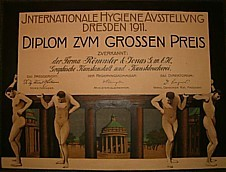
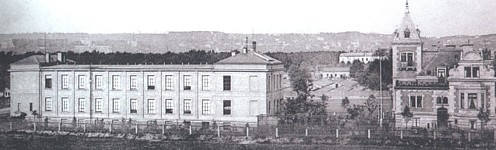
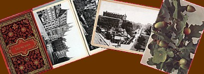

* * *

* * *

Die “Kunstdruck-Anstalt für Lichtdruck” Römmler & Jonas wurde 1871 von Emil Römmler (1842-1941) und seinem Kompagnon, dem Buchhalter Leopold Erasmus Jonas (\* 1839) auf der Pillnitzer Straße 54 gegründet. Der aus einfachen Verhältnissen stammende Unternehmer hatte zunächst in München und Paris das Fotografenhandwerk erlernt und war in dieser Zeit in Kontakt mit dem damals neuartigen Lichtdruckverfahren gekommen. Mit 20 Jahren ließ er sich 1861 in Dresden als Porträt- und Landschaftsfotograf nieder, widmete sich jedoch schon bald der Herstellung von Lichtdrucken. Als einer der Ersten setzte Römmler das großmaschinelle Verfahren der Albertotypie ein, was ihm die Herstellung großer Stückzahlen ermöglichte und so zum wirtschaftlichen Erfolg seines Unternehmens beitrug. 1873 bezog das junge Unternehmen neue Firmen- und Geschäftsräume auf der Neuen Gasse 28.

1878 erwarb Emil Römmler am Striesener Platz 10 ein Haus, in dem er neben seiner Wohnung auch sein Atelier und seine Druckerei einrichtete. Im selben Jahr wurde ihm der Titel eines "Königlich-Sächsischen Hoffotografen" verliehen. Elf Jahre später kaufte er das Grundstück des ehemaligen [Vorwerkes “Lämmchen”](../../../../../zentrum/johannstadt/strassen_johannstadt/blasewitzer_strasse/) an der Blasewitzer Straße 27 und ließ eine moderne Großdruckerei mit Verlagshaus und einer repräsentativen Fabrikantenvilla errichten. Neben Schwarz-Weiß-Bildern stellte die Lichtdruckanstalt und Kunstdruckerei Römmler & Jonas nach der Jahrhundertwende auch erste Farbbilder im Drei-Farb-Druckverfahren her, wofür Römmler eigens ein Patent erworben hatte. Zeitweise beschäftigte die ab 1909 von Römmlers Sohn Hans geleitete Firma 80 Angestellte. 1911 war der Betrieb komplett modernisiert worden und gehörte nun zu den bedeutendsten Produzenten hochwertiger Farbdrucke in Deutschland. Hergestellt wurden vorrangig Licht- und Kunstdrucke, Bildmappen, Kalender, Postkarten und Reproduktionen von Gemälden. Während des Ersten Weltkrieges produzierte man auch Druckerzeugnisse für den militärischen Bedarf, 1922/23 sogar Notgeldscheine.

**_Foto:_** _Verlagsgebäude der Firma Römmler & Jonas an der Blasewitzer Straße 27_

Der engen Kontakt zu nationalistischen Kreisen haltende Hans Römmler jun. entschloss sich 1928, den väterlichen Betrieb
zu verkaufen und den Verkaufserlös der Ludendorff-Bewegung zu stiften. Käufer war die Güntzsche Stiftung, welche den
Geschäftsbetrieb unter dem alten Firmennamen bis 1945 fortführte. Während des Zweiten Weltkrieges waren in einer
Baracke auf dem Betriebsgelände ukrainische Zwangsarbeiterinnen untergebracht. Teile der Druckerei fielen dem Luftangriff zum Opfer. Die erhaltenen Maschinen und Anlagen wurden nach der Enteignung demontiert und als
Reparationsleistungen in die UdSSR verbracht, womit die Geschichte der Druckerei Römmler & Jonas endete. In den
erhaltenen Betriebsgebäuden wurden später Verpackungsmaschinen gebaut und Modeschmuck hergestellt. 1999 wurde der Komplex abgerissen.

**_Foto:_** _Verlagserzeugnisse von Römmler & Jonas aus der Zeit vor dem Ersten Weltkrieg_

* * *

 \[ [Home](../../../../../index.html)\] \[ [Nord](../../../../../nord/)\] \[ [Nordwest](../../../../../nordwest/)\] \[ [Neustadt](../../../../../neustadt/)\]
 \[ [Nordost](../../../../../nordost/)\] \[ [West](../../../../../west/)\] \[ [Zentrum](../../../../../zentrum/)\] \[ [Südwest](../../../../../sudwest/)\]
 \[ [Süd](../../../../../sud/)\] \[ [Südost](../../../../../sudost/)\] \[ [Ost](../../../../../ost/)\] \[ [Register](../../../../../Register/register.html)\] \[ [Kontakt](../../../../../Kontakt/kontakt.html)\] \[ [Impressum](../../../../../impressum/)\]
