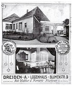
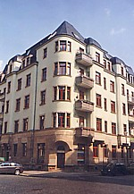
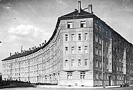
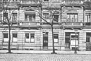
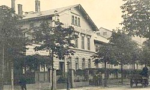
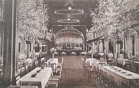
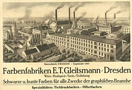
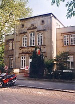

* * *

* * *

**Werbepostkarte des Logenhauses Blumenstraße 3**

* * *

Die heutige Blumenstraße wurde nach dem hier gelegenen [Vorwerk Lämmchen](../../../../zentrum/johannstadt/strassen_johannstadt/blasewitzer_strasse/) ursprünglich Lämmchenweg genannt. Zeitweise war auch der Name Fürsten- bzw. Jagdweg üblich, da
dieser von der Hofgesellschaft auf dem Weg nach Pillnitz genutzt wurde. Erst 1860 wechselte der Name offiziell in Blumenstraße. Mit dieser Namensgebung sollte an die bis 1878
existierende Gärtnerei Lüdecke auf dem Areal des früheren Vorwerkes [“Hopfgartens”](../../../../zentrum/johannstadt/strassen_johannstadt/hopfgartenstrasse/) erinnert werden, welche mit ihren ausgedehnten Anlagen und Schauplatz großer Blumenschauen
beliebtes Ausflugsziel der Dresdner war. Später entstanden auf dem Gelände Wohn- und Geschäftshäuser. Außerdem gab es mit der Dresdner Gardinen- und Spitzenmanufaktur (Nr.
66), der Chemischen Fabrik Gleitsmann (Nr. 68/70) und den „Blumen-Garagen“ der Karosseriebaufirma Gläser (Nr. 88a) einige gewerbliche Unternehmungen. Hinzu kamen
verschiedene öffentliche Einrichtungen. So befand sich auf der Blumenstraße 2 eine Filiale der Stadtsparkasse, die Kreisstelle des Fürsorgeamtes sowie das Büro des Gemeindewaisenrates des städtischen Jugendamtes.

Während die Gebäude zur Innenstadt zu sämtlich dem Luftangriff zum Opfer
fielen, blieben im östlichen Abschnitt der Blumenstraße noch Reste der Vorkriegsbebauung erhalten. Bemerkenswert sind u.a. die Mietshäuser Blumenstraße 90 (Bj. 1909) und 104/106 (Bj. 1907), welche plastischen
Bauschmuck mit Jugendstilelementen aufweisen. Kriegszerstörte Gebäude wurden in den 1960er und 1970er Jahren zum Teil durch Neubauten ersetzt, u.a. durch die am 16. April 1974 eröffnete Kindertagesstätte Blumenstraße 60.

Einzelne Gebäude:

Nr. 3:
Auf diesem Grundstück befand sich bis zur Zerstörung 1945 das Logenhaus der 1911 gegründeten Freimaurerloge “Zum flammenden Stern”. Inhaber der zugehörigen Gaststätte war der Traiteur Walter E. Ferrario, später
der Schankwirt Oskar Beyrich.

Nr. 8: In dem 1945 zerstörten Wohnhaus hatte zeitweise der Bildhauer Emmerich Andresen sein Atelier. Andresen schuf
u.a. die Büste des Schriftstellers Karl Gutzkow, welche einst vor der Kreuzschule am Georgplatz stand. Auch sein
Bildhauerkollege August Schreitmüller wohnte bis 1945 in diesem Gebäude. Schreitmüller (1871-1958), ein Schüler von
Robert Diez, war ab 1907 Professor an der Kunstakademie und gehörte 1909 zu den Mitbegründern der Dresdner Kunstgenossenschaft.

Loschwitzer Hof:
Die Gastwirtschaft auf der Blumenstraße 47 wurde Ende des 19. Jahrhunderts von Hugo Fritzsche gegründet und ab 1905 von der Familie Hering betrieben. Carl Hering hatte sein Lokal im Erdgeschoss des Hauses gegenüber den
“Blumensälen” eingerichtet und betrieb hier zugleich eine Fleischerei. Außerdem gehörte ein Billardzimmer zur Gaststätte, welche sich wegen ihrer preiswerten bürgerlichen
Küche großer Beliebtheit erfreute. Nach Ausbruch des Zweiten Weltkrieges wurde der “Loschwitzer Hof” _(Foto)_ aus wirtschaftlichen Gründen geschlossen und 1945 zerstört.

Blumensäle:
Die bis 1945 zu den größten Johannstädter Lokalen gehörenden “Blumensäle” (Blumenstraße 48) gingen auf ein einst an dieser Stelle befindliches Vorwerk zurück, welches nach seinem Besitzer, dem
Königlichen Stück- und Glockengießer Johann Gottfried Weinhold, “Stückgießers” genannt wurde. Weinhold hatte das damals noch “Neue Sorge” genannte Anwesen 1737 erworben und dort eine Schankwirtschaft
eingerichtet. 1866 fielen die Bauten dem Bau einer preußischen Schanze zum Opfer.

Noch im gleichen Jahr ließ der Besitzer des Vorwerks an gleicher Stelle eine neue Gastwirtschaft errichten. In diesem Zusammenhang wurde das Lokal in
“Zur Güldenen Aue” umbenannt. Das neue Haus besaß neben Restaurations- und Vereinsräumen zwei große Säle _(Foto)_ und diverse Nebenräume. 1901 wechselte der Name in “Blumensäle”. Neben Tanzveranstaltungen und
Konzerten fanden hier auch politische Kundgebungen statt. Am 31. Januar 1907 sprach in diesem Haus August Bebel letztmalig vor Dresdner Arbeitern. Unter dem Motto “Binder, Ernst und das genügt...” führte ab 1913 der
Johannstädter Gastronom Ernst Binder das Vergnügungslokal  zu neuer Blüte. 1945 wurden die “Blumensäle” zerstört. An gleicher Stelle befindet sich heute ein Supermarkt.

Farbenfabrik Gleitsmann (Nr. 68-74): Das Unternehmen wurde 1847 von von Emil Theodor Gleitsmann als “Chemische
Fabrik für trockene Farben” gegründet und umfasste Ende des 19. Jahrhunderts mehrere Grundstücke an der Blumen-
und Gutenbergstraße. Hergestellt wurden verschiedene Farbstoffe und Fertigprodukte, u.a. Sicherheitsdruckfarben für
Banknoten und Briefmarken. Außerdem gab es eine Leinölfirniskocherei, Rußbrennereien und eine Destillation für Harze.
Die mit der Produktion einhergehende Umweltbelastung führte zu Protesten der Anwohner, welche 1898 maßgeblich
zum Erlass eines neuen Ortsgesetzes beitrugen. Darin verbot die Stadt neue Industrieansiedlungen, welche “Ruß, Dämpfe, Gerüche, Geräusche, Erschütterungen und erhebliche Belästigungen der Nachbarschaft von Wohnungen
herbeiführen”.

Der wirtschaftliche Erfolg des Unternehmens führte nach dem ersten Weltkrieg zur Gründung von Niederlassungen in
 Italien, Schweden und Österreich. 1945 wurden die Produktionsräume schwer beschädigt. Dadurch und bedingt durch
 die politische Situation in Ostdeutschland verlegte das Unternehmen seinen Sitz 1953 nach Berlin. Seit Ende der 1990
 Jahre firmiert die E. T. Gleitsmann GmbH & Co. KG als Gleitsmann Security Inks GmbH und ist heute als Spezialist für Sicherheitsfarben Teil des international tätigen Druckfarbenherstellers hubergroup.

Nr. 70:
Die noch erhaltene Villa _(Foto)_ war einst Wohnsitz des Kunstgärtners Rudolf Hermann Lüdicke, der bis 1878 eine Gärtnerei an der Blumenstraße betrieb. An diese erinnert neben der Blumen- auch die [Wintergartenstraße](../../../../zentrum/johannstadt/strassen_johannstadt/). 1878 erwarb der Unternehmer Emil Theodor
Gleitsmann das Gebäude und nutzte das Areal als Wohnhaus und Produktionsstätte für seine Chemische Fabrik. Das 1945 beschädigte Wohnhaus beherbergt heute die Apotheke Johannstadt.

Nr. 88 A:Das Grundstück war unter dem Namen „Blumen-Garagen“ einst Teil der ausgedehnten Produktionsanlagen der [Karosseriebaufirma Gläser](../../../../zentrum/johannstadt/strassen_johannstadt/karosseriebaufabrik_glaser/), welche hier, zuletzt als Betriebsteil des VEB Karosseriebau, Zubehörteile für den Automobilbau herstellte. Anfang
der 1970er Jahre wurde die Produktion nach Radeberg verlagert und die Werkshallen nur noch als Lager genutzt. Das brachliegende Areal erwarb nach 1990 ein privater Investor und
richtete hier 2007 einen Skulpturenpark ein. Im sogenannten “Blumenhof” sind verschiedene Kunstwerke zeitgenössischer Künstler zu sehen, u.a. Plastiken von Joachim Müller und Andreas Gössel (“Messer, Gabel, Löffel”),
Siegfried Haas (“Kontrabass”), Jens Gebhardt (“Keimstudie”) und eine Steinstele von Bernhard Pfaff.

* * *

 \[ [Home](../../../../index.html)\] \[ [Nord](../../../../nord/)\] \[ [Nordwest](../../../../nordwest/)\] \[ [Neustadt](../../../../neustadt/)\] \[ [Nordost](../../../../nordost/)\] \[ [West](../../../../west/)\] \[ [Zentrum](../../../../zentrum/)\] \[ [Südwest](../../../../sudwest/)\] \[ [Süd](../../../../sud/)\] \[ [Südost](../../../../sudost/)\] \[ [Ost](../../../../ost/)\] \[ [Register](../../../../Register/register.html)\] \[ [Kontakt](../../../../Kontakt/kontakt.html)\] \[ [Impressum](../../../../impressum/)\]
