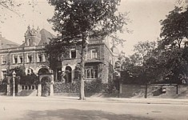
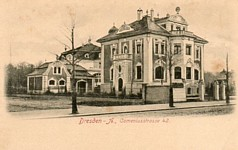
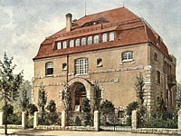
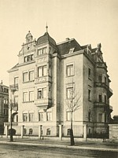
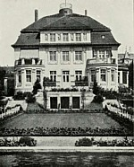
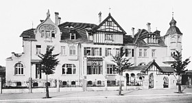

* * *

Die Comeniusstraße entstand Ende des 19. Jahrhunderts und führt vom Stübelplatz (heute [Straßburger Platz](../../../../zentrum/pirnaische_vorstadt/strassen_pirnaische_vorstadt/strassburger_platz/)) bis zum früheren Carlowitzplatz (Bertolt-Brecht-Platz) und von dort weiter bis zur Zwinglistraße auf Grunaer Flur. Ihren Namen erhielt sie 1893 aus Anlass des 300. Geburtstages des tschechischen Theologen und Humanisten Johann Amos Komenský (Comenius). Comenius (1592-1670) gilt als Begründer der wissenschaftlichen Pädagogik und forderte als erster die Einführung eines mehrgliedrigen Schulsystems sowie eine gleichberechtigte Schulbildung auch für Mädchen. Zuvor wurde sie Kirchsteig genannt, da sie von den Bewohnern Striesens und Grunas als Weg zur Kreuzkirche genutzt wurde. Gleichzeitig mit der Comeniusstraße erhielt auch der am Schnittpunkt mit der Fürstenallee des Großen Gartens und der Fürstenstraße (Fetscherstraße) gelegene Comeniusplatz seinen Namen. Bis 1915 endete die Straße am heutigen Bertolt-Brecht-Platz, bevor man sie bis zur Schneebergstraße in Gruna verlängerte. Der kurze Straßenabschnitt westlich der Güntzstraße wurde in der Nachkriegszeit durch Überbauung abgetrennt und 1995 in die Seidnitzer Straße einbezogen.

Wegen ihrer Nähe zum [Großen Garten](../../../../zentrum/grosser_garten/) entstanden an der Comeniusstraße vorrangig Villen und Landhäuser. Mit Ausnahme der sogenannten “Mutschmann-Villa” (Nr. 32) überstand keines dieser Gebäude den Zweiten Weltkrieg. Heute prägen mehrgeschossige Plattenbauten das Straßenbild. Erstmals in Dresden kam bei deren Bau im Jahr 1973/74 der später weit verbreitete Wohnungstyp WBS 70 zum Einsatz. 1961 wurde am Comeniusplatz ein Einkaufszentrum mit mehreren Läden eröffnet. Nach dessen Abriss entstand 2004 auf dem Areal der Senioren-Wohnpark “Am Großen Garten”.

**_Fotos:_** _Villen an der Comeniusstraße: links Nr. 31 von Dr. med Gründler,_

_in der Mitte Nr. 42, erbaut von Heino Otto, rechts Nr. 46, 1905 von Richard Riemerschmid_

_für Dr. Rudolph errichtet. Keines dieser Häuser überstand die Bombennacht von 1945_

Einzelne Gebäude:

Nr. 3: Das villenartige Wohnhaus im Stil der deutschen Neorenaissance wurde 1895/96 vom Architekten Gustav Hänichen erbaut und war später Sitz der Tabakfabrik Dumitrescu. Ab 1925 befand sich hier das “Reichsamt der Deutschen Bauernhochschule”. Diese Einrichtung diente als zentraler Sitz der völkisch-nationalistischen Artamanenbewegung, die im Geiste der “Blut-und-Boden-Ideologie” eine Erneuerung des deutschen Volkstums durch Arbeitsdienste in der Landwirtschaft und die Gewinnung neuer Gebiete in Osteuropa propagierte. Die in Limbach bei Wilsdruff entstandene Gruppierung vermittelte von hier freiwillige Arbeitskräfte für den Einsatz auf Gütern und organisierte Veranstaltungen für ihre Mitglieder. Wegen ihrer ideologischen Ziele galten die Artamanen neben anderen Gruppierungen als Wegbereiter der nationalsozialistischen Ideologie. 1945 wurde das Haus zerstört. An seiner Stelle entstanden später  Wohnhochhäuser.

Nr. 32: Die Villa wurde 1906 nach Plänen des Architekten Heinrich Tscharmann als eines der letzten Gebäude dieses Villenviertels erbaut. Tscharmann gehörte gemeinsam mit Hans Erlwein der Künstlergemeinschaft “Die Zunft” an, die sich einem neuen zweckmäßigen Bauen in klaren Stilformen verschrieben hatte. Bauherr und langjähriger Bewohner war der Wissenschaftler Dr. phil. Walter Luboldt, für den rund um das Haus eine romantische Gartenanlage mit einer Grotte und einer Wasserfläche angelegt wurde. Aus finanziellen Gründen entschloss sich die Familie in den Zwanziger Jahren zur Aufteilung des Hauses in Mietwohnungen.

Ab 1935 bewohnte Sachsens Reichsstatthalter und NSDAP-Gauleiter Martin Mutschmann die
Villa. Nach Kriegsbeginn ließ er im Garten einen Luftschutzbunker für sich und seine Familie anlegen. Als einziges Haus der Comeniusstraße auf Johannstädter Flur überstand die
“Mutschmann-Villa” den Bombenangriff, wurde jedoch teilweise beschädigt. In der Nachkriegszeit nutzten zunächst die FDJ, später die Zivilverteidigung und die Arbeiter- und Bauern-Inspektion das Haus. 1991 bezog für einige Jahre das Finanzamt I die Villa, welche nach ihrer Sanierung 1998 heute gewerblichen Zwecken dient.

Nr. 33: In dieser Villa wohnte bis zu seinem Tod 1934 der jüdische Bankier und Kaufmanns Felix Bondi (1860-1934). Bondi war Teilhaber einer von seinen Vorfahren gegründeten Privatbank und trat vor allem als Förderer von Kunst und
Kultur in Erscheinung. 1911 gehörte er zu den Mitbegründern des Dresdner Museumsvereins und unterstützte verschiedene Aufkäufe der Staatlichen Kunstsammlungen. Zu seiner privaten Sammlung gehörten u.a. Bilder von Wilhelm Trübner, Fritz von Uhde und Max Liebermann. 1945 fiel die Villa den Bomben zum Opfer.

Nr. 46: Die Villa an der Ecke zur Lipsiusstraße entstand 1905 nach Entwürfen des Architekten Richard Riemerschmid, der später als einer der Mitbegründer der Gartenstadt Hellerau bekannt wurde. Das bereits im Stil der Reformbaukunst gestaltete Landhaus Dr. Rudolph fiel 1945 den Bomben zum Opfer.

Nr. 59: Dieses Gebäude an der Einmündung der Anton-Graff- und der Henzestraße war bis zu seiner Zerstörung eng mit der Dresdner Musikgeschichte verbunden. Zwischen 1906 und 1918 wohnte hier der amerikanische Opernsänger Eleazer Leon Rais (1870-1954). Rais war nach einem Gastspiel an die Königliche Hofoper verpflichtet worden und wirkte u.a. im “Tannhäuser” und der Uraufführung der Oper “Salomé” mit. Zeitweise lebte auch die Sängerin Marie Wittich in dem Haus.

Nr. 61-65: Die aufwendig gestaltete Wohnhausgruppe _(Foto)_ entstand 1899/1900 durch das Architektenbüro Rose & Röhle. Die drei villenartigen Reihenhäuser erhielten eine aufwendige Fassadengestaltung mit Neorenaissance- und Jugendstilelementen und waren typisch für den südlichen Teil der Johannstadt. 1937 bezog der Architekt Martin Hammitzsch mit seiner zweiten Frau Angela, einer Halbschwester Adolf Hitlers, eine Wohnung im Haus Nr. 61. Durch diesen Kontakt zur Führung der NSDAP gelang ihm 1938 der Aufstieg in die Bauabteilung des sächsischen Innenministeriums, 1942 die Ernennung zum sächsischen Landesdenkmalpfleger. Hammitzsch, der 1911 das Gebäude der [Tabakfabrik “Yenidze”](../../../../zentrum/friedrichstadt/strassen_friedrichstadt/weisseritzstrasse/yenidze/) entworfen hatte, floh zum Kriegsende aus Dresden und nahm sich auf der Flucht das Leben. Das Paar hatte während der NS-Zeit enge Kontakte zu Gauleiter Mutschmann unterhalten und war auch mit Galeriedirektor Hans Posse und der Witwe Karl Mays befreundet.

Nr. 62: In diesem Haus lebte von 1921 bis zu seinem Tod am 5. August 1926 der frühere Dresdner Oberbürgermeister Otto Beutler. Der ausgebildete Jurist hatte das Amt 1895 übernommen und war bis zu seiner Pensionierung 1915 maßgeblich an der Entwicklung Dresdens zur modernen Großstadt und der Modernisierung der Verwaltung beteiligt.

Nr. 80: Beim Bau dieses Hauses 1934 entdeckten Bauarbeiter im Boden einen Axthammer aus der ältesten Bronzezeit, Hinweis darauf, dass die Grunaer Flur bereits damals besiedelt war. Bronzezeitliche Funde wurden auch in der Grunaer Siedlung und bei der Erweiterung des Striesener Friedhofs gemacht.

Nr. 83: Hier befanden sich bis zur Zerstörung des Hauses 1945 Wohnung und Büro des Architekten Felix Reinhold Voretzsch (1873-1951). Voretzsch hatte sich nach seinem Studium in Chemnitz und Dresden 1895 als freischaffender Künstler und Architekt niedergelassen. Von ihm stammen die Entwürfe für mehrere 1945 zerstörte Wohnhäuser an der Bürgerwiese sowie des [Rathauses Cotta](../../../../west/cotta/).

Nr. 87: Das Wohnhaus an der Einmündung der Zeschaustraße (heute Rudolf-Mauersberger-Straße) war bis 1945 Wohnsitz des früheren sächsischen Ministers für Wirtschaft und Arbeit Georg Lenk (1888-1946). Lenk stammte aus Plauen und war wie der sächsische Gauleiter Martin Mutschmann, zu dem er enge Kontakte unterhielt, zunächst Spitzenfabrikant. 1930 wurde er Reichstagsabgeordneter der NSDAP und im Mai 1933 zum sächsischen Wirtschaftsminister ernannt. Wegen seiner Beteiligung an Kriegsverbrechen und konterrevolutionärer Tätigkeit wurde er nach Kriegsende von einem sowjetischen Militärtribunal zum Tode verurteilt und in Moskau hingerichtet.

Nr. 104: Das Doppelhaus entstand 1936 für den Baumeister August Warnatz, Inhaber der Hoch-, Tief- und Eisenbetonbau KG mit Sitz auf der Serrestraße in der Pirnaischen Vorstadt. Über der Eingangstür befindet sich ein Psalm aus dem Alten Testament.

Nr. 107: Das bis heute erhalten gebliebene Gebäude entstand 1927 als Einfamilienhaus für den Rechtsanwalt Dr. Karl Eckarti. Architekt war der durch seine Kinobauten und das Loschwitzer Künstlerhaus bekannte Martin Pietzsch. Am Haus befindet sich ein 1929 von Otto Pilz geschaffener Brunnen mit einer Bärenplastik und zwei zu Füßen der Säule sitzenden Schildkröten.

* * *

 \[ [Home](../../../../index.html)\] \[ [Nord](../../../../nord/)\] \[ [Nordwest](../../../../nordwest/)\] \[ [Neustadt](../../../../neustadt/)\] \[ [Nordost](../../../../nordost/)\] \[ [West](../../../../west/)\] \[ [Zentrum](../../../../zentrum/)\] \[ [Südwest](../../../../sudwest/)\] \[ [Süd](../../../../sud/)\] \[ [Südost](../../../../sudost/)\] \[ [Ost](../../../../ost/)\] \[ [Register](../../../../Register/register.html)\] \[ [Kontakt](../../../../Kontakt/kontakt.html)\] \[ [Impressum](../../../../impressum/)\]
