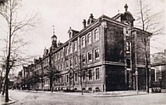

* * *

* * *

* * *

* * *

* * *

* * *

Die meist als “Dürerschule” bezeichnete Staatliche Höhere Versuchsschule wurde
mit Beginn des Schuljahres 1922 gegründet und bezog zunächst einige Räume in der 6. Volksschule auf der Ehrlichstraße. Ziel der reformpädagogischen Bildungsstätte
war die Erprobung neuer Schulkonzepte für Höhere Schulen, die den Schülern unabhängig von ihrer Herkunft und politischen Anschauung eine Gymnasialbildung
ermöglichte. In das Konzept flossen Ideen des Bundes Entschiedener Schulreformer, der Landerziehungsheime, der Arbeiterschulbewegung und der norddeutschen
Kunsterziehungsbewegung ein. Aufgenommen wurde die Kinder im Anschluss an die vierjährige Volksschule und dann bis zum allgemeinen staatlichen Abitur geführt. Wesentliche Inhalte des Schulprofils
waren die Abwechslung von Gesamt- und Projektunterricht, ein begleitendes Kurssystem, die ästhetische und auf Frieden
und Völkerverständigung ausgerichtete Erziehung sowie Koedukation, Schülermitbestimmung und eigenverantwortliche Schulverwaltung mit Wahlkollegium.

Aufgrund der großen Nachfrage wuchs die Schülerzahl von lediglich 30 im Gründungsjahr auf über 370 im Jahr 1929 an.
Deshalb genügten die Räume in der Wilsdruffer Vorstadt schon bald nicht mehr den Anforderungen. 1923 verlegte man
die Versuchsschule deshalb in das Gebäude der 51. Volksschule an der Silbermannstraße in der Nähe des Dürerplatzes _(Foto)_
. Ein ursprünglich geplanter Neubau kam wegen der schwierigen Wirtschaftslage nicht zustande. 1924 erhielt die Dürerschule durch Schenkung eine Villa im Kurort Gohrisch, welche daraufhin als Schullandheim genutzt wurde.

Trotz des Versuches rechter und linker politischer Kreise, stärkeren Einfluss auf die Lehre zu nehmen, konnte die
Dürerschule bis 1933 als reformorientierte humanistische Oberschule fortgeführt werden. Neben der Vermittlung natur-
und geisteswissenschaftlicher Kenntnisse wurde großer Wert auf künstlerischen und heimatverbundenen Unterricht mit
praktischen Elementen gelegt. Enge Kontakte unterhielt die Dürerschule u.a. zu Jugendorganisationen wie dem
“Wandervogel” und der SAJ, zum Sächsischen Heimatmuseum und der Hellerauer Schule, aber auch zu einigen Dresdner Künstlern. Außerdem standen regelmäßige Klassenfahrten und der Austausch mit Schülern aus Österreich,
Großbritannien, der Tschechoslowakei und Frankreich auf dem Programm.

Mit Machtübernahme der Nazis konnte die reformpädagogische Arbeit nicht mehr fortgesetzt werden. 1934 wurde die
Dürerschule zwangsweise aufgelöst und die jüngeren Schüler auf andere Dresdner Oberschulen aufgeteilt. Die letzten
Schüler der Oberprima verließen die zuletzt als “Deutsche Oberschule” bezeichnete Einrichtung 1936, womit die
Geschichte der Dürerschule als eines der bedeutendsten reformpädagogischen Experimente der Weimarer Republik ihr endgültiges Ende fand. Das Schulgebäude wurde 1945 zerstört.

* * *

 \[ [Home](../../../../index.html)\] \[ [Nord](../../../../nord/)\] \[ [Nordwest](../../../../nordwest/)\] \[ [Neustadt](../../../../neustadt/)\] \[ [Nordost](../../../../nordost/)\] \[ [West](../../../../west/)\] \[ [Zentrum](../../../../zentrum/)\] \[ [Südwest](../../../../sudwest/)\] \[ [Süd](../../../../sud/)\] \[ [Südost](../../../../sudost/)\] \[ [Ost](../../../../ost/)\] \[ [Register](../../../../Register/register.html)\] \[ [Kontakt](../../../../Kontakt/kontakt.html)\] \[ [Impressum](../../../../impressum/)\]
