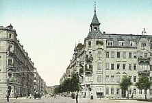
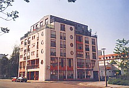
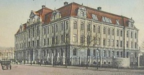
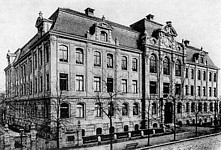
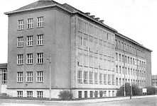
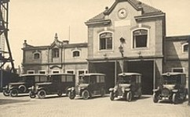
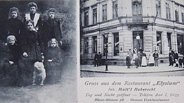
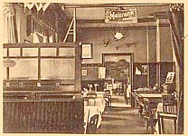
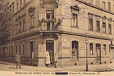

* * *

* * *

Ebenso wie der heute nicht mehr vorhandene [Dürerplatz](../../../../zentrum/johannstadt/strassen_johannstadt/) erhielt auch die Dürerstraße ihren Namen nach dem deutschen Maler und Grafiker Albrecht Dürer
(1471-1528), dessen Holzschnitte und Kupferstiche zu den bedeutendsten Werken der Kulturgeschichte gehören. Ihren Ausgangspunkt hatte die 1873
offiziell benannte Dürerstraße einst am Holbeinplatz (Rietschelstraße) in der Pirnaischen Vorstadt und durchquerte dann die gesamte Johannstadt bis zur Striesener Flurgrenze.

Vor der Zerstörung 1945 gab es an der Dürerstraße neben mehrgeschossigen
Wohn- und Geschäftshäusern auch einige gewerbliche Betriebe und öffentliche Einrichtungen. So hatte in der Nr. 5 die Zigarettenfabrik Delphi, in der Nr. 100 die
Zigarettenfabrik Bassora ihren Sitz. Im Haus Nr. 42 war mit dem Elisenbad eines von mehreren Wannenbädern der Johannstadt zu finden. Auf der Dürerstraße 51
befand sich ab 1896 die Feuerwache Johannstadt. Zuletzt hatte hier bis 1945 die Krankenbeförderungs-Zentrale des Städtischen Feuerwehramtes ihr Depot. In der Nähe des Zöllnerplatzes stand die [20\. Volksschule](../../../../zentrum/johannstadt/), deren Turnhalle zeitweise als Betsaal der Trinitatisgemeinde diente.  Noch erhalten sind einige Gebäude der
1901 eröffneten Städtischen Gewerbeschule an der heutigen Hans-Grundig-Straße, welche nach 1945 in eine Ingenieurhochschule umgewandelt wurde. Weitere Neubauten entstanden erst in jüngster Vergangenheit _(Foto)._

Einzelne Gebäude:

Nr. 8: In diesem heute nicht mehr vorhandenem Wohnhaus zwischen Cranach- und Pestalozzistraße 8 verbrachte der Maler und Grafiker Georg Lührig (1868-1957) seine ersten Dresdner Jahre. Später war er ab 1916 Professor an der Kunstakademie und 1932-33 deren Rektor. Lührig gehörte mehreren Künstlervereinigungen an, so dem Künstlerbund, dem Verein Bildender Künstler und der "Goppelner Gruppe".

Nr. 13: Das Eckhaus zur Pestalozzistraße beherbergte vor 1945 mit der Schankwirtschaft Teutonia eine von zahlreichen kleinen Gastwirtschaften der Pirnaischen Vorstadt.

 Landesversicherungsanstalt Sachsen (Nr. 26): Der Monumentalbau für die Landesversicherungsanstalt Sachsen entstand 1892-95 nach Plänen des Architekten Hermann Thüme. Thüme hatte kurz zuvor den Wettbewerb für den
Neubau gewonnen. Der Gebäudekomplex nahm das gesamte Grundstück zwischen Dürer-, Holbein und Marschnerstraße ein und umschloss als Vierflügelbau einen länglichen, rechteckigen Innenhof. Hier fand ein kleiner
Zierbrunnen des Bildhauers Oswald Kurt Dämmig Aufstellung, der einen Ziehharmonika spielenden Jungen zeigte. 1928 folgte noch ein Ergänzungsbau an
der Ecke Dürer-/Güntzstraße, für den u.a. das einstige Atelier Ernst Hähnels abgerissen werden musste. Die 1945 beschädigten Gebäude wurden später vereinfacht wiederhergestellt und werden
heute von der Deutschen Rentenversicherung genutzt.

Städtische Gewerbeschule (Nr. 45): Die Bildungseinrichtung wurde 1861 von Karl Wilhelm Clauß als Handwerkerschule des Dresdner
Gewerbevereins gegründet und hatte ihren Sitz zunächst auf der Maxstraße 9. Ab 1896 befand sie sich im Besitz der Stadt Dresden, die sich wegen der stark gestiegenen Schülerzahl für den Neubau eines
Schulgebäudes in der Johannstadt entschied. Das nach modernsten Gesichtspunkten errichtete Gebäude an der Dürerstraße 45 erhielt neben den Klassenzimmern für den theoretischen Unterricht auch
Zeichensäle, Werkstätten für Elektrotechniker, Maschinenbauer, Tischler und die verschiedenen Baugewerke. Hinzu kamen eine Bibliothek, Labore, Lehrer- und Konferenzräume sowie
ein für größere Veranstaltungen genutztes Auditorium Maximum. Die Baukosten betrugen 685.000 Mark. Finanziert
wurden diese durch die Stadt sowie mit Unterstützung der sächsischen Industrie, die vor allem Modelle und Exponate für den praktischen Unterricht zur Verfügung stellte

Am 9. April 1901 erfolgte die Aufnahme des Unterrichtsbetriebs in der neuen Gewerbeschule. Erster Direktor war der
Architekt und Hofrat Arnold Kuhnow, der insgesamt 24 Jahre im Amt blieb und maßgeblich zum Erfolg der Schule
beitrug. Neben der allgemeinen Lehrlingsausbildung fanden auch Weiterbildungslehrgänge für künftige Meister und Gehilfen, Abend- und Sonntagskurse statt. Außrdem gab es zeitweise eine Schülerinnen-Abteilung des Dresdner
Frauenfortbildungs-Vereins, bevor dieser 1915 ein eigenes Schulgebäude auf der Pestalozzistraße beziehen konnte.

Im Jahr 1911 besuchten bereits über 1.500 Schüler die Gewerbeschule. Zehn
Jahre später war die Zahl bereits auf 2.883 gestiegen, so dass Erweiterungsbauten notwendig waren. Zuvor erfolgte 1922 die Umbenennung der Einrichtung in
„Städtische Gewerbe- und Technische Mittelschule Dresden“. 1925 wurde eine Fachgewerbeschule für Klempner, Installateure, Goldschmiede und Graveure angegliedert. 1928 kam eine höhere Maschinenbauschule dazu, deren
Absolventen hier das Fachschul-Ingenieur-Reifezeugnis erwerben konnten. Am 30. Juni 1927 begann mit der Absteckung des Bauplatzes der Bau eines
zusätzlichen Schulgebäudes an der Dürer-, Elias- und  Gerokstraße. Die feierliche Einweihung fand am 25. Januar 1930 statt. Ein ursprünglich geplanter zweiter Flügel, der spiegelbildlich westlich an das
Hauptgebäude  angebaut werden sollte, wurde jedoch nicht realisiert.

Die Luftangriffe auf Dresden überstanden die Schulgebäude mit größeren Schäden, blieben jedoch in ihrer Grundsubstanz erhalten. Bereits 1948 konnte
der Gebäudeteil an der Elisenstraße (Hans-Grundig-Straße) wieder genutzt werden. 1957 erfolgte der Neubau des Flügels Dürerstraße _(Foto)_ sowie ein neues Hörsaalgebäude. Zeitgleich entstand an der Güntzstraße ein
Studentenwohnheim. 1952 erfolgte die Umbenennung in Fachschule für Maschinenbau, Elektrotechnik und Feinmechanik Dresden. Ab 1955 wurde sie als Fachschule für Leichtbau bezeichnet. Ein Jahr später wurde aus dieser die
Ingenieurschule für Flugzeugbau Dresden, um hier das benötigte Fachpersonal für die in Dresden geplante Flugzeugproduktion auszubilden.  Nachdem dieses Projekt auf Weisung der DDR-Führung
eingestellt wurde, erhielt die Schule 1962 den Namen Ingenieurschule für Maschinenbau und Elektrotechnik Dresden.
Nach mehreren strukturellen Veränderungen in den 1960er und 1970er Jahren wurde sie 1986 mit der Technischen
Universität vereinigt und als Informatik-Zentrum in die Universität eingegliedert. Bis heute nutzt die Fakultät Informatik die Gebäude der ehemaligen Gewerbeschule.

Feuerwache III / Krankenbeförderungszentrale (Nr. 51):
Da die bisherige organisatorische Struktur der Dresdner Feuerwehr Ende des 19. Jahrhunderts als nicht mehr ausreichend betrachtet wurde, entschied man sich zur
Einrichtung fester Nebenwachen, welche mit entsprechender Löschtechnik ausgestattet wurden. In diesem Zusammenhnag entstand 1886 auf der Dürerstraße die bespannte Feuerwache III. Als “bespannt” galten
Feuerwachen, welche ständig mit Pferden für den Transport von Mannschaften und Löschgerät zum Einsatzort besetzt waren. Mit zunehmender Aufgabenveränderung der Hilfs- und Rettungsdienste übernahm die
Berufsfeuerwehr nach dem Ersten Weltkrieg auch das Unfall- und Krankenbeförderungswesen sowie Erste-Hilfe-Leistungen. Die bisherige Feuerwache III wurde daraufhin aufgelöst und in eine Krankenbeförderungszentrale
mit zehn Kranken- und zwei Totenwagen umgewandelt. Diese bestand bis zur Zerstörung der Gebäude am 13. Februar 1945.

Gaststätte “Zur alten Vogelwiese” (Nr. 57):
Der Name der bis zur Zerstörung 1945 geöffneten Gaststätte im Eckhaus zur Wintergartenstraße erinnerte an den früheren Standort der [Vogelwiese](../../../../zentrum/johannstadt/vogelwiese/). Noch bis 1873 hatte man das Volksfest auf dem
ehemaligen Übungsplatz der Kommunalgarde veranstaltet, bevor die Vogelwiese zu den Elbwiesen gegenüber dem Waldschlösschen verlegt wurde. In der Folgezeit entstanden auch hier Wohnhäuser. Das Lokal gehörte zu den
zahlreichen kleineren Gaststätten der dichtbesiedelten Johannstadt. Weitere befanden sich auf der Dürerstraße u.a. in den
Häusern Nr. 36 / Ecke Elisenstraße (“Elysium”), Nr. 72 (“Dürerschänke”) Nr. 97 (“Zum alten Ritter”), Nr. 101 (“Zur weißen Taube”) und Nr. 105 (“Zum Goldenen Helm”).

**_Fotos:_** _Historische Ansichten Alt-Johannstäder Lokale - links Restaurant “Elysium”, in der Mitte die Gaststube_
_“Zur alten Vogelwiese”, rechts das Restaurant “Zur weißen Taube” im Eckhaus zur Lortzingstraße_

Vereinshaus Johannstadt (Nr. 89):
Das einstöckige Gebäude entstand 1964 als Handwerkerhof der Arbeiter- wohnungsbaugenossenschaft “Fortschritt” und diente als Büro, Werkstatt und Materiallager. Nach dem Umzug der
Geschäftsstelle zur Haydnstraße 1987 wurde das Gebäude als Treffpunkt der AWG für verschiedene Veranstaltungen genutzt. Nach 1990 bezog die aus der AWG hervorgegangene Wohnungsgenossenschaft Johannstadt (WGJ) die
Räume. Neben deren Verwaltung befindet sich hier seit 2005 auch der Sitz des Vereins “Aktives Leben e.V.” mit verschiedenen Veranstaltungsräumen und einer öffentlichen Bibliothek. Regelmäßig finden Lesungen, Kunst- und
Sportkurse sowie wechselnde Ausstellungen statt.

Im Umfeld des Gebäudes sind zwei Kunstwerke zu finden. Unmittelbar vor dem gegenüberliegenden Schulgebäude ist seit 1969 d
ie Bronzeskulptur „Kletternde Kinder“ des Schweriner Bildhauers August Martin Hoffmann (1924–1985) zu finden. Im Frühjahr 2010 wurde neben dem Vereinshaus eine weitere Bronzeplastik “Früchte essende Jugendliche”
aufgestellt. Das Kunstwerk war 1961 vom Leipziger Bildhauer Erich Otto (1906-1990) geschaffen worden und stand bis zum Bau der Altmarktgalerie an der Webergasse.

Gegenüber des Vereinshauses erinnert noch ein aus der Zeit vor dem Zweiten Weltkrieg stammendes Trafohäuschen an
die frühere Bebauung. Es wurde in den 1930er Jahren als Trafostation der DREWAG an der Nordseite des heute nicht
mehr vorhandenen Dürerplatzes errichtet. Der Entwurf stammt vom Radebeuler Architekten Otto Röder. Das kleine
Häuschen erhielt neben den technischen Räumen eine vorgelagerte Sitzhalle sowie einen für Kundgebungen vorgesehenen Vorplatz. In der Sitzhalle befanden sich früher acht Figuren des Dresdner Bildhauer Reinhold Langner.

Nr. 91: In diesem 1945 zerstörten Wohnhaus an der Ecke zur Schumannstraße lebte von 1906 bis 1912 der Ingenieur
und Unternehmer Oskar Ludwig Kummer. Kummer war Begründer der Kummer-Werke in Niedersedlitz, um 1900 größter Hersteller von Elektromotoren in Sachsen. Nach Konkurs der Kummer-Werke ging aus dem Betrieb das [Sachsenwerk](../../../../ost/niedersedlitz/sachsenwerk/) hervor. Vor dem früheren Standort des Hauses befindet sich ein sogenanntes Mahndepot im Gehweg. Die
im Rahmen einer Kunstaktion  versenkte Edelstahlkapsel soll an eine der insgesamt 114 Sirenen erinnern, die ab 1937
durch die Firma Siemens & Halske AG flächendeckend im Stadtgebiet installiert wurden. Diese dienten der Warnung der Bevölkerung vor Luftangriffen und kamen auch am 13. Februar 1945 zum Einsatz.

Nr. 96: Das denkmalgeschützte mehrgeschossige Wohnhaus entstand um 1895 und gehört zu den wenigen erhaltenen
Bauten der Vorkriegszeit. Das Erdgeschoss mit Ladeneinbauten besteht aus Sandstein, die Obergeschosse wurden mit
Klinkern und Sandstein verblendet. Bemerkenswert ist ein 2014 entstandenes Graffitti-Wandbild an der Giebelfront. Geschaffen wurde der überdimensionale pinkfarbene Frauenkopf vom Hallenser Künstlerduo “Chaz”.

Müller & Wetzig (Nr. 100): Die Firma wurde 1899 von Johann Wetzig und Robert Müller als Spezialfabrik für
Projektions- und Vergrößerungsapparate gegründet. Zum Produktionsprofil des Betriebes, welcher zeitweise über 200
Mitarbeiter beschäftigte, gehörten Bildprojektionsapparate der Marke “Dresdensia”, Filmprojektoren und ähnliche
Geräte. Seinen Sitz hatte das Unternehmen auf der Nicolaistraße 15, später auf der Dürerstraße 100. 1938 übernahmen
die Söhne der Gründer den Betrieb, welcher 1945 völlig zerstört wurde. Ein Neuanfang erfolgte 1946 unter dem Namen
M & W Vergrößerungsgeräte-Werk. Nach der Verstaatlichung wurde dieses in VEB Vergrößerungsgeräte-Werk Dresden umbenannt und 1951 mit dem VEB Filmosto vereinigt.

Nr. 101 - 115:
Die beiden viergeschossigen Wohnblocks Dürerstraße 101-107 und 109 - 115 entstanden 1958/59 an Stelle der völlig zerstörten Vorkriegsbebauung. Sie gehören heute zum Bestand der Wohnungsgenossenschaft
Johannstadt (WGJ) und wurden 1995 saniert. Ein verbindender Ergänzungsbau (Nr. 107 a) folgte 1998.

Dresdner Blattgoldschlägerei (Nr. 102a / 104):
Das Unternehmen wurde 1830 als älteste Blattgoldschlägerei in Deutschland gegründet und hatte seit 1936 seine Produktionsräume auf der Dürerstraße 104. Der Betrieb „Blattgold und
Prägefolienfabrik Ferdinand Müller” blieb auch nach 1945 in Privatbesitz und wurde erst 1972 zwangsweise verstaatlicht. Die Zerstörung der Betriebsgebäude zwang jedoch zum umzug auf das Nachbargrundstück 102a. In
verschiedenen Arbeitsgängen wurden hier Blattgoldfolien hergestellt, die auch bei der Restaurierung zahlreicher
historischer Bauten, u.a. am Kronentor des Zwingers, am Goldenen Reiter und beim Wiederaufbau der Frauenkirche verwednet wurden.

Nach der Reprivatisierung gaben die neuen Eigentümer den Standort auf und verlegten den Firmensitz zur Uhdestraße in
Leubnitz-Neuostra. Hier blieb die Firma bis 2002 und verlagerte ihren Sitz dann nach Schwabach bei Nürnberg. Auf dem Grundstück auf der Dürerstraße entstand 1992 ein moderner Neubau, welcher 2009 von der WG Johannstadt
erworben und nach Niedrigenergiestandard modernisiert wurde. Details an der Fassade, wie vergoldete Dachziegel am
Vorbau und große Steine, auf denen einst das Blattgold geschlagen wurde, weisen auf die einstige Tradition des Standorts als Blattgoldschlägerei hin.

Nr. 122:
Das 1945 zerstörte Gebäude diente früher als Mütter- und Säuglingsheim des 1888 von Friederike Hornstein
gegründeten “Frauenvereins zur Hebung der Sittlichkeit”. Die aus Kassel stammende Friederike Hornstein (1843-1915)
war 1885 vom Stadtrat nach Dresden berufen worden, um hier die Stiftung des früheren Dresdner Bürgermeisters Friedrich August Ermel
(1740–1812) für unehelich Gebärende zu leiten. Aufgabe der Stiftung war es, Frauen aus ärmeren Schichten Betreuung bei der Entbindung und Mutterschaft zu bieten. Eine weitere Einrichtung des Vereins befand sich auf der
[Chemnitzer Straße 20](../../../../sud/plauen/strassen_plauen/chemnitzer_strasse/). 1893 erlaubten die finanziellen Mittel den Erwerb des sogenannten “Ermelhauses” in der Oberlößnitz und den Umzug der Einrichtung.

* * *

 \[ [Home](../../../../index.html)\] \[ [Nord](../../../../nord/)\] \[ [Nordwest](../../../../nordwest/)\] \[ [Neustadt](../../../../neustadt/)\] \[ [Nordost](../../../../nordost/)\] \[ [West](../../../../west/)\] \[ [Zentrum](../../../../zentrum/)\] \[ [Südwest](../../../../sudwest/)\] \[ [Süd](../../../../sud/)\] \[ [Südost](../../../../sudost/)\] \[ [Ost](../../../../ost/)\] \[ [Register](../../../../Register/register.html)\] \[ [Kontakt](../../../../Kontakt/kontakt.html)\] \[ [Impressum](../../../../impressum/)\]
