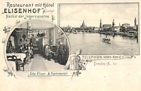
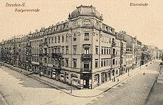
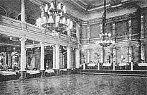

* * *

* * *

Die Elisenstraße verdankt ihren Namen der früheren Schankwirtschaft “Elisens
Ruh”. Diese ging aus dem Mitte des 18. Jahrhundert entstandenen [Vorwerk “Hopfgartens”](../../../../zentrum/johannstadt/strassen_johannstadt/hopfgartenstrasse/) hervor und wurde um 1800 zum Gartenlokal umgewandelt.
Eigentümer war zunächst der Holzhändler Gottfried Peter, ab 1819 der Rentier Friedrich Waeber und seine Frau Elisabeth Karoline, geb. von Ueckermann.
Nach der 1822 mit nur neun Jahren verstorbenen und in einem Mausoleum im Park des Grundstücks beerdigten Tochter des Paares erhielten Grundstück und Schänke ihren Namen. 1842 verließ Waebers Witwe Dresden und ließ die
verstorbene Tochter auf den Eliasfriedhof überführen (Gruft Nr. 98 an der Südmauer). In Erinnerung an diese Begebenheit
wurde 1849 die Elisenstraße benannt. 1878 endete der Schankbetrieb und das Gelände wurde wenig später mit Wohnhäusern bebaut. Lediglich der Name “Elisens Ruhe” blieb noch bis 1945 durch eine gleichnamige Gaststätte am
Bönischplatz / Ecke Wintergartenstraße erhalten. Weitere Lokale befanden sich mit dem Restaurant “Zum Jägerheim” in der Nr. 67 sowie mit dem “Elisenhof” in Nr. 69 _(Bild oben links)_.

Von der Vorkriegsbebauung der Elisenstraße ist heute nichts mehr erhalten.
Ebenso wie in vielen anderen Straßen dominierten hier bis 1945 mehrgeschossige Wohn- und Geschäftshäuser in geschlossener Bebauung. Im Haus Nr. 5c befand
sich zeitweise das britische Konsulat, in Nr. 11 das Konsulat von Paraguay. Unweit davon gab es in der Nr. 18 mit dem Marienheim ein Heim für ältere
pflegebedürftige Damen. Im Bild ist die Einmündung Elisen- / Hopfgartenstraße zu sehen.

Im Zuge des Wiederaufbaus der Johannstadt wurde die Elisenstraße mehrfach unterbrochen und 1960 in Hans-Grundig-
Straße umbenannt. 1993 erfolgte die Rückbenennung des nördlichen Teilabschnitts zwischen Florian-Geyer- und Gerokstraße in Elisenstraße. Die übrigen Teile werden heute weiterhin als [Hans-Grundig-Straße](../../../../zentrum/johannstadt/strassen_johannstadt/) bzw. [Georg-Nerlich- \
Straße](../../../../zentrum/johannstadt/strassen_johannstadt/) (südlich der Striesener Straße) bezeichnet.

Einzelne Gebäude:

Pianofortefabrik Rosenkranz:
Zwischen 1876 und 1893 hatte auf der Elisenstraße 27/28 das bekannte Dresdner [Klavierbauunternehmen Rosenkranz](../../../../zentrum/johannstadt/strassen_johannstadt/klavierbaufirma_rosenkranz/) seinen Firmensitz. Bereits 1882 wurde der Betrieb jedoch zur Tolkewitzer Straße,
1893 schließlich zur Nicolaistraße verlegt, wo die Firma noch bis 1934 existierte.

Palmgarten: Auf dem Grundstück Elisenstraße 60 (Ecke Hopfgartenstraße) befand sich ab 1895 das Tanz- und
Vergnügungslokal “Palmgarten”, welches neben den “Blumensälen” zu den größten Johannstädter Vergnügungsstätten
gehörte. Die Gastwirtschaft besaß neben Restaurant und Versammlungsräumen einen großen Ballsaal und wurde 1945 zerstört.

**_Foto:_** _Blick in den Ballsaal des “Palmgartens”_
