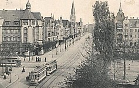
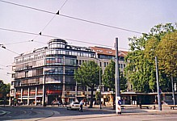
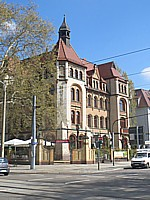

* * *

* * *

Der Fetscherplatz entstand als einer der zentralen Plätze der Johannstadt und
wurde ab 1878 bis 1946 Fürstenplatz genannt. Seinen heutigen Namen erhielt er nach dem Dresdner Arzt Dr. Rainer Fetscher (1895-1945). Fetscher war in den
Zwanziger Jahren als Mediziner auf dem Gebiet der Erbbiologie tätig und wurde 1923 an die Technische Hochschule berufen. Obwohl er sich zeitweise mit
Themen der Rassenforschung und Sozialhygiene befasst hatte, lehnte er die von den Nazis daraus abgeleitete Rassenpolitik ab und musste deshalb 1934 seine
Stelle an der TH aufgeben. Im Anschluss war er als niedergelassener Arzt tätig und bewohnte ein Haus auf der [Rungestraße](../../../../sud/zschertnitz/strassen_zschertnitz/) in Zschertnitz. Beim Versuch, die
Stadt als Parlamentär kampflos an die Rote Armee zu übergeben, wurde Fetscher am 8. Mai 1945 auf der Prager Straße von SS-Leuten erschossen.

Um den Platz stehen sowohl mehrgeschossige Wohn- und Geschäftshäuser als auch
einige Stadtvillen aus der Zeit von 1900 bis zur Gegenwart. Zu diesen gehören die 1902 errichtete Wohnhausgruppe Fetscherplatz 4-7 sowie der bereits zwei Jahre
zuvor eröffnete Artushof. Die durch Kriegszerstörungen entstandenen Baulücken wurden nach 1990 mit modernen Gebäuden geschlossen. 1995 entstand das
Wohn-, Büro- und Geschäftshaus “Akzent” nach Plänen des Architekten Roschik. Wenig später folgte das “Forum am Fetscherplatz” mit einer kleinen Ladenpassage,
womit die bauliche Umrahmung des Platzes ihren Abschluss fand. Heute hat der Fetscherplatz vor allem als Einkaufszentrum und Verkehrsknotenpunkt Bedeutung.

Einzelne Gebäude:

Straßenbahnwartehalle: Das einstöckige Gebäude inmitten des Fetscherplatzes wurde 1949 in Anlehnung an die Ideen des
Bauhauses von Herbert Schneider entworfen und diente seitdem als Wartehalle, Kiosk und Fahrkartenverkauf. Als eines
der wenigen Beispiele der frühen Nachkriegsmoderne steht das kleine Häuschen seit 1990 unter Denkmalschutz. Im Zuge
der Umgestaltung des Platzes wurde es 1998 saniert und beherbergt heute eine Imbissgaststätte. Eine besondere
Kuriosität  ist der durch das Flachdach eingefasste Stamm einer Leierblättrigen Eiche. Der Baum stammt noch aus der Frühzeit des Platzes und ist eine botanische Rarität in Dresden.

Fetscher-Denkmal: Die schlichte Gedenksäule inmitten einer Grünanlage erinnert an den 1945 erschossenen Arzt und
Namensgeber des Platzes. Ursprünglich gab es nur eine Gedenktafel am Ort seines Todes an der Prager Straße / Ecke
Ferdinandstraße, welche jedoch 1965 der Neubebauung der Prager Straße weichen musste. Erhalten ist auch Fetschers Grabstelle auf dem [Heidefriedhof](../../../../nordost/dresdner_heide/heidefriedhof/). 1970 waren seine sterblichen Überreste vom [Leubnitzer Friedhof](../../../../sudost/leubnitz-neuostra/leubnitzer_kirche/) zum Heidefriedhof überführt worden.

Artushof: Der Artushof entstand 1900 an der Nordseite des kurz zuvor angelegten Fürstenplatzes als Hotel mit öffentlicher Gaststätte. Ursprünglich wurde das Haus, welches sich von 1911 bis 1990 im Besitz der Familie Radisch befand, als “Fürstenhof” bezeichnet. Architekten des Gebäudes waren Franz Oskar Hartmann und Felix Reinhold Voretzsch, der die Innengestaltung übernahm.

Als eines der wenigen Gebäude der Johannstadt überstand es den Zweiten Weltkrieg ohne größere Schäden. In den 1970er und 1980er Jahren wurde die frühere Hotelgaststätte als tschechisches Spezialitätenlokal “Ostrava” betrieben. 1992/93 erfolgte eine umfassende Sanierung des unter Denkmalschutz stehenden Gebäudes, welches seitdem als Appartementhotel dient. 2001 eröffnete im Erdgeschoss das österreichische Lokal “Wiener Heuriger”. Heute dienen die Räume als Steakhaus “Estancia”.

* * *

 \[ [Home](../../../../index.html)\] \[ [Nord](../../../../nord/)\] \[ [Nordwest](../../../../nordwest/)\] \[ [Neustadt](../../../../neustadt/)\] \[ [Nordost](../../../../nordost/)\] \[ [West](../../../../west/)\] \[ [Zentrum](../../../../zentrum/)\] \[ [Südwest](../../../../sudwest/)\] \[ [Süd](../../../../sud/)\] \[ [Südost](../../../../sudost/)\] \[ [Ost](../../../../ost/)\] \[ [Register](../../../../Register/register.html)\] \[ [Kontakt](../../../../Kontakt/kontakt.html)\] \[ [Impressum](../../../../impressum/)\]
