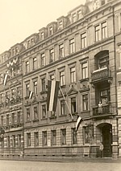
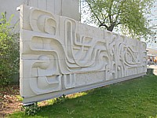
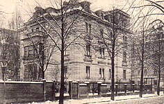
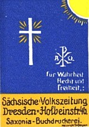
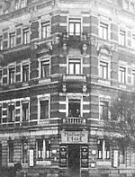
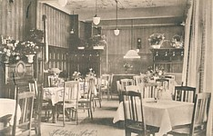

* * *

* * *

Die Holbeinstraße begann ursprünglich am Holbeinplatz hinter dem ehemaligen Landgericht Pillnitzer Straße und und durchquert bis zu ihrem Ende in der Nähe des alten Striesener Dorfkerns die gesamte Johannstadt sowie den Westteil von Striesen, wobei sie hier teilweise dem früheren Verlauf des Landgrabens folgt. Mit der 1873 eingeführten und bis heute unveränderten Namensgebung wird an den Maler Hans Holbein d. J. (1497-1543) erinnert, welcher zu den bedeutendsten Künstlern der deutschen Renaissance gehört. Seit 15. Mai 1905 wird der Name auch auf die früheren Striesener Straßen G und G1 angewendet.

Sämtliche Gebäude im westlichen Teil der Straße, meist mehrgeschossige Wohn- und Geschäftshäuser, fielen 1945 den Bomben zum Opfer. Im Zuge des Wiederaufbaus der Pirnaischen Vorstadt wurde der Abschnitt der Holbeinstraße bis zur Güntzstraße überbaut. Den erhaltenen Teil auf Johannstädter Flur prägen heute Plattenbauten aus den 1970er Jahren. Am Haus Nr. 42, welches bis nach 1990 als Ausländerwohnheim diente, erinnert eine Gedenktafel an den 1991 von rechtsradikalen Jugendlichen getöteten Mosambiquaner Jorge Gomondai. Unweit davon (Nr. 68) ist seit 2013 ein Betonrelief des Künstlers Rudolf Sitte zu sehen. Das Relief “Der Flug der Kraniche” entstand in den 1960er Jahren für die [Flugzeugwerft](../../../../nord/klotzsche/flughafen/flugzeugwerft/) in Klotzsche und wurde später an seinen heutigen Standort versetzt _(Foto_).

Einzelne Gebäude:

Nr. 20: In diesem 1945 zerstörten Eckhaus zur Elisenstraße befand sich ab ca. 1910 die Privatklinik für Chirurgische und Frauen- Krankenheiten von Dr. med. Fritz Schmidt, die bis zum Tod des Arztes Anfang der 1930 Jahre existierte. Danach wurden die Räume in Wohnungen umgewandelt.

Nr. 26: Zu den zahlreichen Kleinbetrieben, die sich seit Ende des 19. Jahrhunderts in der Johannstadt angesiedelt hatten, gehörte die Firma Sächsische Sarg- und Möbelschmuckindustrie G. Schreiber & Co., Holbeinstraße 26. Ähnliche Handwerksbetriebe waren u.a. in der Nr. 39 (Stroh- und Filzhutfabrik von Bruck GmbH), Nr. 46 ("Plama" Fabrik elektrischer Beheizungen) und Nr. 70 (Damenhutfabrik Hans Auer) zu finden. Meist beschäftigten diese Firmen nur wenige Mitarbeiter und nutzten oft die Hintergebäude der Wohnquartiere.

Saxonia-Buchdruckerei (Nr. 46): Die Druckerei wurde 1902 von Heinrich Trümper gegründet und war Produktionsstätte der ab 2. Juli 1902 herausgegebenen "Sächsischen Volkszeitung". Die der Zentrumspartei nahestehende Publikation war einzige katholische Tageszeitung in Sachsen. Geleitet wurde sie von Paul Heßlein. Nach dem Ersten Weltkrieg firmierte das Unternehmen als "Saxonia Buchdruckerei G.m.b.H.". Ab 1927 erschien im Verlag, der seine Redaktionsräume im gleichen Gebäude hatte, wöchentlich das St.-Benno-Blatt als Amtsblatt des bischöflichen Ordinariats des Bistums Dresden-Meißen. Mit der Machtübernahme der Nationalsozialisten und der zwangsweisen Auflösung der Zentrumspartei stellte die "Sächsische Volkszeitung" ihr Erscheinen im Mai 1934 ein. Die Räume der Druckerei übernahm daraufhin der Unternehmer Günter Mau, der hier bis zur Zerstörung 1945 elektrische Heizkörper produzierte.

Tabakfabrik B. Weller (Nr. 51): Das Unternehmen wurde 1868 von B. Weller als Fabrik türkischer Tabake und Cigaretten gegründet, kam jedoch schon wenige Jahre später in den Besitz von Georg von Konopacki. Drei Jahre später verarbeiteten hier 17 Angestellte, meist Frauen, Rohtabak zu Zigaretten. Die Jahresproduktion betrug 1870 2,5 Millionen Stück. Nach dem Ersten Weltkrieg firmierte der zu den zahlreichen kleineren Unternehmen der Branche gehörende Betrieb als "Tabakfabrik B. Weller GmbH", zuletzt bis Mitte der 1930er Jahre als Cigarettenfabrik "Rasma" G.m.b.H. (1935). Wenig später stellte die Tabakfabrik ihre Produktion ein. Ab 1938 nutzte bis zur Zerstörung 1945 ein Bindfaden-Großvertrieb (1938 Treitel & Co, 1943 Klotzky & Co.) die Räume.

Nr. 61: Das Haus war von 1889 bis 1896 Wohnsitz der Kunstmalerin Ilse Ohnesorge (1866-1937). Sie erlernte zunächst bei Georg Estler die Freilicht- und Porzellanmalerei und war später Schülerin von Carl Bantzer. 1896 zog sie aus familiären Gründen nach Sebnitz, wo sie bis zu ihrem Tod als freiberufliche Malerin tätig war und zahlreiche impressionistische Gemälden und Aquarelle, oft mit heimatlichen Motiven aus Sebnitz und der Sächsischen Schweiz schuf.

Nr. 115: In diesem Gebäude in der Nähe der Fürstenstraße (Fetscherstraße) befand sich zwischen 1894 und 1897 das Dresdner Depot der Eberl-Faber-Brauerei aus München. Als klassischer Bierverlag wurden hier Biere mehrerer Brauereien abgefüllt und in Flaschen verkauft. Platzmangel führte 1897 zum Umzug der Firma an den [Bönischplatz](../../../../zentrum/johannstadt/strassen_johannstadt/) 11, wo sie noch bis 1980 existierte.

Nr. 117: Hier wohnte um 1900 der Bildhauer Friedrich August Richard Hecht (1865-1915). Der Schüler Johannes Schillings gehörte dem Dresdner Verein Bildender Künstler an und schuf Plastiken für verschiedene Kirchen und Wohnhäuser. Werke Hechts finden sich u.a. an der Strehlener [Christuskirche](../../../../sudost/strehlen/christuskirche/) und der [Heilig-Geist-Kirche](../../../../ost/blasewitz/heilig-geist-kirche/) in Blasewitz. Sein von ihm selbst gestaltetes Grabmal befindet sich auf dem [Johannisfriedhof](../../../../ost/tolkewitz/johannisfriedhof/).

Holbeinhof (Nr. 119):  Der Holbeinhof im Eckhaus zur Fürstenstraße _(Fotos)_ war eines von mehreren Lokalen auf der Holbeinstraße. Weitere Gaststätten existierten u.a. in der Nr. 42, der Nr. 57 und der Nr. 4 ("Holbeinschlösschen"), wo man um 1935 jeden Dienstag zu einer "langen Nacht mit Bratwurstessen" einlud. Ab 1931 befand sich im Gebäude des Holbeinhofes auch eine Verkaufsniederlassung von Pfunds Molkerei.

Rudolf-Schilling-Häuser: 1910-12 entstanden zwischen Holbeinstraße und Wormser Straße die Rudolf-Schilling-Häuser, initiiert vom Dresdner Spar- und Bauverein. Die Wohnanlage wurde vom renommierten Dresdner Architektenbüro Schilling & Gräbner entworfen und gehört zu den Musterbeispielen des sozialen Wohnungsbaus in der Stadt. Für die Mieter, meist Arbeiter und einfache Angestellte entstanden im Innenhof Spielanlagen, Ruheplätze sowie ein Wannenbad mit Duschen und Wäscherei. Um die Kinder während der Arbeitszeit betreuen zu können, richtete der Verein sogar einen eigenen Kindergarten ein. 1972 übernahm die Wohnungsgenossenschaft Johannstadt die Gebäude, die in den letzten Jahren denkmalgerecht saniert wurden.

* * *

 \[ [Home](../../../../index.html)\] \[ [Nord](../../../../nord/)\] \[ [Nordwest](../../../../nordwest/)\] \[ [Neustadt](../../../../neustadt/)\] \[ [Nordost](../../../../nordost/)\] \[ [West](../../../../west/)\] \[ [Zentrum](../../../../zentrum/)\] \[ [Südwest](../../../../sudwest/)\] \[ [Süd](../../../../sud/)\] \[ [Südost](../../../../sudost/)\] \[ [Ost](../../../../ost/)\] \[ [Register](../../../../Register/register.html)\] \[ [Kontakt](../../../../Kontakt/kontakt.html)\] \[ [Impressum](../../../../impressum/)\]
