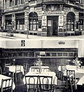

* * *

Die um 1880 angelegte Hopfgartenstraße entstand auf dem Areal des gleichnamigen Vorwerks und wurde wenig später mit Mietshäusern bebaut, von denen jedoch keines die Zerstörungen des Zweiten Weltkriegs überstand. Ihren Namen erhielt sie 1895. Nach 1970 wurde die Straße zur Erschließung des Neubaugebietes in ihrem Verlauf teilweise verändert. In diesem Zusammenhang bezog man die frühere Kamelienstraße und einen Teilabschnitt der Elisenstraße in die Hopfgartenstraße ein.

Hopfgartens Vorwerk:

Das aus einer Mitte des 18. Jahrhunderts gegründeten Gutswirtschaft hervorgegangene Anwesen befand sich ursprünglich im Besitz des Grafen von Lindenau und bestand aus einem schlossartigen Hauptgebäude und mehreren Nebengebäuden, Feldern und Gärten. Nach Abtrennung vom [Vorwerk Tatzberg](../../../../zentrum/johannstadt/strassen_johannstadt/) und wurde es zunächst auch Rappoldisches bzw. Unruh´sches Vorwerk genannt. Zwischen 1704 und 1743 gehörte es dem kurfürstlichen Historiographen Konrad Knauth, danach bis 1755 dem Geheimem Kriegsrat Christoph von Unruh. 1760 nahm der österreichische Feldmarschall Daun im Zusammenhang mit der Schlacht um Dresden hier sein Hauptquartier. Mehrfach wechselten die Besitzer, bevor 1779 der kurfürstlich-sächsische Vizekanzler Georg Wilhelm von Hopfgarten (1739-1813) das Areal erwarb und eine Einkehrstätte einrichtete. Mit seinem parkartigen Garten entwickelte sich “Hopfgartens” zu einem beliebten Ausflugslokal der Dresdner und war Schauplatz für sommerliche Konzerte und verschiedene Vergnügungen. 1813 wurde das Vorwerk zeitweise als Lazarett genutzt. Am 26. August verstarb dort der bei Gefechten um das benachbarte [Vorwerk “Stückgießers”](../../../../zentrum/johannstadt/strassen_johannstadt/blumenstrasse/) schwer verwundete russische General Milesinow, zu dessen Ehren später ein Denkmal im Park des Anwesens aufgestellt wurde.

Nach den kriegsbedingten Zerstörungen veräußerte Georg Wilhelm von Hopfgarten seinen Besitz 1813 an den Holzhändler Gottfried Peter. Ab 1819 gehörte “Hopfgartens” dem pensionierten Leutnant Friedrich Waeber, welcher es in den Folgejahren zu einer parkartigen Gartenanlage umgestaltete. Einen Teil des Grundstücks nahm die Gartenwirtschaft “Elisens Ruhe” ein, deren Name noch heute in der [Elisenstraße](../../../../zentrum/johannstadt/strassen_johannstadt/elisenstrasse/) erhalten geblieben ist.

Waeber galt als großer Garten- und Pflanzenliebhaber und war Mitbegründer der Gesellschaft für Botanik und Gartenbau “Flora”, die im 19. Jahrhundert die Tradition der Dresdner Gartenbauausstellungen begründete. Am 9. Januar 1828 fand im Vorwerk “Hopfgartens” die erste große Dresdner Pflanzenausstellung statt. Auf seinem Besitz richtete Waeber eine Privat- und Handelsgärtnerei ein, welche auch nach seinem Tod 1836 bestehen blieb und später Ludwig Leopold Liebig, einem Schwager Ludwig Richters gehörte. 1859 übernahm der Kunstgärtner Lüdicke das Areal und baute hier einen großen Wintergarten. Die Schauanlage gehörte bis zu ihrem Abbruch 1878 zu den botanischen Sehenswürdigkeiten der Stadt.

Im Zuge der Bebauung der Johannstadt musste die Gärtnerei aufgegeben werden. 1878 ließ die Stadt Dresden einen Teil des Geländes als “Skatingring” für Rollschuh- und Schlittschuhfahrer befestigen. Noch bis 1945 gab es an der Ecke zur Wintergartenstraße das Restaurant “Zur Rollschuhbahn” (Nr. 14 - _Bilder_). Eine weitere Gaststätte "Zur Hopfenprobe" gab es in der Nr. 20. Wenig später wurde das Areal mit Mietshäusern bebaut. Neben der Hopfgartenstraße verdanken auch die [Blumenstraße](../../../../zentrum/johannstadt/strassen_johannstadt/blumenstrasse/), die [Wintergartenstraße](../../../../zentrum/johannstadt/strassen_johannstadt/) und die heute nicht mehr vorhandene Kamelienstraße der ehemaligen Gärtnerei ihren Namen.

Gärtnerei Liebig:

Die Gärtnerei Liebig wurde 1837 auf einem Teil des früheren Vorwerks “Hopfgartens” gegründet und setzte die gärtnerische Tradition des ein Jahr zuvor verstorbenen Grundstücksbesitzers Friedrich Waeber fort. Der zum Tatzberg zu gelegene Gartenbaubetrieb gehörte Ludwig Leopold Liebig (1801-1872), welcher mit Hildegard Richter, einer Schwester des Malers Ludwig Richter, verheiratet war. Liebig züchtete 1843 die erste deutsche Azaleensorte “Aurora” sowie großblumige Rhododendren und Kamelien. Mit seiner Azaleenzucht und der ersten in Dresden gepflanzten Magnolie führte er seinen Betrieb zu internationaler Anerkennung. 1887 wurde die Azaleenproduktion des Betriebes mit 300.000 Stück angegeben. Im gleichen Jahr wurde die Gärtnerei auf Grund der geplanten Bebauung des Areals zur Niederwaldstraße verlegt, wo sie noch bis 1898 existierte.

Schokoladenfabrik Clauß:

Das 1903 gegründete Unternehmen des Schokoladenfabrikanten Bruno Clauß (1872-1930) befand sich an der Einmündung der Hopfgartenstraße in die Stephanienstraße und stellte neben Schokolade und Marzipan auch andere Süßwaren her. Außerdem gehörte eine Kaffeerösterei zum Betrieb. 1921 verlegte Clauß seinen Betrieb zur Stephanienstraße 49. Hier und auf der benachbarten Hopfgartenstraße 28 wurde bis zum Kriegsende produziert. 1923 soll von der Firma die Blockschokolade erfunden worden sein. Auch nach 1945 konnte die Produktion in den nur leicht beschädigten Fabrikgebäuden fortgesetzt werden. Im März 1953 wurde der Firmeninhaber Walter Clauß enteignet. Damit kam der Betrieb zum VEB Dresdner Süßwarenfabriken, der noch funktionstüchtige Maschinen übernahm und die Produktion in der Johannstadt wenig später einstellte. Die Gebäude gehörten dann bis 1991 zum Betonplattenwerk Gerokstraße. Teile des Areals übernahm nach 1990 der Kinderschutzbund, die meisten Bauten stehen jedoch in ruinösem Zustand leer.

* * *

 \[ [Home](../../../../index.html)\] \[ [Nord](../../../../nord/)\] \[ [Nordwest](../../../../nordwest/)\] \[ [Neustadt](../../../../neustadt/)\] \[ [Nordost](../../../../nordost/)\] \[ [West](../../../../west/)\] \[ [Zentrum](../../../../zentrum/)\] \[ [Südwest](../../../../sudwest/)\] \[ [Süd](../../../../sud/)\] \[ [Südost](../../../../sudost/)\] \[ [Ost](../../../../ost/)\] \[ [Register](../../../../Register/register.html)\] \[ [Kontakt](../../../../Kontakt/kontakt.html)\] \[ [Impressum](../../../../impressum/)\]
