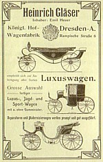
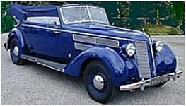
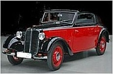

* * *

Die Karosseriebaufirma Gläser wurde 1864 vom Sattlermeister Carl Heinrich Gläser auf der Rampischen Straße 6 in der Nähe des Neumarktes gegründet. Der aus dem Erzgebirgsort Erdmansdorf stammende Handwerker
begann hier mit dem Bau hochwertiger Kutschen und Schlitten und erwarb sich schon bald einen so guten Ruf, dass sich Gläser ab 1870 als “Königlicher Hofwagenbauer” bezeichnen durfte. Teile der Kutschen stammten vom
Radeberger Hufschmied und Wagenbauer Friedrich August Emil Heuer, mit dem Gläser eine enge Freundschaft verband. 1898 trat Heuer als Teilhaber in das Unternehmen ein und setzte sich, gegen den anfänglichen Widerstand
Gläsers, für den Bau von Automobilkarosserien ein.

Nach Gläsers Tod am 5. Dezember 1903 führte Heuer den Betrieb als alleiniger Inhaber weiter und benannte diesen in Luxus-Karosserien &
Luxuswagenfabrik Heinrich Gläser um. Im gleichen Jahr begann die Serienfertigung von Automobil-Karosserien, welche zum durchschlagenden Erfolg wurde. 1905 entstand in enger Zusammenarbeit mit dem Coswiger
Automobilfabrikanten Emil Nacke der erste Kraftomnibus in Sachsen als Jagdmobil für den sächsischen König. 1913 konnte das Unternehmen ein größeres Grundstück an der Arnoldstraße 16-24 in der Johannstadt
erwerben und moderne Betriebsgebäude errichten. In kleinen Serien, aber auch in individuellen Einzelanfertigungen wurden hier Karosserien für Cabriolets und Luxusautos gebaut. Fast alle
namhaften europäischen Automobilhersteller bezogen Gläser-Karosserien aus Dresden. Selbst in die USA wurde
gelegentlich exportiert. Zu den Eigenentwicklungen der Firma gehörten u.a. ein umlegbarer Drehsessel sowie ein per
Handkurbel bedienbares Schiebefenster. 1914 fertigte die Firma das Chassis für den Mercedes-Benz-Dienstwagen des
Generalfeldmarschalls Paul von Hindenburg. Nach Kriegsbeginn musste die Fertigung komplett auf militärische Güter umgestellt werden.

Ab 1918 leiteten Heuers Söhne das Werk. Moderne technische Entwicklungen wie Blech- und Kunststoffverkleidungen
sowie ein 1927 erworbenes Patent zum einfachen Öffnen und Schließen von Fahrzeugverdecks führten das Werk zu neuer Blüte. Gläser-Karosserien wurden von allen namhaften Herstellern wie Audi, Maybach, Horch, Wanderer und
Ford eingesetzt. Kunden waren überwiegend wohlhabende Fabrikanten, Politiker und Künstler, die die individuelle
Gestaltungsmöglichkeiten schätzten. Die Leistungen des Karosseriebauers konnten auch auf der Weltausstellung 1930 in
Paris bewundert werden. Im Zusammenhang mit der Weltwirtschaftskrise kam es jedoch zu finanziellen Problemen.
Wegen der drohenden Zahlungsunfähigkeit nahm sich Georg Heuer 1932 das Leben. Sein bereits 74-jähriger Vater trat
daraufhin wieder in die Firma ein, nahm zwei Jahre später seinen Schwiegersohn Willy Bochmann als Teilhaber auf und
wandelte diese in eine GmbH um. Bis 1939 wurden in Dresden und Radeberg weiterhin Luxuskarosserien gebaut.

Der während des Zweiten Weltkriegs mit der Fertigung von Flugzeugteilen, Aufbauten für Militärfahrzeuge und anderen Rüstungsgütern beauftragte Betrieb
wurde 1945 schwer beschädigt. Nur mühsam konnte die Produktion in den beiden 1946 von der Sowjetischen Militäradministration beschlagnahmten Betriebsteilen wieder aufgenommen werden. Zunächst stellte man hier Taschen,
Planen und Handwagen her, bevor mit dem Bau von Automobilkarossen für die sowjetische Besatzungsmacht begonnen werden konnte. 1948 erfolgte die
Enteignung der Familie Heuer, die daraufhin in den Westen emigrierte und dort in der Oberpfalz ein neues Unternehmen gründete. Der Johannstädter Betrieb mit
seinen Betriebsteilen in Klotzsche und Radeberg, ab 1953 als VEB Karosseriewerke Dresden bezeichnet, arbeitete nun
als Zulieferer für die Autowerke in Zwickau und Eisenach. Vorrangig wurden Karosserien für die IFA-Limousinen F8
und F9, später auch für den Wartburg 311 und Tourist gebaut. Die traditionsreiche Cabriofertigung endete 1967.

Platzmangel und die ungünstige Lage inmitten eines Wohnviertels führten Anfang der 1970er Jahre zur Einstellung der
Produktion und Verlagerung nach Radeberg. Lediglich Verwaltung und Ausbildungsbereich blieben auf der Arnoldstraße
ansässig. Die früheren Werkshallen dienten nun als Lager. Mitte der 1980er Jahre zerstörte ein Großbrand Teile der
Gebäude. Die an ihrer Stelle 1987 errichtete Betonbauhalle wurde zuletzt bis zu ihrem Abriss als Domizil eines Autohauses genutzt. Heute befinden sich auf dem Grundstück Wohnhäuser und ein Altenheim. Der nach der Wende
privatisierte Betriebsteil in Radeberg beliefert heute als Zulieferer alle wichtigen deutschen Hersteller wie VW, Daimler, Audi und BMW.

* * *

 \[ [Home](../../../../index.html)\] \[ [Nord](../../../../nord/)\] \[ [Nordwest](../../../../nordwest/)\] \[ [Neustadt](../../../../neustadt/)\] \[ [Nordost](../../../../nordost/)\] \[ [West](../../../../west/)\] \[ [Zentrum](../../../../zentrum/)\] \[ [Südwest](../../../../sudwest/)\] \[ [Süd](../../../../sud/)\] \[ [Südost](../../../../sudost/)\] \[ [Ost](../../../../ost/)\] \[ [Register](../../../../Register/register.html)\] \[ [Kontakt](../../../../Kontakt/kontakt.html)\] \[ [Impressum](../../../../impressum/)\]
