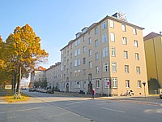
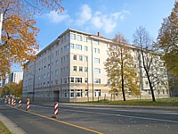
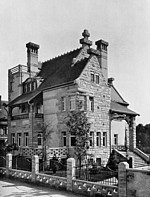
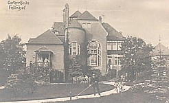
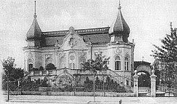
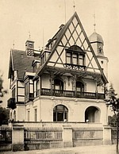

* * *

Mitte des 19. Jahrhunderts befassten sich erstmals Fachleute mit der künftigen Gestaltung des Elbuferbereichs. Pläne sahen hier die Anlage breiter Hochuferstraßen vor, welche den Fluss kanalisieren und die dahinter liegenden Flächen zum Bauland machen sollten. Zahlreiche Bürgerproteste sowie Einwände des Wasserbauinspektors Schmidt verhinderten letztlich die Realisierung. Stattdessen nutzte man die Elbwiesen für verschiedene Großveranstaltungen sowie ab 1874 alljährlich als Schauplatz der [Vogelwiese](../../../../zentrum/johannstadt/vogelwiese/). Lediglich in der Innenstadt wurde der unterhalb der Brühlschen Terrasse gelegene Uferbereich aufgeschüttet und ab 1852 zur Straße ausgebaut. Abschnittsweise erfolgte später die Verlängerung des Terrassenufers, wobei der Abschnitt zwischen Sachsenplatz und Vogelwiese den Namen Johannstädter Ufer erhielt.

1936 wurde diese Straße nach dem preußischen Generalfeldmarschall Paul von Hindenburg (1847-1934) in Hindenburgufer umbenannt, nach 1945 in Käthe-Kollwitz-Ufer. Dabei bezog man auch den früher Hochuferstraße genannten Abschnitt auf Blasewitzer Flur ein. Käthe Kollwitz (1867-1945) gehört zu den bedeutendsten Graphikerinnen und Bildhauerinnen des 20. Jahrhunderts und verbrachte ihre letzten Lebensmonate auf Einladung der Wettiner in Moritzburg, wo heute eine Gedenkstätte an sie erinnert.

Einzelne Gebäude:

_Johannstadt:_

Senioren- und Pflegeheim „Am Elbufer“: Das Heim entstand 2005 auf dem Areal der 1945 zerstörten [Jägerkaserne](../../../../zentrum/johannstadt/strassen_johannstadt/sachsenplatz/) und wurde im Juli 2006 eröffnet. Insgesamt stehen 59 Einzel- und 20 Doppelzimmer zur Verfügung _(Foto)_.

Naumannsche Schwimmanstalt: Diese Badeanstalt, unterhalb des Schlößchen “Antons” am Elbufer gelegen, entstand 1839 unter dem Namen Amalienbäder und besaß insgesamt neun Badehäuschen. Als eines der ersten Bäder überhaupt war dieses als Familienbad deklariert und durfte sowohl von Frauen als auch von Männern besucht werden. 1867 übernahm der aus Pieschen stammende Fischermeister Hottewitzsch die Badeanstalt und führte sie unter seinem Namen weiter. 1901 kaufte Arthur Naumann das Bad und ließ es modernisieren. Dieses existierte noch bis Ende der Zwanziger Jahre und war eines der preiswertesten Elbebäder der Stadt.

Fährgarten Johannstadt:
Das kleine Ausflugslokal befindet sich ungefähr gegenüber der Prießnitzmündung am Elbufer und wurde ursprünglich nach der Besitzerfamilie “Focke´s Strand-Restaurant” genannt. An den Wochenenden fanden hier gelegentlich Konzerte statt, wofür eigens eine hölzerne Musikmuschel errichtet worden war. Stadtbekannt wurde das Lokal nach dem Ersten Weltkrieg unter dem Namen “Eis-Krause”. Ein ähnliches Lokal, volkstümlich als “Hol-über- Hütte” bezeichnet, gab es in Höhe der Schubertstraße.

1945 wurden die Bauten der Sommerwirtschaft zerstört, jedoch bald wieder aufgebaut und nun als “Volksgaststätte Elbfrieden” weitergeführt. Heute trägt die beliebte Gartenwirtschaft den Namen “Fährgarten
Johannstadt” und gehört zu den beliebtesten Biergärten Dresdens. Nach dem Elbehochwasser 2002, welches auch am Fährgarten erheblichen Schaden anrichtete, entstanden neue flutsichere Wirtschafts- und Sanitäranlagen.
Unmittelbar am Fährgarten überquert eine [Elbfähre](../../../../zentrum/johannstadt/) den Fluss, letzte von einst drei Fährstellen des Stadtteils. In der Nähe steht seit 2012 die Plastik “Undine geht” der Künstlerin Angela Hampel. Das Objekt entstand ursprünglich für eine Kunstaktion in Bonn und bildet das Gegenstück zur Plastik “Undine kommt” an der Pieschener Molenbrücke.

_Blasewitz:_

Nr. 79: Die unter Denkmalschutz stehende Villa befand sich vor dem Zweiten Weltkrieg im Besitz von Heinrich Galm, Direktor der [Zigarettenfabrik Kosmos](../../../../zentrum/johannstadt/strassen_johannstadt/), auf der Fürstenstraße 70 (Fetscherstraße).

Nr. 80: Die zweigeschossige Villa wurde um 1910 errichtet und stellt ein Beispiel für reformorientierte Villenarchitektur in Abkehr von historisierenden Stilen dar.

Nr. 81: Auch dieses 1906 errichtete Gebäude gehört zu den zahlreichen Baudenkmalen der früheren Hochuferstraße. Es entstand 1906 nach einem Entwurf von Erich Kleinhempel für den Verlagsbuchhändler Otto Schambach und wird deshalb auch Haus Schambach genannt. Heute wird es als Internat der Hochschule für Kirchenmusik genutzt.

 Villa Rautendelein (Nr. 84 - ehem. Hochuferstraße 12): Die repräsentative zweigeschossige Villa an der Einmündung zum Lothringer Weg entstand 1899/1900 für den Dichter Gerhard Hauptmann. Die Planungen oblagen dem bekannten Architektenbüro Schilling & Gräbner. Das nach einer Figur aus Hauptmanns Drama “Die versunkene Glocke” Villa Rautendelein genannte Haus erregte wegen seiner außergewöhnlichen und monumentalen Gestaltung weit über Dresden hinaus großes Aufsehen. Das stilistisch der Reformbaukunst zugerechnete Gebäude galt als "Höhepunkt des neuen Bauens" und vereinte Elemente des Jugendstils mit den Stilmitteln des monumentalen Materialstils. Im Inneren gruppierten sich die Räume um eine große Diele. Im Erdgeschoss befanden sich Wohn-, Gesellschafts- und Speisezimmer, im ersten Obergeschoss u.a. Küche und Schlafzimmer.

Nach der Scheidung Hauptmanns 1904 überließ er das Haus seiner Frau Marie und den gemeinsamen Kindern, die es bis zu Maries Tod 1909 bewohnten. 1945 fiel die Villa dem Luftangriff zum Opfer. An ihrer Stelle befindet sich heute ein Neubau mit dem Sitz des Bischöflichen Ordinariats des Bistums Dresden-Meißen.

Nr. 87 (Villa Felixhof): Das Grundstück war einst Standort der 1903 erbauten und 1945 durch den Bombenangriff zerstörten Villa “Felixhof”, benannt nach dem Schauspieler Felix Schweighofer (1842-1912), der hier seine letzten Lebensjahre verbrachte. Schweighofer gehörte zu den reichsten Blasewitzer Einwohnern und trat auch als Mäzen in Erscheinung. Nach dem Abriss der Ruine entstand hier eine noch bis in die 1980er Jahre betriebene Zuchtanlage für Karpfen. 2005 wurde das Areal mit zwei modernen neuen Wohnhäusern bebaut.

**_Foto:_** _Blick vom Garten auf die Villa Felixhof um 1910_

Nr. 88 (Villa zur Lippe): Die nach einem ihrer früheren Besitzer benannte Villa wurde 1904 im Stil des Neobarock errichtet _(Foto)_. Auftraggeber waren der international erfolgreiche Theaterschauspieler Felix Schweighofer und die Opernsängerin Fritzi Blum, die den Architekten Richard Schleinitz mit dem Entwurf beauftragten. Allerdings erwies sich das Gebäude schon bald als zu groß für die Bedürfnisse des Künstlerpaares, so dass Schweighofer mit seiner Frau bereits wenige Jahre später das Nachbarhaus Nr. 87 bezog.

Nächste Besitzerin war für einige Jahre die Großherzogin von Mecklenburg-Strelitz, die das Gebäude aufstocken und umbauen ließ. Kurz darauf erwarb Prinz Julius zur Lippe das Anwesen und ließ sich 1911 vom Landschaftsarchitekten Großmann unter Mitwirkung des Gartenexperten Georg Heinsius von Mayenburg einen großzügigen Garten anlegen, der zu den bedeutendsten seiner Art in Dresden gehörte. In der Nachkriegszeit befand sich in der Villa Dresdens einzige Nachttanzbar “Kaskade”. Heute nutzt der Sächsische Landkreistag das nach der Wende sanierte Haus.

Nr. 90: Die Villa Hochuferstraße 19 (heute Käthe-Kollwitz-Ufer 90) entstand als eines der letzten Häuser am Elbufer 1909 für den Major Raoul Zeysing und seine Frau Margarete. Das Haus weist bereits Elemente der Reformarchitektur auf und wurde vom Blasewitzer Baumeister Karl Emil Scherz entworfen. Wie die meisten erhaltenen Villen in diesem Bereich steht auch die Villa Zeysing unter Denkmalschutz.

Nr. 92: Die dreigeschossige Villa im Landhausstil mit Treppenturm und Fachwerkzierrat wurde 1896/97 nach Plänen von Kurt Diestel im Stil der deutschen Neorenaissance errichtet. Bis 1944 befand sie sich im Besitz des Regierungsrates Dr. jur. Kurt Morgenstern. Morgenstern arbeitete zunächst im sächsischen Innenministerium, war von 1901 bis 1904 Leiter der Amtshauptmannschaft Flöha und später Kreishauptmann von Zwickau. Im Ruhestand verzog er nach Dresden und gehörte zeitweise dem Landeskirchenausschuss der Evangelischen Landeskirche an. Den Zweiten Weltkrieg überstand das Haus ohne größere Schäden. 1975 wurde es von Klaus Hennig für sein privates Institut für Alternative Medizin erworben und renoviert. Ende der siebziger Jahre wohnte zeitweise sein Freund, der russische Porträtmaler Peter Bendel als Gast im Haus. Weitere bekannte Gäste waren die russischen Wissenschaftler Ilja Frank und Nikolai Bogoljubow.

Nr. 96: Die Villa entstand um 1900 und wurde vom Architekten Erich Kleinhempel entworfen. Besitzer war der Verlagsbuchhändler Theodor Steinkopf (1870-1955), der hier am 1. Januar 1908 seinen Verlag gründete und verschiedene wissenschaftliche Publikationen herausgab, u.a. zur Kolloidchemie und zu medizinischen Themen. 1929 erhielt er die Ehrendoktorwürde der Technischen Hochschule. 1978 wurde der Verlag aufgelöst. Die Villa wird heute von der Hochschule für Kirchenmusik genutzt und ist u.a. mit zwei Orgeln für die Studenten ausgestattet.

Hochschule für Kirchenmusik (Nr. 97): Die Einrichtung wurde 1949 vom damaligen Kantor der Striesener Versöhnungskirche Martin Flämig gegründet. Ziel ist die Ausbildung junger Musiker, die hier Unterricht im Orgelspiel, Kirchenmusik und Chorleitung erhalten. Zunächst Landeskirchenmusikschule genannt hat sie heute den Status einer Hochschule und ist eine der kleinsten in Sachsen. Neben der Villa Käthe-Kollwitz-Ufer gehören auch ein Verwaltungsgebäude und ein 1999 errichteter Neubau mit Chorprobenraum zum Campus. Das zugehörige Internat ist am Käthe-Kollwitz-Ufer 81 untergebracht.

## [Hochschule für Kirchenmusik](http://www.kirchenmusik-dresden.de)

* * *

 \[ [Home](../../../../index.html)\] \[ [Nord](../../../../nord/)\] \[ [Nordwest](../../../../nordwest/)\] \[ [Neustadt](../../../../neustadt/)\] \[ [Nordost](../../../../nordost/)\] \[ [West](../../../../west/)\] \[ [Zentrum](../../../../zentrum/)\] \[ [Südwest](../../../../sudwest/)\] \[ [Süd](../../../../sud/)\] \[ [Südost](../../../../sudost/)\] \[ [Ost](../../../../ost/)\] \[ [Register](../../../../Register/register.html)\] \[ [Kontakt](../../../../Kontakt/kontakt.html)\] \[ [Impressum](../../../../impressum/)\]
