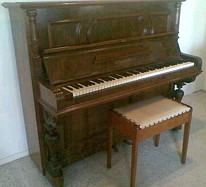

* * *

Die Klavierbaufirma Rosenkranz wurde am 10. Juli 1797 von Ernst Rosenkranz als erstes Unternehmen seiner Art in Sachsen auf der Pfarrgasse 85 in der Dresdner Neustadt gegründet. Der aus dem anhaltischen
Zerbst stammende Rosenkranz hatte zuvor während seiner Wanderjahre in Dresden Station gemacht und hier beim Orgelbauer Heinrich Mack das Instrumentenbauerhandwerk erlernt. Gegen den Widerstand der Tischlerinnung baute
Rosenkranz sein Unternehmen schnell aus und stellte neben Clavichords auch Tafel- und Hammerklaviere sowie Flügel her. 1809 verlegte er die Firma zur Königstraße 85.

Gemeinsam mit anderen Klavierbauexperten setzte
Rosenkranz in seinen Instrumenten verschiedene Neuerungen, u.a. eine veränderte Tastatur ein. Privat unterhielt er Kontakt zum Freundeskreis um die Familie Körner und lernte dort Heinrich von Kleist, Johann Wolfgang von
Goethe und Gerhard von Kügelgen kennen. 1822 wurde er vom Herzog seines Heimatstaates Anhalt mit dem Titel “Wirklicher Hoflieferant” ausgezeichnet. Nach dem Tod des Firmengründers führte zunächst seine Witwe, ab 1830
sein Sohn Friedrich Wilhelm den Geschäftsbetrieb fort. Zu den von ihm ausgebildeten Instrumentenbauern gehörten u.a. die Begründer der Klavierbauwerkstätten Bechstein, Thürmer und Reingräber.

Mit dem Bau der ersten Eisenbahnen und der wirtschaftlichen Entwicklung gelang es Friedrich Wilhelm Rosenkranz, das Exportgeschäft weiter auszubauen und seine
Klaviere nach Nord- und Südamerika zu liefern. Mehrfach wurden Instrumente des Unternehmens auf der Leipziger Messe prämiert. Die Firma gehörte in der zweiten
Hälfte des 19. Jahrhunderts zu den bedeutendsten Klavierbaubetrieben der Welt und genoss sowohl bei Pianisten als auch an den Höfen Europas hohes Ansehen. 1866 wurde der Firmensitz zur [Leipziger Straße](../../../../neustadt/leipziger_vorstadt/leipziger_strasse/) 5 verlegt. Zu diesem Zeitpunkt oblag die
Geschäftsführung bereits Friedrich Wilhelm RosenkranzŽ Bruder Ernst Adolph. Als dieser 1873 ohne Nachfolger verstarb, übernahmen der Advokat Carl August Hippe
und der Kaufmann Ludwig Emil Cyracus die Firma. Zwischen 1876 und 1893 hatte das Unternehmen auf der [Elisenstraße](../../../../zentrum/johannstadt/strassen_johannstadt/elisenstrasse/) 27/28 seinen Sitz.

Fortan wurden vorrangig große Konzertflügel gebaut, nach einer Verschärfung der Zollvorschriften jedoch auch wieder kleinere Instrumente. 1882 verlegten die neuen Eigentümer die Produktion zur [Tolkewitzer Straße](../../../../ost/blasewitz/strassen_blasewitz/tolkewitzer_strasse/) 53, 1893 zur
Nicolaistraße 4 in der Johannstadt. Mit dem Erwerb des Betriebes durch Carl Paul Hohl erlebte die Firma Rosenkranz
ihre letzte Blütezeit. Nach seinem Tod 1917 wechselten mehrfach die Eigentümer, hinzu kamen wirtschaftliche Probleme.
1934 stellte das Unternehmen den Klavierbau ein, existierte als Piano-Handlung jedoch noch bis 1945. Der Markenname “Rosenkranz” wurde nach 1945 zeitweise von der Pianofortefabrik Wolfram genutzt.

* * *

 \[ [Home](../../../../index.html)\] \[ [Nord](../../../../nord/)\] \[ [Nordwest](../../../../nordwest/)\] \[ [Neustadt](../../../../neustadt/)\] \[ [Nordost](../../../../nordost/)\] \[ [West](../../../../west/)\] \[ [Zentrum](../../../../zentrum/)\] \[ [Südwest](../../../../sudwest/)\] \[ [Süd](../../../../sud/)\] \[ [Südost](../../../../sudost/)\] \[ [Ost](../../../../ost/)\] \[ [Register](../../../../Register/register.html)\] \[ [Kontakt](../../../../Kontakt/kontakt.html)\] \[ [Impressum](../../../../impressum/)\]
