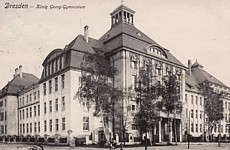
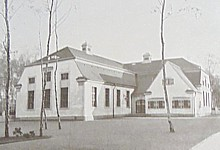
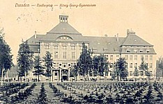
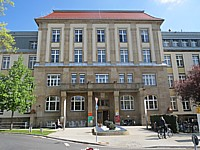

* * *

* * *

* * *

* * *

* * *

* * *

Das König-Georg-Gymnasium entstand als erste humanistische Reformschule Sachsens und wurde am 21. April 1903 eröffnet. Die nach dem damals regierenden König Georg benannte Bildungseinrichtung bezog zunächst
einige Räume der [XII. Bürgerschule](../../../../zentrum/johannstadt/) am Fiedlerplatz, bevor 1905 mit der Errichtung eines Neubaus begonnen werden konnte. Ursprünglich hatte man dafür ein Grundstück am Dürerplatz ausgewählt, entschloss sich jedoch letztlich, das neue Gymnasium am Fiedlerplatz zu bauen.

Das neue Gebäude _(Foto)_
wurde 1905-07 von Stadtbaurat Hans Erlwein errichtet, wobei dieser auf bereits vorliegende Planungen seines Amtsvorgängers Edmund Bräter zurückgreifen konnte. Der moderne Eisenbetonbau erhielt eine repräsentative
Gestaltung mit verschiedenen Reliefs und Ausmalungen, welche vom Bildhauer Prof. Groß und von Otto Gußmann geschaffen wurden. Letzterer war auch Schöpfer des
1910 vollendeten Deckengemäldes im Festsaal, finanziert von der Güntzstiftung. Neben dem eigentlichen Schulgebäude entstanden auch zwei Turnhallen sowie ein
”Waldgarten” im angrenzenden Tännicht. Am 12. Oktober 1907 fand die feierliche Einweihung des neuen Gymnasiums statt.

Zum Konzept der Reformschule gehörte neben naturwissenschaftlichem Unterricht die besondere Förderung des Sprachunterrichts, welcher sowohl in Englisch und Französisch als auch in Latein und Griechisch gegeben wurde.
Bei der Lehrplangestaltung griff man auf das Vorbild des renommierten Frankfurter Goethe-Gymnasiums zurück. Zu den Schülern des König-Johann-Gymnasiums
gehörten u. a. der Schriftsteller Erich Kästner und der Kunsthistoriker Fritz Löffler. Während des Ersten Weltkrieges diente das Schulgebäude als Lazarett, weshalb der
Unterricht bis 1919 wieder in der benachbarten XII. Bürgerschule stattfinden musste.

Als eine der ersten Schulen in Sachsen überhaupt erwarb das Gymnasium 1916 ein
Grundstück in Königstein-Halbestadt zur Einrichtung eines Schullandheimes. 1920 entstand außerdem eine Wanderherberge in Reichenau bei Frauenstein. Nach
Kriegsende konnte der Lehrbetrieb im August 1919 erneut im Stammhaus aufgenommen werden. Fortan gab es wieder regelmäßige Schulfeste, Sportwettbewerbe und künstlerische Veranstaltungen, die das Reformgymnasium
bis 1933 prägten. Nachdem es bereits 1932 zu Einschränkungen des Schulbetriebes aus finanziellen Gründen gekommen war, folgte nun die völlige “Gleichschaltung” im Sinne der nationalsozialistischen Machthaber. 1937 wurde
das König-Georg-Gymnasium in eine Oberrealschule für Jungen umgewandelt. Noch während des Zweiten Weltkrieges
mussten Teile des Grundstücks zur Erweiterung des benachbarten Krankenhauses abgegeben werden. 1943 richtete man in der Schule ein Hilfskrankenhaus ein.

Am 13./14. Februar 1945 wurde das Schulgebäude durch Bombentreffer beschädigt,
blieb jedoch in seinen Grundzügen erhalten. Lediglich die Turnhalle war komplett zerstört. Aus diesem Grund konnten einige Räume schon kurz nach Kriegsende wieder
provisorisch genutzt werden. 1946 wurde die zuletzt König-Georg-Schule genannte Einrichtung mit der Schillerschule in Blasewitz zusammengelegt und dort als [Oberschule\
Dresden-Ost](../../../../ost/blasewitz/) weitergeführt. Das frühere Schulhaus diente nach seiner Wiederherstellung ab 1946 die Poliklinik der Medizinischen Akademie. Heute ist hier die Zahnklinik des [Universitätsklinikums](../../../../zentrum/johannstadt/universitatsklinikum/) untergebracht.

* * *

 \[ [Home](../../../../index.html)\] \[ [Nord](../../../../nord/)\] \[ [Nordwest](../../../../nordwest/)\] \[ [Neustadt](../../../../neustadt/)\] \[ [Nordost](../../../../nordost/)\] \[ [West](../../../../west/)\] \[ [Zentrum](../../../../zentrum/)\] \[ [Südwest](../../../../sudwest/)\] \[ [Süd](../../../../sud/)\] \[ [Südost](../../../../sudost/)\] \[ [Ost](../../../../ost/)\] \[ [Register](../../../../Register/register.html)\] \[ [Kontakt](../../../../Kontakt/kontakt.html)\] \[ [Impressum](../../../../impressum/)\]
