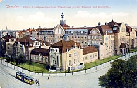
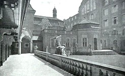
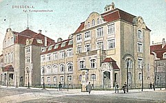
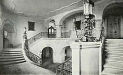
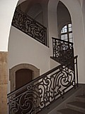
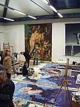

* * *

* * *

* * *

* * *

* * *

* * *

Die offiziell als Staatliche Akademie für Kunstgewerbe bezeichnete Einrichtung wurde 1875 als Königlich-Sächsische Kunstgewerbeschule gegründet. Ziel der Ausbildungsstätte war es, Nachwuchshandwerker in bestimmten Berufen auch künstlerisch auszubilden und so auf eine geschmackvolle Gestaltung industriell gefertigter Produkte Einfluss zu nehmen. Neben einer Zeichenschule gab es Fachklassen für Raumkunst und Architektur, Malerei, Grafik, Textilkunst, Mode und wissenschaftliches Darstellen. Zum ersten Direktor wurde der Architekt Karl Graff (1844-1906) bestellt. Verbunden war die Kunstgewerbeschule mit dem 1876 gegründeten Kunstgewerbemuseum. Dieses Museum sollte vorrangig der Aus- und Weiterbildung der Studenten dienen und umfasste kunstgewerbliche Objekte aller Stilepochen.

**_Fotos:_** _Innenhof und Treppenhaus der Kunstgewerbeschule vor 1945_

Zunächst nutzte die Einrichtung einige Räume der Technischen Bildungsanstalt am Antonsplatz, bevor der Bau eines eigenen Gebäudes an der Eliasstraße begann. Nach Plänen des
Architektenbüros Lossow & Viehweger entstand hier bis 1903 ein ausgedehnter Komplex mit Hörsälen, Ateliers, Bibliothek, Künstler- und Lehrwerkstätten sowie Räumen für das
Kunstgewerbemuseum. Die bauliche Gestaltung erfolgte im Neobarockstil. Zu den Attraktionen gehörte der Einbau des kurz zuvor beim Abbruch des Brühlschen Palais geborgenen Festsaals aus
dem 18. Jahrhundert, des Treppenhauses _(Foto)_ und einiger weiterer Schmuckelemente sowie eines noch heute erhaltenen Barockbrunnens am Güntzplatz. 1914 trennte man Museums- und
Lehrbetrieb, wobei die Kunstgewerbeschule zugleich zur Staatlichen Akademie für Kunstgewerbe erhoben wurde. Das Museum erhielt mehrere öffentlich zugängliche Schauräume, in denen die auf über 30.000 Exponate
angewachsene Sammlung von Glas- und Keramikgegenständen, Möbeln, Holzschnitzereien, Textil-, Leder- und Papiergegenständen vom Mittelalter bis zur Gegenwart einem breiten Publikum präsentiert wurde.

1945 richteten die Bombenangriffe erhebliche Schäden an der Bausubstanz der Akademie an und
vernichteten u.a. den historischen Festsaal. Unter Leitung Reinhold Langners gelang es jedoch, einige Gebäude notdürftig wiederherzurichten und die Akademie als Staatliche Hochschule für
Werkkunst fortzuführen. Seit 1950 gehört sie als Zweigstelle zur Hochschule für Bildende Künste. Schrittweise erfolgte der Wiederaufbau der Gebäude, teilweise jedoch in vereinfachter
Form. Neben der Hochschule nutzten nun bis 2004 auch das Kupferstichkabinett, das Münzkabinett und die Zentrale Kunstbibliothek die Räume. Das frühere Kunstgewerbemuseum
war bereits 1947 den Staatlichen Kunstsammlungen zugeordnet worden und ist seit 1963 als “Museum für Kunsthandwerk” im [Schloss Pillnitz](../../../../nordost/pillnitz/schloss_pillnitz/) zu sehen. Nach 1990 erfolgte eine
etappenweise Sanierung der Gebäude und der Wiederaufbau des ehemaligen Festsaales in moderner Gestalt. Heute sind hier die Werkstätten und Ateliers der Studiengänge für Restaurierung, Bühnen- und
Kostümbild, Theaterausstattung _(Foto)_, die Hochschulbibliothek und die Verwaltung der Hochschule untergebracht.

* * *

 \[ [Home](../../../../index.html)\] \[ [Nord](../../../../nord/)\] \[ [Nordwest](../../../../nordwest/)\] \[ [Neustadt](../../../../neustadt/)\] \[ [Nordost](../../../../nordost/)\] \[ [West](../../../../west/)\] \[ [Zentrum](../../../../zentrum/)\] \[ [Südwest](../../../../sudwest/)\] \[ [Süd](../../../../sud/)\] \[ [Südost](../../../../sudost/)\] \[ [Ost](../../../../ost/)\] \[ [Register](../../../../Register/register.html)\] \[ [Kontakt](../../../../Kontakt/kontakt.html)\] \[ [Impressum](../../../../impressum/)\]
