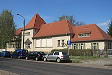
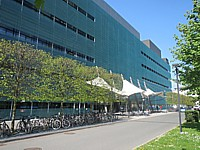
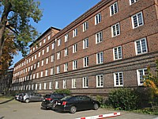
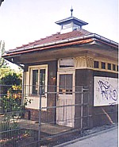
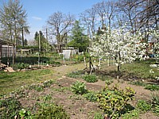
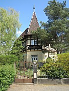

* * *

* * *

Die Pfotenhauerstraße wurde 1876 angelegt und bis 1895 durch die
Aktiengesellschaft “Germania” mit mehrgeschossigen Mietshäusern bebaut. Hinzu kamen kleinere Gewerbebetriebe, wie z. B. die Zigarettenfabriken Arkadia (Nr.
36) und Bendler (Nr. 48). Noch vor dem Ersten Weltkrieg erfolgte eine Ergänzung der Bebauung durch Atelierhäuser der Kunstakademie und Bauten des Johannstädter Krankenhauses. Hier besaß u.a. der Bildhauer Georg Wrba,
Schöpfer des “Rathausesels” und des Europabrunnens, seit Atelier (Nr. 81).

1878 erhielt die Pfotenhauerstraße ihren Namen nach dem ein Jahr zuvor
verstorbenen Dresdner Oberbürgermeister Friedrich Wilhelm Pfotenhauer (1812-1877). Er gehörte ab 1848 dem sächsischen Landtag an und übernahm am 2. Januar 1849 interimsmäßig das Amt des Bürgermeisters. Als erster
Dresdner Kommunalpolitiker durfte er ab 1853 den Titel Oberbürgermeister tragen. Unter seiner Regie entwickelte sich
die Stadt zur bedeutenden Verwaltungs- und Industriemetropole. Sein Grab befindet sich auf dem nahegelegenen [Trinitatisfriedhof](../../../../zentrum/johannstadt/trinitatisfriedhof/).

1945 wurden
zahlreiche Gebäude an der Pfotenhauerstraße zerstört. An deren Stelle entstanden zwischen 1970 und 1975 mehrgeschossige Plattenbauten, kombiniert mit
Versorgungseinrichtungen, Dienstleistungszentrum und Schulbauten. In einem dieser Häuser (Nr. 22) wohnte zwischen 1973 und 1989 der SED-Politiker Hans Modrow.
Modrow war viele Jahre Erster Sekretär der SED-Bezirksleitung Dresden und setzte sich 1989 erfolgreich für eine friedliche Lösung der Konflikte der Wendezeit ein. Für
einige Monate war er Ministerpräsident der DDR und später Vorsitzender der SED- Nachfolgepartei PDS. Im östlichen Teil prägen die Gebäude des ausgedehnten Komplexes des [Universitätsklinikums](../../../../zentrum/johannstadt/universitatsklinikum/) (ehem. Medizinische Akademie) die
Pfotenhauerstraße. Auf dem Gelände des ehemaligen Straßenbahnhofes wurde 1999 bis 2001 der moderne Neubau des Max-Planck-Institutes für molekulare Zellbiologie und Genetik errichtet _(Foto)_.

Einzelne Gebäude:

Bürgerhospital: Die Mitte des 19. Jahrhunderts in der Friedrichstadt gegründete Einrichtung bezog 1890 ein neues Domizil auf der Pfotenhauerstraße. Das Städtische Bürgerhospital stand gemäß Satzung als gemeinnütziges Alters- und Pflegeheim “armen altersschwachen Bürgern von mindestens fünfzig Jahren und unbescholtenem Ruf” offen. Gegen eine Gebühr von 100 Talern erhielten die Bewohner lebenslang freie Wohnung, Pflege und ärztliche Unterstützung.

Nach dem Ersten Weltkrieg machte sich eine Erweiterung des Bürgerheimes notwendig, für die Oberbürgermeister Blüher Grundstücke an der Fürstenstraße und der Neubertstraße erwarb und 1925/26 mit Ergänzungsbauten bebauen ließ. 1945 wurde das Heim teilweise zerstört. Nach dem Wiederaufbau nutzten zeitweise städtische Dienststellen die Gebäude, bevor wieder ein Feierabendheim eingerichtet wurde. Heute bietet es als “Clara-Zetkin-Heim” Platz für ca. 230 pflegebedürftige Senioren. Ein 1971 an der Pfotenhauerstraße errichteter Erweiterungsbau wurde 2009/10 zum Mehrgenerationenhaus mit ca. 150 Wohnungen ausgebaut (Pfotenhauerstraße 86-88). Seit August 2010 erinnert eine Gedenktafel an der Fetscherstraße an Justus Friedrich Güntz. Der Dresdner Unternehmer war auch als Stifter aktiv und finanzierte neben dem Bürgerhospital auch das Krankenhaus Dresden-Neustadt, die Brunnenanlage am Albertplatz und den Gänsediebbrunnen.

Auf dem Gelände steht seit 1941 der sogenannte “Knabenbrunnen”. Dieser wurde 1936 für die Reichsgartenschau in Dresden angefertigt und wenige Jahre später in leicht veränderter Form zum Bürgerheim umgesetzt. Da der Sockel des Brunnens in den 1950er Jahren bei der Neugestaltung des Heilpflanzengartens am Hygienemuseum Verwendung fand, musste der Knabenbrunnen verändert werden. In dieser Form präsentiert er sich bis heute an der Fetscherstraße.

Karl-Stein-Stadion (Nr. 79): Aus einer um 1900 angelegten Radfahrbahn ging 1913 das heutige Karl-Stein-Stadion hervor, bis 1945 Spielstätte des Sportvereins SV "GutsMuts". Zwischen 1901 und 1909 fanden hier zunächst regelmäßig Radrennen, zum Teil sogar mit internationaler Beteiligung statt, bevor der "Verein für Radwettfahrten sich 1909 für den Bau einer größeren Anlage in [Reick](../../../../sudost/reick/) entschied. Daraufhin gestaltete man die Bahn zum Sportstadion mit Rasenplatz und den notwendigen Nebenanlagen um. Weitere Teile des Grundstücks wurden zur Kleingartenanlage. Die Eröffnung als neue Spielstätte des am 8. Mai 1902 von Schülern des Kreuzgymnasiums und des Striesener Turnvereins gegründeten SV GutsMuts" erfolgte am 5. Oktober 1913. Zuvor hatte der Verein Flächen an der Tittmannstraße, an der Stübelallee und am Johannstädter Elbufer bzw. am Wasserwerk Tolkewitz genutzt.

Nach Beseitigung von 1945 entstandenen Kriegsschäden und Benennung nach dem von den Nazis hingerichteten Dresdner Widerstandskämpfer Karl Stein (1902-1942) dient das Stadion seit 1951 der SG Johannstadt (später BSG KWU, BSG Turbine), seit 1990 SSV Turbine Dresden als Spiel- und Trainingsstätte. 1977 wurde eine Flutlichtanlage in Betrieb genommen. Weitere Modernisierungen erfolgten nach 1990. Das heute als Sportanlage Pfotenhauerstraße bezeichnete Stadion besitzt ca. 1500 Zuschauerplätze.

Kleingartenverein Jugendgarten: Der Kleingartenverein wurde 1914 gegründet und befindet sich in der Nähe der Auffahrt zur Waldschlösschenbrücke. Ursprünglich gab es auf dem Grundstück eine Radrennbahn die jedoch nach Protesten der Anwohner wegen Lärmbelästigung aufgegeben werden musste. Initiator war der sozial engagierte Pastor Dr. Luccesi, der mit der Gartenanlage vor allem Jugendlichen eine sinnvolle Form der Freizeitgestaltung bieten wollte. Die Eröffnung erfolgte Ostern 1914. Die Anlage ist ca. einen Hektar groß und besteht aus 47 Parzellen. Im Mittelpunkt erinnert die 1918 gepflanzte Lucchesi-Linde an den Vereinsgründer.

Öffentliche Bedürfnisanstalt: Erwähnenswert ist dieses kleine Gebäude an der Einmündung Pfotenhauer- / Fetscherstraße, weil es um 1906 von Hans Erlwein entworfen wurde. In seiner Tätigkeit als Stadtbaurat befasste sich Erlwein nicht nur mit den Planungen für öffentliche Großprojekte wie das [Klärwerk Kaditz](../../../../nordwest/kaditz/klarwerk/), den [Schlachthof](../../../../zentrum/friedrichstadt/ostragehege/schlachthof/) und verschiedene Schulen, sondern schuf auch einige Kleinbauten. Als einziges dieser Gebäude überstand der kleine Pavillon die Wirren der Zeit und diente nach 1945 viele Jahre als Gartenlaube bzw. Geräteraum eines Imkers.

Internationale Gärten: Die Internationalen Gärten befinden sich in der ehemaligen Gleisschleife der Straßenbahn, welche
bis zur Einstellung des Straßenbahnbetriebs Endstation der Ringstraßenbahn-Linie 26 war. Mit dem Projekt soll die
Integration ausländischer Bewohner Dresdens unterstützt werden, die sich hier im Rahmen eines geförderten Projekts
gärtnerisch betätigen können. Die Zukunft der Anlage ist jedoch unklar, da auf dem Areal der Bau eines Parkhauses vorgesehen ist.

**_Fotos:_** _Öffentliche Bedürfnisanstalt (links) - Internationale Gärten (Mitte) - Einnehmerhaus (rechts)_

Einnehmerhaus:
Das landhausartige Gebäude mit Fachwerkobergeschoss (Nr. 107) wurde im 19. Jahrhundert als Akzisehaus an der damaligen Dresdner Stadtgrenze errichtet. Hier mussten für den Verkauf in der Stadt gedachte Waren
angemeldet und die dafür geforderte Akzise, eine mehrwertsteuerähnliche Abgabe, bezahlt werden. Noch heute erinnert
an der Fassade eine Schrifttafel “40. Hebestelle” mit dem Dresdner Stadtwappen an die einstige Funktion. 1875 wurde die Akzisepflicht aufgehoben. Das Haus dient seitdem Wohnzwecken.

* * *

 \[ [Home](../../../../index.html)\] \[ [Nord](../../../../nord/)\] \[ [Nordwest](../../../../nordwest/)\] \[ [Neustadt](../../../../neustadt/)\] \[ [Nordost](../../../../nordost/)\] \[ [West](../../../../west/)\] \[ [Zentrum](../../../../zentrum/)\] \[ [Südwest](../../../../sudwest/)\] \[ [Süd](../../../../sud/)\] \[ [Südost](../../../../sudost/)\] \[ [Ost](../../../../ost/)\] \[ [Register](../../../../Register/register.html)\] \[ [Kontakt](../../../../Kontakt/kontakt.html)\] \[ [Impressum](../../../../impressum/)\]
