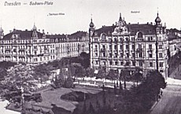
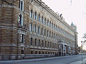
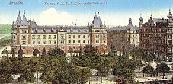
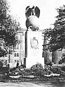
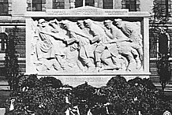

* * *

* * *

Der Sachsenplatz entstand ab 1875 im Zusammenhang mit dem Bau der [Albertbrücke](../../../../zentrum/johannstadt/albertbrucke/) am Altstädter Brückenkopf der neuen Elbquerung. Die Ostseite wurde von der 1880/81 errichteten Jägerkaserne eingenommen. Süd- und
Westseite beherrschten repräsentative Wohn- und Geschäftshäuser im Stil der Neorenaissance _(Foto)_. Die Pläne für diese zu den beeindruckendsten Dresdner
Platzanlagen der Gründerzeit gehörenden Gebäude stammten von Hermann August Richter und wurden vom Architektenbüro Oswald Haenel und Bruno Adam umgesetzt. Neben Wohnungen in den Obergeschossen gab es hier auch
zahlreiche Geschäfte sowie die Gaststätte “Amtshof” (Nr. 2).

Die eigentliche Platzanlage war parkartig gestaltet und wurde später wegen ihrer Nähe zur Jägerkaserne mit militärischen
Erinnerungsstätten versehen. So stand vor der Kaserne eine im Deutsch-französischen Krieg 1870/71 erbeutete französische Mitrailleuse, eine Vorgängerin des Maschinengewehrs. Unweit davon wurde 1913 das nach 1945 als
“militaristisch” entfernte Kolonialkriegerdenkmal eingeweiht.

Als einziges Gebäude der Vorkriegszeit überstand das an der Lothringer Straße im Stil eines Florentiner Palastes errichtete [Amtsgericht](../../../pirnaische_vorstadt/strassen_pirnaische_vorstadt/) die Zerstörungen des Zweiten Weltkrieges. Bis 1945 war dieses Gebäude durch eine heute verschwundene Häuserreihe verdeckt, bildet jetzt jedoch die Westseite des Sachsenplatzes. Die gegenüberliegende Ostseite prägen mehrgeschossige Wohnhochhäuser aus den 1970er Jahren. 1997 wurde auf dem Sachsenplatz ein farbenfroh gestalteter Pavillon errichtet. Dieses “Palaverhaus” stammt von Georg Karl Pfähler und war Teil eines Kunstprojektes. Zwei weitere Kunstwerke, die Sandsteinplastiken “Große Liegende” von Peter Makolies und “Torso” von Michael Göltsche, befinden sich in den Grünanlagen zu beiden Seiten der Sachsenallee.

Einzelne Gebäude:

Jägerkaserne:
Die Jägerkaserne entstand 1880/81 am Brückenkopf der Albertbrücke und war einziger großer Kasernenneubau außerhalb der Albertstadt. Die Entwürfe für den burgartigen Gebäudekomplex stammten von Oswald
Haenel und Bruno Adam. Außerdem wirkte der Militärbauspezialist Fritz Opitz an der Planung mit. Wegen seines
schlossartigen Aussehens galt der Vierflügelbau als “schönster Kasernenbau Sachsens”. Nutzer war das II. Jägerbataillon Nr. 13.

Der Haupteingang zur Jägerkaserne befand sich an der 134 Meter langen Elbfront. Diesem schlossen sich zwei
Seitenflügel und das Exerzierhaus an der Südseite an, das den Komplex baulich abschloss. Im Erdgeschoss waren die
Wache, ein Arrestlokal, das Unteroffizierskasino und Unterrichts- und Büroräume untergebracht. In den Obergeschossen
befanden sich die Mannschaftsstuben, Wasch- und Schlafsäle sowie das Offizierskasino, während die einfachen Dienstgrade  die Speiseräume im Kellergeschoss nutzte. Außerdem gab es einige Wohnungen und Lager- und
Montierungsräume. Das zuletzt als Polizeikaserne genutzte Gebäude fiel 1945 den Bomben zum Opfer und wurde später abgerissen.

**_Foto:_** _Die Jägerkaserne am Sachsenplatz, rechts die Feldherrenstraße (heute Florian-Geyer-Straße)_

Kolonialkriegerdenkmal: Das Denkmal wurde am 12. Oktober 1913 im Beisein des Königs Friedrich August III. und anderer hochrangiger Persönlichkeiten als erstes Ehrenmal für die in den deutschen Kolonien gefallenen Soldaten und Offiziere in Deutschland eingeweiht. Es bestand aus einem massiven quadratischen Kalksteinsockel, welcher von einer Weltkugel mit dem darauf sitzenden Reichsadler bekrönt war. An der Elbseite befand sich das sächsische Wappen mit Krone und die Inschrift: _“Dem Andenken der in den Übersee-Kämpfen gefallenen 14 Offiziere und 134 Unteroffiziere und Mannschaften aus beiden sächsischen Armeekorps XII. und XIX. der Königlich-Sächsischen Armee”_. Die Rückseite zierten Bronzetafeln mit den Namen der Gefallenen. Schöpfer des vom “Sächsischen Militärvereins ehemaliger Überseetruppen Dresden” finanzierten Kriegerdenkmals waren der Architekt Paul Luther und der Bildhauer Arthur Ernst Berger.

Am 27. Mai 1923 wurde das Denkmal um eine weitere Ehrentafel zur Erinnerung an die im Ersten Weltkrieg gefallenen sächsischen Soldaten der deutschen Schutztruppen ergänzt. Die Luftangriffe 1945 überstand das Kolonialkriegerdenkmal ohne Schäden, wurde jedoch wegen seines “militaristischen Charakters” am 20. Januar 1947 entfernt. Erhalten blieb eine Gedenktafel mit den Namen und Todesdaten von sechs in Deutsch-Südwestafrika (heute Namibia) gefallenen Soldaten, die sich heute in einer Vorhalle der [Garnisonskirche](../../../../neustadt/albertstadt/strassen_albertstadt/stauffenbergallee/garnisonskirche/) befindet.

Jägerdenkmal:
Nach dem Ersten Weltkrieg entstand am Sachsenplatz ein zweites militärisches Ehrenmal für die gefallenen Dresdner Jäger, d. h. die Mitglieder des
früheren 2. Sächsischen Jägerbataillons Nr. 13. Die Einweihung des aus einem Sandsteinrelief mit einer Kampfszene bestehenden Denkmals erfolgte im Rahmen
eines Festgottesdienstes anläßlich des 1. Jägertages am 19./20. September 1925. Schöpfer des Jägerdenkmals war der bekannte Bildhauer Georg Wrba, die
Bauausführung übernahm der Baumeister Materne. Das Jägerdenkmal befand sich unmittelbar vor dem Hauptportal der Jägerkaserne und trug neben dem erwähnten Relief die Inschrift: _“Den Dresdner Jaegern 1914 - 1918 - Reserve-Jaeger-Bat. 25 / Radfahrer- Bat. 4 - Jaeger-Bat. 13 / Reserve-Jaeger- Bat. 13. Wir sanken hin für Deutschlands Glanz / Blüh´, Deutschland, uns als Totenkranz”._

Auch dieses Denkmal überstand den Luftangriff ohne größere Schäden. Auf Weisung der sowjetischen Militäradministration musste es jedoch wegen seines militärischen Charakters am 20. Juni 1947 beseitigt werden.

* * *

 \[ [Home](../../../../index.html)\] \[ [Nord](../../../../nord/)\] \[ [Nordwest](../../../../nordwest/)\] \[ [Neustadt](../../../../neustadt/)\] \[ [Nordost](../../../../nordost/)\] \[ [West](../../../../west/)\] \[ [Zentrum](../../../../zentrum/)\] \[ [Südwest](../../../../sudwest/)\] \[ [Süd](../../../../sud/)\] \[ [Südost](../../../../sudost/)\] \[ [Ost](../../../../ost/)\] \[ [Register](../../../../Register/register.html)\] \[ [Kontakt](../../../../Kontakt/kontakt.html)\] \[ [Impressum](../../../../impressum/)\]
