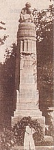

* * *

Die Stübelallee führt an der Nordseite des Großen Gartens entlang und verbindet dabei die Altstadt mit den östlichen Stadtteilen. Ursprünglich war sie Teil der von Dresden nach Pirna führenden Landstraße. Da diese Straße auf Grunaer Flur einst mit Äpfelbäumen bepflanzt war, wurde sie umgangssprachlich "Äppelallee" genannt. Ihren offiziellen Namen erhielt sie 1895 nach dem Dresdner Oberbürgermeister Paul Alfred Stübel (1827-1895). Stübel ließ sich nach seinem Jurastudium 1853 als Advokat in Dresden nieder und gehörte bereits mit 29 Jahren dem Stadtrat an. 1866 übernahm er die Leitung des Stadtbauamtes und wurde am 24. April 1877 zum Oberbürgermeister gewählt. Maßgeblich war er am Aus- und Umbau der städtischen Infrastruktur beteiligt und ließ zahlreiche neue Straßenzüge, Brücken, Schulen und öffentliche Gebäude errichten.

1874 begann die Bebauung der Nordseite der Stübelallee durch die Dresdner-Ostend-Gesellschaft, während die Südseite bis heute vom [Großen Garten](../../../../zentrum/grosser_garten/) bzw. vom Botanischen Garten eingenommen wird. In einem dieser Gebäude (Nr. 37) wohnte in den 1930er Jahren der Musikdirektor des Dresdner Schauspielhauses Bernhard Eichhorn. Bekannt wurde er als Komponist zahlreicher Filmmelodien, u.a. für die UFA-Streifen “Kleider machen Leute” und “Dr. Crippen an Bord”. Die Gebäude fielen 1945 sämtlich dem Luftangriff zum Opfer. Ebenfalls zerstört wurde das erst 1926 erbaute [Planetarium](../../../../Zentrum/Johannstadt/Strassen_Johannstadt/Stubelallee/Planetarium/planetarium.html).

Zwischen 1973 und 1975 entstanden zwischen Stübelallee und Comeniusstraße mehrgeschossige Plattenbauten und Wohnhochhäuser, welche das Neubaugebiet Johannstadt nach Osten abschlossen. Ergänzt wurden diese durch eine Kaufhalle sowie Kinder- und Sozialeinrichtungen. Hier fand auch eine 1969 von Max Piroch geschaffene Bronzeplastik „Familie“ ihren Platz. 1994 folgte der moderne Gebäudekomplex der Berufsgenossenschaft Feinmechanik und Elektrotechnik.

Einzelne Gebäude:

Akzisehaus (Nr. 4): Das kleine Gebäude entstand Anfang des 19. Jahrhunderts an der Flurgrenze zu Gruna und diente der Erhebung der Akzise, einer Einfuhrsteuer, die auf nach Dresden eingeführte Waren erhoben wurde. Mit Abschaffung dieser Verbrauchssteuer und der Eingemeindung Striesens nach Dresden verlor das Haus seine Funktion und diente fortan Wohnzwecken, u.a. für den Gartenmeister des Großen Gartens. 2017 begann der Umbau zu einer kleinen Sommergaststätte.

Nr. 31: Die 1908 für den Fabrikbesitzer Friedrich Eduard Kessel aus Tannenbergsthal errichtete Villa an der Einmündung zur Lipsiusstraße wurde im Zweitem Weltkrieg schwer beschädigt. Nach 1945 erfolgte der Wiederaufbau der Ruine als Kinderwochenheim des VEB Bauunion. Die Eröffnung erfolgte am 2. Februar 1952. Eng verbunden blieb die Kita mit dem Schriftsteller Martin Andersen-Nexö, der sie mehrfach besuchte und die Genehmigung erteilte, sie nach einer seiner Romanfiguren "Ditte Menschenkind" zu benennen. Bis zur Wende diente das Haus als Betriebskindergarten des VEB Bau- und Montagekombinat Kohle und Energie, Betriebsteil Tiefbau. Nach 1990 erfolgte der Abriss zugunsten einer kleinen Wohnanlage.

Lipsiussäule: Die Lipsiussäule wurde 1913 an der Einmündung der Lipsiusstraße in die Stübelallee aufgestellt und erinnert an den Architekten und Baurat Konstantin Lipsius (1832-1894), welcher in
Dresden als Schöpfer der Kunstakademie auf der Brühlschen Terrasse bekannt ist. Außerdem schuf er 1884 den Sockel des “Goldenen Reiters”, entwarf das [Fabrice-Mausoleum](../../../../neustadt/albertstadt/strassen_albertstadt/stauffenbergallee/) an der Stauffenbergallee und war am Bau mehrerer Blasewitzer Villen beteiligt. Das Denkmal besteht aus einem verzierten säulenartigen Unterbau, welcher von einer sitzenden Kinderfigur aus Sandstein bekrönt wird. An der Seite befindet sich eine Inschrift mit Namen und Lebensdaten des Baumeisters. Der Entwurf der Säule stammt vom Görlitzer Kunstprofessor R.Michel, die Finanzierung übernahmen ehemalige Meisterschüler Lipsius´.

Während die umliegenden Gebäude 1945 völlig zerstört wurden, überstand die Lipsiussäule den Luftangriff schwer beschädigt. Aus Sicherheitsgründen wurde die Figur um 1950 entfernt und ist seitdem verschollen. 2005 erfolgte eine Wiederherstellung und Restaurierung des Denkmals nach historischem Vorbild.

* * *

 \[ [Home](../../../../index.html)\] \[ [Nord](../../../../nord/)\] \[ [Nordwest](../../../../nordwest/)\] \[ [Neustadt](../../../../neustadt/)\] \[ [Nordost](../../../../nordost/)\] \[ [West](../../../../west/)\] \[ [Zentrum](../../../../zentrum/)\] \[ [Südwest](../../../../sudwest/)\] \[ [Süd](../../../../sud/)\] \[ [Südost](../../../../sudost/)\] \[ [Ost](../../../../ost/)\] \[ [Register](../../../../Register/register.html)\] \[ [Kontakt](../../../../Kontakt/kontakt.html)\] \[ [Impressum](../../../../impressum/)\]
