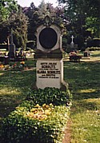
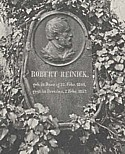
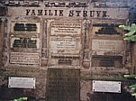
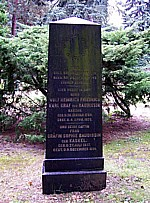
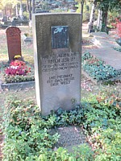
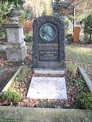
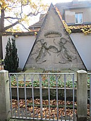
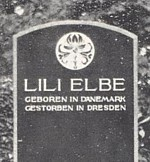
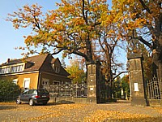
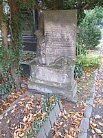

* * *

* * *

* * *

* * *

**Bedeutende Grabstätten:**

_Grabmal Julius Scholtz_

_Grabmal Robert Reinick_

_Familiengrabstätte Struve_

_Grabmal_

_Wolf Graf von Baudissin_

_Grabstätte_

_Kurt Arnold Findeisen_

_Grabstätte Julius Kühn_

_Familiengrabstätte Serre_

_Grabstätte Lili Elbe_

* * *

Der heutige Trinitatisfriedhof zwischen Tatzberg und Fiedlerstraße wurde 1814/15 nach
dem Vorbild des Herrnhuter Friedhofs von Hofbaumeister Gottlob Friedrich Thormeyer entworfen. Grund war die zunehmende Überlastung der innerstädtischen Begräbnisplätze sowie die hohe Sterblichkeitsrate infolge der napoleonischen Kriege und einer Typhusepidemie in Sachsen. In diesem Zusammenhang erwarb die Stadt Dresden für 620 Taler das Areal des verwüsteten [Engelhardtschen Vorwerks](../../../zentrum/johannstadt/strassen_johannstadt/), um hier einen neuen Begräbnisplatz anzulegen. Das Grundstück schien wegen seiner hochwassersicheren leicht erhöhten Lage am Fahrweg nach Blasewitz gut geeignet und war zuvor zeitweise als Exerzierplatz genutzt worden. Die Finanzierung übernahm die Kirchgemeinde der Johanniskirche.

Thormeyer entwarf auf regelmäßigem Grundriss eine großzügige Anlage, die jedoch nur in Ansätzen realisiert wurde. Ursprüngliche Planungen sahen den Bau einer zentralen tempelartigen Grufthalle vor, welche von vier Heckenquartieren umgeben werden sollte. Letztlich entschied man sich jedoch aus Kostengründen nur für den Bau zweier bescheidener Torhäuser und mehrere quadratische Gräberfelder. Als Abgrenzung zur Umgebung entstand eine Sandsteinmauer. Wegen seiner Lage fernab der Stadt wurde der Friedhof zunächst “der Weite Friedhof”, ab 1834 Trinitatisfriedhof genannt.

Erster auf dem neuen Friedhof beigesetzter Verstorbener war der Theologe Christian Wilhelm Kranert (+ 2. 5. 1815), dessen Grabstein mit einer entsprechenden Inschrift noch erhalten ist. Zum Zeitpunkt dieser Beerdigung war mit den Bauarbeiten für den eigentlichen Friedhof jedoch noch nicht einmal begonnen worden. Erst im Januar 1816 erfolgte ohne größere Feierlichkeiten die Einweihung des Begräbnisplatzes, welcher schon vier Jahre später zur Hälfte belegt war. Mehrere alte Grabdenkmale wurden später vom aufgelassenen alten Johannisfriedhof überführt. Neben Dresdner Bürgern fanden hier auch Verstorbene aus dem benachbarten Striesen ihre letzte Ruhestätte.

1834 erfolgte die erste Erweiterung des Friedhofes, wofür man vorsorglich bereits mehrere Grundstücke erworben hatte. Da die Einweihung dieser “zweiten Abtheilung” in der ersten Woche nach Pfingsten (Trinitatiswoche) stattfand, wurde der Friedhof nun offiziell auf den Namen Trinitatisfriedhof getauft. Im Rahmen einer zweiten Erweiterung in den Jahren 1843/46 entstanden ein neues Leichenhaus und ein Unterkunftsgebäude für das Friedhofspersonal. Eine dritte Erweiterung folgte 1872, womit der Friedhof seine heutige Größe von ca. 93.000 m²erhielt.

Bemerkenswert sind zahlreiche Grabstellen Dresdner Künstler sowie zwei Obelisken für 76 Gefallene des Dresdner Maiaufstandes 1849. Die vom Städtischen Hochbauamt unter Leitung von Professor Poelzig 1920 aufgestellten Denkmale tragen die Inschrift “Den Toten der Maikämpfe 1849” und erinnern an eines der bedeutendsten Ereignisse der Stadtgeschichte des 19. Jahrhunderts. Ältestes Monument auf dem Trinitatisfriedhof ist der barocke Grabstein des 1726 ermordeten Theologen Hermann Joachim Hahn _(Foto rechts)_, welcher noch vom alten Johannisfriedhof stammt. Auch der Bildhauer Ernst Rietschel, welcher einige Grabplastiken für diesen Friedhof schuf, liegt hier beerdigt. In seiner Nachbarschaft ruht der Maler Caspar David Friedrich. Dieser, der sich zeitlebens immer wieder mit den Themen Tod und Vergänglichkeit auseinandersetzte, schuf 1825 sein Gemälde “Friedhofseingang”, bei welchem er sich vom Haupteingang des Trinitatisfriedhofes inspirieren ließ. Einige der über 200 historisch und künstlerisch bedeutsamen Grabstätten wurden in den letzten Jahren saniert.

Bedeutende Grabstellen (Auswahl):

Christian Wilhelm Kranert (1754-1815): Der klassizistische Grabstein in der Nähe des Andachtsplatzes erinnert an den
jungen Theologiestudenten Christian Kranert, der am Himmelfahrtstag 1815 als erster auf dem neuen Friedhof beerdigt
wurde. Erst wenige Wochen später begannen die eigentlichen Erschließungsarbeiten für das Gelände. Kranerts Grabmal trägt neben den biografischen Daten die Inschrift: _“Er war der Erstere, der in diesem geweihten Boden einem schöneren Leben entgegen schlummert”_.

Hermann Joachim Hahn (1679-1726):
Das Grabdenkmal stammt noch vom alten Johannisfriedhof und wurde vor allem wegen seiner historischen Bedeutung zum Trinitatisfriedhof umgesetzt. Am 21. Mai 1726 war der evangelische Geistliche
und Diakon der Kreuzkirche von einem geisteskranken Katholiken ermordet worden, was zu erheblichen Unruhen unter
der Bevölkerung führte. Der Grabstein stammt aus der Werkstatt des Bildhauers Kirchner (I. Abteilung/Feld D).

Karl Wilhelm Fischer (1896-1941):
Der Pfarrer der benachbarten Trinitatiskirche gehörte bis zu seinem Tod als Leiter der Bekennenden Kirche in Sachsen zu den entschiedensten innerkirchlichen Gegnern des Naziregimes. Das Kruzifix auf
dem Grab unmittelbar am Andachtsplatz stammt von Kurt Dämmig.

Julius Otto (1804-1877): Mit Lyra und Lorbeerzweigen geschmückt erinnert der Grabstein an den ehemaligen
Kreuzkantor und Komponisten Julius Otto, der den Chor im 19. Jahrhundert zu neuer Blüte führte. Bis 1945 befand sich
vor der Kreuzschule am Georgplatz das Julius-Otto-Denkmal des Bildhauers Gustav Kietz. (I. Abteilung/Feld D)

Friedrich Anton Serre (1789-1863:
Die Familiengrabstätte in Form einer Pyramide in klassizistischem Stil gehört zu den künstlerisch bemerkenswertesten Gräbern des Trinitatisfriedhofs. Serre war während der Napoleonischen Kriege
Adjutant des preußischen Militärgouverneurs von Sachsen und trat später vor allem als Stifter in Erscheinung. Serres
Stadtwohnung und sein Sommersitz in Maxen gehörte zeitweise zu den Mittelpunkten des Dresdner Kulturlebens. Schöpfer des Grabmals unmittelbar links des Haupteingangs war vermutlich Franz Pettrich.

Friedrich Adolph August Struve (1781-1840): Die Grabstelle des 1840 verstorbenen Arztes und Apothekers befindet
sich an der Trennmauer zur Dritten Abteilung. Struve war Besitzer der Salomonisapotheke am Neumarkt und erfand 1820 das künstliche Mineralwasser. Später betrieb er in der Seevorstadt seine Mineralwasseranstalt.

Heinrich Carl Wilhelm Graf von Vitzthum von Eckstädt (1770-1837): Vier steinerne Totenschädel, verbunden durch
Mohnranken, zieren das Grab des aus einem alten sächsischen Adelsgeschlecht stammenden Grafen Vitzthum von Eckstädt. Zwischen 1815 und 1820 war er Generaldirektor der Königlichen Kapelle und des Hoftheaters und berief
Carl Maria von Weber zum Kapellmeister (I. Abteilung/Feld A).

Caspar David Friedrich (1774-1840): Eine schlichte Grabplatte bedeckt die letzte Ruhestätte des Malers Caspar David
Friedrich. Friedrich schuf neben zahlreichen Landschaftsbildern auch mehrere Grabdenkmale und eine Zeichnung vom Haupteingang des Trinitatisfriedhofes. Die heutige Grabanlage wurde 1934 auf Anregung des Sächsischen
Heimatschutzes gestaltet (I. Abteilung/Feld A).

Familiengrabstätte Kaskel: Die Wandgrabanlage zwischen I. und III. Abteilung birgt die sterblichen Überreste mehrerer
Mitglieder der bedeutenden Bankiersfamilie Kaskel. Julius Eduard Kaskel (1802-1862) war Inhaber des gleichnamigen Bankhauses Kaskel und zugleich Besitzer des Ausflugslokals [“Antons”](../../../zentrum/johannstadt/antons/) am Johannstädter Elbufer. Sein Bankhaus gehört
zu den Vorläufern der 1872 entstandenen Dresdner Bank. Kaskels Schwiegersohn, der Kunstmaler Friedrich Gonne,
schuf u.a. einige Deckenbilder in der Semperoper und der 1945 zerstörten Kaskelschen Villa auf der Bürgerwiese. Die
benachbarte Grabstätte weiterer Familienmitglieder, u.a. des Bankiers Gustav Felix Freiherr von Kaskel, wurde nach 1990 von der Dresdner Bank saniert.

Michael de Habbe (1794-1834):
Die Grabstelle, welche ein in der Kunstgießerei Lauchhammer gegossener und reich verzierter Griechenhelm ziert, gehört zu den künstlerisch wertvollsten des Friedhofs. Ursprünglich befand sie sich auf dem
Eliasfriedhof und wurde 1834 auf Betreiben der Witwe des Generals zum Trinitatisfriedhof umgesetzt. Schöpfer des Grabmals waren Gottlob Friedrich Thormeyer und der Bildhauer Julius Kühn (I. Abteilung/Feld A).

Ida von Lüttichau (1798-1856):
Die Tochter des Königlich-Preußischen-Oberstallmeisters von Knobelsdorff war ab 1818 mit Wolf Adolf August von Lüttichau, Generaldirektor des Dresdner Hoftheaters, verheiratet. Als künstlerisch
interessierte Ehefrau unterhielt sie enge freundschaftliche Kontakte zu bedeutenden Künstlern wie Ludwig Tieck, Carl
Maria von Weber, Friedrich von Raumer und Carl Gustav Carus. Außerdem beriet sie ihren Mann bei der Auswahl von
Theaterstücken und der Verpflichtung neuer Mitglieder des Hoftheaters. Das Grabmal wurde 2011/12 restauriert.

Ferdinand von Rayski (1806-1890):
Die Familiengrabstätte im Nordteil der I. Abteilung (Feld E) besteht aus insgesamt fünf Sandsteinplatten, die die Gräber des 1890 verstorbenen Porträtmalers und seiner Familienangehörigen bedecken.
Die Grabanlage wurde 1945 schwer beschädigt und 1985 restauriert.

Martin Wilhelm Oppenheim: Der 1863 verstorbene Bankier gehörte im 19. Jahrhundert zu den wohlhabendsten
Einwohnern Dresdens und war Besitzer der von Gottfried Semper errichteten Villa Rosa an der Holzhofgasse und des
1945 ebenfalls zerstörten Palais Kaskel-Oppenheim an der Bürgerwiese. Semper gestaltete im Auftrag der Familie auch
die Grabstelle auf dem Trinitatisfriedhof, in dem neben Oppenheim und seiner Frau auch seine Tochter und deren Ehemann, der Miniaturmaler August Grahl, beigesetzt sind (Wandgrab III. Abteilung/Ostseite).

Carl Gustav Carus (1789-1869): Die ursprüngliche Grabstätte des bedeutenden Malers und Arztes wurde 1945 ein
Opfer der Bomben. 1949 wurde diese unter Nutzung geborgener Fragmente neu gestaltet. Das Bronzerelief stammt von
Ernst Rietschel, die Schrifttafel von Carus´1945 zerstörtem Wohnhaus in der Innenstadt (Wandgrab III. Abteilung/ Südseite).

Ernst Rietschel (1804-1861):
Leider wurde auch das ursprüngliche Erbbegräbnis des Bildhauers Ernst Rietschel im Zweiten Weltkrieg schwer beschädigt. Bei der Neugestaltung 1949 erhielt das Grab sein heutiges Aussehen mit einem
aus den Trümmern geborgenen Bildnismedaillon seines Schülers Adolf Donndorf. Rietschel selbst trat ebenfalls mehrfach
als Schöpfer von Grabdenkmalen in Erscheinung und schuf u. a. Reliefs für die Gräber Rosa Oppenheims und Carl Gustav Carus´ (Wandgrab III. Abteilung/Westseite).

Ferdinand Wiesand (1781-1813):
Dieses Grabdenkmal ist vor allem wegen seiner künstlerischen Gestaltung von Bedeutung. Der Kaufmann war 1813 an Typhus gestorben und fand seine letzte Ruhestätte zunächst auf dem
Johannisfriedhof. Nach dessen Auflösung wurde der klassizistische Stein umgesetzt. Eine Inschrift trägt die Worte “Des ersten Sohnes Weinen ward dem Scheidenden zum letzten Lächeln” (III. Abteilung/Feld J).

Gräber bedeutender Persönlichkeiten:

**_Grabstätte_**

**_Todesjahr_**

**_Standort\*_**

Hermann Joachim Hahn, Diakon (Grabstein vom alten Johannisfriedhof)

1726

I D

Christian Wilhelm Kranert, Theologe, erste Grabstelle des Friedhofes

1815

I D

Christian Leberecht Vogel, Maler, Professor der Kunstakademie

1816

I A

Christian Gottlieb Kühn, Bildhauer (Grabdenkmal von ihm selbst geschaffen)

1828

I C

Heinrich Carl Wilhelm Graf Vitzthum von Eckstädt, Akademiedirektor

1837

I A

Olsusieff, russischer Major, Stifter der Dresdner Blindenanstalt

1837

I

Caspar David Friedrich, Maler (heutige Grabplatte von 1934)

1840

I A

Friedrich Adolph Struve, Arzt und Apotheker, Erfinder des künstlichen Mineralwassers

1840

I D

Johann Friedrich Kind, Textdichter des “Freischütz”

1843

I D

Johann Christoph Arnold, Verleger und Buchhändler, Förderer Ludwig Richters

1847

I A

Rosa Oppenheim, Grabstein von Gottfried Semper, Reliefmedaillon von Ernst Rietschel

1849

III M

Robert Reinick, Maler und Lyriker

1852

I A

Carl Gottfried Theodor Winkler (Theodor Hell), Schriftsteller

1856

I A

Ida von Lüttichau, Förderin der Kunst und Mäzenin

1856

Carl Gottlieb Reißiger, Musiker

1859

III M

Wilhelmine Schröder-Devrient, Sängerin und Schauspielerin am Hoftheater

1860

I C

Ernst Rietschel, Bildhauer

1861

III J

Julius Eduard Kaskel, Bankier (Bankhaus Kaskel)

1862

I A

Serre, Johann Friedrich Anton, preuß. Major und Stifter, Gründer der Schiller-Lotterie

1863

I D

Otto Ludwig, Dichter (2011 saniert)

1865

III N

Gustav Ritz, Branddirektor, Gründer der Dresdner Feuerwehr (Grabdenkmal von Johannes Schilling)

1867

I E

Carl Gustav Carus, Naturforscher, Arzt und Maler (Reliefmedaillon von Ernst Rietschel)

1869

III J

Carl Eduard Vehse, Demokrat und Historiker (Grab nicht mehr vorhanden)

1870

Blochmann, Rudolf Sigismund, Schöpfer der ersten Gasbeleuchtung in Dresden

1871

I

Friedrich Wieck, Komponist, Vater von Clara Schumann

1873

IV S

Ernst Julius Otto, Kreuzkantor

1877

I D

Wolf Graf von Baudissin, Schriftsteller und Übersetzer

1878

II A

Heinrich Gottlieb Ludwig Reichenbach, Gründer des Botanischen Gartens

1879

I C

Hermann Sigismund Neumann, preuß. Hofgärtner (Schloss Albrechtsberg)

1880

Georg Hermann Nicolai, Architekt

1881

II H

Julius Theodor Erbstein, Historiker und Archivar, Numismatiker

Heinrich Albert Erbstein, Direktor des Münzkabinetts

Richard Julius Erbstein, Direktor des Grünen Gewölbes und der Porzellansammlung

1882

1890

1907

Wandgrab

Harald Julius von Bosse, Hofarchitekt des Zaren, Erbauer der Russ.-Orthodoxen Kirche

1884

zerstört

Franz Jacob Wigard, Arzt, Demokrat und erster sächs. Parlamentsstenograph

1885

I D

Johann Meyer, Unternehmer und Mäzen (Johann-Meyer-Stiftung)

1887

Karl Robert Kummer, Landschaftsmaler

1889

III O

Ferdinand von Rayski, Maler

1890

I E

Gottfried Julius Scholtz, Maler, Professor an der Kunstakademie

1893

I G

Wilhelm Michael Schaffrath, erster Präsident der sächs. Rechtsanwaltskammer, Landtagspräsident

1893

Gustav Felix Freiherr von Kaskel, Mitbegründer der Dresdner Bank

1894

I A

Harald Julius von Bosse, Architekt, Erbauer der Russisch-Orthodoxen-Kirche

1894

Sophie Gräfin von Baudissin (geb. Kaskel), Schrifstellerin, Ehefrau Wolf von Baudissins

1894

II A

Johann Wilhelm Constantin Lipsius, Architekt, Erbauer der Kunstakademie

1894

I D

Karl Heinrich Nicolai, erster Pfarrer der Trinitatiskirche

1896

I D

August Berthelt, Oberschulrat

1896

III J

Hugo Bürkner, Holzbildhauer, Professor an der Kunstakademie

1897

II F

Clemens Alexander Winkler, Chemiker, Entdecker des Germaniums

1904

IV S

Hermann Hultzsch, Bildhauer

1905

Johannes Schilling, Bildhauer (Grabstelle aufgelöst und nach Meißen-Zscheila verlegt)

1910

Basilius von Engelhardt, russischer Astronom (2014 nach Kasan umgebettet)

1915

Marie Wieck, Pianistin

1916

IV S

Prof. Dr. med. Alfred Fiedler, Arzt

1921

III M

Paul Gustav Leander Pfund, Kaufmann und Unternehmer, Besitzer von “Pfunds Molkerei”

1923

III M

Karl Bruno Seitler, Architekt, Leiter der Baugewerkeschule

1925

II O

Therese Malten, Opernsängerin

1930

II O

Ejnar Wegener (Lilli Elbe), dänischer Kunstmaler; erster Mann weltweit, an dem eine Geschlechtsumwandlung vorgenommen wurde (Grab 2016 wiederhergestellt)

1931

Otto Pilz, Bildhauer, Schöpfer zahlreicher Tierplastiken

1934

III M

Karl Wilhelm Fischer, Pfarrer, Leiter der “Bekennenden Kirche” in Sachsen

1941

I D

Friedrich Theodor Paul Adolph, Generalintendant der Hof- und Staatstheater

1941

I D

Franz Rowland, Maler

1941

Richard Guhr, Maler und Bildhauer, Schöpfer des “Goldenen Rathausmannes”

1956

I F

Kurt Arnold Findeisen, Schriftsteller

1963

I C

Otto Rudolph Zaunick, Professor, Wissenschaftshistoriker

1967

I B

Georg Wilhelm Berndt, Professor für Messtechnik an der TU

1968

Gottfried Noth, sächsischer Landesbischof

1971

III L

Karl Laux, Musikwissenschaftler und -kritiker

1978

Familiengrab Jehmlich, Orgelbauerfamilie

I C

\\* Die Zahlen I - IV bezeichnen die vier Abteilungen des Friedhofs, wobei I die älteste (mittlere Abteilung  - Haupteingang), II die von der Fiedlerstraße aus rechts gelegene
(Eingang 2) und III die linke Abteilung (Eingang 3 an der Feierhalle) ist. Friedhofsteil IV ist über den Eingang 2 zu erreichen. Ein Übersichtsplan mit Lage der Grabstätten ist bei der Friedhofsverwaltung erhältlich.

* * *

 \[ [Nord](../../../nord/)\] \[ [Nordwest](../../../nordwest/)\] \[ [Neustadt](../../../neustadt/)\] \[ [Nordost](../../../nordost/)\]
 \[ [West](../../../west/)\] \[ [Zentrum](../../../zentrum/)\] \[ [Südwest](../../../sudwest/)\] \[ [Süd](../../../sud/)\] \[ [Südost](../../../sudost/)\] \[ [Ost](../../../ost/)\] \[ [Register](../../../Register/register.html)\] \[ [Kontakt](../../../Kontakt/kontakt.html)\] \[ [Impressum](../../../impressum/)\]
