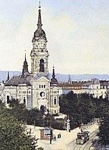
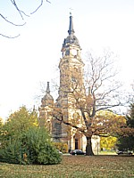

* * *

* * *

* * *

* * *

* * *

* * *

Ursprünglich besuchten die wenigen Bewohner der östlich vor den Toren Dresdens gelegenen Vorwerke die Kreuzkirche. Nachdem im 19. Jahrhundert bereits große Teile der Pirnaischen Vorstadt dicht bebaut worden waren und diese Entwicklung auch auf die 1877 gegründete Johannstadt übergriff, begann 1878 der Bau der Johanniskirche an der Pillnitzer Straße. Doch auch diese Kirche genügte schon bald nicht mehr den Anforderungen. Zählte die Gemeinde im Jahr ihrer Gründung zunächst 23.000 Mitglieder, wuchs sie innerhalb weniger Jahre auf über 40.000 Gläubige.

1888 beschloss der Vorstand der Johanniskirchgemeinde deshalb, die gesamte Johannstadt auszugliedern und dort eine eigene Kirche zu errichten. Bis zu deren Fertigstellung sollte die Turnhalle der 20. Bezirksschule am Zöllnerplatz als Betsaal der neuen Gemeinde dienen. Nach Diskussionen um den künftigen Namen entschied man sich in Anlehnung an den
benachbarten Trinitatisfriedhof für den Namen Trinitatiskirche und setzte eine Ausschreibung für den Neubau an. Da diese nicht die gewünschten Ergebnisse brachte, vergab man den Auftrag schließlich an den Dresdner Architekten Karl Barth, der sich für eine Gestaltung im Stil der italienischen Renaissance entschied. Am 21. September 1891 erfolgte der erste Spatenstich. Bereits im Folgejahr konnte Richtfest gefeiert werden. Nach knapp dreijähriger Bauzeit wurde die Trinitatiskirche am 17. Oktober 1894 geweiht. Die Finanzierung und einen Großteil der Arbeiten hatten zuvor Mitglieder der Gemeinde übernommen.

Das Gotteshaus mit seinem 65 Meter hohen Turm besaß 1200 Sitzplätze und wurde mit Hilfe verschiedener Stifter ausgestattet. Bemerkenswert war ein vom sächsischen Kunstfond finanziertes Gemälde Anton Dietrichs “Christus die Bergpredigt haltend”. Für das Hauptportal schuf der Bildhauer Rudolph Hölbe eine Sandsteinplastik mit Christusfigur.
Die Orgel mit ihren 2547 Pfeifen stammte aus der Werkstatt der Dresdner Firma Kircheisen, die vier Glocken wurden von der Kunstgießerei Bierling gegossen. Diese ersetzte 1920 auch das im Ersten Weltkrieg für Rüstungszwecke eingeschmolzene alte Geläut. Schon bald wurde jedoch diese Kirche wieder zu klein, so dass sich eine erneute Teilung der Gemeinde erforderlich machte. Für den geplanten Neubau erwarb die Trinitatisgemeinde ein Grundstück am Stephanienplatz, wo bis 1904 die [Andreaskirche](../../../zentrum/johannstadt/andreaskirche/) entstand.

Die Bomben des Jahres 1945 beschädigten auch die Trinitatiskirche, deren Kirchenschiff bis auf die Außenmauern zerstört wurde. Erhalten blieben einige Nebenräume und der Kirchturm. _(Foto)_. Ursprünglich war ein Wiederaufbau der Kirchenruine geplant, welcher jedoch mangels Baumaterialien und aus finanziellen Gründen nicht zu Stande kam. Stattdessen nutzt die Gemeinde für ihre Gottesdienste das Anfang der 1960er Jahre wiederaufgebaute Gemeindehaus an der Fiedlerstraße 2. Nachdem durch den Beschluss zum Wiederaufbau der Frauenkirche Dresdens bekannteste Kirchenruine verschwand, entschloss man sich Mitte der 1990er Jahre, die Trinitatiskirche in ihrem derzeitigen Zustand zu belassen und künftig als Mahnmal für die Opfer des Zweiten Weltkrieges zu betrachten. 1996 wurde dafür ein Förderverein gegründet. Im beräumten Innenraum finden heute regelmäßig Open-Air-Gottesdienste und Konzerte statt. Die Räume im Kirchturm werden als Jugendtreff genutzt. Seit 2001 gehört die frühere Trinitatisgemeinde gemeinsam mit der Striesener Erlöser-Andreas-Gemeinde zur Johanneskirchgemeinde.

**_Fotos:_** _Im Innenraum der Trinitatiskirche (2015)_

* * *

 \[ [Home](../../../index.html)\] \[ [Nord](../../../nord/)\] \[ [Nordwest](../../../nordwest/)\] \[ [Neustadt](../../../neustadt/)\] \[ [Nordost](../../../nordost/)\] \[ [West](../../../west/)\] \[ [Zentrum](../../../zentrum/)\] \[ [Südwest](../../../sudwest/)\] \[ [Süd](../../../sud/)\] \[ [Südost](../../../sudost/)\] \[ [Ost](../../../ost/)\] \[ [Register](../../../Register/register.html)\] \[ [Kontakt](../../../Kontakt/kontakt.html)\] \[ [Impressum](../../../impressum/)\]
