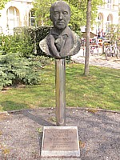
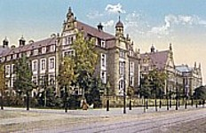
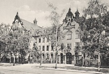
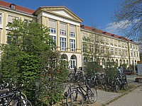
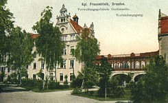
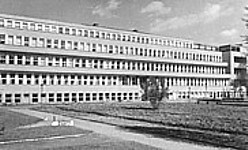
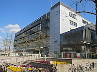
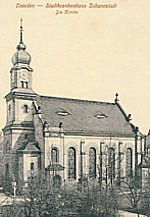
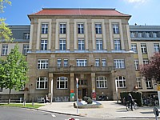
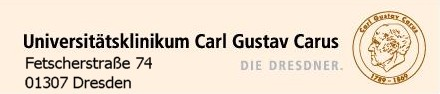

* * *

* * *

* * *

* * *

* * *

* * *

**Gustav-Carus-Denkmal**

Die Geschichte des heutigen Universitätsklinikums reicht bis 18. Jahrhundert zurück. Bereits am 18. November 1748 war auch in Sachsen nach dem Vorbild anderer Länder das “Collegium medico-chirurgicum” als
erste ärztliche Ausbildungsstätte Dresdens gegründet worden. Die Einrichtung befand sich in einem Flügel des Neustädter Kasernenkomplexes an der Hauptstraße und diente vorrangig der Aus- und Weiterbildung von ärztlichem
Fachpersonal, welches in den Grundlagen von Anatomie, Pathologie, Therapie und Chirurgie unterrichtet wurde. Angeschlossen war ein als “Charité” bezeichnetes Hospital. 1781 kam ein Hebammeninstitut, 1786 eine
zahnchirurgische Abteilung hinzu.

Im August 1813 musste das Collegium medico-chirurgicum in Folge der Napoleonischen Kriege geschlossen werden. Zwei Jahre später entstand jedoch im Kurländer Palais eine neue
Chirurgisch-Medizinische Akademie, deren Finanzierung durch den König erfolgte. Diese bestand aus zwei Abteilungen für Chirurgie und Innere Medizin und verfügte insgesamt über 40 Betten. Zu den bedeutendsten Ärzten
dieser Einrichtung gehörte Carl Gustav Carus, dessen Namen das heutige Universitätsklinikum trägt.

Nachdem die bereits bestehenden medizinischen Einrichtungen nicht mehr den Anforderungen und der gestiegenen Bevölkerungszahl genügten, entschloss sich
die Stadt Dresden 1898 zum Erwerb eines Teils des “Birkenwäldchens” am Rande der Johannstadt. Auf dem ca. 63.000 m² großen Grundstück des früheren
“Maternifeldes” errichtete Stadtbaurat Edmund Bräter zwischen 1898 und 1901 ein neues Großkrankenhaus _(Foto)_. Der Komplex bestand zunächst aus zehn
Kranken- und sechs Wirtschaftsgebäuden, welche durch ein unterirdisches Gangsystem miteinander verbunden waren. Die offizielle Eröffnung der ersten
Stationen erfolgte am 2. Dezember 1901. An der Terscheckstraße folgte wenig später die Staatliche Frauenklinik, erbaut nach Plänen von Landesbaumeister Ottomar Reichelt. Ursprünglich waren noch
weitere Gebäude vorgesehen, welche aus finanziellen Gründen zunächst jedoch nicht realisiert werden konnten.

In den Anfangsjahren besaß das neue Krankenhaus Johannstadt 581 Betten in 24 Krankensälen und 79 Zimmern. Neben den notwendigen technischen Einrichtungen
gehörten zur Klinik ein separates Haus für Geisteskranke, zwei Quarantänestationen für Patienten mit ansteckenden Krankheiten, ein Doppelhaus für die Chirurgie sowie Abteilungen für
Sonderkranke, Augen- und Hals-Nasen-Ohren-Leiden. Hinzu kamen großzügige Gartenanlagen, in denen - getrennt
nach Männern und Frauen - Patienten die Möglichkeit zu erholsamen Spaziergängen erhielten. 1913 und 1915 folgten
Erweiterungsbauten für die Innere Abteilung, 1929/30 die Neubauten der Kinderklinik und einer Schwesternschule. Zu
den medizinischen Pionierleistungen gehörte die Gründung der ersten europäischen Diabetikerambulanz 1920 sowie die Einrichtung eines separaten Röntgeninstitutes durch den Internisten Dr. Otto Rostoski.

Im Zuge der Weltwirtschaftskrise geriet das Johannstädter Krankenhaus in massive wirtschaftliche Schwierigkeiten und wurde am 1. April 1932 sogar geschlossen.
Vorausgegangen war ein Beschluss des Stadtrates vom 19. Januar 1932, in dem wegen der Zahlungsunfähigkeit Dresdens drastische Einsparungen im städtischen
Haushalt festgelegt wurden. Erst im Zuge der Neuordnung des Gesundheitswesens wurde es im Juni 1933 wieder eröffnet und erhielt 1934 den Namen Rudolf-Heß-
Krankenhaus. Nach der spektakulären Flucht des NS-Politikers nach England 1941 wechselte der Name in Krankenhaus Fürstenstraße, später in Gerhard-
Wagner- Krankenhaus. Namensgeber war der 1939 verstorbene Reichsärzteführer Gerhard Wagner, der die Klinik im
Sinne der  “Neuen deutschen Heilkunde” zu einem “biologischen Krankenhaus” umwandeln wollte. Dabei sollten schulmedizinische Methoden mit naturheilkundlichen Heilverfahren verknüpft und die Ärzte im Geiste des
Nationalsozialismus zu “Gesundheitsführern” mit allumfassenden Kenntnissen zu gesunder Lebensweise, Rassenhygiene
und medizinischer Versorgung ausgebildet werden. Allerdings kamen diese Planungen nur eingeschränkt zur Umsetzung.
So wurde 1935 eine “Biologische Abteilung für Naturheilkunde” eingerichtet. Unter Leitung des neuen Chefarztes Hermann Jensen entstand in Johannstadt das Mutterhaus der deutschlandweit aktiven “Nationalsozialistischen
Schwesternschaft”. Kurz vor Kriegsbeginn, am 1. Juli 1939, erfolgte am Fiedlerplatz die Grundsteinlegung für ein neues Akademiegebäude. Bereits am 1. September wurden die Arbeiten jedoch wieder eingestellt.

Beim Bombenangriff am 13./14. Februar 1945 wurden zahlreiche Gebäude des Johannstädter Krankenhauses getroffen,
brannten aus oder wurden völlig zerstört. Trotzdem gelang es schon bald, wieder einen Notbetrieb aufzunehmen, bevor
1948 der etappenweise Wiederaufbau begann. In diesem Zusammenhang erweiterte man das Krankenhausgelände durch Einbeziehung des Fiedlerplatzes und des früheren [König-Georg-Gymnasiums](../../../zentrum/johannstadt/strassen_johannstadt/konig-georg-gymnasium/) bis zur Flurgrenze nach Blasewitz.

Am 7. September 1954 erfolgte die Gründung einer Medizinischen Akademie, welche
nicht nur die medizinische Forschung beleben, sondern zugleich der Ausbildung junger Ärzte und Schwestern dienen sollte. Als Zentrum der Einrichtung wählte man das
Johannstädter Krankenhaus aus, obwohl die Lehrveranstaltungen zunächst auch im [Friedrichstädter Krankenhaus](../../../zentrum/friedrichstadt/strassen_friedrichstadt/friedrichstrasse/marcolinipalais/krankenhaus_friedrichstadt/) stattfanden. Zum Rektor ernannte man den Chirurgen
Prof. Dr. Albert Bernhard Fromme. Bereits im ersten Studienjahr belegten 52 Human- und 39 Zahnmedizinstudenten die angebotenen Studiengänge. Wenig später erhielt die
umgangssprachlich kurz “Medak” genannte Einrichtung offiziell den Namen des Malers und Arztes Carl Gustav Carus verliehen. An den Namengeber erinnert heute ein Denkmal vor dem Dekanatsgebäude.

Bis 1958 wurden alle in Johannstadt bestehenden Kliniken und Institute, darunter auch die zuvor rechtlich selbständige
Frauenklinik, in die Medizinische Akademie einbezogen. Für diese entstanden nun weitere Neubauten, mehrere
Studenten- und Schwesternwohnheime und 1976 am Fiedlerplatz eine Poliklinik für die ambulante Patientenbetreuung. Zu
den hier wirkenden renommierten Medizinern gehörten der Dermatologe Heinz-Egon Kleine-Natrop, der Chirurg Hans
Bernhard Sprung, der Gynäkologe Robert Ganse, der Augenarzt Fritz Müller und der HNO-Arzt Fredo Günnel. Bis zu
ihrer Auflösung 1993 gehörte die “Medak” zu den wichtigsten medizinischen Einrichtungen im Osten Deutschlands.

Zum 1. Oktober 1993 wurde die Medizinische Akademie im Zuge der Neugliederung der sächsischen
Hochschullandschaft als Medizinische Fakultät an die Technische Universität angeschlossen und wird nach einer
Rechtsformänderung seit Juli 1999 als Universitätsklinikum “Carl Gustav Carus” bezeichnet. Derzeit sind hier über 3.600
Mitarbeiter an 21 Fachkliniken, fünf interdisziplinären Zentren und drei Instituten beschäftigt. Für die jährlich ca. 220.000
Patienten stehen 1.200 Betten zur Verfügung. Moderne Um- und Neubauten entstehen derzeit für das geplante Diagnostisch-Internistisch-Neurologische Zentrum sowie für das zur Klinik gehörende Cochlear Implant Centrum der
HNO-Klinik.

Einzelne Gebäude:

Frauenklinik: Die Johannstädter Frauenklinik geht auf eine 1775 gegründete private Hebammenschule zurück. Diese hatte ihr Domizil in der früheren
Neustädter Kaserne und wurde im 19. Jahrhundert zur Königlichen Frauenklinik umgewandelt. Da die Räumlichkeiten in der Neustadt nicht mehr den gewachsenen Anforderungen genügten, entstand 1903 ein Neubau an der
Pfotenhauer-/Ecke Fürstenstraße. Dieser bestand aus zwei Häusern (ursprünglich waren fünf geplant) mit insgesamt 290 Betten sowie einem Verwaltungs- und Wirtschaftsgebäude und war vom Stadtkrankenhaus durch
eine Mauer getrennt. Im Patientenhaus gab es im Erdgeschoss die gynäkologische Abteilung, während die beiden Obergeschosse für die Geburtshilfe zur Verfügung standen. Weitere
Räume wurden als Wohn- und Schlafräume der hier ausgebildeten Hebammenschülerinnen genutzt bzw. standen mittellosen bedürftigen Schwangeren in den letzten Wochen vor der Geburt als Unterkunft zur Verfügung.

Trotz der Nähe zum Stadtkrankenhaus blieb die Frauenklinik auch in der Johannstadt weiterhin selbstständig und kam
erst 1956 organisatorisch zur Medizinischen Akademie. Am wiederaufgebauten Gebäude erinnert seit 2005 eine Gedenktafel an die ca. 200 beim Bombenangriff 1945 in der Frauenklinik ums Leben gekommenen Kinder, Mütter und
Angestellten.

Orthopädische Klinik: Die Gebäude der 1945 schwer beschädigten Frauenklinik wurden 1953/54 in leicht veränderter
Form wiederaufgebaut und beherbergen seitdem die Orthopädische Klinik. Die architektonische Gestaltung übernahmen
die Architekten Alexander Künzer und Wolfgang Klossek. An der Fassade befindet sich ein Relief der Bildhauerin Magdalena Gressner.

Chirurgische Klinik: Dieses Klinikgebäude entstand zwischen 1952 und 1955 unter Einbeziehung der Ruinen des zerstörten Schwesternhauses der Kinderklinik. Neben Operationssälen und Krankenzimmern erhielt das Gebäude auch einen Hörsaal für die Medizinstudenten und Räume für die Bibliothek. Die Planungen des Wiederaufbaus oblagen Heinz Mersiowsky und Günter Wild. 2008 wurde die Klinik (Haus 19) für das neue Internistisch-Neurologische Zentrum umgebaut.

2015 erfolgte die Grundsteinlegung für ein neues Chirurgisches Zentrum. Dafür wird der 1996 errichtete Neubau (Haus 58) erweitert und soll künftig die chirurgische Notaufnahme, eine Ambulanz sowie Intensiv- und Pflegestationen aufnehmen. Hinzu kommen 17 moderne OP-Säle. Die Fertigsstellung ist für September 2018 geplant.

Klinik für Psychotherapie und Psychosomatik:
Die neue Klinik entstand 2008/09 im Gebäude der früheren Augenklinik und besitzt 16 Patientenzimmer, Behandlungs- und Theraoieräume. Außerdem gibt es mehrere teilstationäre Plätze.
Ursprünglich war das Gebäude als “Absonderungshaus” für ansteckend Kranke gebaut worden. Im Dachgeschoss befanden sich außerdem einige Zimmer zur Unterbringung von Angehörigen weiter entfernt wohnender Patienten. Die
Augenklinik bezog wenig später provisorisch einen Flügel dieses Hauses und nutzte diesen bis nach 1990.

Neurologisches Zentrum: Das nach modernsten Kriterien ausgestattete Diagnostisch-Internistisch-Neurologische Zentrum entstand ab 2007 an Stelle eines abgerissenen Vorgängerbaus (Haus 27) und besitzt 213 Pflegebetten im Neubau und 120 Betten in der ehemaligen Chirurgischen Klinik. Die Einweihung erfolgte 2011.

Pathologisches Institut:
Das vorrangig der medizinischen Forschung und der Studentenausbildung dienende Institut bezog 1962 einen Neubau an der Schubertstraße 15. Unter Leitung der Architekten Manfred Grafe und Karl Richter entstand
ein moderner dreigeschossiger Zweckbau mit einem Hörsaal.

Kinderklinik: Die Kinderklinik wurde zwischen 1927 und 1930 nach einem Entwurf des Dresdner Stadtbaurates Paul Wolf errichtet. Die feierliche Grundsteinlegung erfolgte am 31. Oktober 1927. Vorläufer war eine bereits 1897 als erste derartige Einrichtung in der Welt gegründete [Säuglingsklinik](../../../zentrum/johannstadt/strassen_johannstadt/) auf der Arnoldstraße 1. Bereits 1901 hatte deren Besitzer, der Arzt Arthur Schloßmann die Einrichtung einer speziellen Klinik für Kinder angeregt.

Das anlässlich der II. Internationalen Hygieneausstellung am 15. Mai 1930 eröffnete moderne Gebäude _(Foto)_ im Bauhausstil bestand aus zwei durch einen überdachten Gang miteinander verbundenen Flügeln und besaß an den Patientenzimmern ca. 100 Meter lange durchgehende Balkons, welche bei schönem Wetter den Aufenthalt im Freien erlaubten. Außerdem gab es einen Hörsaal mit 120 Plätzen, die Kinderpoliklinik, eine Bibliothek und Arbeits-, Wohn- und Speiseräume für das Personal sowie eine Schwesternschule im Ostflügel. Zur Behandlung lungenkranker Kinder erhielt das Klinikgebäude eine Dachterrasse für die Freiluftbehandlung. Der ursprünglich geplante vierte Flügel, ein Mütter- und Säuglingsheim, wurde aus finanziellen Gründen nicht realisiert.

1945 wurde die Kinderklinik schwer beschädigt und 1946 als erstes Krankenhausgebäude in Dresden wiederaufgebaut. Ab 1954 gehörte sie zur Medizinischen Akademie und wurde bis 1968 von Professor Georg Harnapp geleitet. Trotz mehrfacher Renovierung erwies sich das Haus nach 1990 als nicht mehr sanierungswürdig und wurde deshalb 1999 abgerissen. An gleicher Stelle entstand eine 2003 eröffnete moderne Frauen- und Kinderklinik mit 250 Betten (Haus 21). Die Planungen des fünfgeschossigen Neubaus an der Pfotenhauerstraße stammen vom Büro Heinle, Wischer und Partner _(Foto)_.

Schwesternschule: Das Gebäude entstand in den Zwanziger Jahren nach Plänen von Stadtbaurat Wolf im Bauhausstil.
Hier erfolgte die Ausbildung der für die Klinik benötigten Krankenschwestern. 1990/92 wurden die Häuser saniert. In
diesem Zusammenhang erhielt der Innenhof einen kleinen Brunnen, welcher von der Dresdner Bildhauerin Heidemarie
Dreßel gestaltet wurde. In einem bereits vorhandenen Wasserbecken befinden sich verschiedene Keramikelemente, die geschickt Bezug auf die Architektur des Gebäudes nehmen.

Rektorat:
1955/56 wurde an der Fiedlerstraße in klassischer Bauweise ein Verwaltungsgebäude für die Medizinische Akademie errichtet. Die Planungen stammen von Heinz Mersiowsky, welcher für mehrere Nachkriegsneubauten der
Klinik verantwortlich zeichnete. Neben dem Rektorat wurden hier auch Büros, wissenschaftliche Fachkabinette und ein Hörsaal mit 300 Plätzen untergebracht.

Krankenhauskapelle:
Die neoromanische Kapelle entstand zeitgleich mit dem Bau des Stadtkrankenhauses nach Plänen Edmund Bräters und wurde am 2. Dezember 1901 geweiht.
Einige Reliefs und Plastiken am Turm und der Westfassade stammten von Otto Schilling, die Glasfenster schuf der Historienmaler Eugen Louis Otto. Im Inneren besaß die Kirche eine
Kanzel aus Kiefernholz, dazu passendes Gestühl und hölzerne Emporen sowie eine Orgel der Firma Jehmlich. Der Altar aus französischem Kalkstein war mit einer Reliefdarstellung der
Ölbergszene und einem Triumphkreuz Oscar Rassaus verziert. Künstlerisch orientierte sich das zur seelsorgerischen Betreuung der Patienten gedachte Gotteshaus am gerade aufkommenden Jugendstil.

Nach Machtübernahme der Nazis sollte die Krankenhauskapelle mit ihrem 31 Meter hohen Turm ebenso wie einige Wirtschaftsgebäude zugunsten eines zentralen Platzes abgerissen
werden. Kriegsbedingt kam es jedoch nicht mehr dazu. Allerdings wurde auch die Kirche 1945 schwer beschädigt und
brannte aus. Obwohl ein Wiederaufbau durchaus möglich gewesen wäre, entschied sich die Klinikleitung 1946 für den
Abriss der Ruine. Dieser erfolgte vier Jahre später. Fortan standen lediglich zwei Dienstzimmer sowie ein “Raum der Stille” im Obergeschoss des Verwaltungsgebäudes für die Seelsorge zur Verfügung.

Erst nach der politischen Wende konnte am 5. Dezember 2000 auf dem Platz der ehemaligen Kapelle der Grundstein für
einen Neubau gelegt werden. Das ökumenisch genutzte Seelsorgezentrum entstand nach Plänen von Johannes Kister, Reinhard Scheithauer und Susanne Gross in modernen Bauformen und wurde am 2. Dezember 2001 geweiht. Beim Bau
entdeckte Fragmente der früheren Krankenhauskirche sind heute in einer kleinen Parkanlage zu besichtigen.

Küchenhaus:
Das Gebäude wurde als zentrales Versorgungshaus für alle Abteilungen des Stadtkrankenhauses erbaut und erhielt eine moderne Großküche mit zehn Dampfkochkesseln, zwei Bratherden und weiterer Küchentechnik. Im gleichen
Haus befanden sich auch Speiseräume für das Krankenhauspersonal, Wohnungen für die Angestellten sowie die krankenhauseigene Fleischerei. Hinzu kamen Lagerräume für Lebensmittel und Getränke.

Versorgungszentrum: Das im Haus 60 untergebrachte neue Versorgungszentrum entstand 2009 und beherbergt Räume für Logistik und Einkauf sowie die Klinikapotheke.

Zahnklinik: Das zwischen 1905 und 1907 errichtete Gebäude der heutigen Zahnklinik
diente bis 1943 als Domizil des König-Georg-Gymnasiums. Die Pläne für den Monumentalbau stammen von Stadtbaurat Hans Erlwein, den plastischen Fassadenschmuck schuf der Bildhauer Groß. Während des Zweiten Weltkrieges
nutzte es die Johannstädter Klinik als Hilfskrankenhaus. 1945 wurde das Gebäude vor allem im Dachgeschoss beschädigt, blieb in seiner Grundsubstanz jedoch erhalten.
Zunächst als Poliklinik der Medizinischen Akademie genutzt, beherbergt es heute die Zahnklinik des Universitätsklinikums. 2010 erfolgte eine umfassende Sanierung.

Herzzentrum:
Das neue Herzzentrum wurde 1994 auf einem Grundstück an der Schubertstraße erbaut und ermöglicht seitdem die Durchführung komplizierter herzchirurgischer Eingriffe. Der erste Bauabschnitt wurde in Fertigteilbauweise
errichtet und konnte schon Ende 1994 eingeweiht werden. Nach Plänen des Architekten Walter Tempel folgte im
Anschluss ein größerer Neubau an der Ecke Fetscher-/Pfotenhauerstraße. Träger des Zentrums ist der gemeinnützige Verein Herz-Kreislaufzentrum Dresden e.V.

Medizinisch-Theoretisches Zentrum:
Die vor allem der medizinischen Forschung dienende Einrichtung entstand 2000 in einem Neubau an der Fiedlerstraße. Künftig ist die Erweiterung um ein zusätzliches Gebäude vorgesehen. Dafür soll die
benachbarte ehemalige Schuhcremefabrik “Eg-Gü” zu einem Forschungszentrum umgebaut werden.

Mukoviszidose-Zentrum “Christiane Herzog”:
Das Mukoviszidose-Zentrum der Dresdner Universitätsklinik (UMC) wurde am 30. März 2012 als erstes in den neuen Bundesländern eröffnet und trägt den Namen der verstorbenen Gattin
des früheren Bundespräsidenten Roman Herzog. Christiane Herzog hatte sich engagiert für die Erforschung dieser
Stoffwechselkrankheit eingesetzt. Die Einrichtung dient der komplexen Versorgung der Patienten und wird zum Teil von der Christiane-Herzog-Stiftung finanziert.

* * *

 \[ [Home](../../../index.html)\] \[ [Nord](../../../nord/)\] \[ [Nordwest](../../../nordwest/)\] \[ [Neustadt](../../../neustadt/)\] \[ [Nordost](../../../nordost/)\] \[ [West](../../../west/)\] \[ [Zentrum](../../../zentrum/)\] \[ [Südwest](../../../sudwest/)\] \[ [Süd](../../../sud/)\] \[ [Südost](../../../sudost/)\] \[ [Ost](../../../ost/)\] \[ [Register](../../../Register/register.html)\] \[ [Kontakt](../../../Kontakt/kontakt.html)\] \[ [Impressum](../../../impressum/)\]
