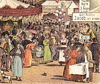
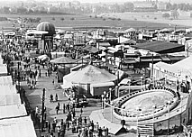
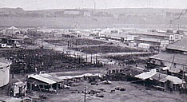
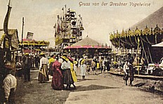

* * *

Die Geschichte der Dresdner Vogelwiese reicht bis ins Mittelalter zurück. Damals war es Brauch, alljährlich zum Pfingstfest ein Zielschießen abzuhalten, um den Schützenkönig zu krönen und gleichzeitig die
Wehrfähigkeit der Bürger zu überprüfen. Offiziell wurde dieser Wettstreit ab 1577 von der Schützengilde veranstaltet. Das Schießen fand auf einer Freifläche in der Wilsdruffer Vorstadt statt, woran heute noch der Name
des Schützenplatzes erinnert. Auch die Schießgasse in der Nähe des Pirnaischen Platzes steht mit diesem traditionellen Volksfest in Verbindung.

Nach 1700 wandelte sich die Vogelwiese immer mehr zu einem Familien- und
Volksfest. Höhepunkt blieb zwar auch weiterhin der Wettstreit mit der Armbrust, um den auf einer hohen Holzstange angebrachten Holzvogel zu treffen. Im Umfeld boten
nun aber verstärkt Händler ihre Waren an und trugen durch die zu entrichtenden Standgebühren zur Finanzierung des Spektakels bei. Die Verantwortung wechselte in
dieser Zeit vom städtischen Rat zum Schützenverein. Mit zunehmender Ausdehnung reichte der Platz am Rand der Altstadt nicht mehr aus, weshalb die Vogelwiese auf die
sogenannte “Ziegelwiese” an der Ziegelstraße / Rietschelstraße ausweichen musste. Mit einigen Unterbrechungen fand das Fest an dieser Stelle bis 1840 statt. Neben
Dresdner Bürgern nahmen nun auch Adlige und Hofbedienstete am Wettkampf teil. Sogar August der Starke soll sich auf der Vogelwiese belustigt haben. Ab 1830 waren auch Frauen für den
Schützenwettbewerb zugelassen, allerdings mit getrennter Wertung. Sieben Jahre später entstand auf dem Areal an der
Ziegelstraße nach Plänen von Johann Andreas Schubert und des Ingenieurs Taubert das erste Elbdampfschiff  “Königin Maria”. Anschließend gab man die Fläche zur Bebauung mit Wohn- und Geschäftshäusern frei.

Für die weitere Durchführung der Vogelwiese stellte die Stadt den ehemaligen
Übungsplatz der Kommunalgarde zur Verfügung. Dieser lag vor den Toren Dresdens auf einer Freifläche zwischen der heutigen Gerok-, Dürer- und Güntzstraße und wurde ab 1841 für das alljährliche Spektakel genutzt.
Nach einem erneuten Standortwechsel waren ab 1874 die Johannstädter Elbwiesen Schauplatz des Volksfestes. Dafür erwarb die Bogenschützengesellschaft einige Flächen in der
Nähe des Schlößchens “Antons” am Elbufer, welche sich zuvor im Besitz der Dresdner Fleischerinnung befanden. Während der eigentliche Anlass immer mehr in
den Hintergrund trat, wandelte sich die Vogelwiese nun endgültig zum größten Dresdner Volksfest für die ganze Familie. Alljährlich boten Bratwurst- und Getränkehändler, Tanzzeltbetreiber,
Karussells, Achterbahnen, Schausteller und Kuriositätenstände verschiedenste Vergnügungen für jung und alt an. Auch
kleine Theateraufführungen, Wettbewerbe im Klettern an Holzstangen, Schlangenbeschwörer, Seiltänzer und exotische Volksangehörige gehörten zum Programm _(Foto um 1937)._

Zu einem der tragischsten Ereignisse in der Geschichte der Vogelwiese kam es am 2. August 1909. Durch eine Unachtsamkeit am Stand
“Zum Bratwurstglöcklein” brach ein Feuer aus, welches schnell um sich griff  und einen Großteil des Festgeländes vernichtete. Trotz des Einsatzes der Feuerwehr und eines Militärbataillons der Jägerkaserne
brannten 27 Etablissements und 60 Buden vollständig nieder, weit über hundert kleinere Stände wurden ebenfalls zerstört. Wie durch ein Wunder gab es keine ernsthaft Verletzten.

**_Foto:_** _die Vogelwiese nach dem Brand von 1909_

Die Johannstädter Vogelwiese blieb bis zum Zweiten Weltkrieg alljährlich Anziehungspunkt der Dresdner Bürger. In Spitzenzeiten wurden sogar eigene
“Vogelwiesenlinien” der Straßenbahn eingesetzt, um die tausenden Besucher zum Gelände zu bringen. Erst nach Kriegsbeginn endete die Tradition 1942
vorerst. Das frühere Vogelwiesengelände diente später als Trümmerablageplatz und stand deshalb nicht mehr zur Verfügung. 1947 kam es dennoch zu einer
Neuauflage der Vogelwiese, welche zunächst am Neustädter Elbufer und am Alaunplatz, 1949 auf dem Gelände des Zoos und ab 1953 am damaligen Fucikplatz (heute Straßburger Platz) veranstaltet wurde. 1991 kehrte die
Vogelwiese an ihren alten Standort zurück. Da dieser jedoch wegen der Bauarbeiten für die Waldschlösschenbrücke
nicht mehr zur Verfügung stand, musste das Fest 2004 zur Marienbrücke ausweichen. Ob und wann die Vogelwiese wieder in der Johannstadt veranstaltet wird, steht noch nicht fest.
